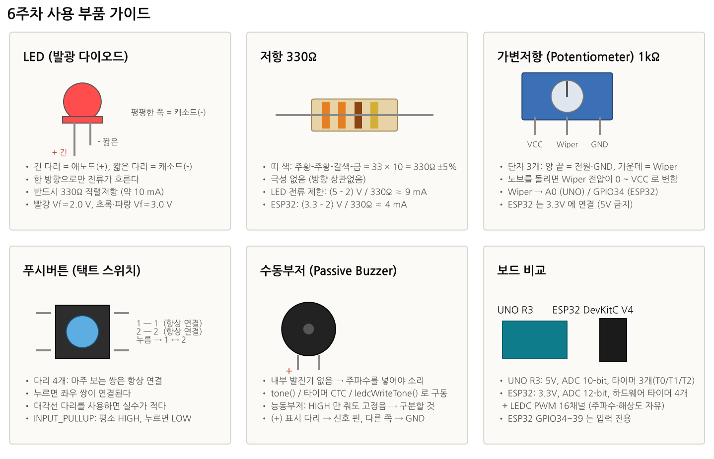
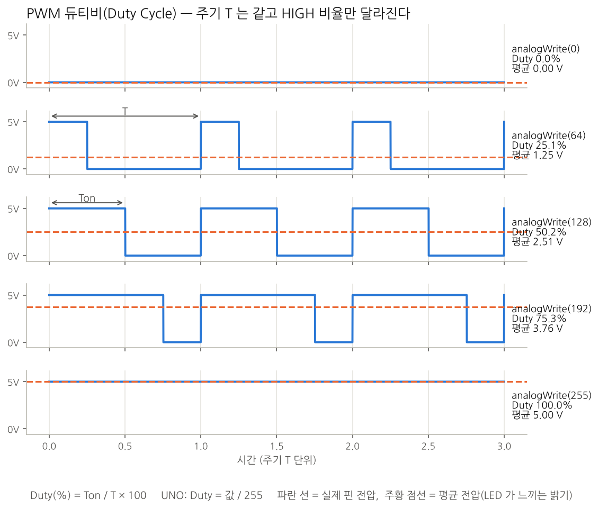
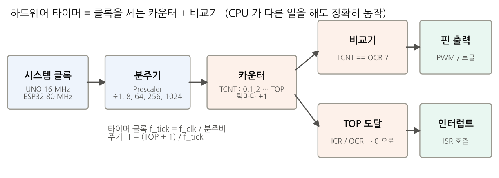
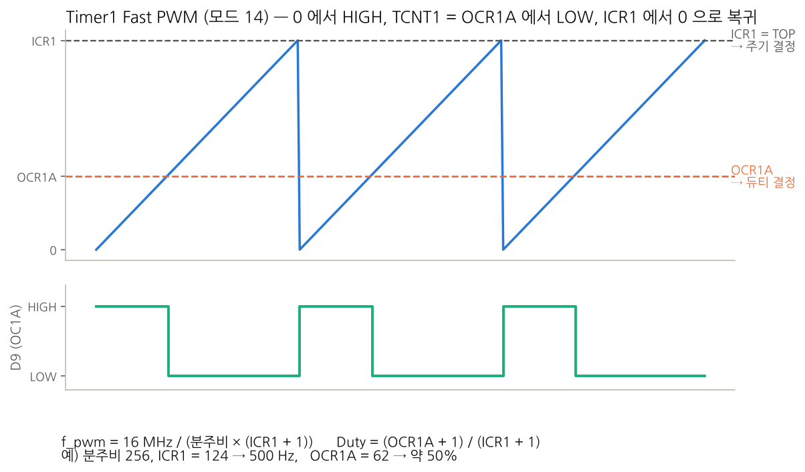
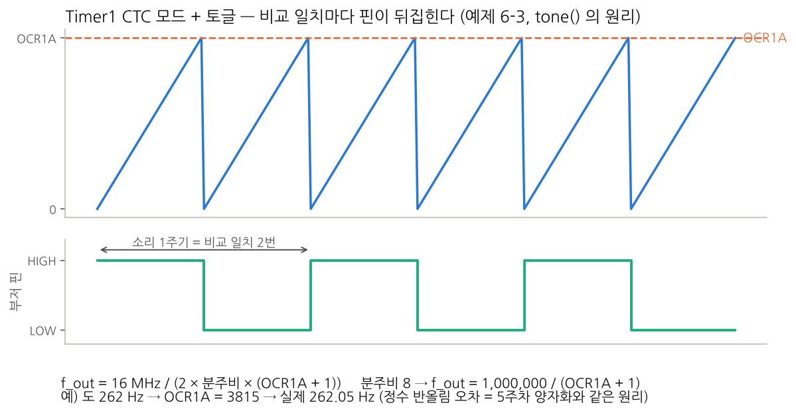
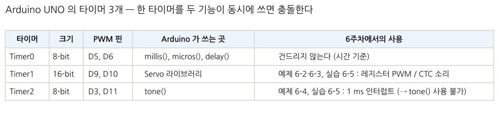
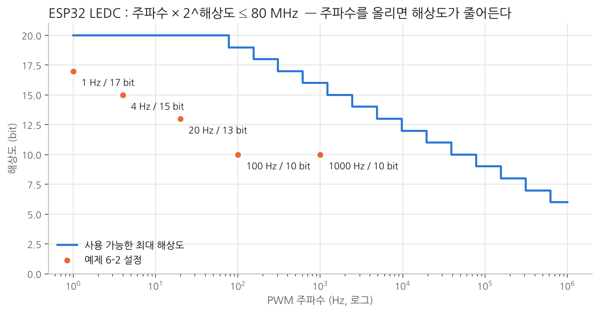
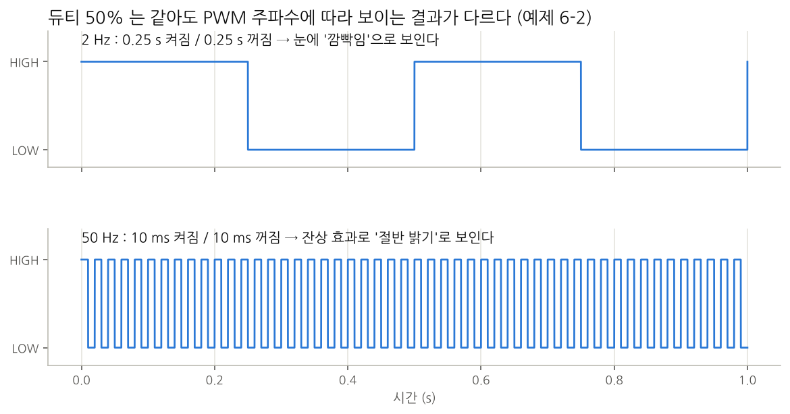

# Week06 — 타이머(Timer)와 PWM 출력 제어

> **강의계획서 6주차:** 타이머 레지스터와 PWM 원리를 이해하고 이를 응용할 수 있다.
> 대상 보드: Arduino UNO R3 / ESP32 DevKitC V4 (Arduino-ESP32 코어 **3.x**) · 수업 3시간

## 학습 흐름

```
4주차 GPIO·millis 상태머신 → 5주차 ADC·map()·analogWrite
  → 6주차 analogWrite 의 정체(타이머) · 레지스터로 PWM/소리 · 타이머 인터럽트 샘플링
  → 7주차 Interrupt (ISR, volatile, 외부 인터럽트)
```

## 수업 운영

| 교시 | 이론 | 실습 |
|---|---|---|
| 1교시 | PWM(주기·주파수·듀티), 타이머 구조(클록→분주기→카운터→비교기) | [예제 6-1](examples/ex6-1_pwm_duty) PWM 듀티 · [예제 6-2](examples/ex6-2_timer_pwm_freq) 레지스터 PWM |
| 2교시 | CTC 모드와 소리, 타이머 인터럽트, ISR 규칙 | [예제 6-3](examples/ex6-3_timer_tone) 타이머 소리 · [예제 6-4](examples/ex6-4_timer_sampling) 정밀 샘플링 |
| 3교시 | 타이머 자원 배분, 종합 설계 | [실습 6-5](labs/lab6-5_precise_lamp) 정밀 가변램프 |

## 폴더 구성

```
week06/
├── images/                  이론 그림 (PWM 파형, 타이머 구조, 부품 가이드 …)
├── examples/
│   ├── ex6-1_pwm_duty/        README · uno/ · esp32/ · images/
│   ├── ex6-2_timer_pwm_freq/
│   ├── ex6-3_timer_tone/
│   └── ex6-4_timer_sampling/
├── labs/lab6-5_precise_lamp/
└── workbooks/week06_workbook.md   학생 기록용 워크북
```

각 예제 폴더: `uno/sketch.ino`, `uno/diagram.json`(Wokwi), `esp32/sketch.ino`, `esp32/diagram.json`, `images/schematic_*.png`(회로도), `images/wiring_*.png`(연결도)

## 사용 부품



| 부품 | 수량 | 사용 |
|---|---|---|
| UNO R3 또는 ESP32 DevKitC V4 | 1 | 전체 |
| LED (빨강, 초록) | 2 | 6-1, 6-2, 6-5 |
| 저항 330Ω | 2 | LED 직렬 |
| 가변저항 1kΩ | 1 | 6-2, 6-4, 6-5 |
| 푸시버튼 | 1 | 전체 |
| 수동부저 | 1 | 6-3 |

## 공통 핀 맵

| 기능 | UNO | ESP32 |
|---|---|---|
| 램프 LED / 부저(6-3) | D9 (Timer1 OC1A) | GPIO25 / GPIO23 |
| 2번째 LED | D6 | GPIO26 |
| 가변저항 Wiper | A0 | GPIO34 (3.3V 전원) |
| 버튼 | D2 | GPIO13 |

## 핵심 그림

| | |
|---|---|
|  |  |
|  |  |
|  |  |
|  |  |

## 검증

- 모든 스케치는 `arduino-cli` 로 **UNO(avr)·ESP32(esp32 3.3.0)** 컴파일을 통과했다.
- UNO 의 예제 6-3·6-4·실습 6-5 는 `simavr` 시뮬레이터에서 시리얼 출력을 확인했다 (예: 262 Hz → OCR1A 3815, Timer2 샘플 간격 10,000 µs).
- 실제 보드 동작은 수업 전에 한 번 더 확인할 것.
