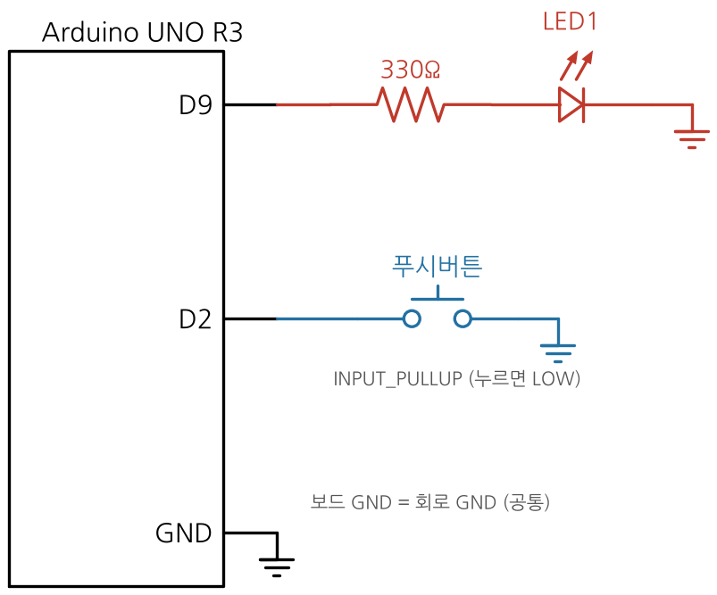
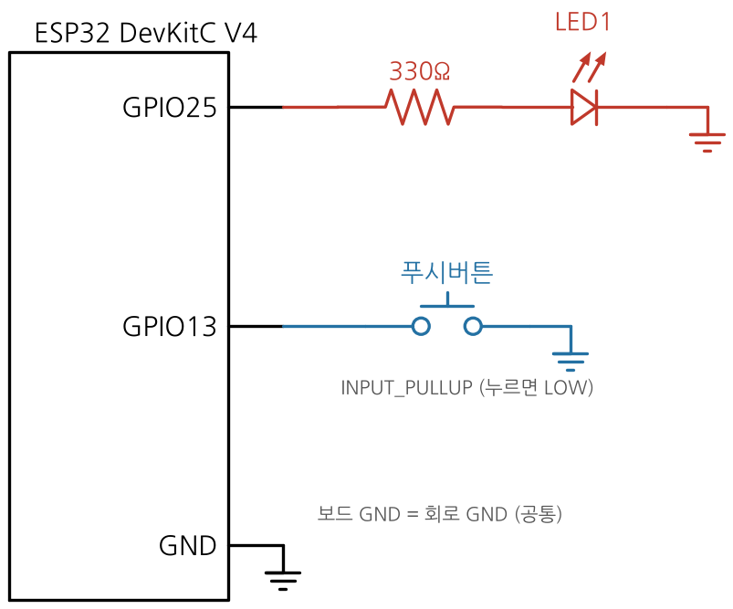
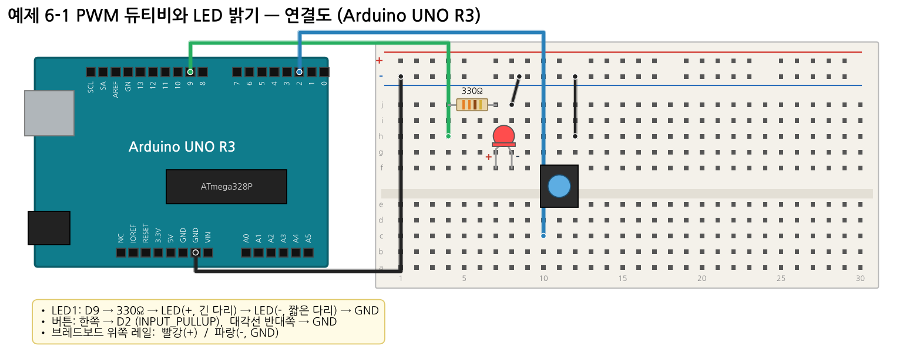
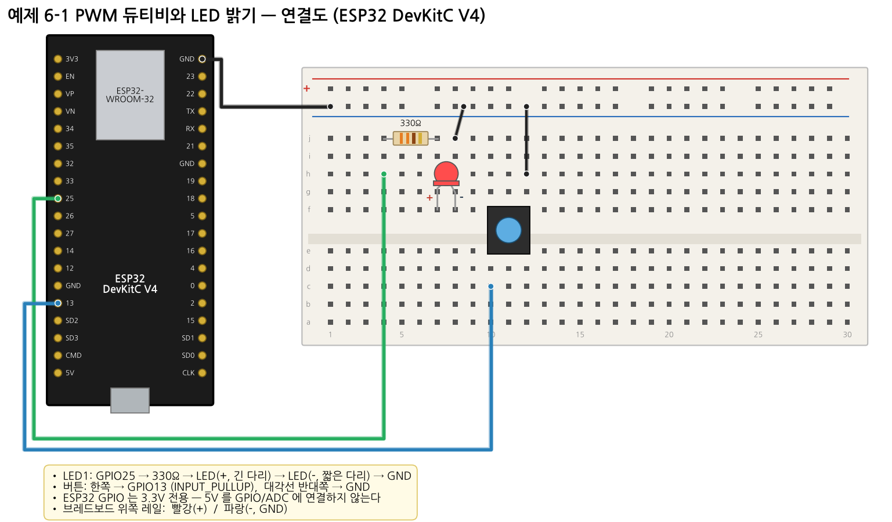

# 예제 6-1 — PWM 듀티비와 LED 밝기

**목표:** `analogWrite()` 가 전압이 아니라 **사각파의 HIGH 비율(듀티비)** 을 바꾼다는 것을 확인하고, PWM 값 → 듀티비(%) → Ton(ms)을 계산한다.

## 부품

| 부품 | 수량 | 비고 |
|---|---|---|
| Arduino UNO R3 또는 ESP32 DevKitC V4 | 1 | |
| LED (빨강) | 1 | 긴 다리(+) / 짧은 다리(-) |
| 저항 330Ω | 1 | 주황-주황-갈색-금 |
| 푸시버튼 | 1 | 대각선 다리 사용 |

## 연결

| 연결 | UNO | ESP32 |
|---|---|---|
| LED (330Ω 직렬) | D9 → 330Ω → LED(+) → LED(-) → GND | GPIO25 → 330Ω → LED(+) → LED(-) → GND |
| 버튼 | D2 ↔ 버튼 ↔ GND | GPIO13 ↔ 버튼 ↔ GND |

| 회로도 UNO | 회로도 ESP32 |
|---|---|
|  |  |




## 실행

1. 전원을 뺀 상태에서 연결도대로 배선한다.
2. `uno/sketch.ino` 또는 `esp32/sketch.ino` 를 업로드한다 (ESP32 는 보드 매니저 **esp32 3.x**).
3. 시리얼 모니터 **115200 baud** 를 연다.
4. 버튼을 누를 때마다 PWM 이 0 → 32 → 64 → 128 → 192 → 255 로 바뀐다.

Wokwi: 새 프로젝트를 만든 뒤 `sketch.ino` 와 `diagram.json` 탭 내용을 이 폴더의 파일로 교체한다.

## 예상 출력 (UNO)

```
PWM=128  Duty=50.2%  T=2.04ms  Ton=1.02ms
```

UNO D9 의 PWM 은 Timer1 이 만드는 **약 490 Hz**, ESP32 `analogWrite()` 는 LEDC 의 **1 kHz** 이다.

## 기록표

| PWM | 계산 Duty(%) | Ton (UNO, ms) | LED 밝기 관찰 |
|---|---|---|---|
| 0 | 0 | 0 | |
| 64 | 25.1 | 0.51 | |
| 128 | 50.2 | 1.02 | |
| 192 | 75.3 | 1.54 | |
| 255 | 100 | 2.04 | |

## 생각해 보기

- PWM 64 와 128 의 밝기 차이와 128 과 255 의 밝기 차이 중 어느 쪽이 더 크게 느껴지는가? (5주차 감마 보정)
- `analogWrite()` 가 "아날로그 출력"이 아닌 이유는?
