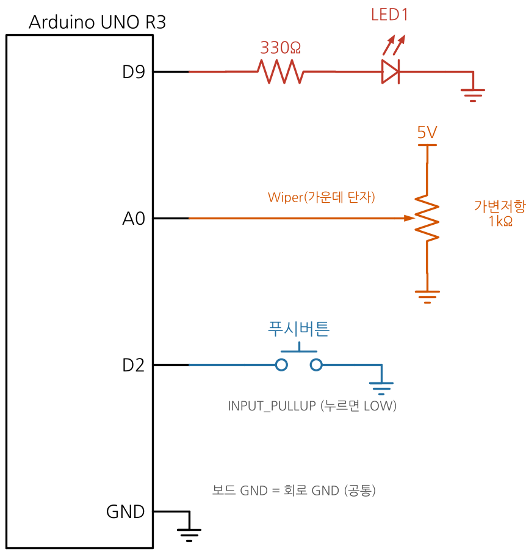
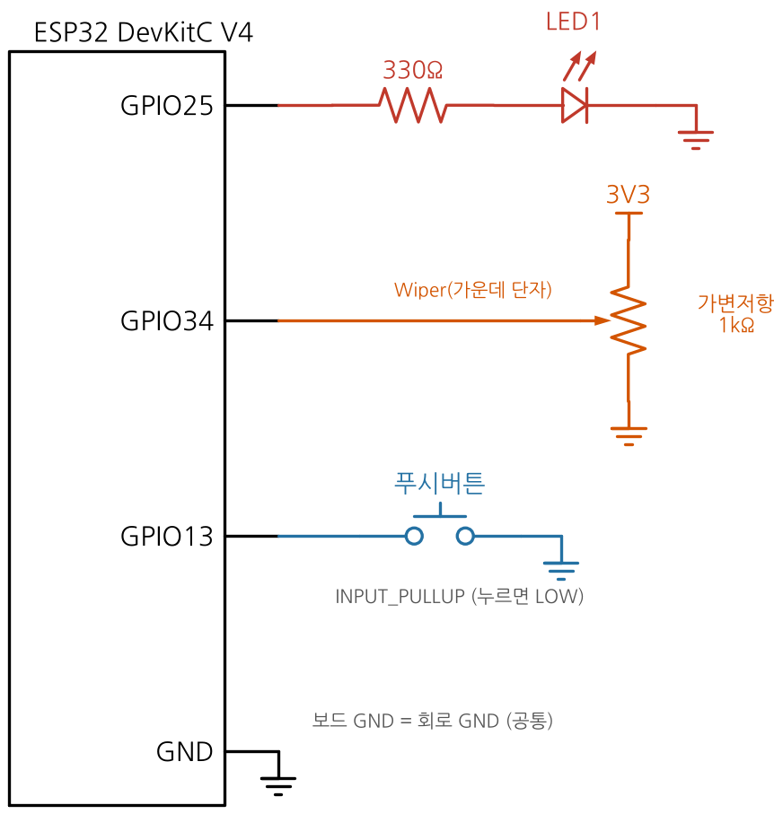
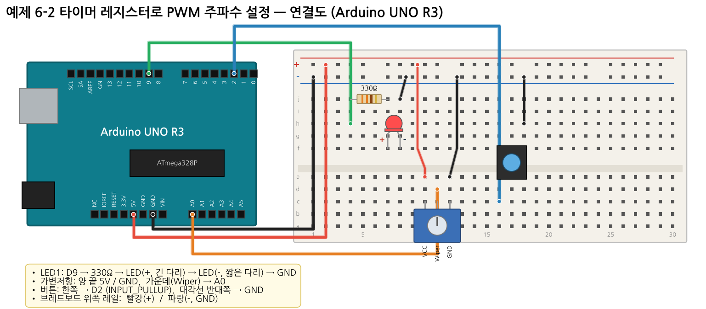
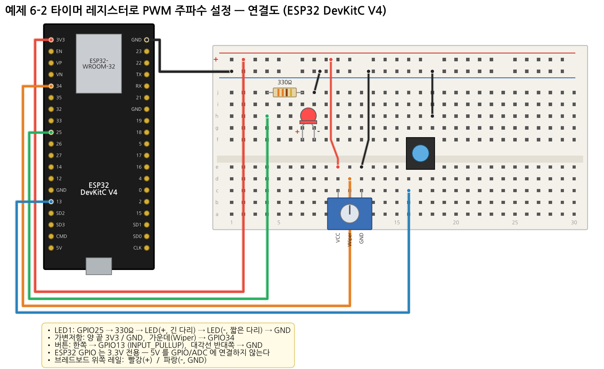

# 예제 6-2 — 타이머 레지스터로 PWM 주파수·듀티 직접 설정

**목표:** `analogWrite()` 뒤에 숨어 있는 **타이머 레지스터**를 직접 설정해 PWM **주파수**와 **듀티**를 따로 조절한다. 주파수가 낮으면 깜빡임, 높으면 밝기로 보이는 것을 눈으로 확인한다.

## 부품

LED 1, 330Ω 1, 가변저항 1kΩ 1, 푸시버튼 1

## 연결

| 연결 | UNO | ESP32 |
|---|---|---|
| LED (330Ω 직렬) | D9 (Timer1 OC1A) | GPIO25 (LEDC) |
| 가변저항 양 끝 | 5V / GND | **3.3V** / GND |
| 가변저항 가운데(Wiper) | A0 | GPIO34 |
| 버튼 (주파수 변경) | D2 ↔ GND | GPIO13 ↔ GND |

| 회로도 UNO | 회로도 ESP32 |
|---|---|
|  |  |




## 핵심 이론

### UNO — Timer1 Fast PWM (모드 14, TOP = ICR1)


| 레지스터 | 설정 | 의미 |
|---|---|---|
| `TCCR1A` | `COM1A1`, `WGM11` | OC1A(D9) 비반전 PWM 출력 |
| `TCCR1B` | `WGM13`, `WGM12`, `CS12` | 모드 14, 분주비 256 |
| `ICR1` | `62500 / f - 1` | TOP → **주파수** 결정 |
| `OCR1A` | `ICR1 × ADC / 1023` | 비교값 → **듀티** 결정 |

- 타이머 클록: 16 MHz / 256 = **62,500 Hz** (1 tick = 16 µs)
- `f_pwm = 62,500 / (ICR1 + 1)`, `Duty = (OCR1A + 1) / (ICR1 + 1)`

| 목표 f | ICR1 | 1 tick 당 듀티 분해능 |
|---|---|---|
| 1 Hz | 62499 | 0.0016 % |
| 100 Hz | 624 | 0.16 % |
| 1000 Hz | 61 | 1.6 % |

주파수를 올릴수록 TOP 이 작아져 **듀티를 나눌 수 있는 단계 수(해상도)** 가 줄어든다.

### ESP32 — LEDC


`f_pwm = 80 MHz / (분주비 × 2^res)`, 분주비는 1~1023 → 주파수마다 해상도를 골라야 한다. 코드의 `SETTINGS[]` 표 참고.

## 실행

1. 업로드 후 시리얼 모니터 115200.
2. 가변저항을 가운데쯤(약 50%)에 둔다.
3. 버튼을 눌러 1 → 4 → 20 → 100 → 1000 Hz 로 바꾸며 LED 를 관찰한다.
4. 각 주파수에서 가변저항을 돌려 듀티를 바꿔 본다.

## 예상 출력

```
UNO   : f=100Hz  ICR1=624  OCR1A=311  Duty=49.9%
ESP32 : f=100Hz  res=10bit  duty=511/1023  Duty=50.0%
```

## 기록표

| f (Hz) | ICR1 (UNO) / res (ESP32) | 보이는 모습 (깜빡임 / 떨림 / 밝기) |
|---|---|---|
| 1 | | |
| 4 | | |
| 20 | | |
| 100 | | |
| 1000 | | |

## 주의

- UNO: 이 예제는 Timer1 을 직접 바꾸므로 D9·D10 의 `analogWrite()`, Servo 라이브러리와 함께 쓸 수 없다.
- Fast PWM 은 `OCR1A = 0` 이어도 1 tick 동안 HIGH 가 나오므로, 코드의 `setDuty()` 는 0 일 때 출력을 분리해 완전히 끈다.
- ESP32 가변저항은 반드시 3.3V 에 연결한다.

## 생각해 보기

1. 사람 눈에 깜빡임이 사라지는 주파수는 대략 몇 Hz 부터였는가?
2. 분주비 256, ICR1 = 249 이면 PWM 주파수는? (정답: 250 Hz)
3. 같은 듀티에서 1 kHz 와 20 Hz 의 LED 평균 전력은 같은가?
