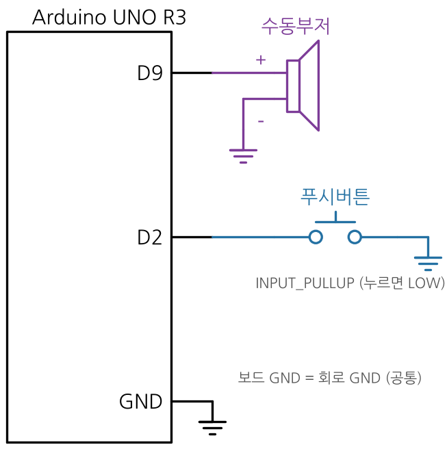
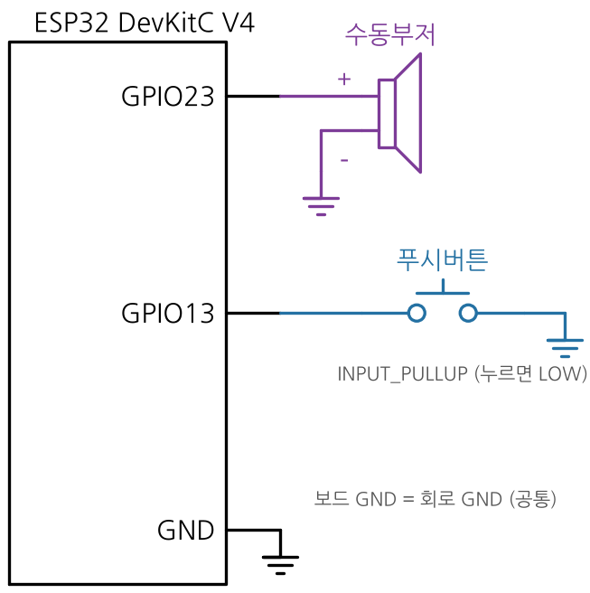
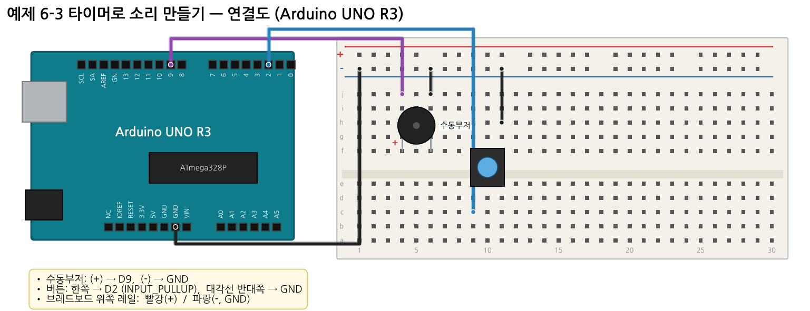
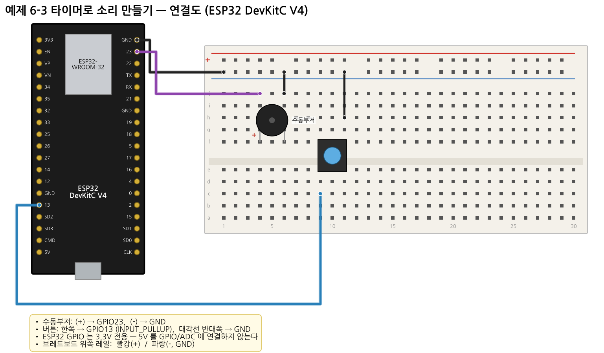

# 예제 6-3 — 타이머로 소리 만들기 (tone() 직접 구현)

**목표:** 소리의 높이 = 신호의 **주파수**임을 이해하고, 타이머 비교 일치(CTC)로 원하는 주파수를 직접 만든다. 정수 레지스터 때문에 생기는 **주파수 오차**를 계산한다.

## 부품

수동부저 1, 푸시버튼 1

> **수동부저 vs 능동부저**: 수동부저는 내부 발진기가 없어 주파수 신호를 넣어야 소리가 난다. 능동부저는 HIGH 만 줘도 고정음이 나므로 이 예제에 맞지 않는다.

## 연결

| 연결 | UNO | ESP32 |
|---|---|---|
| 수동부저 (+) | **D9** (Timer1 OC1A) | GPIO23 |
| 수동부저 (-) | GND | GND |
| 버튼 (옥타브 전환) | D2 ↔ GND | GPIO13 ↔ GND |

> 5주차에서는 부저를 D11 에 연결했다. 이 예제(UNO)는 Timer1 출력핀인 **D9** 로 옮긴다.

| 회로도 UNO | 회로도 ESP32 |
|---|---|
|  |  |




## 핵심 이론 — CTC 모드 + 토글


- `TCCR1B = WGM12 | CS11` → CTC 모드, 분주비 8 → 타이머 클록 2 MHz
- `TCCR1A = COM1A0` → 비교 일치마다 D9 반전
- 일치 2번이 소리 1주기 → `f_out = 1,000,000 / (OCR1A + 1)` → `OCR1A = 1,000,000 / f - 1`

| 음 | 목표 f | OCR1A | 실제 f |
|---|---|---|---|
| 도 | 262 | 3815 | 262.05 |
| 미 | 330 | 3029 | 330.03 |
| 라 | 440 | 2271 | 440.14 |
| 높은 도 | 523 | 1911 | 523.01 |

ESP32 는 `ledcWriteTone(pin, f)` 가 LEDC 분주비를 계산하고 **실제로 설정된 주파수**를 돌려준다.

## 실행

1. 업로드 후 시리얼 모니터 115200.
2. 도~높은 도가 0.4 초씩 울린다 (0.1 초 쉼, `delay()` 없음).
3. 버튼을 누르면 한 옥타브 위(×2)로 바뀐다.

## 예상 출력

```
UNO   : Do  target=262Hz  OCR1A=3815  real=262.05Hz
ESP32 : Do   target=262Hz  real=262Hz
```

## 기록표

| 음 | 목표 Hz | OCR1A (UNO) | 실제 Hz | 오차 Hz |
|---|---|---|---|---|
| 도 | 262 | | | |
| 솔 | 392 | | | |
| 높은 도 | 523 | | | |
| 높은 도 ×2 | 1046 | | | |

## 생각해 보기

1. 듀티(PWM)와 주파수(tone)는 무엇이 다른가? LED 와 부저 중 어느 쪽이 듀티에, 어느 쪽이 주파수에 반응하는가?
2. Arduino `tone()` 은 UNO 에서 Timer2 를 쓴다. 그러면 tone() 을 쓰는 동안 D3·D11 PWM 이 안 되는 이유는?
3. 분주비를 8 → 1 로 바꾸면 OCR1A 와 오차는 어떻게 달라지는가? 262 Hz 를 만들 수 있는가? (힌트: 16-bit 최대 65535)
