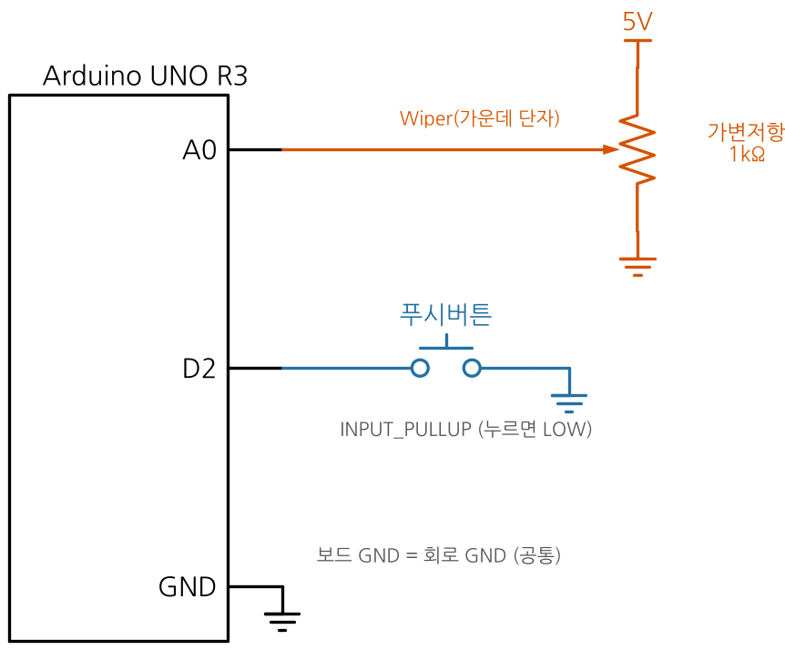
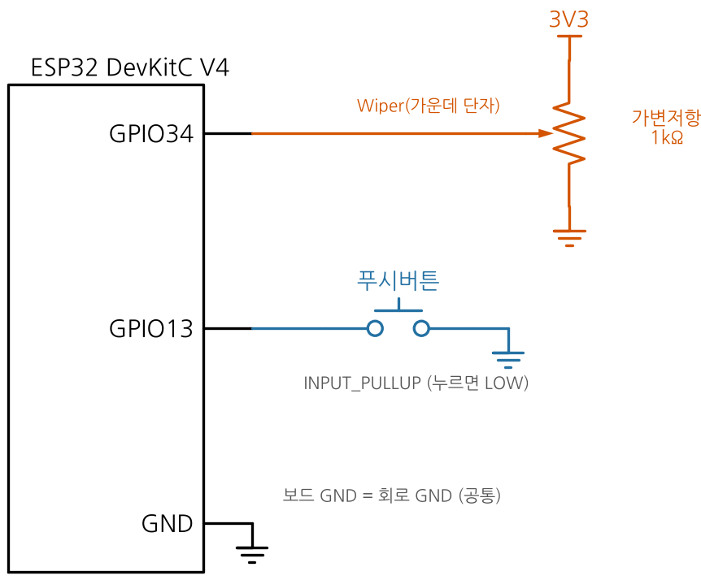
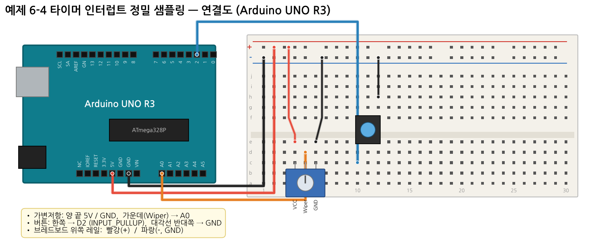
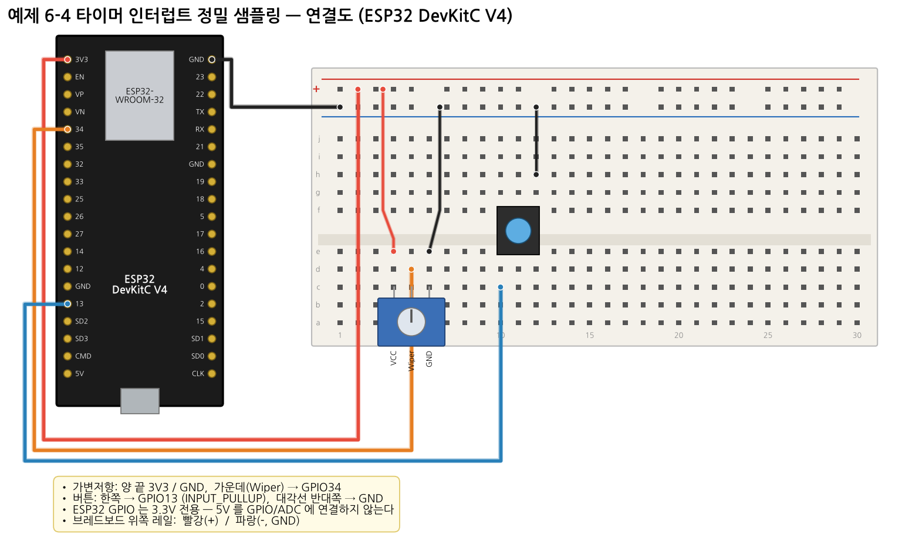
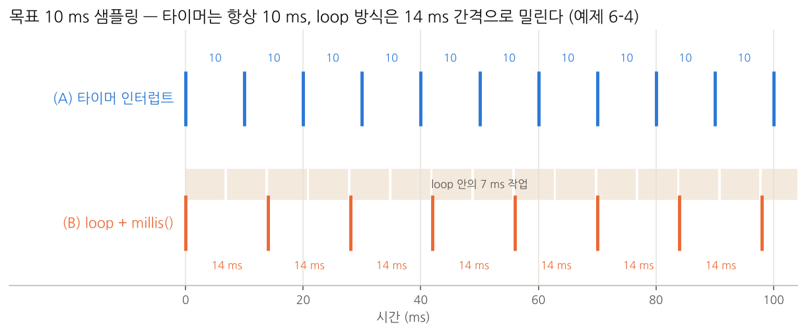

# 예제 6-4 — 하드웨어 타이머 인터럽트로 정확한 샘플링 주기 만들기

**목표:** 5주차의 `millis()` 샘플링은 loop 가 바쁘면 주기가 밀린다. **하드웨어 타이머 인터럽트**는 loop 와 상관없이 정확한 주기로 실행된다는 것을 측정값으로 비교한다.

## 부품

가변저항 1kΩ 1, 푸시버튼 1 (부하 표시는 보드 내장 LED 사용)

## 연결

| 연결 | UNO | ESP32 |
|---|---|---|
| 가변저항 양 끝 | 5V / GND | **3.3V** / GND |
| 가변저항 Wiper | A0 | GPIO34 |
| 버튼 (부하 ON/OFF) | D2 ↔ GND | GPIO13 ↔ GND |
| 부하 표시 LED | 내장 D13 | 내장 GPIO2 |

| 회로도 UNO | 회로도 ESP32 |
|---|---|
|  |  |




## 핵심 이론



**UNO — Timer2 CTC 인터럽트**

| 레지스터 | 값 | 의미 |
|---|---|---|
| `TCCR2A` | `WGM21` | CTC 모드 |
| `TCCR2B` | `CS22 \| CS20` | 분주비 128 → 125 kHz |
| `OCR2A` | 124 | 125 tick = **1 ms** |
| `TIMSK2` | `OCIE2A` | 비교 일치 A 인터럽트 허용 → `ISR(TIMER2_COMPA_vect)` |

ISR 이 1 ms 마다 호출되고, 10 번째마다 `analogRead()` 를 한다 (UNO 는 약 112 µs 로 짧아 ISR 안에서 허용).

**ESP32 — hw_timer + 태스크**

```c++
timer = timerBegin(1000000);            // 1 MHz
timerAttachInterrupt(timer, &onTimer);  // ISR 등록
timerAlarm(timer, 10000, true, 0);      // 10,000 µs 마다 반복
```

ESP32 코어 3.x 의 `analogRead()` 는 ISR 안에서 호출하면 안 되므로, ISR 은 우선순위 높은 태스크를 **깨우기만** 하고 태스크가 ADC 를 읽는다.

**ISR 작성 규칙:** 짧게, `Serial`·`delay()` 금지, 공유 변수는 `volatile` + 읽을 때 인터럽트 잠시 금지(또는 임계구역).

## 실행

1. 업로드 후 **Serial Plotter** 115200 을 연다.
2. 부하 OFF 상태에서 `TimerMax` 와 `LoopMax` 를 본다.
3. 버튼을 눌러 부하(loop 에 7 ms 작업)를 켠다 → 내장 LED 켜짐.
4. `LoopMax` 가 커지고 `TimerMax` 는 그대로인지 확인한다.

## 예상 출력 (UNO, simavr 시뮬레이션으로 확인한 값)

```
부하 OFF: Target:10000,TimerMin:10000,TimerMax:10000,LoopMin:9208,LoopMax:10252,Samples:100,...
부하 ON : Target:10000,TimerMin:10000,TimerMax:10000,LoopMin:14296,LoopMax:17432,Samples:100,...
```

부하가 없어도 `LoopMin` 이 9.2 ms 로 나오는 이유: UNO 의 `millis()` 는 1.024 ms 마다 갱신되며 가끔 2씩 증가한다.

## 기록표

| 조건 | TimerMin | TimerMax | LoopMin | LoopMax | Samples/s |
|---|---|---|---|---|---|
| 부하 OFF | | | | | |
| 부하 ON (7 ms) | | | | | |

## 주의

- UNO: Timer2 를 사용하므로 이 예제에서는 `tone()`, D3·D11 PWM 을 쓸 수 없다.
- 7주차(Interrupt)에서 ISR·volatile·임계구역을 자세히 다룬다.

## 생각해 보기

1. 부하 시간을 7 ms → 12 ms 로 바꾸면 LoopMax 는 대략 얼마가 되는가? (실제 보드 값은 시리얼 출력 시간이 더해져 시뮬레이션보다 조금 크다)
2. OCR2A 를 249, 분주비를 64 로 바꾸면 인터럽트 주기는? (16 MHz / 64 / 250 = 1 kHz → 1 ms, 같음)
3. 5주차 나이퀴스트 정리와 연결: 샘플링 주기가 흔들리면 어떤 문제가 생기는가?
