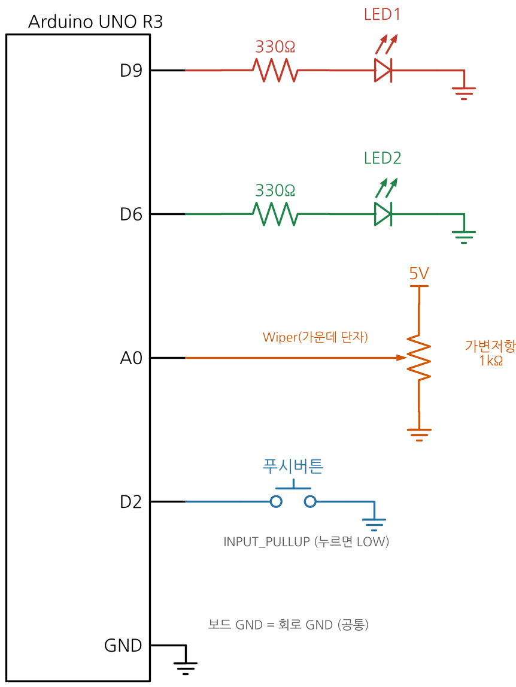
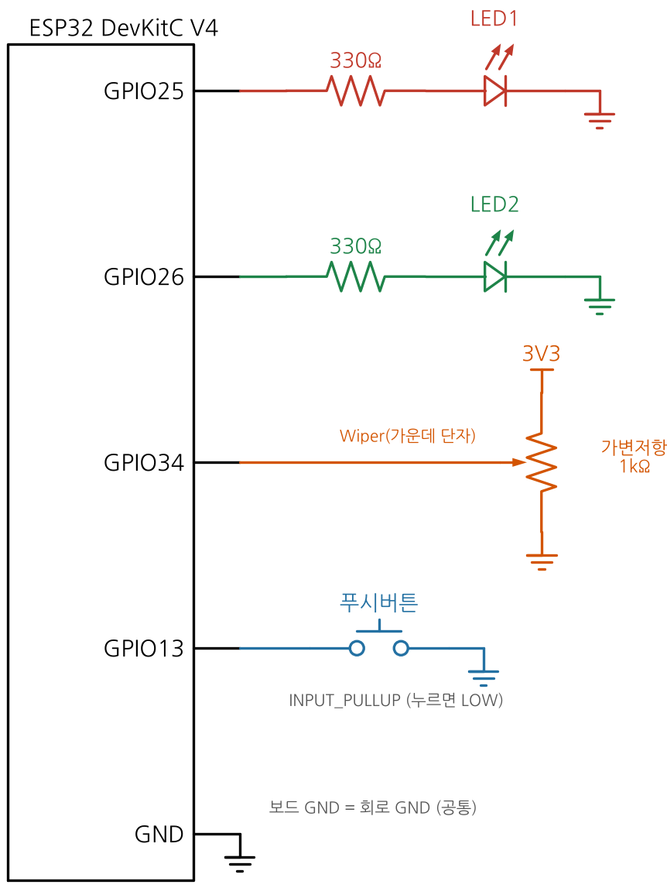
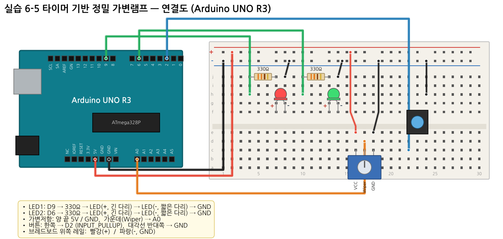
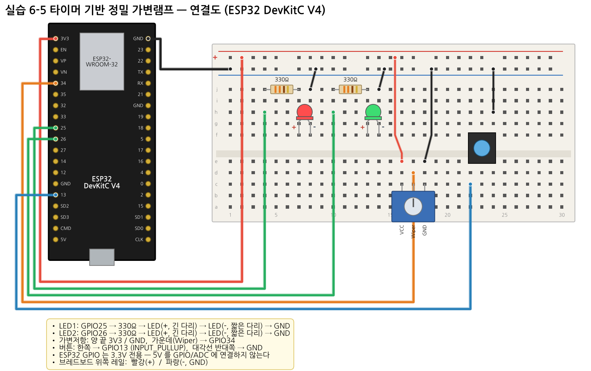

# 실습 6-5 — 타이머 기반 정밀 가변램프 (종합)

**목표:** 예제 6-2(타이머 PWM)와 6-4(타이머 샘플링)를 합쳐, **두 개의 타이머가 각자 다른 일을 동시에** 하는 시스템을 만든다. 타이머 자원을 어떻게 나눠 쓰는지 설명할 수 있다.

## 부품

LED 2 (빨강·초록), 330Ω 2, 가변저항 1kΩ 1, 푸시버튼 1

## 연결

| 연결 | UNO | ESP32 |
|---|---|---|
| LED1 램프 (330Ω) | D9 (Timer1 OC1A) | GPIO25 (LEDC) |
| LED2 심장박동 (330Ω) | D6 | GPIO26 |
| 가변저항 양 끝 | 5V / GND | **3.3V** / GND |
| 가변저항 Wiper | A0 | GPIO34 |
| 버튼 (PWM 주파수 변경) | D2 ↔ GND | GPIO13 ↔ GND |

| 회로도 UNO | 회로도 ESP32 |
|---|---|
|  |  |




## 타이머 자원 배분 (UNO)


| 타이머 | 이 실습에서의 역할 |
|---|---|
| Timer0 | `millis()` — 그대로 둔다 |
| Timer1 | 램프 LED PWM (Fast PWM 모드 14, 2/10/50/500 Hz) |
| Timer2 | 1 ms 인터럽트 → 10 ms 마다 ADC 샘플링, 500 ms 마다 LED2 토글 |

→ Timer2 를 쓰므로 `tone()` 은 쓸 수 없다. **ESP32** 는 하드웨어 타이머 4개와 LEDC 16채널이 있어 이런 충돌이 적다.

## 요구사항

1. 가변저항을 **정확히 100 Hz** 로 샘플링하고 최근 **8개 이동평균**으로 잡음을 줄인다.
2. 평균값으로 LED1 듀티를 바꾼다 (0 이면 완전히 꺼짐).
3. 버튼으로 PWM 주파수 2 → 10 → 50 → 500 Hz 를 순환한다.
4. LED2 는 loop 가 바빠도 정확히 **0.5 초마다** 토글된다.
5. `loop()` 안에서 `delay()` 금지. 500 ms 마다 상태를 시리얼로 출력한다.

## 예상 출력

```
UNO   : f=500Hz ADC=512 ICR1=124 OCR1A=62 Duty=50.4% Samples/0.5s=50
ESP32 : f=500Hz ADC=2048 res=10bit duty=511/1023 Duty=50.0% Samples/0.5s=50
```

`Samples/0.5s` 가 항상 **50** 이면 100 Hz 샘플링이 정확하다는 뜻이다.

## 단계별 진행 (부분 테스트 → 완성)

| 단계 | 할 일 | 확인 |
|---|---|---|
| 1 | LED2 와 Timer2/hw_timer 만 넣고 0.5 s 토글 | 스톱워치로 10회 = 5 초 |
| 2 | ISR(태스크)에서 ADC 샘플링, `Samples/0.5s` 출력 | 50 고정 |
| 3 | 예제 6-2 의 Timer1/LEDC PWM 코드 추가 | 가변저항으로 밝기 변화 |
| 4 | 이동평균 추가 | 노브를 고정했을 때 ADC 값 흔들림 감소 |
| 5 | 버튼으로 주파수 순환 | 2 Hz 깜빡임 ↔ 500 Hz 밝기 |

## 평가 기준 (10점)

| 항목 | 배점 |
|---|---|
| 회로 구성 (극성·저항·ESP32 3.3V) | 2 |
| 100 Hz 정밀 샘플링 + 이동평균 (`Samples/0.5s = 50`) | 3 |
| 타이머 PWM 주파수·듀티 제어 | 2 |
| LED2 0.5 s 정확도 + delay() 미사용 | 1 |
| 타이머 자원 배분 설명 (보고서) | 2 |

## 도전 과제

- **ESP32:** 듀티가 90 % 이상이면 GPIO23 수동부저로 `ledcWriteTone()` 경고음을 낸다 (LEDC 채널 1개 추가).
- **UNO:** 위 기능을 UNO 에서 하려면 어떤 타이머가 부족한가? 해결 방법(예: 부저를 Timer1 CTC 로, 램프를 Timer0 핀 D5/D6 의 analogWrite 로)을 제안하라.
- 이동평균 개수 8 → 32 로 바꾸면 반응 속도는 어떻게 되는가?

## 제출물

1. 전체 배선 사진 (보드·브레드보드가 모두 보이게)
2. `sketch.ino`
3. 시리얼 모니터 캡처 (주파수 4가지 모두)
4. 보고서: 타이머 자원 배분표와 2 Hz / 500 Hz 에서 보이는 차이 설명
