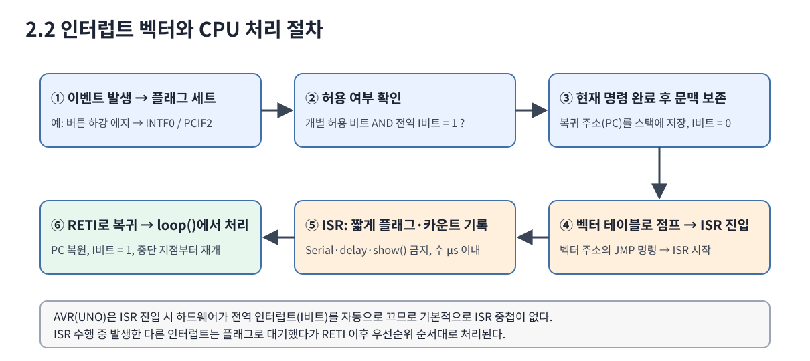
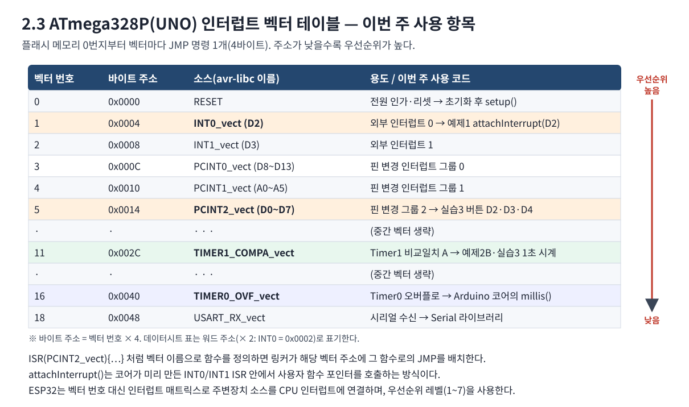
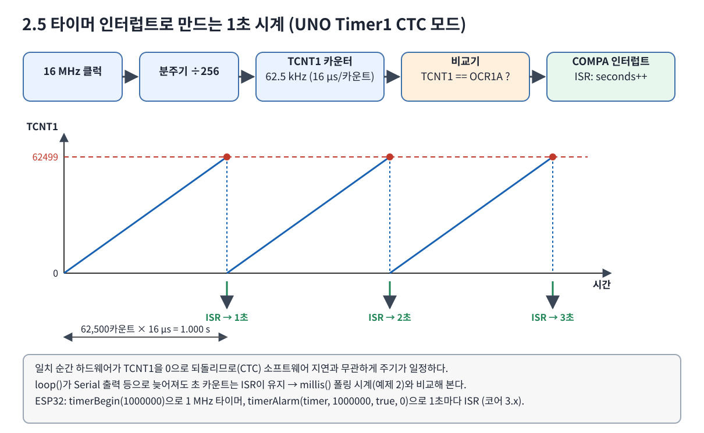

# 7주차 핵심 이론 보충: 실제 코드로 이해하는 Arduino 함수와 인터럽트
## 1. 함수·상수·사용자 변수 구분
- **Arduino 코어 제공**: `pinMode()`, `digitalRead()`, `millis()`, `noInterrupts()`, `interrupts()`, `attachInterrupt()`, `digitalPinToInterrupt()`, `Serial.begin()`, `Serial.print()`, `Serial.println()`.
- **Arduino 코어 상수**: `INPUT_PULLUP`, `HIGH`, `LOW`, `FALLING`.
- **사용자가 정의한 변수**: `level`, `paused`, `BUTTON_PINS`, `elapsedSeconds`, `interruptEvents`.
- **C/C++ 언어 요소**: `const`(수정 금지), `volatile`(비동기 변경을 컴파일러에 알림), `uint8_t`(부호 없는 8비트 정수), `uint32_t`(부호 없는 32비트 정수).
- **외부 라이브러리**: `Adafruit_NeoPixel`와 인스턴스의 `begin()`, `clear()`, `setPixelColor()`, `Color()`, `setBrightness()`, `show()`.
- **사용자 정의 함수**: `updateClock()`, `updateButtons()`, `processButton()`, `renderLeds()`, `printStatus()`는 Arduino 내장 함수가 아니라 이 실습에서 정의한 함수다.

## 2. Arduino 기본 함수
### 2.1 pinMode(pin, INPUT_PULLUP)
```cpp
pinMode(BUTTON_PINS[0], INPUT_PULLUP);
```
지정 핀을 입력으로 구성하고 내부 풀업을 활성화한다. 버튼 반대쪽을 GND에 연결하면 평상시 HIGH, 누르는 동안 LOW가 된다. ESP32 내부 풀업은 일반적으로 3.3V 논리 전압 기준이다.
### 2.2 digitalRead(pin)
```cpp
if (digitalRead(BUTTON_PINS[i]) == HIGH) {
  lowStartedAt[i] = 0;
}
```
입력 전압을 논리 HIGH/LOW로 읽는다. 본 실습에서는 ISR 발생 직후 곧바로 인정하지 않고, 30ms 이상 LOW를 유지하는지 확인하는 디바운싱 용도로 사용한다.
### 2.3 millis()
```cpp
uint32_t now = millis();
if ((uint32_t)(now - lastClockTick) >= 1000UL) {
  lastClockTick += 1000UL;
}
```
부팅 이후 경과한 밀리초를 반환한다. 반환값은 계속 증가하다가 약 49.7일 후 32비트 범위에서 순환한다. 부호 없는 정수로 **두 시각의 차**를 계산하면 일반적인 짧은 간격 측정에서 오버플로에 강하다. `delay(1000)`와 달리 루프에서 버튼 이벤트를 계속 처리할 수 있다. 이는 실제 시각을 유지하는 RTC가 아니다.
### 2.4 Serial.begin/print/println
```cpp
Serial.begin(115200);
Serial.print("[STATE] level=");
Serial.println(level);
```
시리얼 통신을 초기화하고 학습자가 실행 결과를 관찰하게 한다. `print()`는 줄바꿈 없이, `println()`은 줄바꿈까지 출력한다. 시리얼 모니터의 속도도 115200으로 맞춘다. ISR 안에서 Serial 출력을 수행하지 않는다.

## 3. 외부 인터럽트 API
```cpp
attachInterrupt(
  digitalPinToInterrupt(BUTTON_PINS[0]),
  onIncrease,
  FALLING
);
```
- `digitalPinToInterrupt(pin)`: Arduino 논리 핀 번호에서 인터럽트 번호/식별자를 얻는다.
- `attachInterrupt(interrupt, callback, mode)`: 콜백 ISR을 연결한다.
- `FALLING`: HIGH에서 LOW로 바뀔 때 발생하는 하강 에지를 뜻한다.
- UNO ATmega328P에서 `attachInterrupt()`가 다루는 외부 인터럽트는 주로 D2(INT0), D3(INT1)이다. D4까지 세 버튼을 모두 인터럽트 입력으로 사용하기 위해 본 통합 실습은 PCINT를 사용한다.
- `noInterrupts()`/`interrupts()`: 보통 단일 코어 AVR 환경에서 짧은 공유 데이터 복사 중 인터럽트를 차단/복원하는 데 쓰인다. 호출 전에 인터럽트가 비활성화되었을 가능성이 있으면 상태 복원을 고려해야 한다.

## 4. UNO ATmega328P PCINT 레지스터
```cpp
ISR(PCINT2_vect) {
  uint8_t current = PIND;
  uint8_t falling = previousPortD & (uint8_t)~current;
  interruptEvents |= (falling >> 2) & 0x07;
  previousPortD = current;
}
```
- `ISR(PCINT2_vect)`: AVR 하드웨어의 포트 D 핀 변경 인터럽트 벡터에 연결하는 매크로다. Arduino 기본 일반 함수가 아니라 AVR 코어 도구체인의 기능이다.
- `PIND`: 포트 D 핀의 현재 논리 상태를 담는 하드웨어 입력 레지스터다. D2·D3·D4는 비트 2·3·4에 대응한다.
- `PCMSK2`: 포트 D에서 어떤 비트의 변화가 PCINT를 유발할지 지정하는 마스크다. D2=PCINT18, D3=PCINT19, D4=PCINT20.
- `PCICR`: PCINT 그룹을 활성화한다. `PCIE2`는 포트 D 그룹 허용 비트다.
- `PCIFR`: 발생 플래그 레지스터이며 AVR에서는 해당 비트에 1을 써서 플래그를 지운다.
- `_BV(bit)`: 해당 비트에 1을 갖는 마스크를 만드는 AVR 매크로다.
- `falling`: 이전 상태는 1이고 현재 상태는 0인 비트만 추린다. ISR에서는 LED 출력·디바운스·시리얼 출력을 하지 않고 이벤트 플래그만 기록한다.

## 5. ESP32의 ISR과 임계구역
```cpp
void ARDUINO_ISR_ATTR onIncrease() {
  portENTER_CRITICAL_ISR(&eventMux);
  interruptEvents |= 0x01;
  portEXIT_CRITICAL_ISR(&eventMux);
}
```
- `ARDUINO_ISR_ATTR`: ESP32 Arduino 코어에서 ISR용 속성을 지정하는 매크로이며 코어 버전에 따라 정의가 달라질 수 있다.
- `portMUX_TYPE`: ESP32 FreeRTOS의 스핀락 제어에 사용하는 타입이다.
- `portENTER_CRITICAL_ISR()`/`portEXIT_CRITICAL_ISR()`: ISR 문맥에서 짧은 공유 데이터 변경 구간을 보호한다.
- 메인 루프는 이에 대응해 `portENTER_CRITICAL()`/`portEXIT_CRITICAL()`로 이벤트를 복사한 후 플래그를 비운다.
- ESP32는 멀티코어 환경일 수 있으므로 단순한 `volatile`만으로 동시 접근의 안전성을 보장하지 않는다.

## 6. 인터럽트 벡터 테이블과 CPU 처리 절차



1. 주변장치가 이벤트를 감지하면 **인터럽트 플래그**(예: `INTF0`, `PCIF2`, `OCF1A`)가 1이 된다.
2. 개별 허용 비트(`EIMSK`, `PCICR`, `TIMSK1`)와 전역 허용 비트(SREG의 I비트, `sei()`/`interrupts()`)가 모두 1이면 요청이 받아들여진다.
3. CPU는 실행 중인 명령을 마친 뒤 복귀 주소(PC)를 스택에 저장하고 I비트를 0으로 만든다.
4. 플래시 0번지부터 놓인 **벡터 테이블**의 해당 항목(JMP 명령)으로 이동해 ISR을 시작한다. 여러 요청이 동시에 대기 중이면 벡터 번호가 작은 것이 먼저다.
5. ISR은 플래그·카운트만 기록하고 빨리 끝낸다. 컴파일러가 ISR 앞뒤에 사용 레지스터 저장/복원 코드를 자동으로 넣는다.
6. `RETI` 명령으로 PC를 복원하고 I비트를 다시 1로 만든 뒤 중단 지점부터 실행을 이어 간다.

`ISR(PCINT2_vect) { ... }`처럼 **avr-libc 벡터 이름**으로 함수를 정의하면 링커가 벡터 5번 자리에 이 함수로의 점프를 넣는다. `attachInterrupt()`는 코어에 이미 정의된 `INT0_vect`/`INT1_vect` ISR이 사용자 함수를 함수 포인터로 호출해 주는 방식이다.

## 7. 타이머 인터럽트로 만드는 시계


### UNO Timer1 CTC 모드
```cpp
ISR(TIMER1_COMPA_vect) {      // 벡터 11
  isrSeconds++;
  tickFlag = true;
}

noInterrupts();
TCCR1A = 0;  TCCR1B = 0;  TCNT1 = 0;
OCR1A  = 62499;                     // 16MHz / 256 = 62,500Hz → 62,500카운트 = 1초
TCCR1B = _BV(WGM12) | _BV(CS12);    // CTC 모드(TOP=OCR1A), 분주 256
TIFR1  = _BV(OCF1A);                // 남은 플래그 제거
TIMSK1 = _BV(OCIE1A);               // 비교일치 A 인터럽트 허용
interrupts();
```
| 레지스터/비트 | 뜻 |
|---|---|
| `TCCR1A`, `TCCR1B` | 타이머1 제어. Arduino 코어가 PWM용으로 미리 설정하므로 0으로 초기화 후 설정 |
| `WGM12` | CTC 모드: TCNT1이 OCR1A와 같아지면 0으로 되돌림 |
| `CS12` | 분주비 256 선택(타이머 시작) |
| `OCR1A` | 비교값. 주기 = (OCR1A+1) × 분주 / 16MHz |
| `TIMSK1`의 `OCIE1A` | 비교일치 A 인터럽트 허용 |
| `TIFR1`의 `OCF1A` | 비교일치 플래그(1을 써서 지움) |

계산 연습: 0.5초 주기는 `OCR1A = 31249`, 10ms 주기(분주 64)는 `OCR1A = 2499`.

### ESP32 하드웨어 타이머 (Arduino-ESP32 코어 3.x)
```cpp
hw_timer_t *timer = timerBegin(1000000);     // 1 MHz (1틱 = 1µs)
timerAttachInterrupt(timer, &onTimer);       // ISR 연결
timerAlarm(timer, 1000000, true, 0);         // 1,000,000틱 = 1초, 자동 재장전, 무한 반복
```
코어 2.x에서는 `timerBegin(0, 80, true)`, `timerAlarmWrite()`, `timerAlarmEnable()`을 쓴다. 실습 코드는 `#if ESP_ARDUINO_VERSION_MAJOR >= 3`로 두 버전을 모두 지원한다.

### millis() 시계와 비교
| 항목 | millis() 폴링 시계(예제 2) | 타이머 인터럽트 시계(예제 2B) |
|---|---|---|
| 1초 판단 | loop()가 매번 시간 차이 계산 | 타이머 하드웨어가 1초마다 ISR 호출 |
| loop()가 막히면 | 판단이 늦어짐(while로 따라잡음) | 초 카운트는 정확히 유지 |
| 사용 자원 | Timer0(코어가 이미 사용) | UNO Timer1 추가 사용 → D9·D10 PWM 불가 |
| 정확도 | 둘 다 보드 발진자(세라믹 공진자) 오차의 영향 → 장기 정확도가 필요하면 RTC 모듈 |

## 8. 이벤트 기반 프로그램 구조


실습 3은 "**ISR은 사건 기록, loop()는 사건 처리**" 구조다. 버튼 ISR과 타이머 ISR이 공유 변수에 사건을 기록하고, loop()는 임계구역에서 한 번에 복사한 뒤 순서대로 처리한다. 새로운 기능(예: LED 표시)을 추가해도 ISR은 바뀌지 않고 loop()의 처리 함수만 늘어난다.

## 9. NeoPixel 라이브러리
```cpp
Adafruit_NeoPixel bar(8, BAR_PIN, NEO_GRB + NEO_KHZ800);
bar.begin();
bar.setBrightness(50);
bar.clear();
bar.setPixelColor(0, bar.Color(0, 30, 0));
bar.show();
```
- 객체 생성자의 8은 **LED 개수**, BAR_PIN은 DIN 신호용 MCU 핀이다.
- `NEO_GRB`: 장치의 색상 바이트 순서, `NEO_KHZ800`: 프로토콜 속도 설정이다.
- `begin()`: NeoPixel 출력 초기화.
- `setBrightness()`: 전체 출력 밝기 스케일 설정(0~255). 교육용 실습은 낮은 밝기부터 시작한다.
- `clear()`: 라이브러리의 픽셀 버퍼를 0으로 초기화.
- `setPixelColor(index, color)`: 인덱스 0부터 LED 색상을 설정. **호출만으로는 실제 LED에 반영되지 않는다.**
- `Color(r,g,b)`: RGB 값을 LED 색상값으로 만든다.
- `show()`: 버퍼를 직렬 데이터로 전송하고 실제 LED 출력을 갱신한다. ISR 내부에서 실행하면 안 된다.
- WS2812 8LED + 12LED는 총 20개 LED이며 밝기/색상에 따라 외부 전원 요구량이 달라진다.

## 10. 사용자 정의 함수와 호출 관계
```text
setup()
 ├─ Serial.begin(115200)
 ├─ pinMode(..., INPUT_PULLUP)
 ├─ bar.begin() / ring.begin()
 └─ attachInterrupt(...) 또는 PCINT2 설정

loop()
 ├─ updateClock(now) → Serial.print/println()
 └─ updateButtons(now)
      ├─ takeInterruptEvents()
      ├─ digitalRead() → 디바운스
      └─ processButton()
           ├─ printStatus() → Serial.print/println()
           └─ renderLeds() → setPixelColor() → show()
```
`updateClock`와 `updateButtons`는 사용자가 만든 함수이고, `loop`가 반복 호출한다. `setup`·`loop`는 Arduino 스케치의 정해진 진입점 형태다.

## 11. 학생 코드 읽기 문제
1. `const uint8_t BAR_PIN = 6;`은 Arduino 내장 변수인가, 사용자가 정의한 상수인가?
2. 내부 풀업을 쓰는데 버튼을 누르면 LOW가 되는 까닭은?
3. `millis()`와 `delay()`의 차이는?
4. UNO의 PCINT2 벡터와 D2/D3의 INT0/INT1은 무엇이 다른가?
5. `volatile`이 있어도 왜 임계구역이 필요한가?
6. `setPixelColor()` 다음에 `show()`를 호출해야 하는 이유는?
7. ISR에서 `Serial.println()`이나 `show()`를 호출하지 않는 이유는?
8. 출력 로그 `[EVENT]`, `[STATE]`, `[CLOCK]`은 어떤 위치에서 생성되는가?
9. `OCR1A = 62499`에서 1을 빼는 이유는? 2초 주기를 만들려면 분주비와 OCR1A를 어떻게 정하는가?
10. PCINT2_vect와 TIMER1_COMPA_vect가 동시에 대기 중이면 어느 ISR이 먼저 실행되는가?

## 12. 참고 코드
- [UNO WS2812 인터럽트 통합 실습](../labs/uno_04_ws2812_interrupt/uno_04_ws2812_interrupt.ino)
- [ESP32 WS2812 인터럽트 통합 실습](../labs/esp32_04_ws2812_interrupt/esp32_04_ws2812_interrupt.ino)

**검증 범위:** UNO 코드는 avr-gcc 빌드와 simavr 시뮬레이션으로 확인했다. ESP32 코드는 코어 3.x/2.x API 기준 문법 검사를 했다. 실물 보드 검증은 별도로 필요하다.
