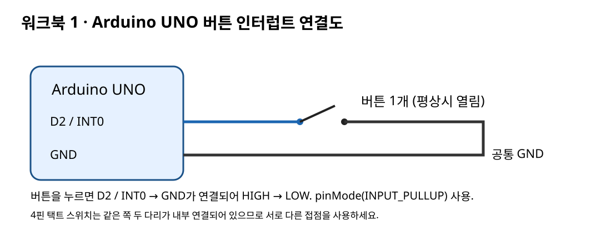
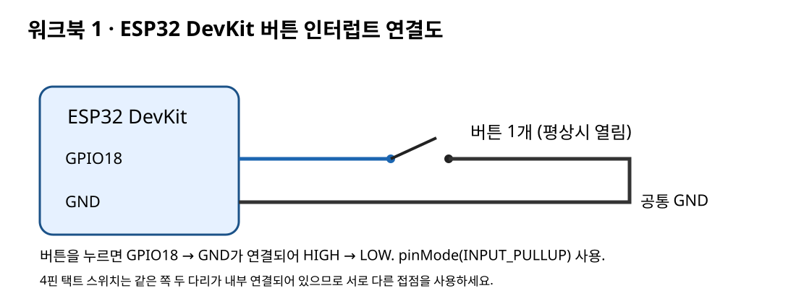

# 워크북 1: 인터럽트와 시계 만들기
## 목표
버튼 하강 에지 인터럽트가 ISR을 호출하는 순서를 설명하고, `millis()` 폴링 시계와 **타이머 인터럽트 시계**를 각각 구현해 비교한다.

## 준비물
Arduino UNO 또는 ESP32 DevKit, 택트 버튼 1개, 브레드보드, 점퍼선, USB.

## 연결 (예제 1만 버튼 필요, 예제 2·2B는 USB만 연결)



- UNO: D2 → 버튼 접점 A, 버튼 접점 B(대각선 다리) → GND
- ESP32: GPIO18 → 버튼 접점 A, 버튼 접점 B(대각선 다리) → GND
- 택트 스위치의 같은 면 2핀은 내부적으로 연결되어 있다. 브레드보드 중앙 홈을 가로질러 꽂고 대각선 다리를 사용한다.
- 내부 풀업 사용. 외부 5V/3.3V를 버튼에 직결하지 않는다.

## 실습
1. Arduino IDE에서 보드를 선택한다. (ESP32는 보드 매니저에서 **esp32 by Espressif 3.x** 설치)
2. **예제 1** `examples/uno_01_external_interrupt` 또는 `examples/esp32_01_external_interrupt`를 업로드한다.
3. 시리얼 모니터 115200bps. 버튼을 한 번 누를 때 출력 횟수를 관찰한다. 접점 바운스 때문에 2회 이상 출력될 수 있다 → 디바운스가 왜 필요한지 기록.
4. **예제 2** `examples/*_02_clock`을 업로드하여 1초마다 `HH:MM:SS`가 출력되는지 확인한다. (`millis()` 폴링 방식)
5. **예제 2B** `examples/*_02b_timer_interrupt_clock`을 업로드한다. 같은 결과지만 1초를 **타이머 하드웨어가 인터럽트로** 알려 준다.
   - UNO: Timer1 CTC, 16 MHz ÷ 256 = 62.5 kHz, `OCR1A = 62499` → 정확히 1초마다 `TIMER1_COMPA_vect`
   - ESP32: `timerBegin(1000000)`(1 MHz) + `timerAlarm(timer, 1000000, true, 0)` → 1초마다 `onTimer()`
6. 비교 실험: 예제 2와 2B의 `loop()` 끝에 `delay(1500);`을 넣어 보자.
   - 예제 2: 출력이 1.5초마다 몰려서 나오지만 `while`로 밀린 초를 따라잡는다.
   - 예제 2B: 초 카운트는 ISR이 계속 올리므로 정확하다. 단, 출력은 `loop()`가 돌아올 때만 되므로 일부 초가 건너뛰어 보일 수 있다 → 왜 그런지 설명.

## 예상 출력
```text
UNO Timer1 CTC 1Hz interrupt clock
TIME 00:00:01
TIME 00:00:02
TIME 00:00:03
```

## 질문
1. 인터럽트 벡터의 역할은 무엇인가? `TIMER1_COMPA_vect`는 몇 번 벡터인가? (그림 2.3 참고)
2. 왜 ISR 안에서 `Serial.print()`와 `delay()`를 피해야 하는가?
3. UNO에서 `isrSeconds`(4바이트)를 읽을 때 `noInterrupts()`가 필요한 이유는?
4. `millis()` 시계와 타이머 인터럽트 시계 모두 RTC라고 부를 수 없는 이유는?

## 제출
연결 사진, 시리얼 모니터 로그(예제 1·2·2B), 인터럽트 처리 흐름도, 질문 답 4문항.
