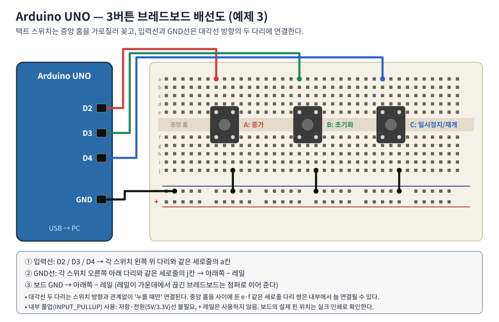
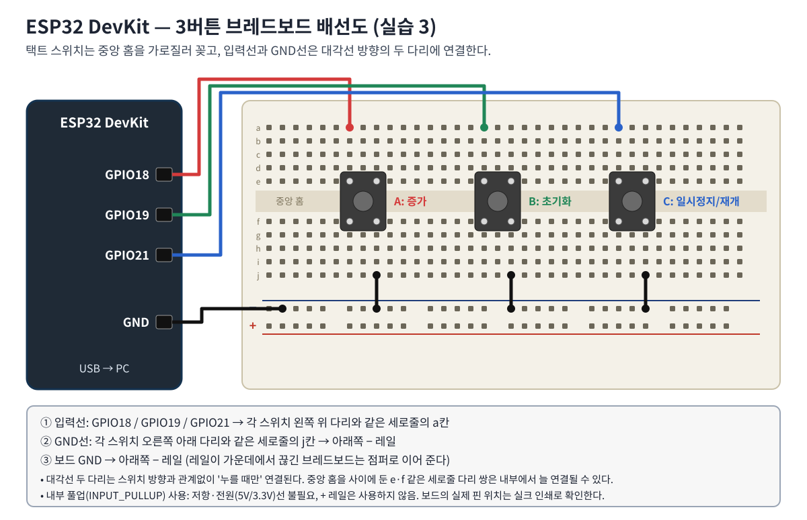
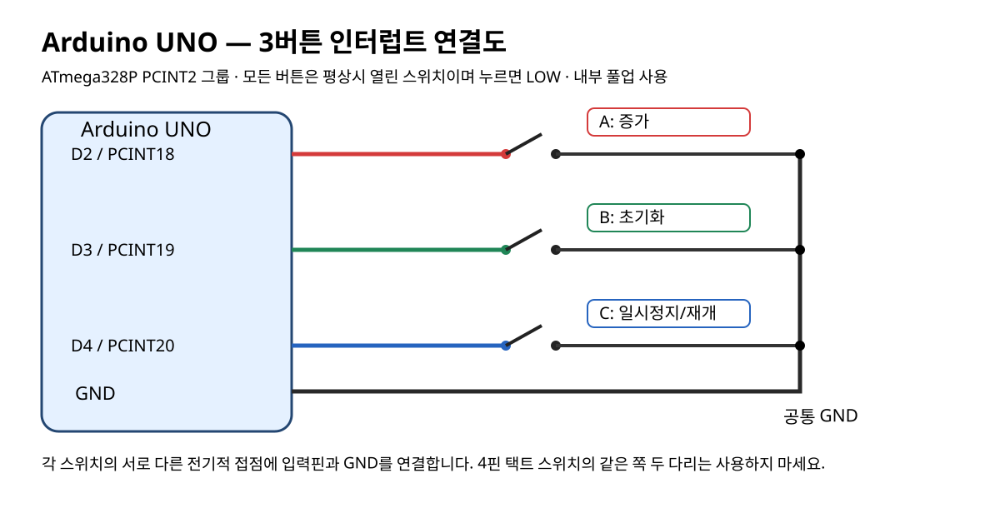
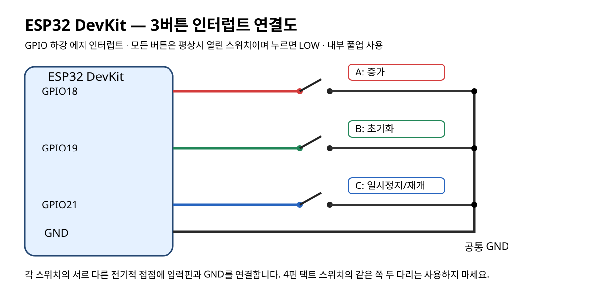
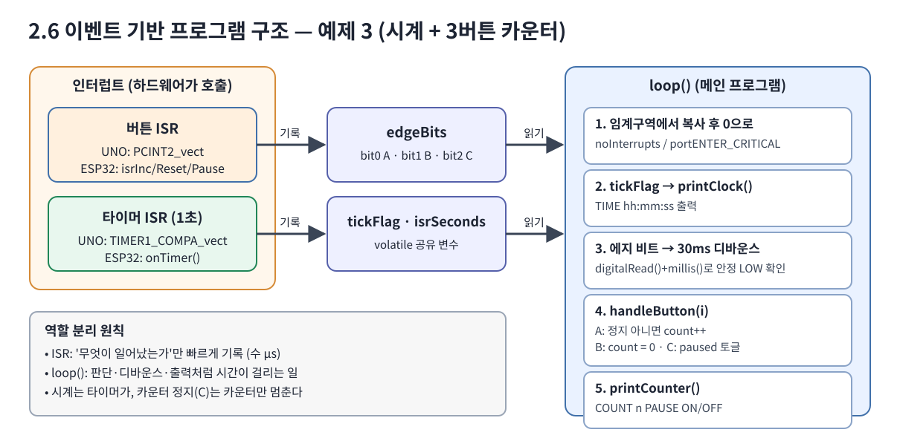

# 워크북 2: 시계와 3버튼 인터럽트 카운터
## 목표
버튼 3개를 인터럽트 입력으로 설정하여 카운터 **증가 / 초기화 / 일시정지** 기능을 구현하고, 타이머 인터럽트 시계와 함께 동작하는 이벤트 기반 프로그램을 완성한다.

## 준비물
UNO 또는 ESP32 DevKit, 택트 버튼 3개, 브레드보드, 점퍼선(4색 권장), USB.

## 배선 및 기능
|기능|UNO|ESP32|접속|
|---|---|---|---|
|A 카운터 +1|D2 (PCINT18)|GPIO18|핀 → 버튼 → GND|
|B 초기화 0|D3 (PCINT19)|GPIO19|핀 → 버튼 → GND|
|C 일시정지/재개|D4 (PCINT20)|GPIO21|핀 → 버튼 → GND|

### 브레드보드 배선도 (이 그림대로 꽂는다)



### 회로도 (전기적 연결)



각 입력은 `INPUT_PULLUP`이므로 버튼을 누르면 HIGH → LOW. 세 버튼의 GND선은 − 레일 하나에 모으고 레일은 보드 GND에 연결한다. 레일이 가운데에서 끊긴 브레드보드는 점퍼로 이어야 한다. + 레일과 5V/3.3V는 사용하지 않는다.

## 프로그램 구조


- **버튼 ISR**: 어느 버튼에 하강 에지가 생겼는지 `edgeBits`에 비트로만 기록
- **타이머 ISR**: 1초마다 `isrSeconds++`, `tickFlag = true`
- **loop()**: 공유 변수를 임계구역에서 복사 → 시계 출력 → 30ms 디바운스 → `handleButton()` → 상태 출력

## 학습 수행
1. USB를 분리한 상태에서 버튼을 중앙 홈을 가로지르게 놓고 배선도대로 결선한다.
2. `labs/uno_03_buttons_pcint` 또는 `labs/esp32_03_buttons_gpio`를 업로드한다.
3. 시리얼 모니터 115200bps. `TIME`이 매초 증가하는지 확인한다.
4. 기능 확인표를 채운다.

|순서|조작|기대 출력|결과|
|---|---|---|---|
|1|A 5번|COUNT 5 PAUSE OFF| |
|2|B 1번|COUNT 0 PAUSE OFF| |
|3|C 1번|COUNT 0 PAUSE ON| |
|4|A 2번 (정지 중)|COUNT 0 PAUSE ON (변화 없음)| |
|5|C 1번|COUNT 0 PAUSE OFF| |
|6|A 1번|COUNT 1 PAUSE OFF| |
|7|A를 1초 이상 길게|COUNT 2 (한 번만 증가)| |
|8|정지 중에도 TIME|계속 증가| |

5. 빠르게 연속으로 누를 때(초당 10회 이상) 놓치는 입력이 있는지 관찰하고 이유를 쓴다(디바운스 30ms, 이벤트 비트 병합).
6. 오동작 시 점검 순서: 버튼 4핀 방향 → GND 공통 연결 → 핀 번호 → 레일 끊김 → 코드의 핀 배열.

## 예상 출력 (시뮬레이션 결과 예)
```text
UNO: D2 increment, D3 reset, D4 pause/resume (Timer1 clock)
COUNT 0 PAUSE OFF
TIME 00:00:01
COUNT 1 PAUSE OFF
COUNT 2 PAUSE OFF
TIME 00:00:02
COUNT 0 PAUSE OFF
COUNT 0 PAUSE ON
TIME 00:00:03
```

## 이론 정리
- UNO의 D2/D3에는 INT0/INT1도 있지만 D4까지 세 입력을 같은 방식으로 묶기 위해 PCINT2 그룹(벡터 5)을 사용한다. 그룹 ISR이므로 `PIND`를 이전 값과 비교해 **어느 핀이** 떨어졌는지 직접 판별한다.
- ESP32는 핀마다 `attachInterrupt()`로 별도 ISR을 연결한다.
- `volatile`은 최적화를 막을 뿐, 여러 바이트·여러 명령 동작의 원자성은 보장하지 않는다 → UNO는 `noInterrupts()`, ESP32는 `portENTER_CRITICAL()`.
- C(일시정지)는 **카운터만** 멈춘다. 시계는 타이머 인터럽트가 계속 진행시킨다.
- Timer1을 시계로 쓰므로 UNO의 D9·D10 PWM(`analogWrite`)은 이 실습 중 사용할 수 없다.

## 도전 과제
1. 버튼 B를 2초 이상 길게 누르면 시계도 00:00:00으로 초기화되도록 수정하라.
2. 카운터가 일시정지 중일 때 LED_BUILTIN(D13 / ESP32 GPIO2)이 1초 주기로 깜빡이게 하라(타이머 ISR의 tickFlag 활용, `delay()` 금지).

## 제출 체크리스트
- [ ] UNO/ESP32 보드 타입 기재
- [ ] 연결 표와 연결 사진
- [ ] 기능 확인표 8항목
- [ ] 접점 바운스와 디바운스 설명
- [ ] 외부 인터럽트(INT0)와 핀 변경 인터럽트(PCINT) 차이 설명
- [ ] millis() 시계와 타이머 인터럽트 시계 차이 설명
- [ ] 오류 및 개선점 기록
