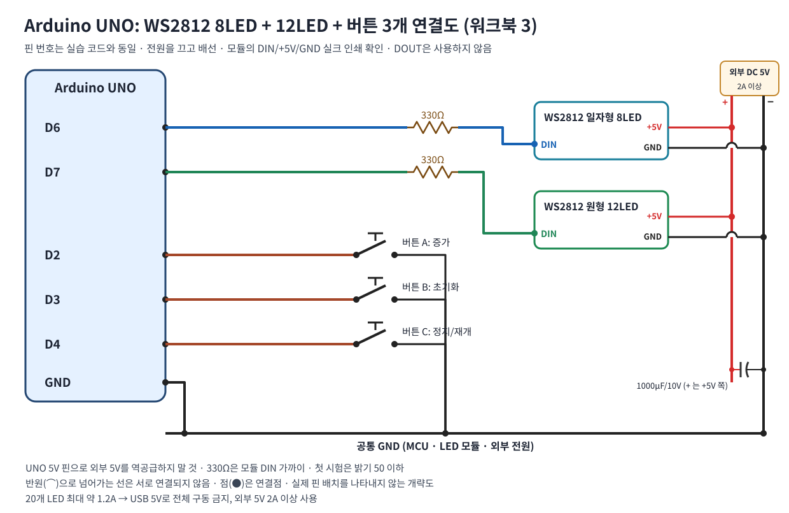
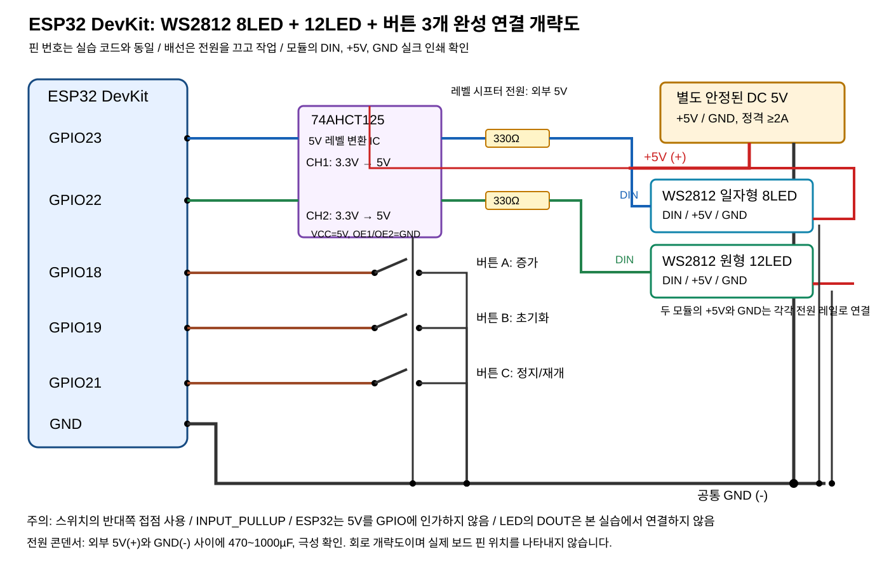

# WS2812 8LED 일자형 · WS2812 12LED 원형: 인터럽트 확장 실습
## 부품과 특징
- 8LED 일자형 WS2812 계열 RGB LED 모듈: DIN, +5V, GND (연결 전 보드 실크를 반드시 확인).
- 12LED 원형 WS2812 계열 RGB LED 모듈: DIN, +5V, GND. 데이터 입력 DIN과 출력 DOUT을 혼동하지 말 것.
- 개별 LED는 RGB 24비트 색상 데이터를 사용하지만 모듈 이름의 '8비트/12비트'는 여기서 LED 8개·12개를 뜻함. WS2812/WS2812B 칩 변형 확인.
- Adafruit NeoPixel 라이브러리 설치: Arduino IDE > 라이브러리 관리자 > 'Adafruit NeoPixel' 검색 > 설치.
## 전원 안전
최대 흰색 밝기에서 LED당 최대 약 60mA를 보수적으로 산정하면 합계 20개는 최대 약 1.2A(+보드 소비 전류 별도)까지 가능. **USB 5V/MCU 5V 핀만으로 전체 20개를 구동하지 말 것.** 5V 2A 이상 안정된 별도 전원 권장, 실제 전원/전선 정격 확인. 5V 전원 +를 두 모듈 +5V, -를 두 모듈 GND에 연결하고 MCU GND에도 공통 접지. 보드가 별도 USB로 연결된 상태에서 외부 5V를 UNO 5V 핀 또는 ESP32 5V 핀으로 역공급하지 말 것.
전원 입구에 470~1000µF/6.3V 이상 전해콘덴서(극성 확인), 각 DIN 바로 앞 330~470Ω 직렬저항 권장. **ESP32의 3.3V 데이터는 5V 구동 WS2812에서 신뢰성이 낮으므로 74AHCT125/74HCT245 같은 5V 구동 레벨 시프터 사용 권장** (양 채널 각각). MCU 전원 OFF 상태에서 LED 데이터가 인가되지 않도록 전원 순서 준수.
## 배선표
|모듈|Arduino UNO|ESP32 DevKit|전원|
|---|---|---|---|
|일자형 8LED DIN|D6 → 330Ω → DIN|GPIO23 → 74AHCT125 → 330Ω → DIN|별도 +5V, GND|
|원형 12LED DIN|D7 → 330Ω → DIN|GPIO22 → 74AHCT125 → 330Ω → DIN|별도 +5V, GND|
|버튼 A/B/C|D2/D3/D4|GPIO18/19/21|각 버튼 반대쪽 GND|
**기존 PCINT/GPIO 인터럽트 입력 배선은 그대로 유지한다.** 모든 GND는 공통이어야 하며 데이터 출력 DOUT과 DIN을 혼동하지 않는다.
## 연결도

74AHCT125 핀: 1A=2번, 1Y=3번, 2A=5번, 2Y=6번, 1OE=1번·2OE=4번(GND), VCC=14번(+5V), GND=7번. 사용하지 않는 3·4채널 입력(9·12번)과 OE(10·13번)는 GND에 연결한다.

## 동작
- 버튼 A: 레벨 1 증가(0→12→0). 8LED 바는 8칸이 상한, 12LED 링은 12칸이 상한.
- 버튼 B: 레벨 0 초기화.
- 버튼 C: 일시정지/재개 토글. 일시정지 시 마지막 LED가 붉은색으로 표시되어 레벨과 겹칠 수 있다.
- 시계: 초 단위 시리얼 출력은 일시정지 상태에서도 진행된다.
## 실습 확인
1. 전원을 분리하고 GND→+5V→데이터 순서로 배선 확인.
2. 라이브러리 설치 후 해당 보드 스케치를 업로드한다. 시리얼 모니터 115200bps.
3. 각 버튼을 천천히 12회 누르면서 직선(최대 8) 및 링(최대 12)의 켜진 칸 수를 기록.
4. 초기화, 정지/재개, 연속 누름 및 30ms 디바운싱 관찰.
5. RGB 색상과 밝기 파라미터를 바꾸되 첫 검증은 낮은 밝기로 진행.
6. 버튼 인터럽트 ISR에서는 LED show()를 실행하지 말 것: MCU/LED 전송 타이밍 제약이 있고 인터럽트 지연을 유발한다.
### 검증 구분
스케치 및 배선은 학습용 설계안이며 실제 Arduino IDE 컴파일/실물 보드 검증은 별도로 수행해야 한다.
