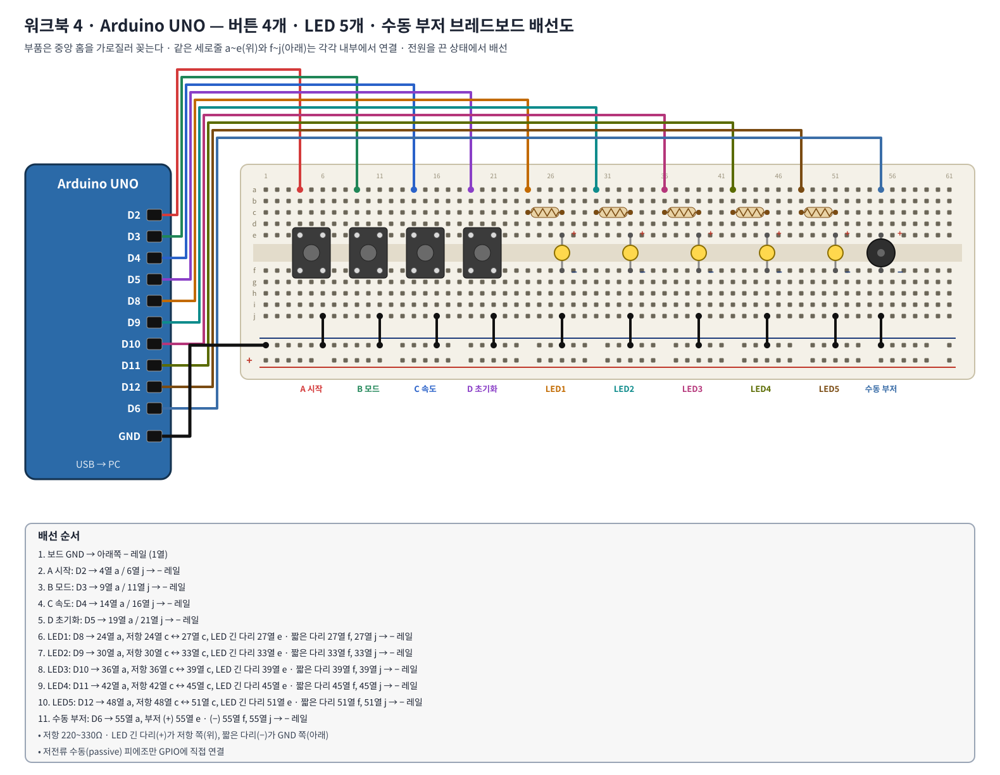
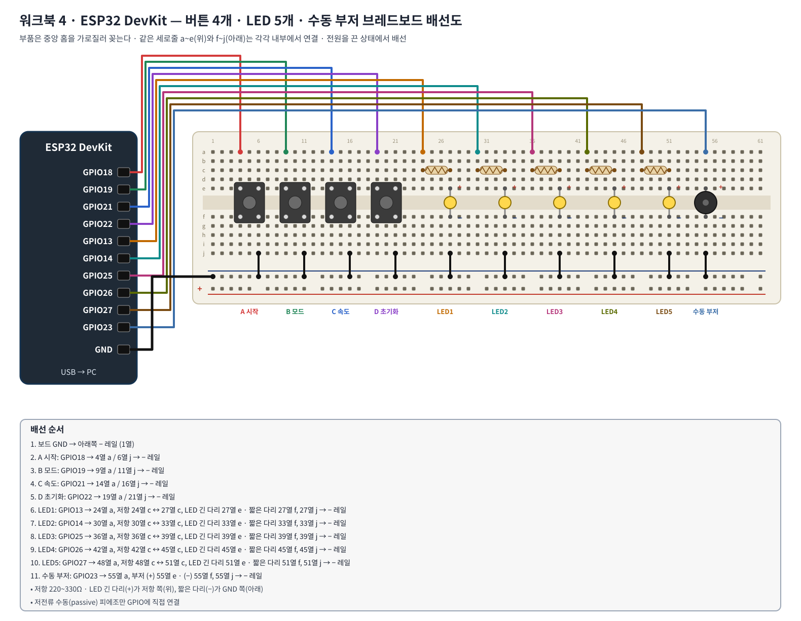
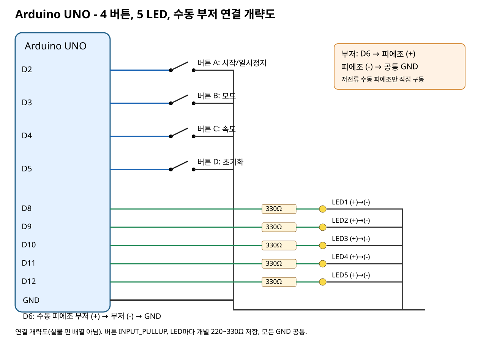
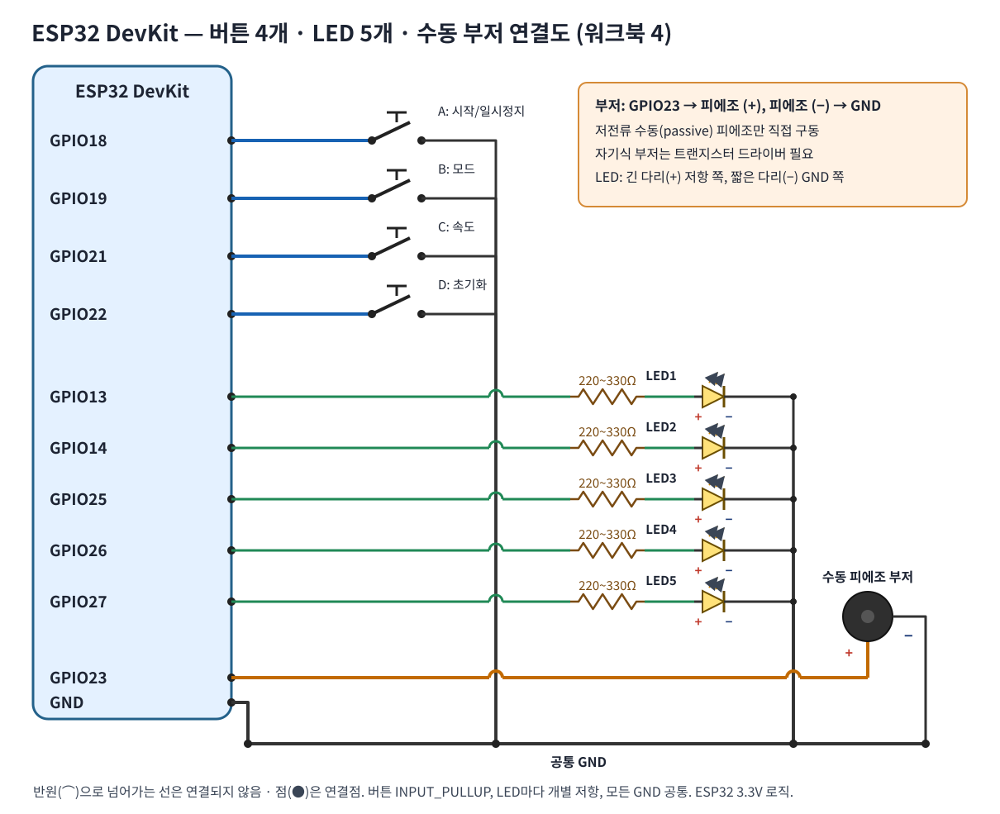

# 워크북 4 — 인터럽트 기반 LED 5개·버튼 4개·수동 부저 1개 시퀀서
## 학습 목표
ISR에서 버튼 이벤트를 기록하고 loop()에서 디바운싱·상태기계·LED 점등·부저 연주·시리얼 상태 출력을 비차단 방식으로 동시 처리한다.
## 준비물
UNO 또는 ESP32 DevKit 1개, 5mm LED 5개, 220~330Ω 저항 5개, 푸시버튼 4개, **저전류 수동 피에조 부저** 1개, 점퍼선/브레드보드/USB. 전류 소모가 큰 자기식 부저는 트랜지스터 드라이버가 필요하므로 직접 GPIO에 연결하지 않는다.
## 핀 연결표
|부품|UNO|ESP32|연결|
|---|---|---|---|
|버튼 A 시작·일시정지|D2 / PCINT18|GPIO18|신호→버튼→GND|
|버튼 B 모드|D3 / PCINT19|GPIO19|신호→버튼→GND|
|버튼 C 속도|D4 / PCINT20|GPIO21|신호→버튼→GND|
|버튼 D 초기화|D5 / PCINT21|GPIO22|신호→버튼→GND|
|LED1~LED5|D8,D9,D10,D11,D12|GPIO13,14,25,26,27|각 핀→220~330Ω→LED 긴 다리(+), 짧은 다리(-)→GND|
|수동 피에조 부저|D6|GPIO23|출력 핀→저전류 수동 피에조(+), (-)→GND|
### 브레드보드 배선도 (이 그림대로 꽂는다)



### 회로도



보드별 3.3V/5V 로직 전압을 준수한다. LED마다 저항 1개를 반드시 사용한다. UNO PCINT는 D2~D5 네 핀의 변화를 하나의 그룹 ISR로 처리한다.
## 학습 전에 함수 설명
- `INPUT_PULLUP`·`digitalRead()`: 버튼 입력.
- `ISR(PCINT2_vect)`·`PIND`·`PCMSK2`: UNO의 4버튼 핀 변경 인터럽트.
- `attachInterrupt(..., FALLING)`: ESP32 입력핀별 인터럽트.
- `millis()`: 입력 안정화 35ms, LED 주기 450/250/120ms, 부저 발음 80ms 시간 측정.
- `tone(pin,frequency)`, `noTone(pin)`: 수동 피에조 음 발생·정지. ESP32 코어 버전에서 지원 여부 확인.
- `digitalWrite()`: LED를 켜거나 끈다.
- `Serial.print()`: 버튼/상태/음계를 기록한다.
## 3가지 LED 패턴
모드 0 순차 한 개 점등, 모드 1 막대 누적 점등, 모드 2 전체 동시 점멸. A=동작/일시정지, B=모드 순환, C=주기 변경, D=정지와 초기화.
## 실습 순서
1. 배선도를 참고해 USB를 분리한 상태에서 버튼 4개, LED 5개 각각의 직렬 저항, 수동 피에조 부저를 연결한다.
2. Arduino IDE에서 보드와 포트 설정 후 해당 `.ino` 파일을 연다.
3. 업로드하여 Serial Monitor를 115200bps로 설정한다.
4. A를 눌러 LED가 진행하며 부저에서 음이 나오는지 확인한다.
5. B를 눌러 모드 0→1→2를 확인한다.
6. C를 눌러 주기 250→120→450ms를 관찰한다. (주기를 바꾸는 순간부터 새 주기로 다음 스텝이 진행된다)
7. A를 다시 눌러 중지하고 D로 모든 상태를 초기화한다.
8. 버튼을 길게 누르거나 빠르게 연속 누르고 디바운싱 및 이벤트 병합을 토의한다.
## 예상 출력 (실제 보드 측정이 아닌 예시)
```text
[EVENT] READY
[STATE] running=OFF mode=0 period=250 position=0
[EVENT] A RUN/PAUSE
[STATE] running=ON mode=0 period=250 position=0
[STEP] LED=2 note=330
[EVENT] B MODE
[STATE] running=ON mode=1 period=250 position=1
[EVENT] C SPEED
[STATE] running=ON mode=1 period=120 position=1
[EVENT] D RESET
[STATE] running=OFF mode=0 period=250 position=0
```
ESP32 코드의 상태 로그는 `tempo=...` 대신 표기되며 `[EVENT] A START/PAUSE` 문구를 출력한다. 실제 출력 및 버튼 타이밍에 따라 순서가 달라진다.
## 실행 자료
- [UNO 완성 코드](../labs/uno_05_advanced_sequencer/uno_05_advanced_sequencer.ino)
- [ESP32 완성 코드](../labs/esp32_05_advanced_sequencer/esp32_05_advanced_sequencer.ino)
## 점검 및 제출
- [ ] 버튼별 기능 4개
- [ ] LED 5개 각 저항 연결과 극성
- [ ] 피에조 부저 음계, 멈춤 동작
- [ ] 3개 모드와 3개 속도
- [ ] 이벤트/상태/음정 시리얼 출력
- [ ] 멈춤 중 루프가 멈추지 않음을 설명
실물 컴파일 및 보드 검증은 별도로 수행해야 한다.

---
## 📋 작업 확인 결과 리포트 (학생 작성)
> 노션에서는 이 페이지를 **복제**하거나 표를 복사해 본인 리포트에 붙여 작성한다. GitHub에서는 이 파일을 내려받아 `[ ]`를 `[x]`로 바꾸고 빈칸을 채운다. 판정은 `O / X / △` 중 하나로 쓴다.

### 0. 기본 정보
| 항목 | 입력 |
|---|---|
| 학번 / 이름 | |
| 실습 일시 | |
| 사용 보드 | ☐ Arduino UNO ☐ ESP32 DevKit |
| Arduino IDE / 보드 패키지 버전 | |
| 팀원(있으면) | |

### 1. 결선 확인
| 부품 | 기준 핀(UNO / ESP32) | 내가 연결한 핀 | 저항·극성 확인 | 판정 |
|---|---|---|---|---|
| 버튼 A 시작/일시정지 | D2 / GPIO18 | | GND ☐ | |
| 버튼 B 모드 | D3 / GPIO19 | | GND ☐ | |
| 버튼 C 속도 | D4 / GPIO21 | | GND ☐ | |
| 버튼 D 초기화 | D5 / GPIO22 | | GND ☐ | |
| LED1~5 | D8~D12 / GPIO13,14,25,26,27 | | 저항 5개 ☐ 극성 ☐ | |
| 수동 부저 | D6 / GPIO23 | | +/− ☐ | |

### 2. 기능 확인표
| 순서 | 조작 | 기대 결과 | 관찰 결과 | 판정 |
|---|---|---|---|---|
| 1 | A | running=ON, LED 진행, 음 출력 | | |
| 2 | B | mode 0→1 (막대 누적) | | |
| 3 | B | mode 1→2 (전체 점멸) | | |
| 4 | B | mode 2→0 (한 개 순차) | | |
| 5 | C | 주기 250→120ms | | |
| 6 | C | 주기 120→450ms | | |
| 7 | A | running=OFF, LED·부저 정지 | | |
| 8 | D | 모든 상태 초기화(mode=0, 250ms) | | |

### 3. 타이밍 측정
| 주기 설정 | 기대(ms) | 10스텝 걸린 시간(초) | 1스텝 계산값(ms) | 판정 |
|---|---|---|---|---|
| 450 | 450 | | | |
| 250 | 250 | | | |
| 120 | 120 | | | |

### 4. 분석
| 질문 | 답 |
|---|---|
| 일시정지 중에도 loop()가 멈추지 않는 이유 | |
| 부저 80ms를 delay 없이 끄는 방법 | |
| 이벤트 병합(빠른 연속 누름)이 일어나는 이유 | |

### 문제 해결 기록
| 증상 | 원인(추정) | 조치 | 결과 |
|---|---|---|---|
| | | | |
| | | | |

### 제출물 확인
| 제출물 | 첨부 여부 | 파일명/링크 |
|---|---|---|
| 회로 사진(전체 + 연결부 확대) | ☐ | |
| 시리얼 모니터 캡처 | ☐ | |
| 수정한 코드(.ino) | ☐ | |
| 질문 답·고찰 | ☐ | |

### 교수자 확인
| 항목 | 확인 | 점수/메모 |
|---|---|---|
| 회로 결선 | ☐ | |
| 기능 동작 | ☐ | |
| 분석·고찰 | ☐ | |
