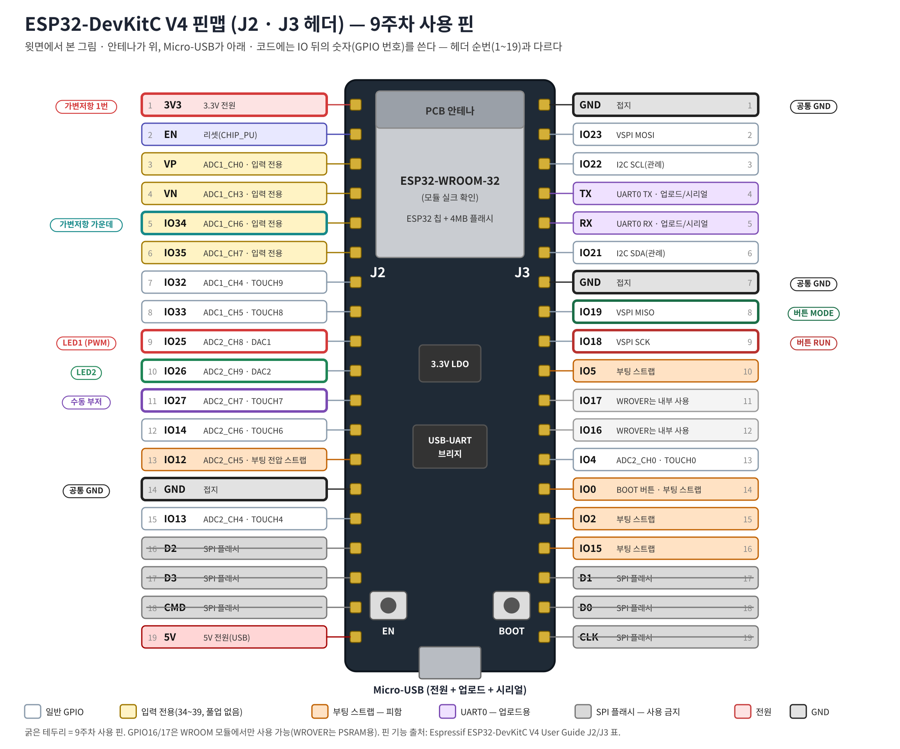
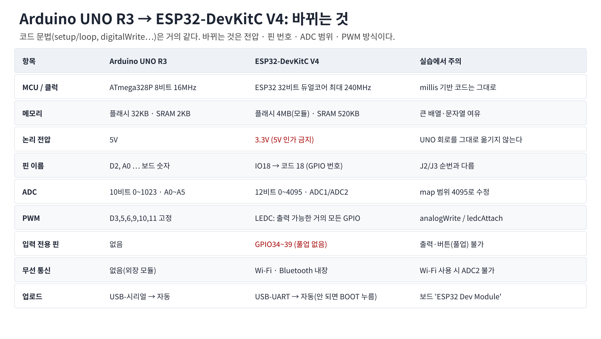
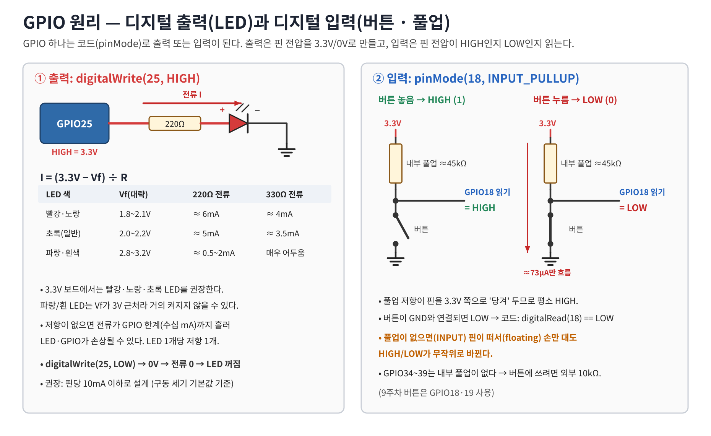
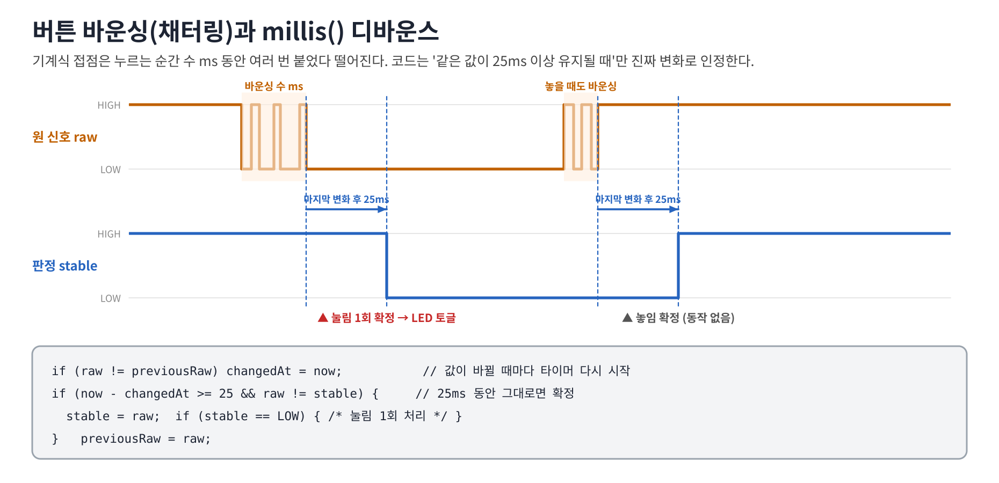
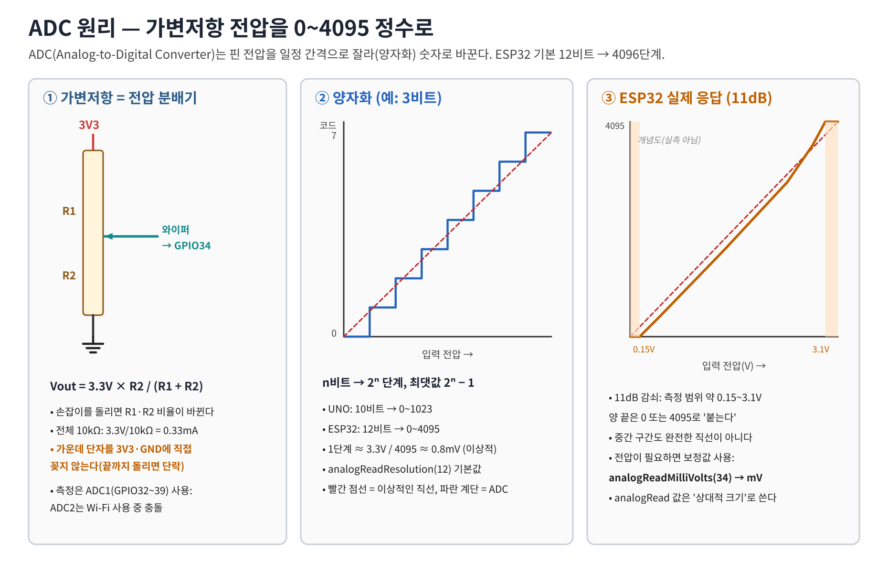
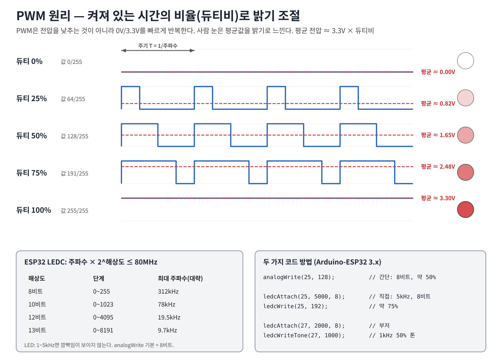
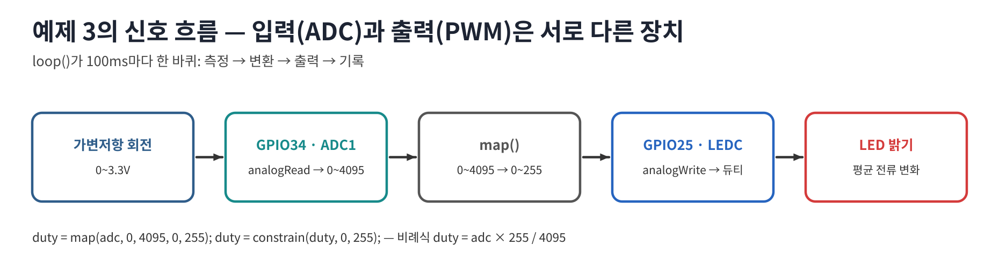
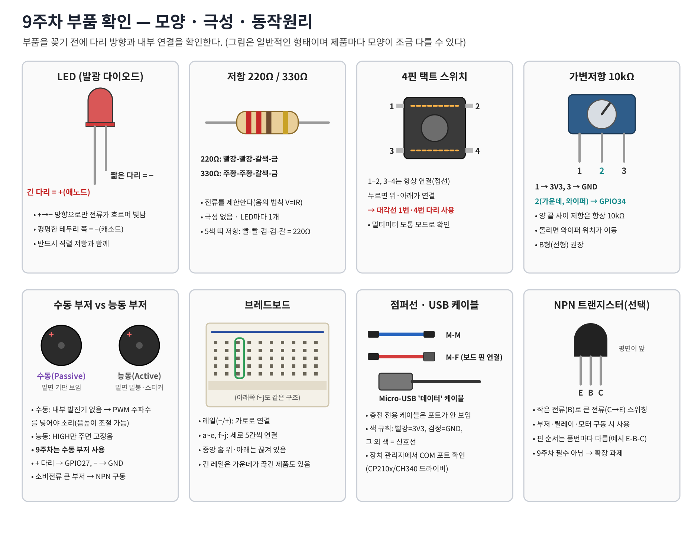
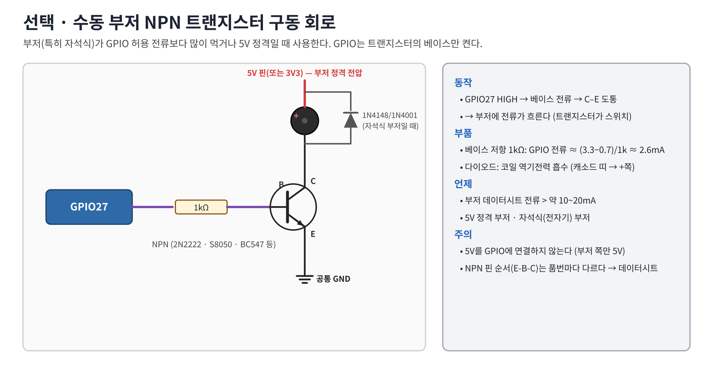
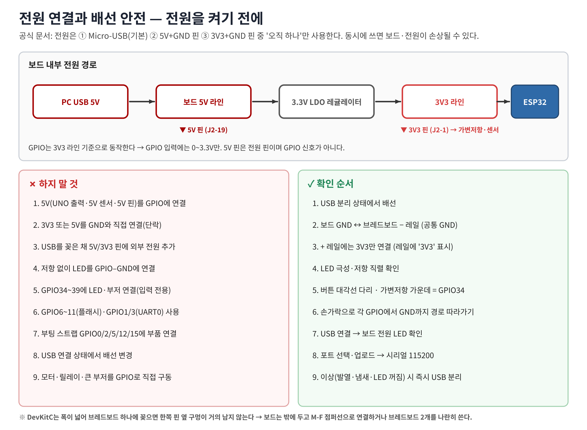

# 9주차 이론학습 — ESP32-DevKitC V4 · GPIO · ADC · PWM

> 학습 순서: ① 보드 구조 → ② UNO와 차이 → ③ 핀맵·사용 핀 → ④ GPIO → ⑤ ADC → ⑥ PWM → ⑦ 부품 → ⑧ 전원·안전 → ⑨ 이해도 점검
> 그림은 모두 `../images/`에 SVG(원본)·PNG(문서 삽입용)로 있다. 그림 생성 스크립트: `images/gen_theory.py`, `images/gen_examples.py`

## 1. ESP32-DevKitC V4 보드 구조


| 부분 | 역할 | 실습에서의 의미 |
|---|---|---|
| ESP32-WROOM-32 모듈 | ESP32 칩(듀얼코어) + 4MB SPI 플래시 + PCB 안테나 | 스케치가 저장·실행되는 곳 |
| Micro-USB | 전원 + 업로드 + 시리얼 | **데이터** 케이블 필요(충전 전용은 포트가 안 보임) |
| USB-UART 브리지 | USB ↔ UART0(GPIO1/3) 변환 | Windows에서 COM 포트로 보임. 정품은 CP210x, 호환보드는 CH340/CH9102일 수 있어 드라이버 확인 |
| 3.3V LDO | USB 5V → 3.3V | ESP32와 3V3 핀 공급 |
| EN 버튼 | 리셋 | 프로그램을 처음부터 다시 실행 |
| BOOT 버튼(GPIO0) | 다운로드 모드 진입 | 업로드가 `Connecting....___`에서 멈추면 BOOT를 누른 채 업로드 시작 → 진행되면 놓기 |
| J2(왼쪽)·J3(오른쪽) 헤더 | 각 19핀, 총 38핀 | 핀 순번(1~19)이 아니라 **IO 번호**를 코드에 쓴다 |

- 실장 모듈 확인: WROVER 모듈이면 GPIO16/17을 쓰지 않는다(9주차는 사용하지 않음).
- 'ESP32 DevKit V1(30핀)' 등 다른 보드는 핀 배열이 다르다. 반드시 보드 실크인쇄로 IO 번호를 찾는다.
- 보드 폭이 넓어 브레드보드 1개에 꽂으면 한쪽 옆 구멍이 거의 남지 않는다 → 보드를 밖에 두고 **M-F 점퍼선**으로 연결하거나 브레드보드 2개를 나란히 사용한다.

## 2. Arduino UNO R3와의 차이


| 항목 | Arduino UNO R3 | ESP32-DevKitC V4 | 실습에서 주의 |
|---|---|---|---|
| MCU / 클럭 | ATmega328P 8비트 16MHz | ESP32 32비트 듀얼코어 최대 240MHz | millis 기반 코드는 그대로 동작 |
| 메모리 | 플래시 32KB · SRAM 2KB | 플래시 4MB(모듈) · SRAM 520KB | |
| 논리 전압 | 5V | **3.3V (5V 인가 금지)** | UNO 회로·5V 센서를 그대로 연결하지 않는다 |
| 핀 이름 | D2, A0 | IO18 → 코드 `18` | J2/J3 순번과 다름 |
| ADC | 10비트 0~1023, A0~A5 | 12비트 0~4095, ADC1/ADC2 | `map(…, 0, 4095, …)` |
| PWM | D3·5·6·9·10·11 고정 | LEDC를 출력 가능 GPIO 대부분에 연결 | `analogWrite` / `ledcAttach` |
| 입력 전용 핀 | 없음 | GPIO34~39(내부 풀업 없음) | 출력·INPUT_PULLUP 불가 |
| DAC | 없음 | GPIO25·26 8비트 DAC(`dacWrite`) | 9주차는 PWM만 사용 |
| 무선 | 없음 | Wi-Fi · Bluetooth | Wi-Fi 사용 중 ADC2 사용 불가 |
| 업로드 | 자동 | 자동(안 되면 BOOT) | 보드: **ESP32 Dev Module** |

> UNO D25와 ESP32 GPIO25는 같은 핀이 아니다. 같은 스케치라도 핀 번호와 ADC 범위를 반드시 바꾼다.

## 3. 9주차 핀 할당

| 핀(실크) | 헤더 | 연결 부품 | 방향·기능 | 선택 이유 / 주의 |
|---|---|---|---|---|
| IO25 | J2-9 | 220Ω → LED1(+) | 출력 · PWM | 일반 출력 핀, 부팅 영향 없음 |
| IO26 | J2-10 | 220Ω → LED2(+) | 출력 | 〃 |
| IO27 | J2-11 | 수동 부저(+) | LEDC 톤 | 소형 3.3V 부저만 직결, 아니면 NPN 구동 |
| IO34 | J2-5 | 가변저항 가운데 | ADC1_CH6 입력 | 입력 전용 · ADC1이라 Wi-Fi와 충돌 없음 |
| IO18 | J3-9 | 버튼 RUN → GND | INPUT_PULLUP | 내부 풀업 있음 |
| IO19 | J3-8 | 버튼 MODE → GND | INPUT_PULLUP | 〃 |
| 3V3 | J2-1 | 가변저항 1번, 아래 + 레일 | 3.3V 공급 | 5V 핀과 혼동 금지 |
| GND | J2-14, J3-1, J3-7 | 모든 부품 − | 공통 기준 | 반드시 브레드보드 − 레일과 연결 |

**피할 핀**: GPIO6~11(D0~D3·CMD·CLK, 내부 SPI 플래시) · GPIO0/2/5/12/15(부팅 스트랩: 부팅 순간 전압이 부팅 모드를 결정, 특히 GPIO12가 HIGH면 플래시 전압 오류) · GPIO1/3(UART0, 업로드·시리얼) · GPIO34~39(출력 불가).

## 4. GPIO — 디지털 입력·출력


**출력**: `pinMode(25, OUTPUT); digitalWrite(25, HIGH);` → 핀 전압 3.3V → 저항·LED로 전류가 흐른다.

- 전류 I = (3.3V − Vf) / R. 빨간 LED(Vf≈2.0V) + 220Ω → 약 6mA, 330Ω → 약 4mA.
- 파랑·흰 LED는 Vf≈3V라 3.3V에서 매우 어둡다 → 빨강·노랑·초록 LED 권장.
- GPIO 출력 전류는 핀당 10mA 이하로 설계(저항 없이 연결 금지).

**입력**: `pinMode(18, INPUT_PULLUP);` → 내부 풀업(약 45kΩ)이 핀을 3.3V로 당긴다.

- 버튼 놓음 = HIGH(1), 버튼 누름 = GND 연결 = LOW(0) → `digitalRead(18) == LOW`가 '눌림'.
- 풀업이 없으면 핀이 떠서(floating) 값이 무작위로 바뀐다. GPIO34~39는 내부 풀업이 없어 버튼에 외부 10kΩ 풀업이 필요하다.

**디바운스**:



기계식 접점은 누를 때·뗄 때 수 ms 동안 여러 번 튄다. 값이 바뀔 때마다 시간을 기록하고, **25ms 동안 같은 값이 유지될 때만** 변화로 인정한다(예제 2, 2B).

```cpp
const int LED = 25, BUTTON = 18;
void setup() { pinMode(LED, OUTPUT); pinMode(BUTTON, INPUT_PULLUP); }
void loop()  { digitalWrite(LED, digitalRead(BUTTON) == LOW ? HIGH : LOW); }  // 누르는 동안만 켜짐
```

## 5. ADC — 아날로그 전압을 정수로


- 가변저항(10kΩ)은 **전압 분배기**: 양 끝 3V3·GND, 가운데(와이퍼) 전압 Vout = 3.3V × R2/(R1+R2).
- n비트 ADC → 2ⁿ 단계, 최댓값 2ⁿ−1. ESP32 기본 12비트 → **0~4095**, 1단계 ≈ 0.8mV(이상적).
- ESP32 실제 응답: `ADC_11db` 감쇠에서 측정 범위 **약 150~3100mV**. 0.15V 이하·3.1V 이상은 0/4095로 붙고, 중간도 완전한 직선이 아니다. → `analogRead()`는 '상대적 크기', 전압이 필요하면 보정된 `analogReadMilliVolts()`를 쓴다.
- ADC2(GPIO0/2/4/12~15/25~27)는 Wi-Fi 드라이버와 공유 → 센서는 **ADC1(GPIO32~39)** 에 연결하는 습관.

```cpp
const int POT = 34;
void setup() {
  Serial.begin(115200);
  analogReadResolution(12);              // 0~4095
  analogSetPinAttenuation(POT, ADC_11db);  // ※ ADC_ATTEN_DB_11(ESP-IDF 상수)은 이 함수에 넣으면 컴파일 오류
}
void loop() {
  Serial.printf("raw=%d  mV=%lu\n", analogRead(POT), (unsigned long)analogReadMilliVolts(POT));
  delay(100);
}
```

## 6. PWM — 듀티비로 밝기 조절


- PWM은 0V/3.3V를 빠르게 반복. **듀티비 = HIGH 시간 / 주기 × 100%**, 평균 전압 ≈ 3.3V × 듀티비.
- 8비트: 0=0%, 64≈25%, 128≈50%, 191≈75%, 255=100%. 눈의 밝기 감각은 비선형이라 25%→50%보다 0%→25%가 더 크게 느껴진다.
- ESP32는 **LEDC** 주변장치로 PWM을 만든다. 조건: **주파수 × 2^해상도 ≤ 80MHz** (8비트면 최대 약 312kHz, 12비트면 약 19.5kHz).
- 방법 ① `analogWrite(pin, 0~255)` — 간단(8비트, 기본 주파수). 방법 ② `ledcAttach(pin, freq, bits)` + `ledcWrite(pin, duty)` — 주파수·해상도 지정(예제 3B).
- 수동 부저는 듀티가 아니라 **주파수**가 음높이: `ledcWriteTone(pin, Hz)`, `ledcWriteTone(pin, 0)` = 무음(예제 4).



## 7. 이번 주 재료와 동작원리


| 재료 | 수량 | 원리·역할 | 확인 포인트 |
|---|---:|---|---|
| ESP32-DevKitC V4 | 1 | 프로그램 실행·GPIO 제어 | 모듈(WROOM) · 실크 IO 번호 |
| Micro-USB 데이터 케이블 | 1 | 전원·업로드·시리얼 | 포트 표시 여부 |
| 브레드보드(830홀 권장) | 1~2 | 세로 5칸·레일 가로 연결 | 레일 중간 끊김 |
| 점퍼선 M-M / M-F | 15+ | 연결 | 빨강=3V3, 검정=GND |
| LED 빨강·초록 | 2 | 순방향 전류로 발광 | 긴 다리 + |
| 저항 220Ω(또는 330Ω) | 2 | LED 전류 제한 | 빨-빨-갈 / 주-주-갈 |
| 4핀 택트 스위치 | 2 | 누르면 접점 연결 | 대각선 다리 사용 |
| 가변저항 10kΩ(B형) | 1 | 전압 분배 → ADC | 가운데 = 와이퍼 |
| 수동 부저(3.3V 구동 소형) | 1 | 주파수 → 소리 | 밑면 기판 보임 = 수동 |
| (선택) NPN 2N2222/S8050 + 1kΩ (+다이오드) | 1 | 부저 전류 증폭 | 아래 NPN 구동 회로 |
| (선택) 멀티미터 | 1 | 전압·도통 확인 | |



DHT11·NeoPixel은 9주차 필수 회로에서 제외(10주차 확장).

## 8. 전원·배선 안전


1. 전원은 **Micro-USB, 5V+GND, 3V3+GND 중 하나만** (공식 문서 경고).
2. GPIO에 5V 금지. 5V 핀은 전원 핀이지 신호 핀이 아니다.
3. 브레드보드 + 레일에는 **3V3만** 연결하고, 레일 옆에 '3V3'라고 표시한다.
4. 3V3·5V를 GND와 직접 연결(단락) 금지 — 가변저항 가운데를 레일에 꽂지 않는다.
5. LED마다 저항 1개, 극성 확인. GPIO34~39에 출력 부품 금지.
6. 배선 변경은 항상 USB를 뺀 상태에서. 이상 발열·냄새 시 즉시 USB 분리.
7. 부저·모터·릴레이처럼 전류가 큰 부하는 트랜지스터로 구동.

## 9. 이해도 점검
1. GPIO 입력과 출력은 어떻게 다른가?
2. UNO의 5V 신호가 ESP32 GPIO에 위험한 이유는?
3. GPIO34에 LED를 연결하면 켜지지 않는 이유는?
4. 12비트 ADC의 최댓값은? 4095는 정확히 3.3V인가?
5. PWM 25%의 의미와 평균 전압은?
6. `INPUT_PULLUP` 버튼을 누르면 HIGH인가 LOW인가? 이유는?
7. 빨간 LED + 220Ω에 흐르는 전류를 계산하라.
8. 8비트 LEDC로 낼 수 있는 최대 PWM 주파수는 대략 얼마인가?
9. Wi-Fi를 쓰는 프로젝트에서 가변저항을 GPIO26에 연결하면 어떤 문제가 생기는가?
10. 업로드가 `Connecting....`에서 멈추면 어떻게 하는가?

## 참고 공식 자료
- Espressif ESP32-DevKitC V4 User Guide(J2/J3 표·전원 옵션): https://docs.espressif.com/projects/esp-dev-kits/en/latest/esp32/esp32-devkitc/user_guide.html
- Arduino-ESP32 GPIO: https://docs.espressif.com/projects/arduino-esp32/en/latest/api/gpio.html
- Arduino-ESP32 ADC(감쇠별 측정 범위): https://docs.espressif.com/projects/arduino-esp32/en/latest/api/adc.html
- Arduino-ESP32 LEDC: https://docs.espressif.com/projects/arduino-esp32/en/latest/api/ledc.html
- Arduino UNO R3: https://docs.arduino.cc/hardware/uno-rev3/
- 보조: https://machinejw.tistory.com/21
