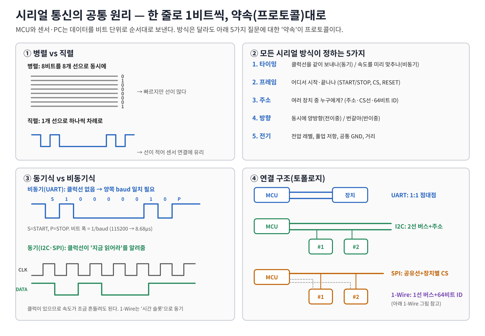
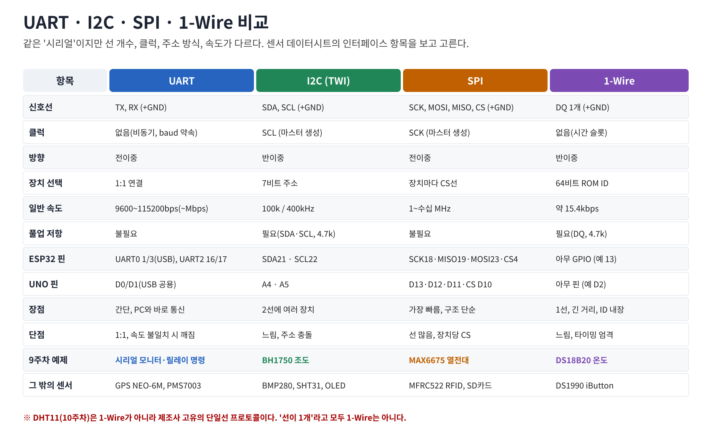
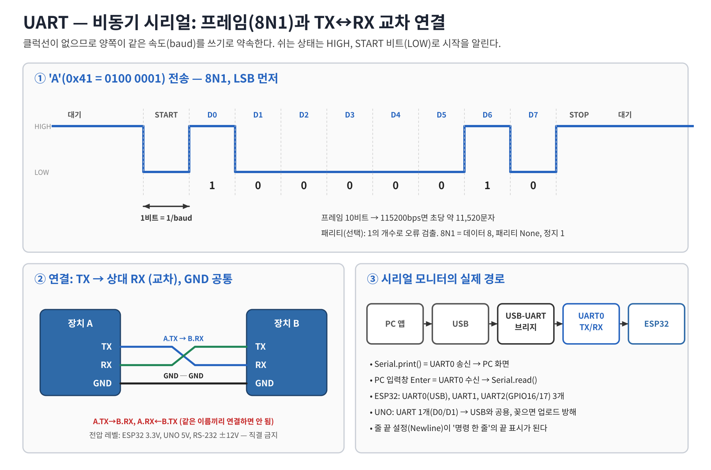
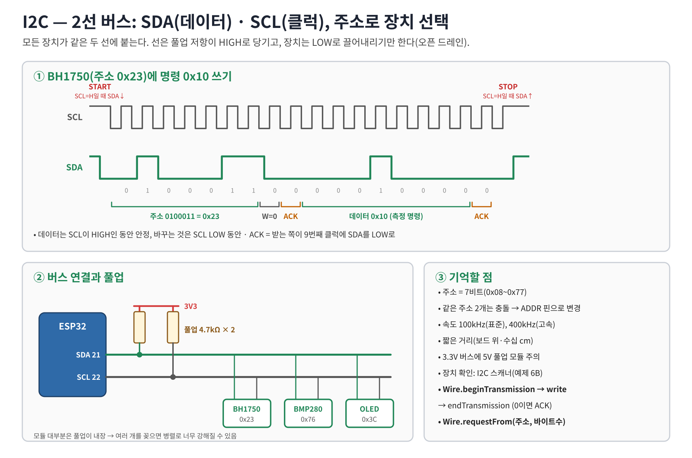
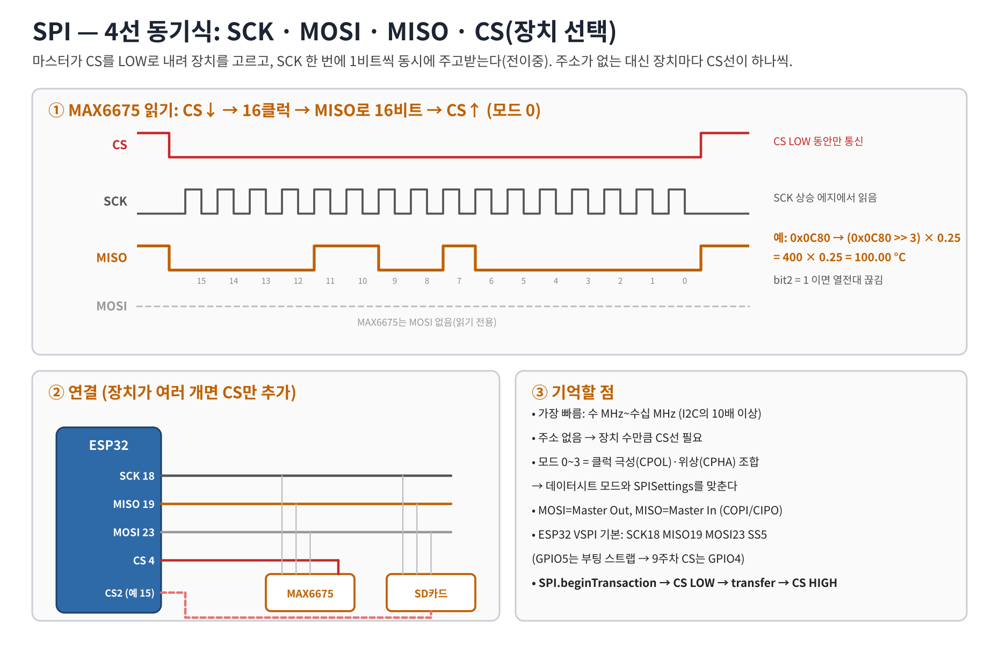
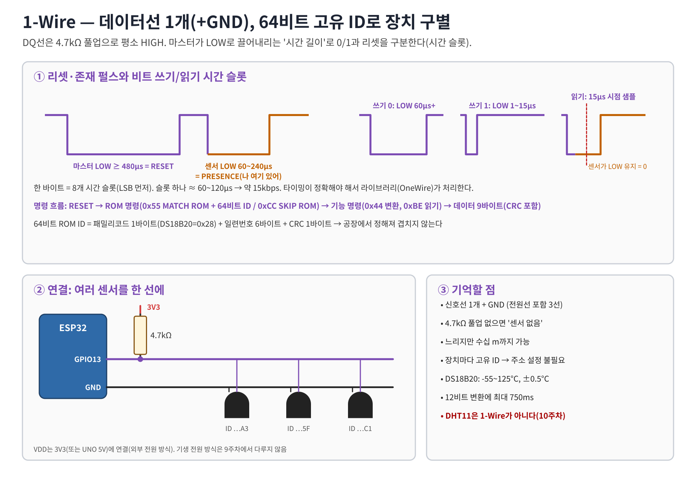

# 9주차 이론학습 (Part B) — 시리얼 통신: UART · I2C · SPI · 1-Wire

> 학습 목표
> 1. 시리얼 통신의 공통 원리를 이해하고, UART·I2C·SPI·1-Wire 각 방식의 신호선 구성, 속도, 장단점을 비교 설명할 수 있다.
> 2. 실습: 시리얼 모니터로 센서값을 송신하고, PC에서 명령을 수신하면 릴레이를 제어한다(양방향 통신).
>
> 보드: ESP32-DevKitC V4 (모든 예제), Arduino UNO (예제 5·6·7·8 동일 코드로 가능, 5B는 ESP32 전용)

## 1. 시리얼 통신의 공통 원리

- **직렬(Serial)**: 데이터를 1비트씩 차례로 한 선으로 보낸다. 병렬보다 선이 적어 센서·모듈 연결에 쓰인다.
- 모든 시리얼 방식은 다섯 가지를 약속(프로토콜)한다.

| 약속 | 질문 | UART | I2C | SPI | 1-Wire |
|---|---|---|---|---|---|
| 타이밍 | 언제 비트를 읽나 | 미리 정한 baud | SCL 클럭 | SCK 클럭 | 시간 슬롯 |
| 프레임 | 시작·끝 표시 | START/STOP 비트 | START/STOP 조건 | CS LOW~HIGH | RESET 펄스 |
| 주소 | 누구에게 | 없음(1:1) | 7비트 주소 | 장치별 CS선 | 64비트 ROM ID |
| 방향 | 동시에 양방향? | 전이중 | 반이중 | 전이중 | 반이중 |
| 전기 | 전압·풀업 | 3.3V/5V TTL | 오픈드레인+풀업 | 푸시풀 | 오픈드레인+풀업 |

- **동기식**(I2C, SPI): 마스터가 클럭을 함께 보내 '지금 읽어라'를 알려준다 → 속도가 조금 흔들려도 된다.
- **비동기식**(UART): 클럭선이 없어 양쪽이 같은 baud를 약속해야 한다. 다르면 글자가 깨진다.
- **마스터/슬레이브**: 통신을 시작하고 클럭을 만드는 쪽이 마스터(ESP32/UNO), 응답하는 쪽이 슬레이브(센서).
- **공통 GND**: 모든 방식에서 신호 전압의 기준. GND를 빼면 아무 통신도 되지 않는다.

## 2. 네 가지 방식 비교

| 항목 | UART | I2C | SPI | 1-Wire |
|---|---|---|---|---|
| 신호선 | TX, RX | SDA, SCL | SCK, MOSI, MISO, CS | DQ |
| 일반 속도 | 9600~115200bps (최대 수 Mbps) | 100k / 400kHz | 1~수십 MHz | 약 15.4kbps |
| 연결 구조 | 1:1 | 버스, 최대 100여 개 | 버스 + 장치별 CS | 버스, 개수 제한 거의 없음 |
| 장점 | 간단, PC와 바로 통신 | 2선으로 여러 장치 | 가장 빠름 | 1선, 긴 배선, ID 내장 |
| 단점 | 1:1, baud 불일치 시 오류 | 느림, 주소 충돌, 짧은 거리 | 선이 많음 | 느림, 타이밍 엄격 |
| ESP32 핀 | UART0 1/3(USB), UART2 16/17 | SDA 21, SCL 22 | SCK 18, MISO 19, MOSI 23, CS 4 | 아무 GPIO (13) |
| UNO 핀 | D0/D1(USB 공용) | A4/A5 | D13/D12/D11, CS D10 | 아무 핀 (D2) |
| 9주차 예제 | 시리얼 모니터 + 릴레이 | BH1750 조도 | MAX6675 열전대 | DS18B20 온도 |
| 다른 센서 예 | GPS NEO-6M, 미세먼지 PMS7003 | BMP280, SHT31, OLED | MFRC522 RFID, SD카드 | DS1990 iButton |

> **주의**: DHT11(10주차)은 1-Wire가 아니다. 선이 1개라도 제조사 고유 프로토콜이다.

## 3. UART — 비동기 시리얼

- 쉬는 상태 HIGH → **START 비트(LOW)** → 데이터 8비트(**LSB 먼저**) → (패리티) → **STOP 비트(HIGH)**. 이것을 **8N1**이라 한다.
- 1비트 시간 = 1/baud. 115200bps → 8.68µs, 프레임 10비트 → 초당 약 11,520바이트.
- 연결: **TX → 상대 RX, RX ← 상대 TX** (교차), GND 공통. 전압 레벨이 다르면(5V↔3.3V, RS-232 ±12V) 직결 금지.
- 시리얼 모니터 경로: PC 앱 ⇄ USB ⇄ USB-UART 브리지 ⇄ UART0(GPIO1/3) ⇄ ESP32.
  - `Serial.print()` = 송신, `Serial.available()`/`Serial.read()` = 수신.
  - 시리얼 모니터의 **줄 끝(Newline)** 설정이 '명령 한 줄'의 끝(`'\n'`)을 만든다.
- ESP32는 하드웨어 UART가 3개(UART0=USB, UART1, UART2=GPIO16/17). UNO는 1개(D0/D1)가 USB와 공용이다.

## 4. I2C — 2선 주소 버스

- SDA(데이터)·SCL(클럭) 두 선에 여러 장치를 병렬로 연결한다. 선은 **풀업 저항**(보통 4.7kΩ, 모듈에 내장)이 HIGH로 당기고, 장치는 LOW로만 끌어내린다(오픈 드레인).
- 순서: **START**(SCL=H일 때 SDA↓) → 7비트 **주소** + R/W → **ACK**(받는 쪽이 SDA LOW) → 데이터 바이트 + ACK … → **STOP**(SCL=H일 때 SDA↑).
- 같은 주소의 장치가 둘이면 충돌 → ADDR 핀으로 주소를 바꾼다(BH1750: 0x23 ↔ 0x5C).
- Arduino `Wire`: `beginTransmission(addr)` → `write()` → `endTransmission()`(0이면 ACK) / `requestFrom(addr, n)` → `read()`.

## 5. SPI — 4선 고속 동기식

- SCK(클럭), MOSI(마스터→슬레이브), MISO(슬레이브→마스터), CS(장치 선택, LOW=선택).
- 주소가 없고 **CS선**으로 장치를 고른다 → 장치가 늘면 CS선도 늘어난다.
- 클럭 1번에 1비트를 동시에 주고받는 **전이중**. 수 MHz~수십 MHz로 가장 빠르다.
- **모드 0~3**: 클럭 극성(CPOL)과 읽는 에지(CPHA)의 조합. 데이터시트의 모드를 `SPISettings`에 맞춘다(MAX6675 = 모드 0).
- ESP32 VSPI 기본 SS는 GPIO5(부팅 스트랩 핀) → 9주차는 CS로 GPIO4를 쓴다(CS는 아무 출력 GPIO 가능).

## 6. 1-Wire — 1선 버스, 64비트 ID

- DQ 1선 + GND. DQ는 **4.7kΩ 풀업**으로 평소 HIGH. 풀업이 없으면 센서를 찾지 못한다.
- 마스터가 LOW로 끌어내리는 **시간 길이**로 신호를 구분: RESET(≥480µs) → 센서의 PRESENCE 응답 → 쓰기 0(긴 LOW)/쓰기 1(짧은 LOW)/읽기 슬롯.
- 장치마다 공장에서 정해진 **64비트 ROM ID**(패밀리 코드 + 일련번호 + CRC) → 한 선에 여러 개 연결해도 구별된다.
- 명령 흐름: RESET → ROM 명령(0x55 MATCH ROM+ID 또는 0xCC SKIP ROM) → 기능 명령(DS18B20: 0x44 변환, 0xBE 읽기) → 데이터 + CRC.
- 타이밍이 µs 단위로 엄격하므로 `OneWire` 라이브러리가 비트 단위 처리를 맡고, 예제는 바이트 명령을 직접 보낸다.

## 7. 9주차 시리얼 예제 목록

| 예제 | 방식 | 부품 | ESP32 핀 | UNO 핀 | 라이브러리 |
|---|---|---|---|---|---|
| 5 | UART 양방향 | 가변저항 + 릴레이 모듈 + LED | GPIO34, GPIO32 | A0, D7 | 없음 |
| 5B | UART2 루프백 | 점퍼선 1개 | GPIO16↔17 | (ESP32 전용) | 없음 |
| 6B | I2C 스캐너 | I2C 모듈 아무거나 | 21/22 | A4/A5 | Wire(내장) |
| 6 | I2C | BH1750(GY-302) | 21/22 | A4/A5 | Wire(내장) |
| 7 | SPI | MAX6675 + K형 열전대 | 18/19, CS 4 | 13/12, CS 10 | SPI(내장) |
| 8 | 1-Wire | DS18B20 + 4.7kΩ | GPIO13 | D2 | OneWire(설치) |

## 8. 이해도 점검

1. 동기식과 비동기식의 차이를 클럭선 유무로 설명하라.
2. UART에서 TX를 상대 TX에 연결하면 왜 통신이 안 되는가?
3. 115200bps 8N1로 'A' 한 글자를 보내는 데 걸리는 시간은? (≈ 86.8µs)
4. I2C에 풀업 저항이 필요한 이유는? 주소가 같은 센서 두 개를 쓰려면?
5. SPI가 I2C보다 빠른 이유 두 가지와, 대신 치르는 비용은?
6. 1-Wire에서 여러 센서를 한 선에 연결해도 구별되는 이유는?
7. DHT11이 1-Wire가 아닌 이유는?
8. 시리얼 모니터에서 `ON`을 보냈는데 반응이 없다. 확인할 설정 두 가지는? (baud, 줄 끝)

## 참고
- Arduino Serial: https://docs.arduino.cc/language-reference/en/functions/communication/serial/
- Arduino Wire: https://docs.arduino.cc/language-reference/en/functions/communication/wire/
- Arduino SPI: https://docs.arduino.cc/language-reference/en/functions/communication/SPI/
- ESP32 Arduino Serial/I2C/SPI: https://docs.espressif.com/projects/arduino-esp32/en/latest/api/i2c.html
- BH1750 데이터시트(ROHM), MAX6675 데이터시트(Analog Devices/Maxim), DS18B20 데이터시트(Analog Devices/Maxim)
