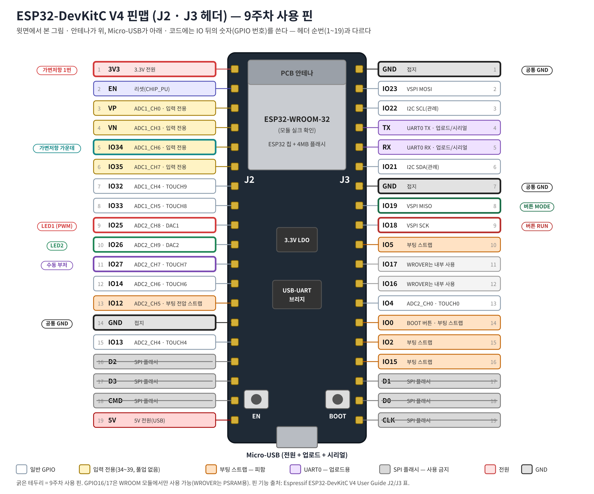
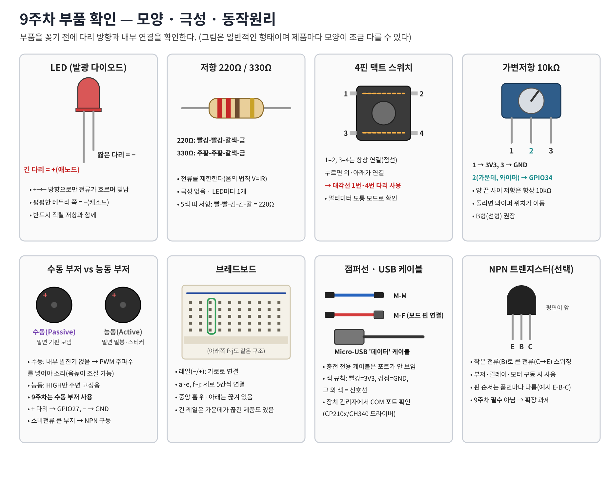
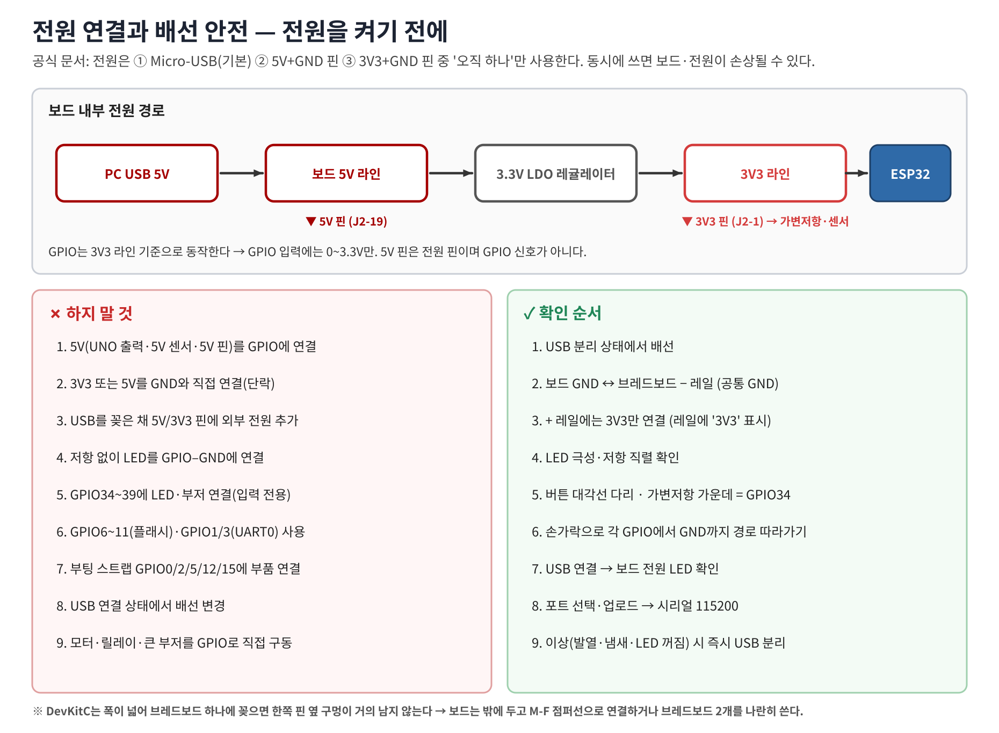

# 워크북 0 — 실습 전 준비: 보드 확인 · 개발환경 · 안전 점검 (0~20분)



## 0-1. 보드와 부품 확인
| 확인 | 방법 | ✔ |
|---|---|---|
| 보드가 ESP32-DevKitC V4(38핀)인가 | 뒷면/앞면 인쇄, J2·J3 각 19핀 | |
| 모듈이 ESP32-WROOM-32 계열인가 | 금속 실드 인쇄 | |
| 부품 수량 | LED 빨강·초록 각1, 220Ω 2, 택트 2, 가변저항 10kΩ 1, 수동 부저 1, 점퍼선 | |
| 수동/능동 부저 구별 | 밑면에 기판이 보이면 수동 | |



## 0-2. Arduino IDE 설정 (부품 연결 없이)
1. 파일 → 환경설정 → 추가 보드 매니저 URL: `https://espressif.github.io/arduino-esp32/package_esp32_index.json`
2. 보드 매니저 → **esp32 by Espressif Systems 3.x** 설치 (2.x면 `ledcAttach`가 없어 예제 3B·4가 컴파일되지 않는다)
3. 도구 → 보드 → **ESP32 Dev Module**, 포트 선택(장치 관리자에서 CP210x/CH340 확인)
4. [예제 0 board_check](../examples/00_board_check/00_board_check.ino) 업로드 → 시리얼 모니터 **115200**

예상 출력:
```
=== Week09 ESP32-DevKitC V4 board check ===
Chip model   : ESP32-D0WD-V3 (rev 3)      ← 칩/리비전은 보드마다 다를 수 있음
CPU cores    : 2, CPU freq: 240 MHz
Flash size   : 4194304 bytes
uptime 1000 ms
```

## 0-3. 업로드 문제 해결
| 증상 | 원인 | 해결 |
|---|---|---|
| 포트가 안 보임 | 충전 전용 케이블 / 드라이버 | 데이터 케이블 교체, CP210x·CH340 드라이버 설치 |
| `Connecting....___` 후 실패 | 자동 다운로드 모드 진입 실패 | **BOOT 누른 채** 업로드 → `Writing` 나오면 놓기 |
| `'ledcAttach' was not declared` | 코어 2.x | 보드 매니저에서 3.x로 업데이트 |
| 시리얼에 깨진 글자 | baud 불일치 | 115200 선택 |
| 업로드 후 반응 없음 | 리셋 필요 | EN 버튼 누르기 |
| 부품 연결 후 업로드 실패 | 스트랩 핀(0/2/5/12/15) 사용 | 9주차 핀표대로만 연결 |

## 0-4. 배선 안전 체크리스트 (모든 워크북 공통)


- [ ] 배선 중에는 USB를 뺐다.
- [ ] 전원은 USB 하나만 사용한다(5V/3V3 핀에 외부 전원 없음).
- [ ] 보드 GND ↔ 브레드보드 − 레일이 연결되어 있다.
- [ ] + 레일에는 3V3만 연결했고 5V 핀은 사용하지 않았다.
- [ ] LED마다 저항이 직렬로 있고 긴 다리가 GPIO 쪽이다.
- [ ] 버튼은 대각선 다리를 사용했다.
- [ ] 가변저항 가운데 다리만 GPIO34에 연결했다.
- [ ] GPIO0/2/5/12/15, 1/3, 6~11에는 아무것도 연결하지 않았다.
- [ ] 각 GPIO에서 GND까지의 경로를 손가락으로 따라가 보았다.
