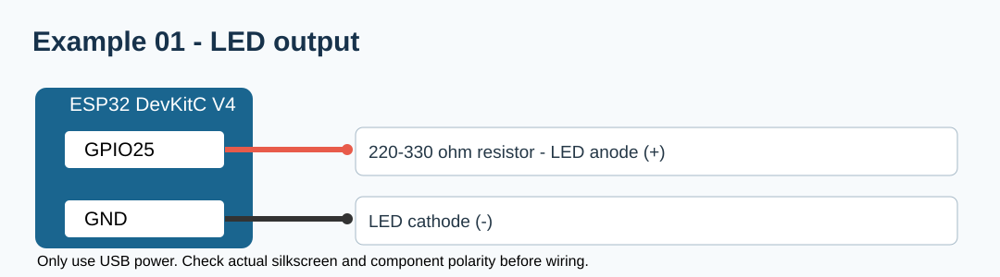

# 워크북 1 — LED 출력과 millis() 기초

## 준비물
ESP32-DevKitC V4, LED 1개, 220~330Ω 저항 1개, 점퍼선, 브레드보드, Micro-USB 데이터 케이블.

## 연결표
| ESP32 | 중간 연결 | 최종 연결 |
|---|---|---|
| GPIO25 | 저항 220~330Ω | LED 애노드(+) |
| GND | 직접 | LED 캐소드(-) |

## 따라 하기
1. USB 연결 전에 저항과 LED의 극성을 확인한다.
2. 회로도와 동일하게 연결한다(LED 저항은 반드시 직렬).
3. [완성 코드](../examples/01_led/01_led.ino)를 열고 Arduino IDE로 업로드한다.
4. 시리얼 모니터(115200)를 열고 LED ON/OFF 기록을 확인한다.
5. `500`을 `200`으로 바꾸고 점멸 속도를 비교한다.

## 확인
- LED 점멸 주기: ______ ms
- 저항 없이 연결하면 안 되는 이유: ____________
- `delay()`와 `millis()`의 차이: ____________
- 제출: 배선 사진, LED 영상, 시리얼 로그.
