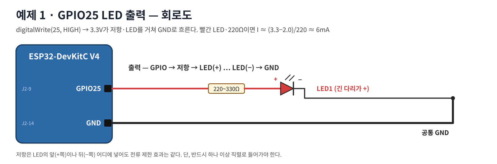
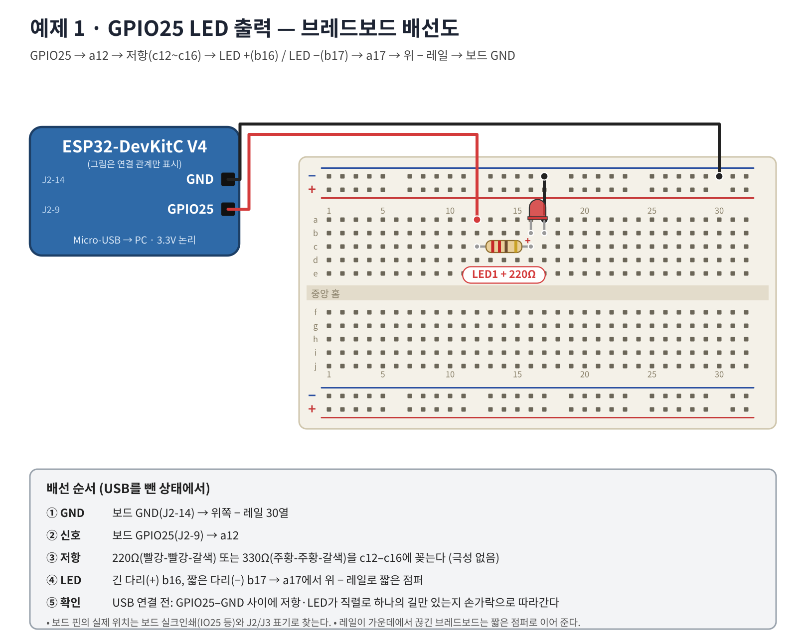

# 워크북 1 — GPIO25 LED 출력과 millis() 점멸 (20~50분)

## 목표
GPIO를 출력으로 설정하고, `delay()` 없이 `millis()`로 500ms마다 LED를 켜고 끈다.

## 1. 회로 이해


- `digitalWrite(25, HIGH)` → GPIO25 = 3.3V → 저항 → LED(+→−) → GND로 전류 → 발광
- 빨간 LED·220Ω: I ≈ (3.3 − 2.0) / 220 ≈ **6mA** (안전 범위)

## 2. 부품

| 부품 | 수량 | 확인 |
|---|---:|---|
| ESP32-DevKitC V4 + USB 데이터 케이블 | 1 | 워크북 0 완료 |
| 빨간 LED | 1 | 긴 다리 = + |
| 저항 220Ω(빨-빨-갈-금) 또는 330Ω | 1 | 극성 없음 |
| 점퍼선 M-F 2, M-M 1 | 3 | |

## 3. 브레드보드 배선


| 순서 | ESP32 핀 | 브레드보드 구멍 | 부품 |
|---:|---|---|---|
| 1 | GND (J2-14) | 위 − 레일 | |
| 2 | GPIO25 (J2-9) | a12 | |
| 3 | | c12 – c16 | 저항 |
| 4 | | b16(+) · b17(−) | LED |
| 5 | | a17 → 위 − 레일 | 점퍼 |

## 4. 코드 — [01_led.ino](../examples/01_led/01_led.ino)
```cpp
const int LED_PIN = 25;
unsigned long lastToggle = 0;
bool ledOn = false;
void setup() {
  Serial.begin(115200);
  pinMode(LED_PIN, OUTPUT);
  digitalWrite(LED_PIN, LOW);
}
void loop() {
  unsigned long now = millis();
  if (now - lastToggle >= 500) {      // 500ms가 지났으면
    lastToggle = now;
    ledOn = !ledOn;
    digitalWrite(LED_PIN, ledOn ? HIGH : LOW);
    Serial.println(ledOn ? "LED ON" : "LED OFF");
  }
}
```
예상 시리얼 출력: `LED ON` / `LED OFF`가 0.5초마다 번갈아 출력

## 5. 동작 검증

| 시험 | 기대 결과 | 관찰 | 판정 |
|---|---|---|---|
| 업로드 직후 | 0.5초 켜짐/0.5초 꺼짐 | | |
| 시리얼 로그 | ON/OFF 교대 | | |
| `500` → `200` | 더 빠른 점멸 | | |
| 저항 220Ω → 330Ω | 조금 어두워짐 | | |
| (멀티미터) LED 켜짐 시 GPIO25–GND 전압 | 약 3.3V | | |

## 6. 문제 해결

| 증상 | 확인 |
|---|---|
| LED가 전혀 안 켜짐 | LED 방향(긴 다리가 b16?) · GND 레일 연결 · GPIO25가 맞는 핀인가(J2-9) |
| 시리얼은 나오는데 LED만 안 켜짐 | 저항과 LED가 같은 세로줄(16열)에 있는가 |
| 매우 어두움 | 파랑/흰 LED 사용 여부 → 빨강으로 교체 |

## 7. 과제
1. LED를 0.1초 켜고 0.9초 끄는 '심장 박동' 점멸로 바꿔라(ON/OFF 시간을 따로).
2. `delay(500)` 버전과 `millis()` 버전의 차이를 '다른 일을 동시에 할 수 있는가'로 설명하라.
3. 빨간 LED + 330Ω의 전류를 계산하라.

제출: 배선 사진 1장, 점멸 영상, 시리얼 캡처.
