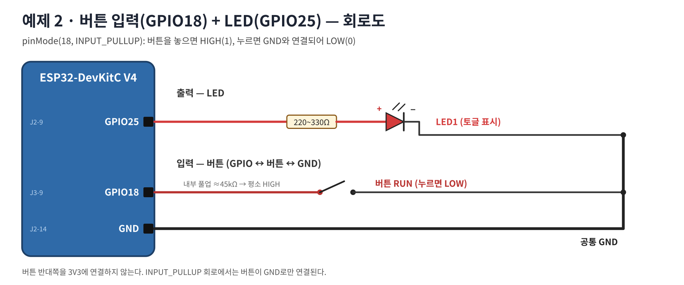
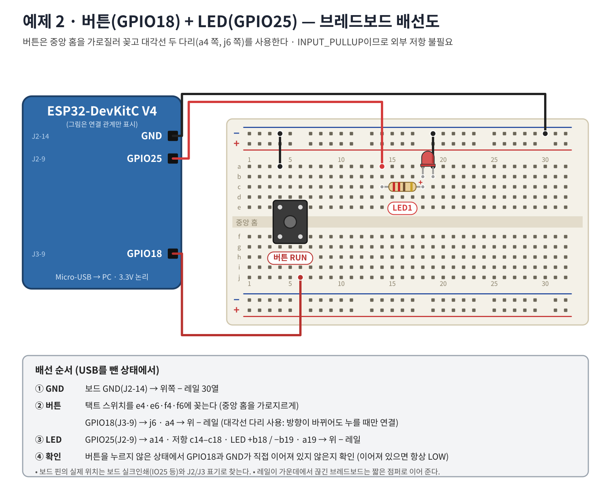

# 워크북 2 — 버튼 입력(INPUT_PULLUP)과 디바운스 (50~80분)

## 목표
버튼을 1번 누를 때마다 LED가 정확히 1번 토글되게 하고, 바운싱을 직접 관찰한다.

## 1. 회로 이해



- `INPUT_PULLUP`: 내부 저항(약 45kΩ)이 GPIO18을 3.3V로 당김 → 놓으면 **HIGH**, 누르면 GND 연결 → **LOW**
- 버튼 반대편은 GND로만 연결한다(3V3 연결 금지).

## 2. 부품
워크북 1 회로 + 4핀 택트 스위치 1, 점퍼선 M-F 1, M-M 1

## 3. 브레드보드 배선


| 순서 | ESP32 핀 | 브레드보드 구멍 | 부품 |
|---:|---|---|---|
| 1 | GND (J2-14) | 위 − 레일 | |
| 2 | | e4 · e6 · f4 · f6 | 택트 스위치(중앙 홈을 가로질러) |
| 3 | GPIO18 (J3-9) | j6 | |
| 4 | | a4 → 위 − 레일 | 점퍼(대각선 다리) |
| 5 | GPIO25 (J2-9) | a14, 저항 c14–c18, LED +b18/−b19, a19 → − 레일 | LED |

> 확인: USB 연결 전, 멀티미터 도통 모드로 j6–a4가 **버튼을 누를 때만** 연결되는지 확인한다.

## 4. 코드 — [02_button.ino](../examples/02_button/02_button.ino)
핵심 부분:
```cpp
bool raw = digitalRead(BUTTON_PIN);
unsigned long now = millis();
if (raw != previousRaw) changedAt = now;                   // 변할 때마다 타이머 재시작
if (now - changedAt >= DEBOUNCE_MS && raw != stable) {     // 25ms 동안 그대로면 확정
  stable = raw;
  if (stable == LOW) { ledOn = !ledOn; digitalWrite(LED_PIN, ledOn); }
}
previousRaw = raw;
```
예상 출력: `Button pressed, LED=ON` / `LED=OFF`가 누를 때마다 1줄

## 5. 바운싱 관찰 — [02b_bounce_count.ino](../examples/02b_bounce_count/02b_bounce_count.ino) (같은 회로)
시리얼 모니터 입력창에 숫자를 보내면 디바운스 시간이 바뀐다.
| DEBOUNCE_MS | 10회 누름 후 press 수 | rawEdges(바운스 포함) | 체감 반응 |
|---:|---:|---:|---|
| 0 | | | |
| 5 | | | |
| 25 | | | |
| 200 | | | |

예상: rawEdges는 누름 횟수×2보다 크게 나올 수 있다(누름+뗌+바운스). 200ms면 빠르게 연타할 때 누락이 생긴다.

## 6. 동작 검증
| 시험 | 기대 결과 | 관찰 | 판정 |
|---|---|---|---|
| 버튼 1회 | LED 켜짐, 로그 1줄 | | |
| 버튼 10회 | 토글 정확히 10회 | | |
| 버튼을 길게 누름 | 토글 1회만 | | |

## 7. 문제 해결
| 증상 | 확인 |
|---|---|
| 누르지 않아도 계속 토글/LOW | 버튼이 같은 쪽 다리(항상 연결)에 꽂힘 → 90° 돌리거나 대각선 확인 |
| 눌러도 반응 없음 | GND 점퍼(a4) 누락 · GPIO18 핀 위치(J3-9) |
| 1번 눌렀는데 2번 토글 | DEBOUNCE_MS가 너무 작음 |
| `pinMode(18, INPUT)`으로 바꿨더니 이상 | 풀업 없음 → 플로팅 |

## 8. 과제
1. '누르는 동안만 켜짐' 코드와 '토글' 코드의 차이를 설명하라.
2. 버튼을 GPIO34에 연결하면 어떻게 되는가? 해결하려면 무슨 부품이 필요한가?
3. 길게 누르기(1초 이상) 감지를 추가해 보라.

제출: 배선 사진, 10회 시험 로그, 디바운스 비교표.
