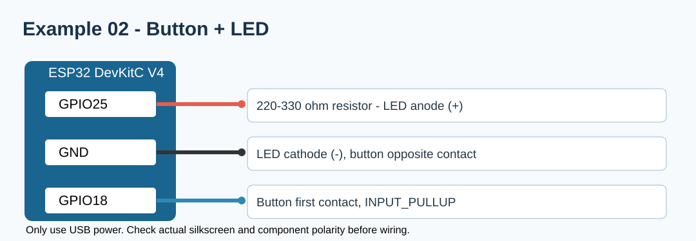

# 워크북 2 — 버튼 입력과 디바운스

## 준비물·배선
워크북1 부품 + 택트 버튼 1개. LED: GPIO25→220~330Ω→LED+→LED−→GND. 버튼: GPIO18→버튼 접점A, 반대편 접점B→GND. `INPUT_PULLUP`을 사용하므로 외부 풀업 저항은 없어도 된다.

## 따라 하기
1. USB를 분리하고 버튼을 연결한다. 같은쪽 두 다리를 착각하지 않도록 멀티미터로 확인한다.
2. [완성 코드](../examples/02_button/02_button.ino)를 업로드한다.
3. 버튼을 1회 누르면 LED ON, 다시 누르면 OFF를 확인한다.
4. `DEBOUNCE_MS`를 5, 25, 100으로 바꾸고 반응을 비교한다.

## 확인
- 버튼을 누르기 전 입력값: ______ (HIGH)
- 누른 직후 입력값: ______ (LOW)
- 버튼 10회에 따른 LED 전환 횟수: ______
- 제출: 배선 사진, 버튼 10회 실험 로그.
