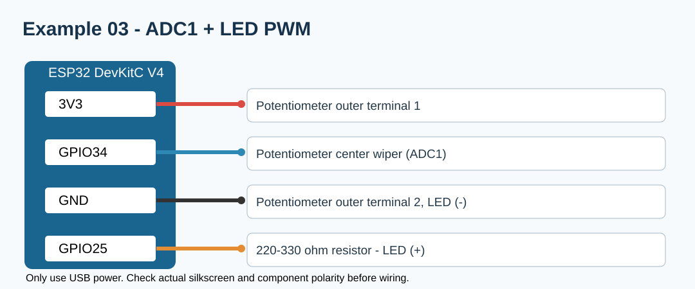

# 워크북 3 — 가변저항 ADC1 입력과 LED PWM

## 연결표
| ESP32 | 연결 부품 |
|---|---|
| 3V3 | 가변저항 양끝 중 1개 |
| GPIO34 | 가변저항 가운데(와이퍼) |
| GND | 가변저항 나머지 양끝 중 1개 |
| GPIO25 | 220~330Ω → LED 애노드 |
| GND | LED 캐소드 |

## 따라 하기
1. 가변저항 3핀을 구별해 **전원을 뺀 상태**에서 연결한다.
2. [완성 코드](../examples/03_adc_pwm/03_adc_pwm.ino)를 업로드한다.
3. 천천히 돌리면서 시리얼 모니터의 ADC(0~4095 예상)와 PWM(0~255)을 기록한다.
4. PWM 값을 직접 `0`, `64`, `128`, `255`로 넣었을 때와 비교한다.

## 결과표
| 가변저항 위치 | ADC 관찰값 | PWM | LED 체감 밝기 |
|---|---:|---:|---|
| 최저 | | | |
| 가운데 | | | |
| 최고 | | | |

## 분석
ADC 값이 실제 전압과 완전히 비례하지 않을 수 있는 이유를 설명한다. 센서와 GND 공통 연결 여부를 확인한다.
