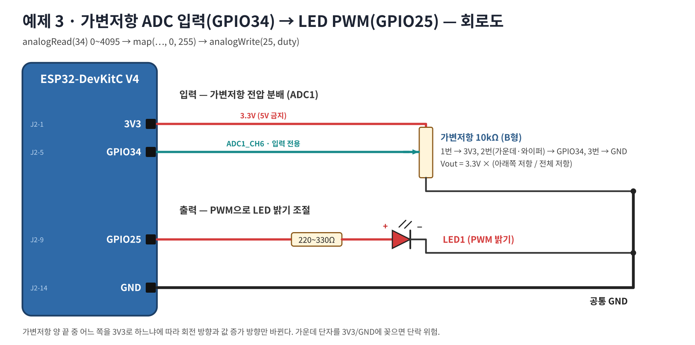
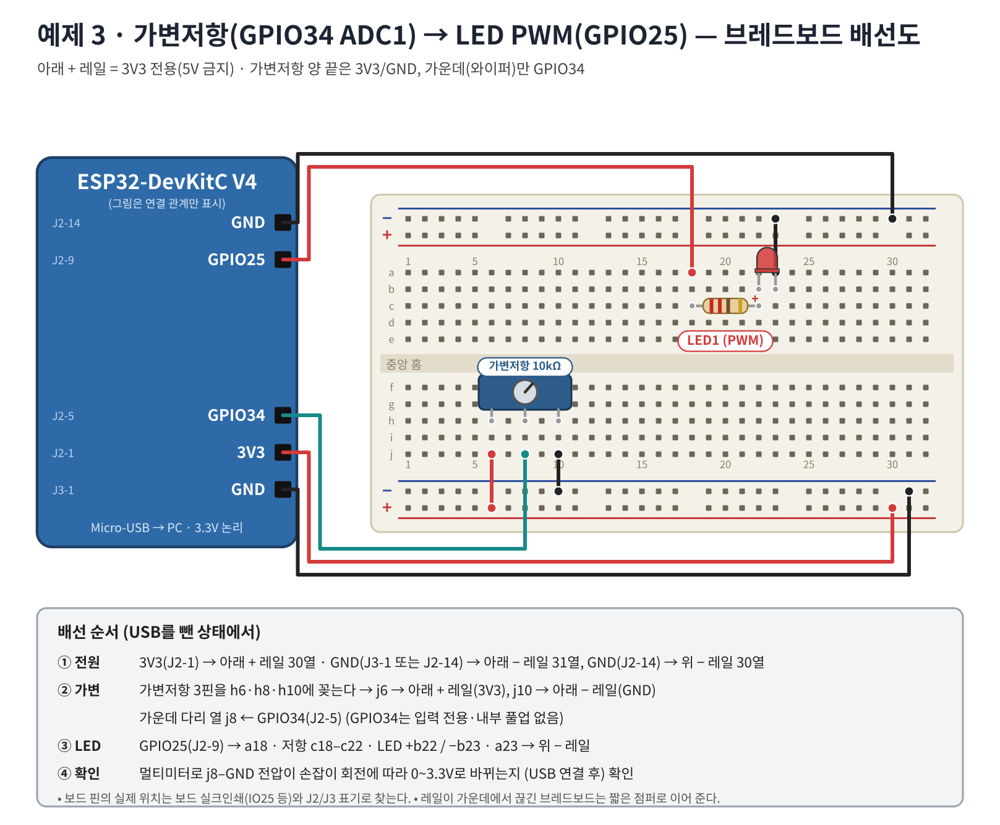

# 워크북 3 — 가변저항 ADC1 입력과 LED PWM 출력 (80~110분)

## 목표
가변저항 전압을 ADC(GPIO34)로 읽고, 그 값을 PWM 듀티로 바꾸어 LED 밝기를 조절한다.

## 1. 원리 확인


## 2. 회로도


## 3. 부품
워크북 1 LED 회로 + 가변저항 10kΩ 1, 점퍼선 M-F 3(3V3·GND·GPIO34), M-M 2

## 4. 브레드보드 배선


| 순서 | ESP32 핀 | 브레드보드 구멍 | 부품 |
|---:|---|---|---|
| 1 | 3V3 (J2-1) | 아래 + 레일 (**3V3 표시**) | |
| 2 | GND (J3-1) | 아래 − 레일 | |
| 3 | GND (J2-14) | 위 − 레일 | |
| 4 | | h6 · h8 · h10 | 가변저항(1·2·3번) |
| 5 | | j6 → 아래 + 레일 · j10 → 아래 − 레일 | 점퍼 |
| 6 | GPIO34 (J2-5) | j8 | 와이퍼 |
| 7 | GPIO25 (J2-9) | a18, 저항 c18–c22, LED +b22/−b23, a23 → 위 − 레일 | LED |

> 위험: 가운데 다리(8열)를 + 또는 − 레일에 연결하면 끝까지 돌렸을 때 3V3–GND 단락이 된다.

## 5. 코드 — [03_adc_pwm.ino](../examples/03_adc_pwm/03_adc_pwm.ino)
```cpp
const int POT_PIN = 34, LED_PIN = 25;
unsigned long lastRead = 0;
void setup() {
  Serial.begin(115200);
  analogReadResolution(12);
  analogSetPinAttenuation(POT_PIN, ADC_11db);
}
void loop() {
  unsigned long now = millis();
  if (now - lastRead >= 100) {
    lastRead = now;
    int adc = analogRead(POT_PIN);                    // 0~4095
    uint32_t mv = analogReadMilliVolts(POT_PIN);      // 보정된 mV
    int duty = constrain(map(adc, 0, 4095, 0, 255), 0, 255);
    analogWrite(LED_PIN, duty);
    Serial.printf("ADC=%4d  mV=%4lu  PWM=%3d\n", adc, (unsigned long)mv, duty);
  }
}
```
예상 출력: `ADC=2048  mV=1650  PWM=127` (값은 보드마다 다름). 도구 → **시리얼 플로터**로 보면 그래프로 확인 가능.

## 6. 측정 기록

| 손잡이 위치 | ADC | mV(코드) | 멀티미터 V | PWM | LED 밝기 |
|---|---:|---:|---:|---:|---|
| 왼쪽 끝 | | | | | |
| 1/4 | | | | | |
| 가운데 | | | | | |
| 3/4 | | | | | |
| 오른쪽 끝 | | | | | |

관찰 포인트: 끝 근처에서 ADC가 0 또는 4095로 '붙는' 구간이 있는가? mV와 멀티미터 값의 차이는?

## 7. PWM 단계 실험 — [03b_ledc_pwm_steps.ino](../examples/03b_ledc_pwm_steps/03b_ledc_pwm_steps.ino) (LED만 사용)
`ledcAttach(25, 5000, 8)` 후 듀티 0 → 64 → 128 → 192 → 255를 1.5초마다 바꾼다.

| duty | % | 평균 전압(계산) | 밝기 1~5 |
|---:|---:|---:|---|
| 0 | 0 | 0 V | |
| 64 | 25 | 0.83 V | |
| 128 | 50 | 1.65 V | |
| 192 | 75 | 2.48 V | |
| 255 | 100 | 3.30 V | |

추가: `PWM_FREQ`를 5000 → 5로 바꾸면 무엇이 보이는가? (깜빡임 = PWM의 정체)

## 8. 문제 해결

| 증상 | 확인 |
|---|---|
| ADC가 항상 0 | 가변저항 3V3 연결 · j6 점퍼 · + 레일이 3V3인지 |
| ADC가 항상 4095 | GND 연결 누락(j10) |
| 값이 마구 흔들림 | 와이퍼가 GPIO34(J2-5)인가, GND 공통인가 |
| 회전 방향이 반대 | 정상 — 1번·3번 연결을 바꾸면 반대가 된다 |
| LED 밝기 변화가 끝에서만 큼 | 눈의 비선형성 → 과제 3 |

## 9. 과제
1. ADC 값이 실제 전압과 완전히 비례하지 않는 이유 2가지를 설명하라.
2. ADC 값이 2000 이상일 때만 LED가 켜지도록(문턱값) 바꿔라. 문턱 근처 깜빡임을 막으려면?(히스테리시스)
3. `duty = duty * duty / 255;`(감마 보정 근사)를 적용하고 밝기 변화 체감을 비교하라.

제출: 배선 사진, 측정 표, 시리얼 플로터 캡처.
