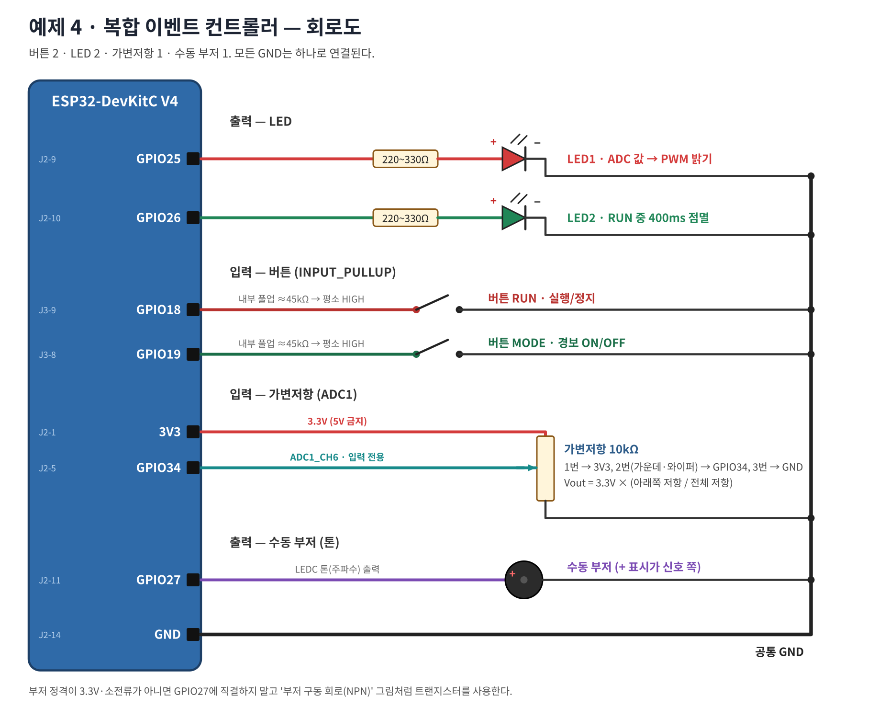
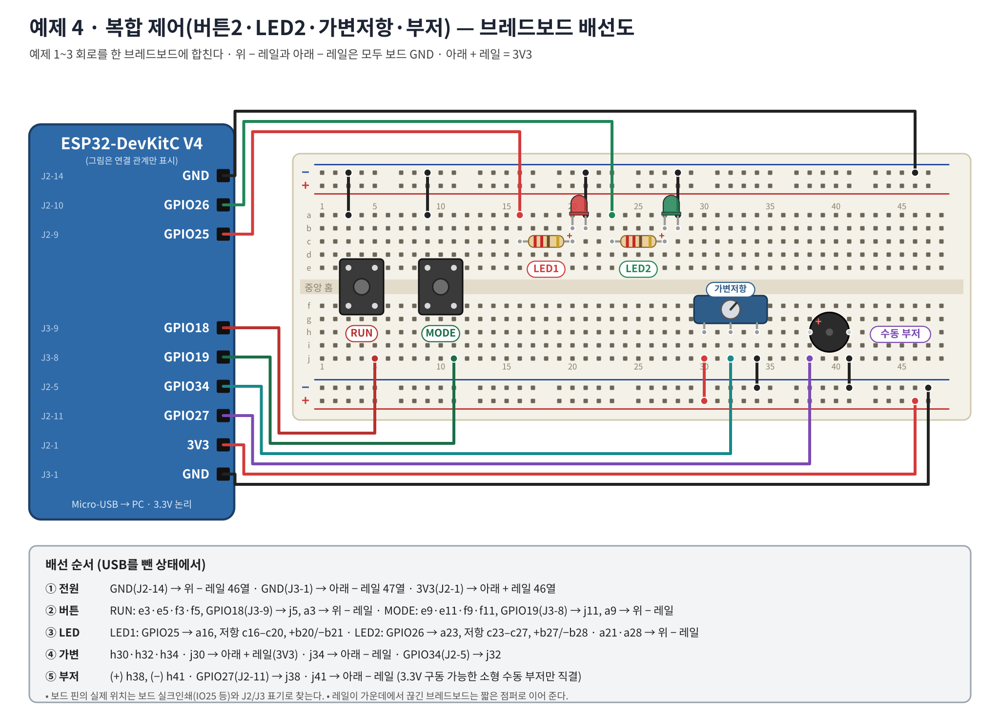
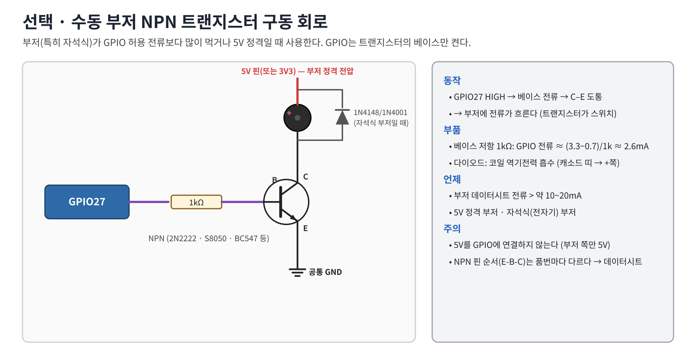

# 워크북 4 — 복합 이벤트 컨트롤러 (심화, 110~165분)

## 목표
버튼 2 · LED 2 · 가변저항 · 수동 부저를 `delay()` 없이 동시에 처리한다.

| 입력/출력 | 핀 | 동작 |
|---|---|---|
| RUN 버튼 | GPIO18 | 실행/정지 토글 + 짧은 확인음 |
| MODE 버튼 | GPIO19 | 경보 모드 ON/OFF + 짧은 확인음 |
| 가변저항 | GPIO34 | ADC 0~4095 |
| LED1 | GPIO25 | 실행 중 ADC → PWM 밝기, 정지 시 꺼짐 |
| LED2 | GPIO26 | 실행 중 400ms 점멸 |
| 수동 부저 | GPIO27 | 실행 + 경보 모드 + ADC>3200이면 1초마다 150ms 경고음 |

## 1. 회로도


## 2. 브레드보드 배선


| 순서 | ESP32 핀 | 브레드보드 | 부품 |
|---:|---|---|---|
| 1 | GND (J2-14) / GND (J3-1) / 3V3 (J2-1) | 위 − 레일 / 아래 − 레일 / 아래 + 레일 | 전원 |
| 2 | GPIO18 (J3-9) | j5 (스위치 e3·e5·f3·f5, a3 → 위 −) | RUN |
| 3 | GPIO19 (J3-8) | j11 (스위치 e9·e11·f9·f11, a9 → 위 −) | MODE |
| 4 | GPIO25 (J2-9) | a16, 저항 c16–c20, LED +b20/−b21, a21 → 위 − | LED1 빨강 |
| 5 | GPIO26 (J2-10) | a23, 저항 c23–c27, LED +b27/−b28, a28 → 위 − | LED2 초록 |
| 6 | GPIO34 (J2-5) | j32 (가변저항 h30·h32·h34, j30 → +, j34 → −) | 가변저항 |
| 7 | GPIO27 (J2-11) | j38 (부저 +h38 / −h41, j41 → 아래 −) | 수동 부저 |

> 권장 순서: 워크북 3 회로를 그대로 두고 버튼 2개 → LED2 → 부저 순으로 추가하며 단계마다 업로드해 확인한다.

### 부저 주의
그림처럼 GPIO에 직결하는 것은 **3.3V로 구동 가능한 소형(압전식) 수동 부저**일 때만이다. 데이터시트 전류가 10~20mA를 넘거나 5V 정격·자석식이면 아래 NPN 회로를 사용한다(코드는 동일).


## 3. 코드 — [04_integrated.ino](../examples/04_integrated/04_integrated.ino)
구조(한 번의 `loop()`가 아래 6단계를 수 µs 안에 돌고 반복):

1. 버튼 이벤트(디바운스 구조체) → 상태 토글 + `beep()`
2. 100ms마다 ADC → LED1 PWM
3. 400ms마다 LED2 토글
4. 경보 조건 확인 → 1초마다 `beep(1500Hz, 150ms)`
5. 톤 종료 시각이 지났으면 `ledcWriteTone(BUZZER, 0)`
6. 500ms마다 상태 로그

부저는 LED와 다른 LEDC 채널을 쓴다: `ledcAttach(27, 2000, 8)` → `ledcWriteTone(27, 주파수)`.

예상 시리얼 출력:
```
Week09 ready: RUN=GPIO18, MODE=GPIO19
RUN=1 MODE=0 ADC=1000 LED2=1
[BTN] RUN=OFF
[BTN] RUN=ON
[BTN] ALARM_MODE=ON
[ALARM] ADC=4000 > 3200
```
(호스트 시뮬레이션으로 바운스가 있는 버튼 입력에서 1회 누름 = 1회 토글, 경보 1초 주기를 확인함)

## 4. 동작 검증

| 시험 | 기대 결과 | 관찰 | 판정 |
|---|---|---|---|
| 전원 직후 | RUN=1, LED2 점멸, LED1 밝기 = 손잡이 | | |
| RUN 1회 | 짧은 '삑', LED1·LED2 꺼짐 | | |
| RUN 2회 | 실행 재개 | | |
| 손잡이 회전 | LED1 밝기 변화, LED2 점멸 속도는 그대로 | | |
| MODE ON + 손잡이 최대 | 1초마다 경고음, 로그 `[ALARM]` | | |
| MODE OFF | 경고음 멈춤 | | |
| 경보 중 RUN 연타 | 누를 때마다 정확히 1회 토글 | | |

## 5. 문제 해결

| 증상 | 확인 |
|---|---|
| 부저 무음 | 수동/능동 구분, + 다리 방향, GPIO27(J2-11), 코어 3.x |
| 부저 소리 작음 | 소형 압전 부저 특성 → NPN 구동 또는 주파수 2~4kHz 시도 |
| 업로드 실패(부품 연결 후) | 부저·버튼이 스트랩 핀(0/2/5/12/15)에 꽂혀 있지 않은가 |
| 경보가 안 울림 | MODE ON인가, RUN 상태인가, 로그의 ADC가 3200을 넘는가 |
| LED2 점멸이 버튼 누를 때 멈춤 | 코드에 `delay()`가 들어가지 않았는가 |

## 6. 확장 과제
1. `ALARM_LEVEL`을 2500으로 바꾸고, MODE ON일 때 LED2를 100ms 빠른 점멸로 바꿔라.
2. 경고음 주파수를 ADC에 비례(1000~3000Hz)하게 바꿔라.
3. `delay(300)`을 loop에 넣었을 때 버튼 반응과 LED2가 어떻게 변하는지 측정하고 이유를 쓰라.
4. (선택) NPN 구동 회로를 꾸며 직결과 소리 크기를 비교하라.

제출: 배선 사진, 동작 영상(전 시험 항목), 시리얼 캡처, 수정 코드.
