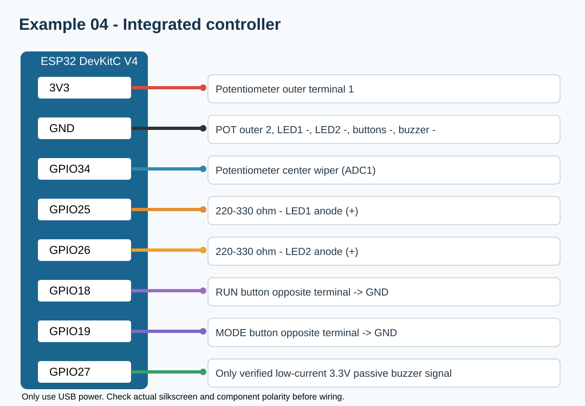

# 워크북 4 — ESP32 복합 이벤트 컨트롤러 (심화)

## 학습 과제
**버튼2 + LED2 + 가변저항1 + 수동부저1**로 작은 인터랙티브 장치를 만든다.
- RUN 버튼(GPIO18): 실행/정지
- MODE 버튼(GPIO19): 경보 모드 ON/OFF
- LED1(GPIO25): 가변저항의 ADC 값에 따른 PWM 밝기
- LED2(GPIO26): 실행 중 400ms 간격 점멸
- BUZZER(GPIO27): 버튼 이벤트 때 짧은 소리, 경보모드에서 ADC가 높은 경우 1초 간격 경보(고전류 부저는 직접 연결 금지)
- POT(GPIO34): 3.3V ADC1 아날로그 입력

## 부품 및 배선
| ESP32 | 중간 연결 | 부품 단자 |
|---|---|---|
| GPIO25 | 220~330Ω | LED1 + |
| GND | 직접 | LED1 - |
| GPIO26 | 220~330Ω | LED2 + |
| GND | 직접 | LED2 - |
| GPIO18 | 버튼 접점1 | 버튼1 → 반대 접점 GND |
| GPIO19 | 버튼 접점1 | 버튼2 → 반대 접점 GND |
| 3V3 | 직접 | POT 끝단1 |
| GPIO34 | 직접 | POT 가운데 |
| GND | 직접 | POT 끝단2 |
| GPIO27 | 구동 회로/저전류 3.3V용 부저 입력 | BUZZER + 또는 신호 |
| GND | 직접 | BUZZER - 또는 GND |

**부저 주의:** 부저 모델에 따라 단순 GPIO 직결이 허용되지 않는다. 수동 부저 단품의 전류가 GPIO 허용 범위를 초과하면 반드시 NPN 트랜지스터·베이스 저항을 사용하며, 모듈이 5V 전용일 경우 별도 전원·레벨 호환을 확인한다. 그림은 **3.3V 저전류 부저 모듈용 예시**이다.

## 순서
1. 워크북 1~3을 각각 성공적으로 완료한다.
2. 전원을 끄고 그림과 표의 GND·3V3·GPIO를 모두 결선한다.
3. [완성 코드](../examples/04_integrated/04_integrated.ino)를 업로드한다.
4. 버튼1 누름→정지, 다시 누름→재개를 확인한다.
5. 가변저항 회전→LED1 밝기 변화 확인.
6. 버튼2 눌러 MODE ON→ADC값을 높이면 주기적 경보를 확인한다.
7. 두 버튼을 번갈아 누르며 LED2가 계속 정상 점멸하는지 확인한다.
8. `delay()`를 추가했을 때 입력 응답성이 변하는 이유를 정리한다.

## 동작 확인
| 시험 | 기대 결과 | 관찰 | 판정 |
|---|---|---|---|
| RUN 버튼 1회 | LED 꺼짐 | | |
| RUN 버튼 2회 | 실행 재개 | | |
| POT 회전 | LED1 밝기 변경 | | |
| MODE ON, POT 최고 | 주기적 경보 | | |
| MODE OFF | 추가 경보 중지 | | |
| 빠른 버튼 연속 입력 | 버튼 누름 1회당 토글 1회 | | |

## 확장 과제
1. ADC 경보 임계값을 `3200`에서 `2500`으로 변경한다.
2. LED2 점멸 주기를 200ms로 바꾼다.
3. `Serial.printf`로 RUN/MODE/ADC/PWM 상태를 보기 좋게 정리한다.
4. (선택) 부저 구동에 트랜지스터 사용한 회로를 별도로 설계해 전류를 측정한다.
