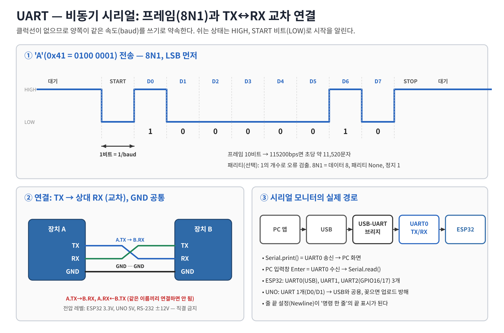
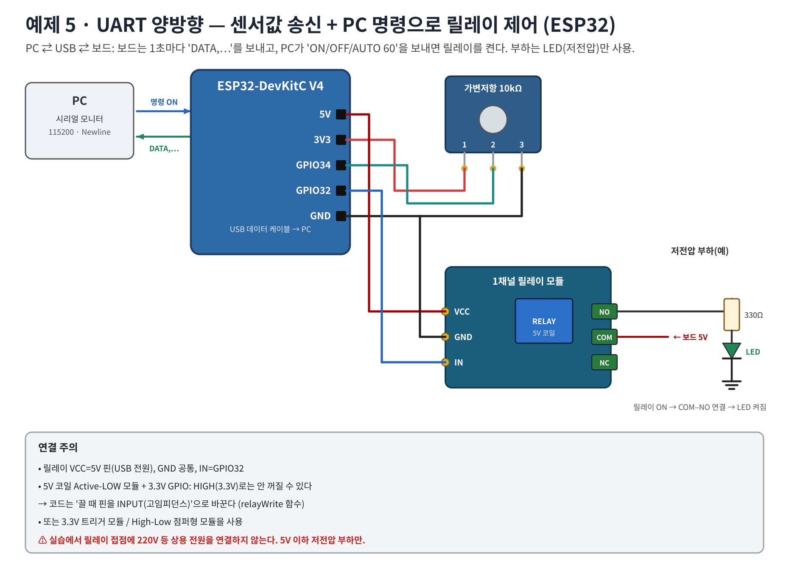
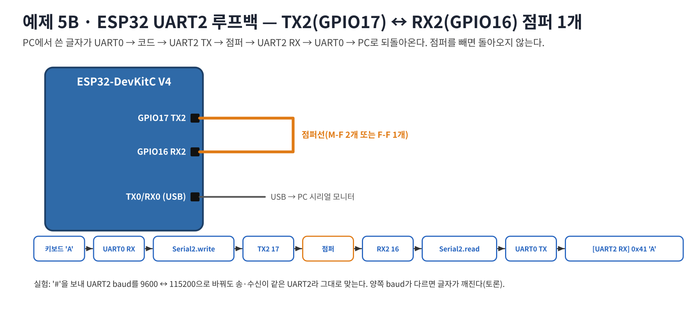

# 워크북 5 — UART 양방향 통신: 센서값 송신 + PC 명령으로 릴레이 제어

> 학습 목표 2 실습. 보드: ESP32-DevKitC V4 또는 Arduino UNO (같은 스케치)

## 목표
- MCU → PC: 1초마다 가변저항 값을 `DATA,시간,adc,%,relay,mode` 형식으로 보낸다.
- PC → MCU: `ON`, `OFF`, `AUTO 60`, `PERIOD 500`, `STATUS`, `HELP` 명령을 한 줄씩 받아 릴레이를 제어한다.

## 1. 원리


- 송신과 수신이 서로 다른 선(TX/RX)이라 **동시에** 일어날 수 있다(전이중).
- 수신 쪽은 글자를 하나씩 모으다가 `'\n'`(줄 끝)을 만나면 '명령 한 줄'로 처리한다 → 시리얼 모니터 줄 끝 = **Newline**.
- `delay()` 없이 `millis()`로 송신 주기를 관리해야 수신이 막히지 않는다.

## 2. 부품
| 부품 | 수량 | 비고 |
|---|---:|---|
| ESP32-DevKitC V4 또는 UNO | 1 | |
| 가변저항 10kΩ | 1 | 센서 대용(워크북 3 회로 재사용) |
| 1채널 릴레이 모듈(5V 코일, IN 단자) | 1 | ESP32는 3.3V 트리거형 권장 |
| LED + 330Ω | 1 | 릴레이 부하(저전압) |
| 점퍼선 | 10 | |

## 3. 연결도
ESP32:


UNO:


| 부품 단자 | ESP32 | UNO |
|---|---|---|
| 가변저항 1 / 2 / 3 | 3V3 / GPIO34 / GND | 5V / A0 / GND |
| 릴레이 VCC / GND / IN | 5V / GND / GPIO32 | 5V / GND / D7 |
| 릴레이 COM | 5V | 5V |
| 릴레이 NO → 330Ω → LED → GND | | |

> ESP32 + 5V Active-LOW 모듈: GPIO HIGH(3.3V)로는 모듈 입력 LED가 완전히 꺼지지 않아 릴레이가 계속 붙어 있을 수 있다. 코드의 `relayWrite()`는 OFF일 때 핀을 `INPUT`(고임피던스)으로 바꿔 이 문제를 피한다. 3.3V 트리거형 모듈이면 `RELAY_ACTIVE_LOW`만 맞추면 된다.
>
> 릴레이 접점에 220V 상용 전원을 연결하지 않는다.

## 4. 코드 — [05_uart_bidir_relay.ino](../examples/05_uart_bidir_relay/05_uart_bidir_relay.ino)
핵심 구조:
```cpp
void loop() {
  // 1) 수신: 들어온 바이트를 줄 단위로 모은다 (블로킹 없음)
  while (Serial.available() > 0) {
    char c = Serial.read();
    if (c == '\r') continue;
    if (c == '\n') { line[lineLen] = '\0'; handleCommand(line); lineLen = 0; }
    else if (lineLen < sizeof(line) - 1) line[lineLen++] = c;
  }
  // 2) 송신: 주기마다 센서값 CSV
  if (millis() - lastSend >= period) { /* DATA,... 출력, AUTO면 임계값 비교 */ }
}
```

## 5. 실행 예 (시리얼 모니터 115200, 줄 끝 = 새 줄)
```
# Week09 UART bidirectional demo
Commands: ON | OFF | AUTO <0-100> | PERIOD <ms> | STATUS | HELP
DATA,1000,1203,29,0,MANUAL
> ON
OK RELAY ON
DATA,3000,1203,29,1,MANUAL
> AUTO 50
OK AUTO 50
DATA,4000,1203,29,0,AUTO          ← 29% < 50% → 자동 OFF
DATA,5000,3200,78,1,AUTO          ← 손잡이를 돌려 78% → 자동 ON
> PERIOD 50
ERR PERIOD 100~10000
```
(호스트 시뮬레이션으로 명령 처리·AUTO 히스테리시스(5%) 동작을 확인함. ESP32 ADC 값 예시)

## 6. 동작 검증
| 시험 | 기대 결과 | 관찰 | 판정 |
|---|---|---|---|
| 업로드 후 | 1초마다 DATA 줄 | | |
| `ON` | OK RELAY ON, 딸깍 소리, LED 켜짐 | | |
| `off` (소문자) | OK RELAY OFF | | |
| `AUTO 60` + 손잡이 최대 | 자동 ON, 다시 내리면 55% 미만에서 OFF | | |
| `PERIOD 200` | DATA가 5배 빨라짐 | | |
| `HELLO` | ERR unknown | | |
| 줄 끝 '없음'으로 바꾸고 `ON` | 반응 없음 → 이유 설명 | | |
| 시리얼 플로터 | 센서 % 그래프 | | |

## 7. 문제 해결
| 증상 | 확인 |
|---|---|
| 글자가 깨짐 | 시리얼 모니터 baud 115200 |
| 명령 반응 없음 | 줄 끝 '새 줄' 설정, 다른 프로그램이 포트 사용 중인지 |
| 릴레이가 안 꺼짐(ESP32) | Active-LOW 5V 모듈 → relayWrite의 INPUT 방식 확인 또는 3.3V 트리거 모듈 |
| 릴레이 딸깍하지만 LED 안 켜짐 | COM=5V, NO 단자 사용(NC 아님), LED 극성 |
| 업로드 실패(UNO) | D0/D1에 연결된 선 제거 |

## 8. 과제
1. `BLINK <ms>` 명령을 추가해 릴레이를 주기적으로 ON/OFF 하라.
2. DATA 줄에 센서 전압(mV)을 추가하라(ESP32: `analogReadMilliVolts`).
3. 송신 형식을 JSON(`{"adc":1203,"relay":1}`)으로 바꾸고 장단점을 비교하라.
4. (확장) 센서를 DS18B20(워크북 8)으로 바꿔 '온도 30°C 이상이면 팬 릴레이 ON'으로 만들어라.

제출: 연결 사진, 명령·응답 로그, 시리얼 플로터 캡처, 동작 영상.

---

## 부록 — 예제 5B: ESP32 UART2 루프백


GPIO17(TX2)과 GPIO16(RX2)을 점퍼선 1개로 연결하고 [05b_uart2_loopback.ino](../examples/05b_uart2_loopback/05b_uart2_loopback.ino)를 업로드한다. 시리얼 모니터에 `A`를 보내면 `[UART2 RX] 0x41 'A'`가 돌아온다. 점퍼를 빼면 돌아오지 않는다 → TX/RX가 실제 전선임을 확인. (UNO는 하드웨어 UART가 1개라 생략)
