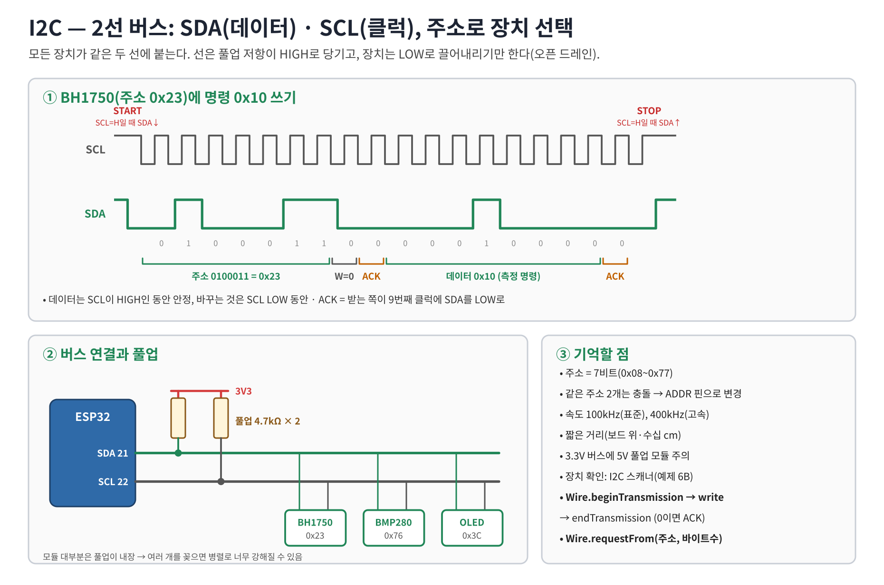
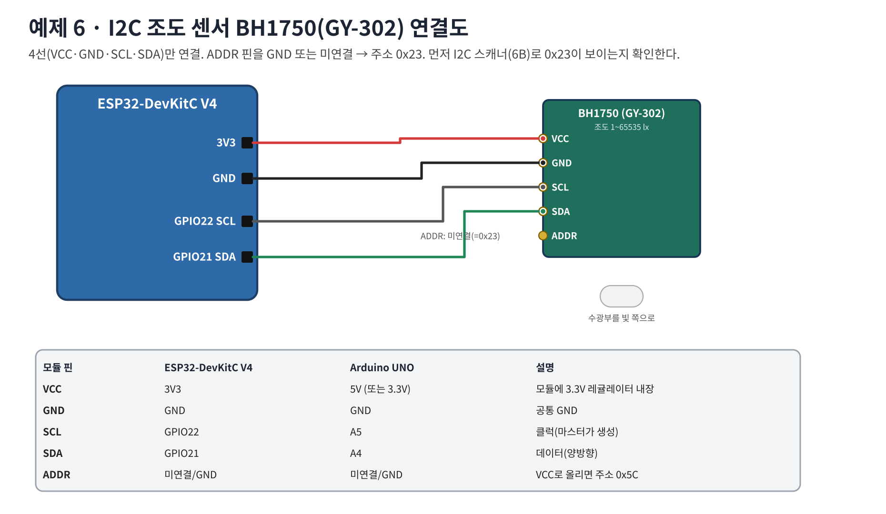
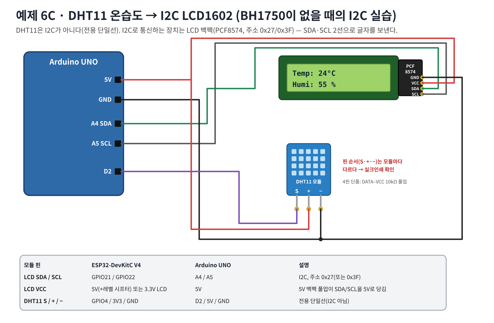
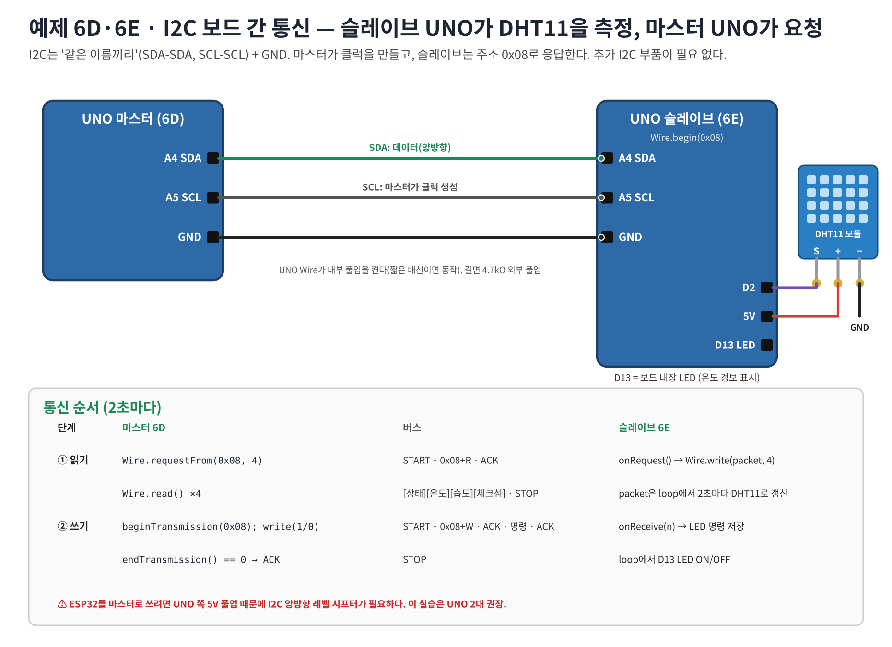

# 워크북 6 — I2C 조도 센서 BH1750 (GY-302)

## 목표
I2C 스캐너로 장치 주소를 확인하고, 라이브러리 없이 `Wire`로 명령을 보내 조도(lx)를 읽는다.

## 1. 원리


## 2. 연결도


| BH1750 | ESP32 | UNO |
|---|---|---|
| VCC | 3V3 | 5V(모듈 레귤레이터) |
| GND | GND | GND |
| SCL | GPIO22 | A5 |
| SDA | GPIO21 | A4 |
| ADDR | 미연결(0x23) | 미연결(0x23) |

## 3. 단계 1 — I2C 스캐너 [06b_i2c_scanner.ino](../examples/06b_i2c_scanner/06b_i2c_scanner.ino)
예상 출력:
```
Scanning I2C 0x08~0x77 ...
  found 0x23
devices: 1
```
- `devices: 0` → SDA/SCL 바뀜, VCC/GND, 핀 번호 확인.
- ADDR를 VCC로 옮기면 0x5C로 바뀌는지 확인한다.

## 4. 단계 2 — 조도 읽기 [06_i2c_bh1750.ino](../examples/06_i2c_bh1750/06_i2c_bh1750.ino)
```cpp
Wire.beginTransmission(0x23);   // START + 주소 + W
Wire.write(0x10);               // 연속 고해상도 측정 명령
Wire.endTransmission();         // STOP, 반환 0 = ACK
delay(180);                     // 측정 시간
Wire.requestFrom(0x23, 2);      // START + 주소 + R, 2바이트
uint16_t raw = (Wire.read() << 8) | Wire.read();
float lux = raw / 1.2;          // 데이터시트 환산식
```
예상 출력(시리얼 플로터 가능): `lux` → `312.5`, 손으로 가리면 `5.0` 근처, 휴대폰 손전등 `2000+`.

## 5. 측정 기록
| 조건 | lux | raw(=lux×1.2) |
|---|---:|---:|
| 실내 조명 | | |
| 손으로 가림 | | |
| 손전등 | | |

## 6. 문제 해결
| 증상 | 확인 |
|---|---|
| no ACK | 스캐너로 주소 확인, SDA↔SCL 교차 여부 |
| 값이 65535 근처 고정 | 너무 밝음(포화) |
| 다른 I2C 모듈과 함께 안 됨 | 주소 충돌·풀업 과다 |

## 7. 과제
1. 측정 명령 0x20(1회 측정)으로 바꾸고 차이를 설명하라.
2. 조도가 50 lx 미만이면 워크북 5의 릴레이를 켜는 '자동 조명'으로 합쳐라.
3. 로직 분석기(있다면)로 SDA/SCL 파형을 캡처해 주소 0x23과 ACK를 찾아라.

---

# 대체 실습 — BH1750이 없을 때: DHT11을 이용한 I2C 실습

> **주의: DHT11은 I2C 센서가 아니다.** DATA 1선의 제조사 고유 프로토콜(10주차)이다. 그래서 DHT11만으로는 I2C를 배울 수 없고, 아래처럼 **DHT11 값을 I2C 장치로 보내거나 I2C로 주고받는** 구성으로 실습한다.
>
> | 가진 부품 | 선택할 실습 |
> |---|---|
> | DHT11 + I2C LCD1602(백팩 PCF8574) | **6C** — DHT11 측정값을 I2C LCD에 표시 |
> | DHT11 + Arduino UNO 2대 | **6D·6E** — UNO 2대 I2C 통신(슬레이브가 DHT11 측정, 마스터가 요청) |
> | DHT20/AHT20(I2C 온습도) | 6B 스캐너로 주소(0x38) 확인 후 라이브러리 예제 사용 |

라이브러리: **DHT sensor library**(Adafruit) + **Adafruit Unified Sensor**, 6C는 추가로 **LiquidCrystal I2C**(Frank de Brabander).

## 6C. DHT11 → I2C LCD1602



| 부품 단자 | ESP32 | UNO | 설명 |
|---|---|---|---|
| LCD SDA / SCL | GPIO21 / GPIO22 | A4 / A5 | I2C, 주소 0x27(또는 0x3F) |
| LCD VCC / GND | 5V(레벨 시프터 사용) 또는 3.3V LCD / GND | 5V / GND | |
| DHT11 S / + / − | GPIO4 / 3V3 / GND | D2 / 5V / GND | 전용 단일선(I2C 아님) |

> - **ESP32 주의**: 5V LCD 백팩은 SDA·SCL을 5V로 풀업한다 → ESP32 핀에 5V가 걸린다. I2C 양방향 레벨 시프터를 쓰거나, 이 실습은 **UNO로 진행**한다.
> - 먼저 **예제 6B 스캐너**로 LCD 주소(0x27/0x3F)를 확인하고 코드의 `LCD_ADDR`를 맞춘다.
> - 글자가 안 보이면 백팩의 파란 가변저항(명암)을 돌린다.

코드 — [06c_dht11_i2c_lcd.ino](../examples/06c_dht11_i2c_lcd/06c_dht11_i2c_lcd.ino)
```cpp
#include <Wire.h>
#include <LiquidCrystal_I2C.h>
#include <DHT.h>
#if defined(ESP32)
const int DHT_PIN = 4;
#else
const int DHT_PIN = 2;
#endif
const uint8_t LCD_ADDR = 0x27;            // 6B 스캐너로 확인
DHT dht(DHT_PIN, DHT11);
LiquidCrystal_I2C lcd(LCD_ADDR, 16, 2);

void setup() {
  Serial.begin(115200);
#if defined(ESP32)
  Wire.begin(21, 22);
#else
  Wire.begin();
#endif
  lcd.init(); lcd.backlight(); lcd.print("DHT11 + I2C LCD");
  dht.begin();
}

void loop() {
  static unsigned long last = 0;
  if (millis() - last < 2000) return;     // DHT11은 1초에 1번 이하
  last = millis();
  float h = dht.readHumidity(), t = dht.readTemperature();
  if (isnan(h) || isnan(t)) { lcd.setCursor(0, 1); lcd.print("DHT read fail   "); return; }
  lcd.setCursor(0, 0); lcd.print("Temp: "); lcd.print(t, 0); lcd.print((char)223); lcd.print("C    ");
  lcd.setCursor(0, 1); lcd.print("Humi: "); lcd.print(h, 0); lcd.print(" %     ");
}
```
예상: LCD 1행 `Temp: 24°C`, 2행 `Humi: 55 %`, 시리얼 `24,55`.

생각해 보기: `lcd.print()` 한 번에 I2C로 몇 바이트가 오가는가? (PCF8574는 4비트 모드라 글자 1개 = 니블 2개 × E 펄스 → 수 바이트) → I2C로 큰 화면을 빠르게 갱신하기 어려운 이유.

## 6D·6E. UNO 2대 I2C 통신 — 슬레이브가 DHT11 측정, 마스터가 요청



| 신호 | UNO 마스터(6D) | UNO 슬레이브(6E) |
|---|---|---|
| SDA | A4 | A4 |
| SCL | A5 | A5 |
| GND | GND | GND |
| DHT11 S / + / − | — | D2 / 5V / GND |
| 경보 LED | — | D13(보드 내장) |

같은 이름끼리 연결한다(UART처럼 교차하지 않음). ESP32를 마스터로 쓰려면 레벨 시프터가 필요하므로 UNO 2대를 권장한다.

**패킷 4바이트**: `[상태 0/1][온도 °C][습도 %][체크섬 = 앞 3바이트 합의 하위 8비트]`

슬레이브 — [06e_i2c_slave_dht11_uno.ino](../examples/06e_i2c_slave_dht11_uno/06e_i2c_slave_dht11_uno.ino)
```cpp
#include <Wire.h>
#include <DHT.h>
const uint8_t MY_ADDR = 0x08;
DHT dht(2, DHT11);
volatile uint8_t packet[4] = {1, 0, 0, 1};
volatile int8_t  ledCmd = -1;

void onRequestHandler() {                 // 마스터가 requestFrom() 하면 호출 — 짧게
  uint8_t buf[4];
  for (int i = 0; i < 4; i++) buf[i] = packet[i];
  Wire.write(buf, 4);
}
void onReceiveHandler(int count) {        // 마스터가 쓰기 전송을 하면 호출
  while (Wire.available()) ledCmd = Wire.read();
  (void)count;
}

void setup() {
  Serial.begin(115200);
  pinMode(13, OUTPUT);
  dht.begin();
  Wire.begin(MY_ADDR);                    // 주소를 주면 슬레이브
  Wire.onRequest(onRequestHandler);
  Wire.onReceive(onReceiveHandler);
}

void loop() {
  static unsigned long last = 0;
  if (millis() - last >= 2000) {          // 2초마다 측정해 패킷 갱신
    last = millis();
    float h = dht.readHumidity(), t = dht.readTemperature();
    uint8_t p[4];
    if (isnan(h) || isnan(t)) { p[0] = 1; p[1] = 0; p[2] = 0; }
    else { p[0] = 0; p[1] = (uint8_t)(int8_t)lround(t); p[2] = (uint8_t)lround(h); }
    p[3] = (uint8_t)(p[0] + p[1] + p[2]);
    noInterrupts(); for (int i = 0; i < 4; i++) packet[i] = p[i]; interrupts();
  }
  if (ledCmd >= 0) {
    noInterrupts(); int8_t c = ledCmd; ledCmd = -1; interrupts();
    digitalWrite(13, c ? HIGH : LOW);
  }
}
```

마스터 — [06d_i2c_master_uno.ino](../examples/06d_i2c_master_uno/06d_i2c_master_uno.ino)
```cpp
#include <Wire.h>
const uint8_t SLAVE_ADDR = 0x08;
const int ALARM_TEMP = 28;

void setup() { Serial.begin(115200); Wire.begin(); }   // 주소 없이 = 마스터

void loop() {
  static unsigned long last = 0;
  if (millis() - last < 2000) return;
  last = millis();
  // 1) 읽기: START + 0x08(R) → 4바이트 → STOP
  if (Wire.requestFrom(SLAVE_ADDR, (uint8_t)4) != 4) { Serial.println(F("no answer from 0x08")); return; }
  uint8_t st = Wire.read(), t = Wire.read(), h = Wire.read(), ck = Wire.read();
  if ((uint8_t)(st + t + h) != ck) { Serial.println(F("checksum error")); return; }
  if (st != 0) { Serial.println(F("slave: DHT11 read fail")); return; }
  // 2) 쓰기: START + 0x08(W) + 명령 → STOP
  bool on = (int8_t)t >= ALARM_TEMP;
  Wire.beginTransmission(SLAVE_ADDR);
  Wire.write(on ? 1 : 0);
  uint8_t err = Wire.endTransmission();   // 0 = ACK
  Serial.print(F("T=")); Serial.print((int8_t)t); Serial.print(F("C  H=")); Serial.print(h);
  Serial.print(F("%  -> LED ")); Serial.print(on ? F("ON") : F("OFF"));
  Serial.println(err == 0 ? F("  (ACK)") : F("  (NACK)"));
}
```

예상 출력
```
[마스터]                                [슬레이브]
T=24C  H=55%  -> LED OFF  (ACK)         measure  T=24C  H=55%
T=29C  H=60%  -> LED ON   (ACK)         recv LED cmd = 1     (센서를 손으로 감쌈)
```

## 대체 실습 검증
| 시험 | 기대 결과 | 관찰 | 판정 |
|---|---|---|---|
| 6B 스캐너 | 6C: 0x27(또는 0x3F) / 6D: 0x08 | | |
| 센서를 손으로 감쌈 | 온도·습도 상승, LCD/시리얼 갱신 | | |
| (6D) 28°C 이상 | 슬레이브 D13 LED ON, (ACK) | | |
| SDA 선 제거 | 6C 화면 멈춤 / 6D `no answer from 0x08` | | |
| (6D) 슬레이브 주소를 0x09로 변경 | 마스터 NACK·no answer → 주소의 의미 | | |
| DHT11 S 선 제거 | `DHT read fail` (I2C는 정상) → 두 통신이 별개임을 확인 | | |

## 대체 실습 문제 해결
| 증상 | 확인 |
|---|---|
| LCD에 네모만 보임 | 주소 불일치(0x27↔0x3F), 명암 가변저항 |
| LCD 아무것도 안 보임 | 백라이트·VCC 5V, SDA/SCL 바뀜 |
| `DHT read fail` 반복 | S 핀 위치, 2초 이상 간격, 4핀 단품이면 10kΩ 풀업 |
| `no answer from 0x08` | 슬레이브 스케치, A4/A5/GND, 마스터·슬레이브 바뀜 |
| `checksum error` | 배선 길이, 접촉 불량 |

## 대체 실습 과제
1. 6C에서 LCD 2행에 '불쾌지수'(DI = 0.81T + 0.01H(0.99T − 14.3) + 46.3)를 표시하라.
2. 6D 패킷에 '측정 횟수'(1바이트)를 추가해 5바이트로 늘려라. 마스터·슬레이브 양쪽에서 무엇을 바꿔야 하는가?
3. DHT11 통신과 I2C 통신을 신호선·클럭·주소·속도로 비교하는 표를 작성하라.
4. (참고) ipmes 'I2C 통신 실험 — 아두이노 간 통신하기'(https://ipmes.tistory.com/115)와 6D·6E를 비교해 차이(요청 방식 requestFrom, 체크섬)를 설명하라.
