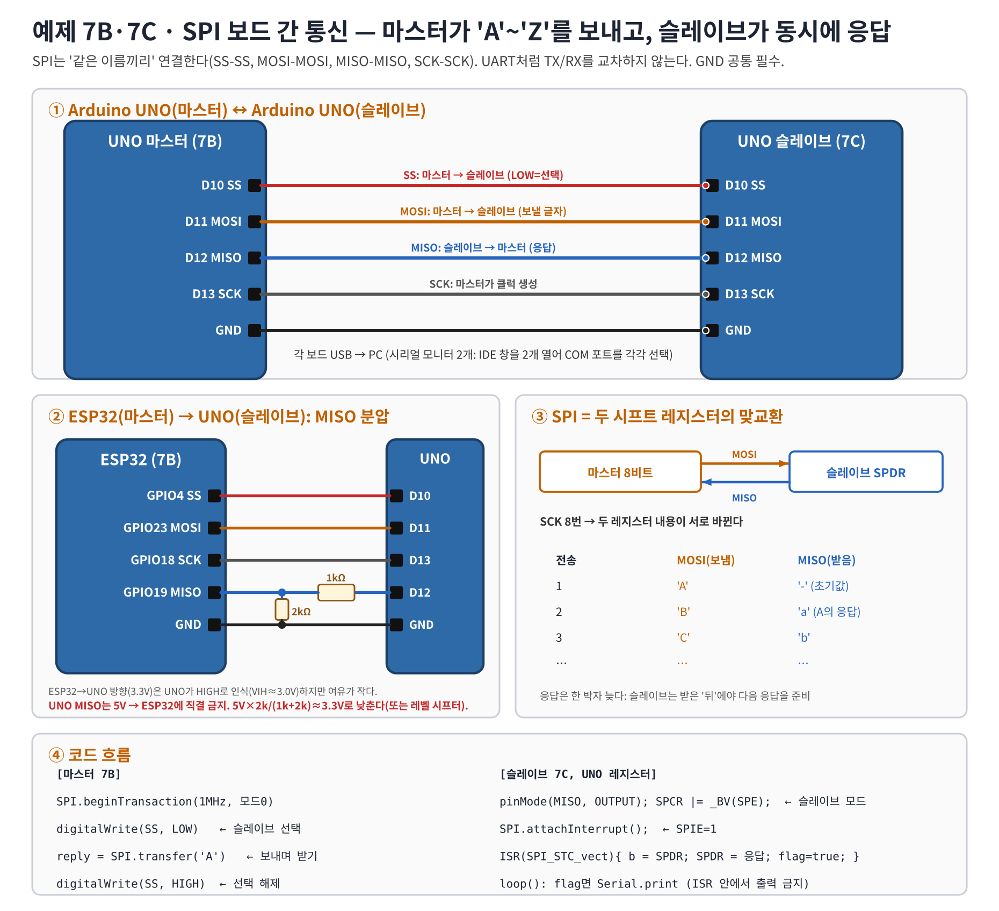

# 워크북 7 — SPI 통신: 보드 간 통신(마스터 ↔ 슬레이브) + 센서 응용(MAX6675)

> Part A(필수): 아두이노 2대를 SPI로 연결해 마스터가 글자를 보내고 슬레이브가 받는다(참고: ipmes 'SPI 통신 실험 — 아두이노 간 문자 주고받기' 방식).
> Part B(응용): 같은 SPI 원리로 센서(MAX6675 열전대)를 읽는다.

## 1. 원리


- 마스터가 **SS(CS)를 LOW**로 내려 슬레이브를 고르고, **SCK** 8번 동안 **MOSI**로 1바이트를 보낸다.
- 같은 8클럭 동안 슬레이브는 **MISO**로 1바이트를 돌려준다 → SPI는 **두 시프트 레지스터의 맞교환**(전이중).
- 슬레이브는 클럭을 만들지 않으므로, 응답은 '미리' 준비해 둔 값이다 → 응답이 한 박자 늦다.

---

## Part A. 아두이노 2대 SPI 통신 (예제 7B 마스터 + 7C 슬레이브)



### A-1. 준비물
| 부품 | 수량 | 비고 |
|---|---:|---|
| Arduino UNO | 2 | 마스터 1, 슬레이브 1 (또는 ESP32 마스터 + UNO 슬레이브) |
| 점퍼선 M-M | 5 | SS·MOSI·MISO·SCK·GND |
| USB 케이블 | 2 | 시리얼 모니터 2개 |
| (ESP32 마스터일 때) 저항 1kΩ, 2kΩ | 각 1 | UNO MISO 5V → 3.3V 분압 |

### A-2. 결선 — 같은 이름끼리 (UART처럼 교차하지 않는다)
| 신호 | 방향 | UNO 마스터 | UNO 슬레이브 | ESP32 마스터를 쓸 때 |
|---|---|---|---|---|
| SS | 마스터 → 슬레이브 | D10 | D10 | GPIO4 → D10 |
| MOSI | 마스터 → 슬레이브 | D11 | D11 | GPIO23 → D11 |
| MISO | 슬레이브 → 마스터 | D12 | D12 | D12 → 1kΩ → GPIO19 (GPIO19–GND 2kΩ) |
| SCK | 마스터 → 슬레이브 | D13 | D13 | GPIO18 → D13 |
| GND | 공통 | GND | GND | GND |

> - GND를 연결하지 않으면 두 보드의 전압 기준이 달라 글자가 깨진다.
> - UNO의 D13에는 보드 LED가 있어 SCK가 움직일 때 깜빡일 수 있다(정상).
> - UNO 마스터의 D10은 반드시 OUTPUT이어야 한다(INPUT이고 LOW가 되면 UNO가 스스로 슬레이브 모드로 바뀜).

### A-3. 마스터 코드 — [07b_spi_master.ino](../examples/07b_spi_master/07b_spi_master.ino) (UNO·ESP32 공용)
```cpp
#include <SPI.h>
#if defined(ESP32)
const int SS_PIN = 4;
#else
const int SS_PIN = 10;
#endif
SPISettings settings(1000000, MSBFIRST, SPI_MODE0);   // 1MHz, 모드0
char sendChar = 'A';

void setup() {
  Serial.begin(115200);
  pinMode(SS_PIN, OUTPUT);
  digitalWrite(SS_PIN, HIGH);
#if defined(ESP32)
  SPI.begin(18, 19, 23, SS_PIN);
#else
  SPI.begin();
#endif
}

void loop() {
  static unsigned long last = 0;
  if (millis() - last < 1000) return;
  last = millis();
  SPI.beginTransaction(settings);
  digitalWrite(SS_PIN, LOW);                    // 슬레이브 선택
  uint8_t reply = SPI.transfer(sendChar);       // 보내면서 동시에 받기
  digitalWrite(SS_PIN, HIGH);                   // 선택 해제
  SPI.endTransaction();
  Serial.print(F("Send : ")); Serial.print(sendChar);
  Serial.print(F("   Recv : ")); Serial.println((char)reply);
  sendChar = (sendChar == 'Z') ? 'A' : sendChar + 1;
}
```

### A-4. 슬레이브 코드 — [07c_spi_slave_uno.ino](../examples/07c_spi_slave_uno/07c_spi_slave_uno.ino) (UNO 전용)
Arduino `SPI` 라이브러리는 마스터용이라, 슬레이브는 ATmega328P의 SPI 레지스터를 직접 설정한다.

| 레지스터·함수 | 의미 |
|---|---|
| `SPCR |= _BV(SPE)` | SPI 켜기. MSTR 비트가 0이므로 **슬레이브 모드** |
| `pinMode(MISO, OUTPUT)` | 슬레이브에서 출력은 MISO 하나뿐 |
| `SPI.attachInterrupt()` | SPCR의 SPIE=1 → 1바이트 수신 완료마다 인터럽트 |
| `ISR(SPI_STC_vect)` | Serial Transfer Complete 인터럽트 함수 |
| `SPDR` | 읽으면 받은 바이트, 쓰면 다음에 보낼 바이트 |

```cpp
#include <SPI.h>
volatile uint8_t rxByte = 0;
volatile bool    rxReady = false;

void setup() {
  Serial.begin(115200);
  pinMode(MISO, OUTPUT);
  SPCR |= _BV(SPE);             // 슬레이브 모드로 SPI 켜기
  SPDR = '-';                   // 첫 응답
  SPI.attachInterrupt();        // SPIE = 1
}

ISR(SPI_STC_vect) {             // 짧게: 읽고, 다음 응답 넣고, 플래그
  uint8_t b = SPDR;
  rxByte = b;
  rxReady = true;
  SPDR = (b >= 'A' && b <= 'Z') ? (b + ('a' - 'A')) : '?';
}

void loop() {
  if (rxReady) {                // ISR 안에서는 Serial을 쓰지 않는다
    noInterrupts(); uint8_t b = rxByte; rxReady = false; interrupts();
    Serial.print(F("Receive : ")); Serial.println((char)b);
  }
}
```

### A-5. 실행 순서와 예상 출력
1. 슬레이브 UNO에 7C, 마스터 보드에 7B를 업로드한다(포트를 헷갈리지 않게 보드에 '마스터/슬레이브' 표시).
2. 배선 후 Arduino IDE 창을 2개 열어 각 COM 포트의 시리얼 모니터(115200)를 연다.
3. 슬레이브의 EN/RESET을 먼저 누르고 마스터를 리셋한다.

```
[마스터]                       [슬레이브]
Send : A   Recv : -            Receive : A   (next reply : a)
Send : B   Recv : a            Receive : B   (next reply : b)
Send : C   Recv : b            Receive : C   (next reply : c)
...
Send : Z   Recv : y            Receive : Z
Send : A   Recv : z            Receive : A
```
(응답이 한 박자 늦게 오는 것이 정상 — 표 ③ 참고)

### A-6. 동작 검증
| 시험 | 기대 결과 | 관찰 | 판정 |
|---|---|---|---|
| 1초마다 Send/Receive | 같은 글자가 양쪽에 | | |
| 마스터 Recv | 직전 글자의 소문자 | | |
| GND 선 제거 | 글자 깨짐·누락 | | |
| MISO 선 제거 | 마스터 Recv가 0xFF 또는 0x00 | | |
| MOSI·MISO 서로 바꿔 꽂기 | 통신 안 됨 → '같은 이름끼리'의 이유 | | |
| 클럭 1MHz → 8MHz | 슬레이브 수신 오류(UNO 슬레이브 최대 4MHz) | | |

### A-7. 문제 해결
| 증상 | 확인 |
|---|---|
| 슬레이브 아무것도 안 나옴 | SS(D10) 연결, 마스터 SS가 LOW로 내려가는지, 7C가 슬레이브에 올라갔는지 |
| 마스터 Recv : 0xFF | MISO 끊김 또는 슬레이브 미동작 |
| 글자가 한 칸씩 밀림·깨짐 | GND 공통, SPI 모드(양쪽 모드0), 클럭 속도 |
| 업로드 후 반응 없음 | 마스터·슬레이브 스케치가 바뀌어 올라가지 않았는지(COM 포트 확인) |
| ESP32 GPIO 손상 우려 | MISO 분압(1k/2k) 없이 UNO D12를 ESP32에 직결하지 않는다 |

### A-8. 과제
1. 슬레이브 응답을 '받은 글자 + 1'로 바꾸고 마스터 출력이 어떻게 바뀌는지 예측 후 확인하라.
2. 마스터가 `"HELLO"` 문자열을 한 번의 SS LOW 동안 5바이트 연속 전송하게 바꿔라. 슬레이브는 SS가 HIGH가 될 때 한 줄로 출력하라(힌트: SS 핀 상태 확인).
3. 마스터에서 `ON`/`OFF`를 보내면 슬레이브의 LED(D9)가 켜지게 하라 — I2C·UART 보드 간 통신과 비교.
4. SPI와 UART 보드 간 연결의 결선 차이(같은 이름끼리 vs 교차)를 이유와 함께 설명하라.

---

## Part B. SPI 센서 응용 — MAX6675 열전대 온도 센서 (예제 7)


Part A에서 '마스터 = 우리 보드'였다면, 여기서는 **센서가 슬레이브**다. MAX6675는 MOSI가 없는 읽기 전용 슬레이브로, 마스터가 클럭 16개를 주면 온도 16비트를 MISO로 내보낸다.

| MAX6675 | ESP32 | UNO |
|---|---|---|
| VCC | 3V3 | 5V |
| GND | GND | GND |
| SCK | GPIO18 | D13 |
| CS | GPIO4 | D10 |
| SO (MISO) | GPIO19 | D12 |

코드 — [07_spi_max6675.ino](../examples/07_spi_max6675/07_spi_max6675.ino)
```cpp
SPI.beginTransaction(SPISettings(1000000, MSBFIRST, SPI_MODE0));
digitalWrite(CS_PIN, LOW);
uint16_t v = SPI.transfer16(0x0000);  // 16클럭, 16비트 수신
digitalWrite(CS_PIN, HIGH);           // 다음 변환 시작(약 220ms)
SPI.endTransaction();
if (v & 0x0004) { /* 열전대 끊김 */ }
float tempC = (v >> 3) * 0.25;
```
예상 출력(실온): `# raw=0x2D0` → `22.50` 근처.

| raw(16진) | 2진 | bit2 | (raw>>3)×0.25 | 의미 |
|---|---|---|---|---|
| 0x02D0 | 0000 0010 1101 0000 | 0 | 22.50°C | 실온 |
| 0x0C80 | 0000 1100 1000 0000 | 0 | 100.00°C | 끓는 물 |
| 0x0004 | 0000 0000 0000 0100 | 1 | — | 열전대 끊김 |

| 증상 | 확인 |
|---|---|
| no sensor (0x0000/0xFFFF) | SO↔MISO, CS 핀, VCC |
| thermocouple open | 열전대 단자 조임 |
| 같은 값 반복 | 500ms 이상 간격(변환 220ms) |

과제: Part A의 마스터와 MAX6675를 같은 SPI 버스에 함께 연결하려면 어떤 선을 추가해야 하는가? (CS 2개)

## 참고
- ipmes, SPI 통신 실험 — 아두이노 간 문자 주고받기: https://ipmes.tistory.com/116 (시리즈: I2C 편 https://ipmes.tistory.com/115)
- ATmega328P 데이터시트 SPI 장(SPCR, SPSR, SPDR)
