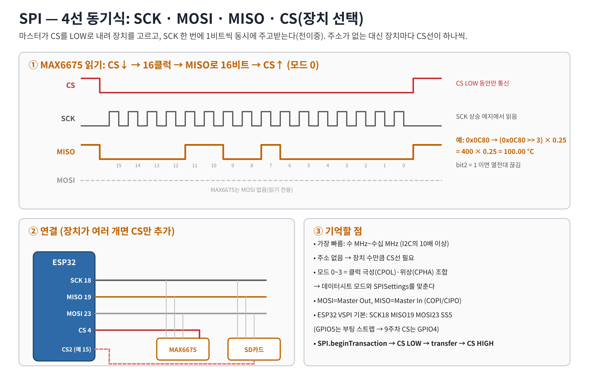
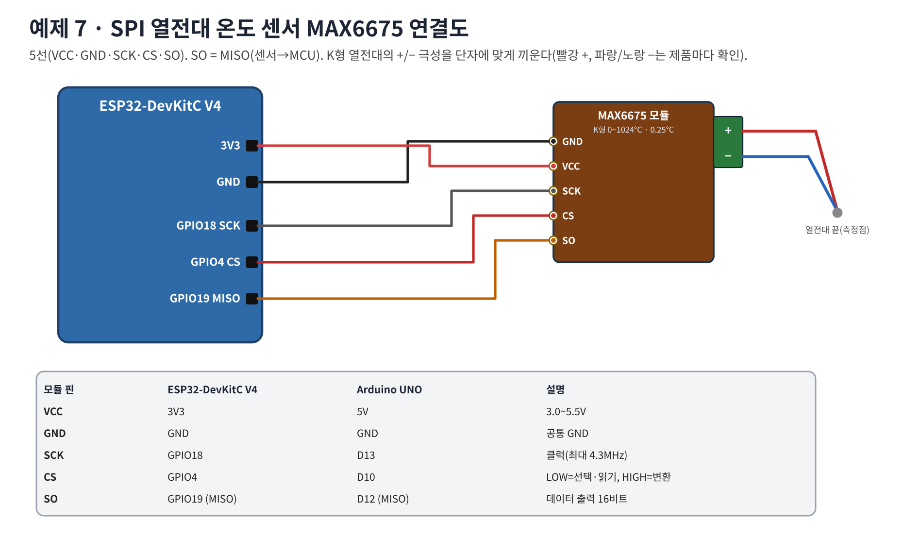

# 워크북 7 — SPI 열전대 온도 센서 MAX6675

## 목표
CS를 직접 제어하며 SPI로 16비트를 읽고, 비트 연산으로 온도와 오류 비트를 해석한다.

## 1. 원리


## 2. 연결도


| MAX6675 | ESP32 | UNO |
|---|---|---|
| VCC | 3V3 | 5V |
| GND | GND | GND |
| SCK | GPIO18 | D13 |
| CS | GPIO4 | D10 |
| SO (MISO) | GPIO19 | D12 |

K형 열전대 +/− 를 모듈 단자에 극성대로 연결한다(반대로 끼우면 온도가 내려간다).

## 3. 코드 — [07_spi_max6675.ino](../examples/07_spi_max6675/07_spi_max6675.ino)
```cpp
SPI.beginTransaction(SPISettings(1000000, MSBFIRST, SPI_MODE0));
digitalWrite(CS_PIN, LOW);            // 장치 선택
uint16_t v = SPI.transfer16(0x0000);  // 16클럭, MISO로 16비트 수신
digitalWrite(CS_PIN, HIGH);           // 선택 해제 → 다음 변환 시작(약 220ms)
SPI.endTransaction();
if (v & 0x0004) { /* 열전대 끊김 */ }
float tempC = (v >> 3) * 0.25;        // bit14..3, 0.25°C 단위
```
예상 출력(실온): `# raw=0x2D0` → `22.50` 근처. 손으로 열전대 끝을 쥐면 상승한다.

## 4. 비트 해석 연습
| raw(16진) | 2진 | bit2 | (raw>>3)×0.25 | 의미 |
|---|---|---|---|---|
| 0x02D0 | 0000 0010 1101 0000 | 0 | 22.50°C | 실온 |
| 0x0C80 | 0000 1100 1000 0000 | 0 | 100.00°C | 끓는 물 |
| 0x0004 | 0000 0000 0000 0100 | 1 | — | 열전대 끊김 |
| 측정값 | | | | |

## 5. 문제 해결
| 증상 | 확인 |
|---|---|
| no sensor (0x0000/0xFFFF) | SO↔GPIO19, CS 핀, VCC |
| thermocouple open | 열전대 단자 나사 조임 |
| 읽을 때마다 같은 값 | 500ms보다 빨리 읽음(변환 220ms) |
| 온도가 반대로 움직임 | 열전대 +/− 반대 |

## 6. 과제
1. SPI 클럭을 4MHz, 8MHz로 바꿔 보고 결과를 기록하라(데이터시트 최대 4.3MHz).
2. 같은 SPI 버스에 두 번째 장치를 추가한다면 어떤 선을 추가해야 하는가?
3. 80°C 이상이면 워크북 5의 릴레이를 끄는 과열 보호를 만들어라.
