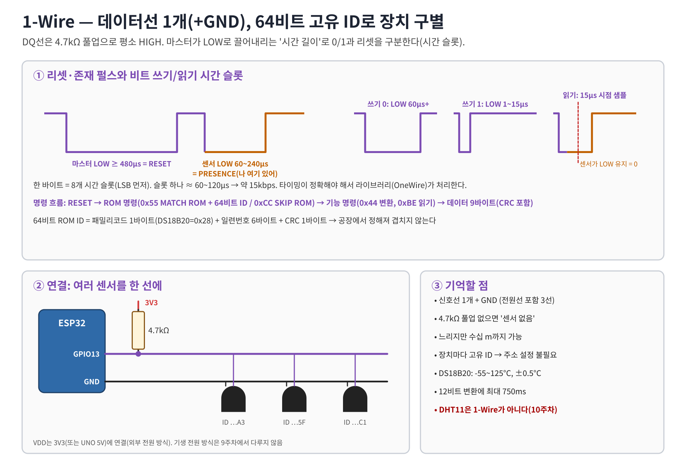
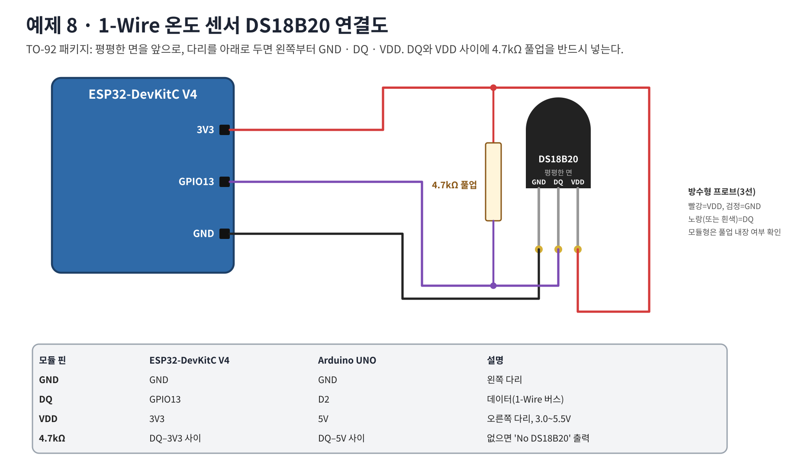

# 워크북 8 — 1-Wire 온도 센서 DS18B20

## 목표
4.7kΩ 풀업이 있는 1-Wire 버스에서 센서의 64비트 ID를 찾고, 명령(0x44, 0xBE)을 보내 온도를 읽는다.

## 1. 원리


## 2. 준비
Arduino IDE → 라이브러리 매니저 → **OneWire** (Paul Stoffregen) 설치.

## 3. 연결도


| DS18B20 (평평한 면 앞) | ESP32 | UNO |
|---|---|---|
| 왼쪽 GND | GND | GND |
| 가운데 DQ | GPIO13 | D2 |
| 오른쪽 VDD | 3V3 | 5V |
| 4.7kΩ | DQ–3V3 사이 | DQ–5V 사이 |

> VDD와 GND를 반대로 꽂으면 센서가 뜨거워지며 손상된다. 꽂은 뒤 손으로 만져 열이 나면 즉시 USB를 뺀다.

## 4. 코드 — [08_onewire_ds18b20.ino](../examples/08_onewire_ds18b20/08_onewire_ds18b20.ino)
```cpp
ow.search(addr);                   // SEARCH ROM: 64비트 ID 찾기 (addr[0]==0x28)
ow.reset(); ow.select(addr); ow.write(0x44);   // 변환 시작
delay(750);                        // 12비트 변환
ow.reset(); ow.select(addr); ow.write(0xBE);   // 스크래치패드 읽기
for (int i = 0; i < 9; i++) d[i] = ow.read();  // 9바이트(마지막은 CRC)
int16_t raw = (d[1] << 8) | d[0];
float tempC = raw / 16.0;          // 1/16 °C 단위
```
예상 출력:
```
ROM 28:FF:64:1E:0F:4C:3A:9B
tempC
23.56
```
(ROM ID는 센서마다 다르다)

## 5. 실험
| 실험 | 결과 |
|---|---|
| 손으로 쥠 | 온도 상승 속도 |
| 4.7kΩ 제거 | 'No DS18B20' 또는 CRC error |
| 센서 2개 연결 | ROM 2개 출력 → 코드에서 두 개 모두 읽도록 수정 |

## 6. 문제 해결
| 증상 | 확인 |
|---|---|
| No DS18B20 | 풀업, DQ 핀, 다리 순서 |
| 85.00 계속 | 변환 전에 읽음(전원 리셋 기본값) → 750ms 대기 |
| CRC error | 접촉 불량, 긴 배선, 풀업 값 |

## 7. 과제
1. 0xCC(SKIP ROM)로 바꿔 센서 1개일 때 코드를 단순화하라. 센서가 2개면 왜 안 되는가?
2. 해상도를 9비트로 바꾸면 변환 시간과 분해능이 어떻게 바뀌는가?(데이터시트)
3. 워크북 5와 합쳐 `DATA,ms,tempC,relay` 를 보내고 `AUTO 28`로 팬(릴레이)을 제어하라.
4. DHT11(10주차)과 DS18B20의 통신 방식 차이를 표로 정리하라.
