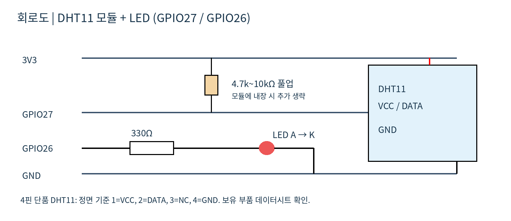

## Windows 11 Home 공통 실습 환경

학생 PC의 OS는 모두 **Windows 11 Home**을 기준으로 합니다. Arduino IDE 2.x, Python 3.13, 선택 MySQL Community Server 8.0.46/Workbench 8을 사용합니다.

1. ZIP 파일을 우클릭 → 모두 압축 풀기로 풉니다. ZIP 안에서 파일을 직접 실행하지 않습니다.
2. 파일 탐색기에서 `week12` 폴더를 열고 주소 표시줄에 `powershell`을 입력해 Enter를 누릅니다. 서버 실행은 일반 권한 PowerShell에서 진행합니다.
3. `py -3.13 --version`을 확인합니다. `py`가 없으면 `python --version`으로 3.13인지 확인하고, 맞을 때만 이후 명령의 `py -3.13`을 `python`으로 바꿉니다. 둘 다 실행되지 않으면 Python 설치와 실행 경로부터 확인합니다.
4. 장치 관리자의 포트(COM 및 LPT)에서 ESP32의 COM 번호를 확인합니다. 포트가 없으면 데이터 USB 케이블과 보드 USB-UART 칩에 맞는 드라이버를 확인합니다.
5. 신뢰하는 실습용 Wi-Fi에서는 설정 → 네트워크 및 인터넷 → Wi-Fi → 연결한 네트워크 속성에서 네트워크 프로필을 개인으로 설정합니다. 공용 Wi-Fi를 임의로 개인으로 바꾸지 않습니다.
6. PC 서버 방화벽 설정은 Windows 보안 → 방화벽 및 네트워크 보호에서 확인합니다. 아래 `New-NetFirewallRule` 명령은 Windows 11 Home에서도 사용할 수 있으며 관리자 PowerShell에서 한 번만 실행합니다. 일반 서버 실행에는 관리자 권한이 필요하지 않습니다. 관리자 계정이 없으면 교수자에게 해당 PC의 규칙 설정을 요청합니다.
7. 모바일은 `http://PC의_IPv4:8000`에 접속합니다. Windows Home이라는 이유로 별도 서버 OS가 필요한 실습은 아닙니다.

[Microsoft 방화벽 공식 안내](https://support.microsoft.com/en-gb/windows/security/windows-security/firewall-and-network-protection-in-the-windows-security-app)

# 12주차 무선통신(Wi-Fi)과 센서 원격 전송

## 1. 학습목표

- SSID, IP 주소, 포트, HTTP 요청·응답을 설명한다.
- ESP32를 AP 및 STA 모드로 동작시킨다.
- DHT11 온습도를 PC 서버로 주기 전송하고 모바일에서 확인한다.
- 웹 명령을 GPIO 출력으로 연결하고 센서값 저장 흐름을 설명한다.

## 2. 180분 운영

|시간|내용|완료 기준|
|---|---|---|
|0~25분|통신 기초·코드 키워드·부품 원리|AP/STA·GET/POST 구분|
|25~45분|환경·배선·스캔 예제|SSID/RSSI 확인|
|45~90분|워크북 1|모바일 온습도·LED 제어|
|90~100분|휴식·PC 네트워크 확인|PC IPv4 기록|
|100~155분|워크북 2|PC 수신·모바일 관제|
|155~170분|선택 MySQL 또는 장애 실험|저장/재연결 관찰|
|170~180분|평가·결과보고|증거 화면 제출|

## 3. 환경과 사전 준비

Windows 11 Home, Arduino IDE 2.x, ESP32 by Espressif Systems 3.3.2 (이번 검증 버전), 보드 ESP32 Dev Module, Python 3.13, 선택 MySQL Community Server 8.0.46/Workbench 8. 보드 패키지의 실제 설치 버전은 결과보고에 기록한다. 기본 UART 115200, 업로드 속도 문제 시 115200으로 낮춘다.

Arduino IDE 파일 → 기본 설정 → 추가 보드 관리자 URL에 다음 공식 stable 주소를 등록한다.

```text
https://espressif.github.io/arduino-esp32/package_esp32_index.json
```

도구 → 보드 관리자에서 esp32 by Espressif Systems 설치 → ESP32 Dev Module 선택 → 장치 관리자에서 COM 포트 확인. 라이브러리 관리자에서 DHT sensor library by Adafruit와 Adafruit Unified Sensor 설치. WiFi/WebServer/HTTPClient는 ESP32 패키지에 포함된다. 라이브러리 설치 시간은 수업 전에 확보하고, 각 PC에서 파일 → 예제 → DHT sensor library의 예제가 열리는지 확인한다.

## 4. 네트워크 통신 이론

Wi-Fi는 무선 LAN 연결 방식이며 인터넷 연결과 동일하지 않다. ESP32의 클래식 Wi-Fi는 2.4GHz 대역을 사용한다. AP는 접속을 받아 주고 STA는 AP에 접속한다. 워크북 1은 ESP32가 AP·HTTP 서버, 워크북 2는 ESP32가 STA·HTTP 클라이언트이다.

IP는 장치를 찾는 주소, 포트는 서비스를 찾는 번호다. `http://192.168.0.10:8000`에서 8000은 PC 수집 서버 포트이다. `127.0.0.1`과 `localhost`는 접속하는 장치 자신이므로 ESP32 설정에 PC 주소 대신 넣으면 안 된다. 같은 SSID라도 게스트 격리/AP isolation이 켜져 있으면 서로 통신하지 못할 수 있다.

|방식|용도|이번 자료에서의 위치|
|---|---|---|
|HTTP GET|측정값 조회·명령 조회|모바일 polling, ESP32 명령 polling|
|HTTP POST|센서값 업로드·상태 변경|PC 수신, LED 명령|
|SoftAP 직접 접속|공유기 없이 장치 설정·현장 제어|워크북 1|
|STA 공유기 접속|여러 장치와 서버를 하나의 LAN으로 연결|워크북 2|
|MQTT publish/subscribe|브로커를 통한 다수 장치 비동기 메시지|비교 학습, 구현은 다음 확장|
|WebSocket|지속 연결을 이용한 양방향 push|비교 학습, 본 예제는 HTTP polling|
|UDP|연결 설정이 가볍지만 전달 보장이 없는 전송|방송·탐색 개념 비교|

본 실습의 실시간은 약 2.5~3초 주기의 근실시간이다. LED 명령은 최대 수 초 후 반영되며 화면의 명령 접수는 물리 출력 성공 확인을 뜻하지 않는다. 센서 이상 시 유효하지 않은 값을 업로드하지 않고 PC 화면의 수신 경과 시간이 늘어난다.

## 5. 중요 코드·함수 미리 보기

|키워드/함수|설명|관찰할 점|
|---|---|---|
|WiFi.mode(WIFI_AP/STA)|무선 역할 선택|서버/클라이언트와 별개 계층|
|WiFi.scanNetworks(), RSSI()|주변 SSID·신호 세기 조회|dBm은 0에 가까울수록 강함|
|WiFi.softAP(), softAPIP()|ESP32 AP 생성·주소 확인|팀마다 SSID 변경|
|WiFi.begin(), status(), reconnect()|공유기 연결·상태·재시도|무한 while 대기 대신 주기 확인|
|WebServer.on(), handleClient()|URL 처리 등록·요청 처리|loop가 자주 돌아야 응답 가능|
|HTTPClient.begin(), POST(), GET(), end()|HTTP 요청 및 자원 반환|음수는 통신 실패, 201은 저장 수신 성공|
|millis(), unsigned long|경과 시간 기반 주기 실행|뺄셈으로 오버플로에 대응|
|dht.begin(), readTemperature(), readHumidity()|센서 초기화·측정|측정 간격 2.5초|
|isnan(), NAN|읽기 실패·아직 값 없음 표시|실패값을 0°C로 오해하지 않음|
|JSON, Content-Type|구조화 메시지·형식 선언|temperature/humidity는 숫자|
|pinMode(), digitalWrite()|GPIO26 출력·LED 상태 변경|부팅 직후 LOW|
|ThreadingHTTPServer, Lock|PC HTTP 처리·공유 자료 보호|CSV/최신값/명령 접근 동기화|
|SQL parameter %s|값을 SQL 문과 분리|문자열 이어 붙이기 대신 매개변수 사용|

## 6. 부품 동작원리·배선

DHT11은 내부 온도·습도 감지와 디지털 변환 회로가 측정값을 단일 데이터 선으로 제공한다. DATA는 I2C가 아니며 전용 타이밍 프로토콜을 라이브러리가 처리한다. LED는 순방향 전류에서 발광하며 330Ω 저항으로 전류를 제한한다. GPIO26의 3.3V 출력에서 빨간 LED 순방향 전압을 약 2V라 가정하면 전류는 약 (3.3−2)/330 = 4mA이다.

|준비 부품|수량|설명|
|---|---|---|
|ESP32 DevKitC V4 + 데이터 USB 케이블|각 1|USB 전원만 사용|
|DHT11 모듈|1|VCC/DATA/GND 라벨 확인|
|LED + 330Ω|각 1|A 긴 다리, K 짧은 다리|
|브레드보드·점퍼선|1세트|전원 레일 분리 구간 확인|
|4.7~10kΩ|조건부 1|단품/풀업 없는 모듈 DATA 풀업|

|ESP32 기능 핀|연결|공식 헤더 위치|
|---|---|---|
|3V3|DHT11 VCC|J2-1|
|GPIO27|DHT11 DATA|J2-11|
|GPIO26|330Ω → LED A|J2-10|
|GND|DHT11 GND, LED K|J2-14|

보완한 배선도는 38핀 보드와 브레드보드 구멍 좌표를 함께 표시한다. 실물 실크 인쇄와 공식 핀맵을 함께 확인한다. 3핀 모듈의 핀 순서는 제조사별로 다르다. DHT11 모듈은 3.3V 동작 지원 제품을 사용하고, 5V 전용 모듈은 그대로 연결하지 않는다. 단품은 데이터시트를 확인해 3.3V 동작 가능 여부와 풀업을 확인한다. GPIO에 5V를 입력하지 않는다. USB·5V 헤더·3V3 헤더로 동시에 전원을 넣지 않는다. 참고 블로그의 5V 핀에 12V를 넣는 설명은 따라 하지 않는다. 공식 가이드의 5V 기준을 따른다.



## 7. 평가문제와 정답

1. AP와 STA의 차이를 이번 두 실습에 대응하시오. 정답: 1은 ESP32 AP, 2는 공유기에 접속하는 STA.
2. 모바일에서 PC 서버에 접속할 주소는? ①localhost ②PC의 LAN IPv4:8000 ③MySQL 3306. 정답: ②.
3. 센서 데이터 업로드에 사용한 메서드와 성공 상태 코드는? 정답: POST, 201.
4. millis()가 있어도 HTTP가 지연되는 이유는? 정답: 요청은 동기식이며 연결·응답 대기 시간 동안 loop가 지연된다. 코드에는 제한 시간이 있다.
5. 게스트 Wi-Fi에서 같은 SSID인데 접속이 안 되는 이유 한 가지는? 정답: 클라이언트 격리.
6. 명령 접수와 실제 LED 상태 확인의 차이를 설명하시오. 정답: 서버에 원하는 값 저장과 ESP32의 명령 수신·GPIO 실행은 서로 다른 단계다.

## 8. 학습요약

센서 → ESP32 → HTTP → PC → 모바일 흐름과 모바일 → 서버 명령 → ESP32 GPIO 흐름을 구분한다. 연결이 안 되면 전원/배선, IP, Wi-Fi 대역·격리, 서버 실행, 포트·방화벽, HTTP 코드 순서로 확인한다.

## 참고

- https://docs.espressif.com/projects/esp-dev-kits/en/latest/esp32/esp32-devkitc/user_guide.html
- https://docs.espressif.com/projects/arduino-esp32/en/latest/api/wifi.html
- https://docs.espressif.com/projects/arduino-esp32/en/latest/installing.html
- https://github.com/adafruit/DHT-sensor-library
- https://machinejw.tistory.com/21 (보드 외형 참고, 전원·설치 정보는 공식 자료 우선)

## 실제 배선 그림


별도 physical_wiring.md의 좌표 표와 센서 단독 테스트부터 진행한다.
