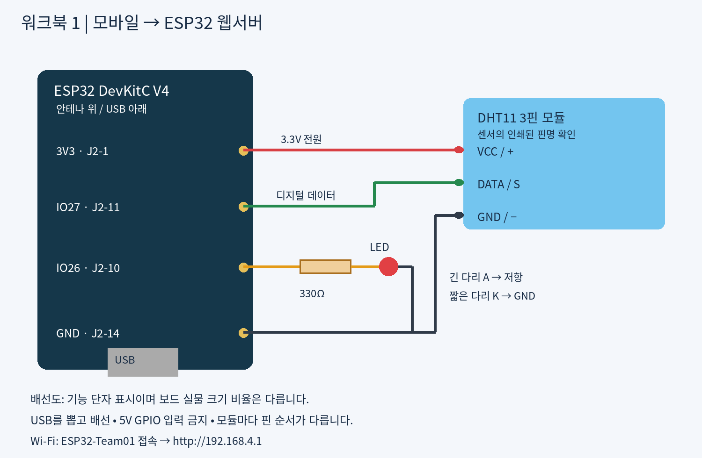

# 배선·센서 확인


USB를 뽑고 아래 그림대로 연결합니다. DHT11 핀 순서는 제품마다 다르므로 모듈의 VCC·DATA·GND 표시를 확인합니다.



|순서|연결|
|---|---|
|1|ESP32 GND → 상단 − 레일|
|2|ESP32 3V3 → 상단 + 레일|
|3|DHT11 VCC → a6, DATA → a7, GND → a8|
|4|상단 + 레일 → e6, 상단 − 레일 → e8|
|5|GPIO27 → e7|
|6|GPIO26 → a16|
|7|330Ω 저항 → e16과 e20 사이|
|8|LED 긴 다리(A) → b20, 짧은 다리(K) → b21|
|9|a21 → 상단 − 레일|

같은 번호의 a~e는 내부로 연결됩니다. 그림과 센서 핀 순서가 다르면 핀 이름에 맞춰 연결합니다. 풀업이 없는 센서는 DATA와 3V3 사이에 4.7~10kΩ을 추가합니다. 배선 확인 후 USB를 연결합니다.

## 2. 센서 확인하기

1. `firmware/00_dht_check/00_dht_check.ino`를 엽니다.
2. **확인(✓) → 업로드(→)**를 누릅니다.
3. 시리얼 모니터를 열고 `115200`을 선택합니다.
4. 아래처럼 온습도가 3회 나오면 다음 단계로 갑니다. 숫자는 달라도 됩니다.

```text
T=24.0 C, H=52.0 %
```

### 센서 확인 코드

```cpp
#include <DHT.h>
#include <math.h>
DHT dht(27, DHT11);
unsigned long lastSample = 0;
void setup() {
  Serial.begin(115200);
  dht.begin();
  Serial.println("DHT11 check: GPIO27, 3.3V, common GND");
}
void loop() {
  if (millis() - lastSample < 2500) return;
  lastSample = millis();
  float t = dht.readTemperature();
  float h = dht.readHumidity();
  if (isnan(t) || isnan(h)) {
    Serial.println("FAIL: check DHT type, DATA, power and pull-up");
    return;
  }
  Serial.printf("T=%.1f C, H=%.1f %%\n", t, h);
}
```

