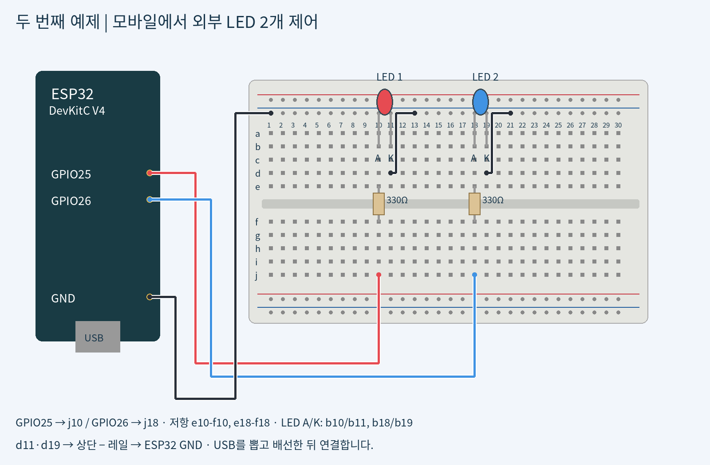

## 두 번째 예제 · Wi-Fi LED 2개 제어

휴대폰에서 LED 1·2를 각각 켜고 끕니다. DevKitC V4의 전원 LED 대신 **외부 LED 2개**를 연결합니다.

### 1. 회로 연결하기

1. USB를 뽑고 앞 실습의 센서·버튼 배선을 분리합니다.
2. LED 2개와 330Ω 저항 2개를 아래처럼 연결합니다.



|부품|연결|
|---|---|
|LED 1|GPIO25 → 330Ω → LED 긴 다리(A), 짧은 다리(K) → GND|
|LED 2|GPIO26 → 330Ω → LED 긴 다리(A), 짧은 다리(K) → GND|

그림의 좌표: LED A/K는 b10/b11과 b18/b19, 저항은 e10-f10과 e18-f18, GPIO25/26은 j10/j18에 연결합니다. d11·d19를 상단 − 레일에 연결하고 해당 레일을 ESP32 GND에 연결합니다.

3. 배선을 확인하고 USB를 꽂습니다.

### 2. 코드 업로드하기

1. 새 스케치를 열고 아래 전체 코드를 붙여넣습니다. 다운로드한 파일은 `firmware/00_wifi_two_led/00_wifi_two_led.ino`입니다.
2. `ESP32-LED-Team01`을 팀 이름으로 바꿉니다.
3. **ESP32 Dev Module → 해당 COM 포트**를 선택합니다.
4. 확인(✓) → 업로드(→)를 누릅니다.
5. 시리얼 모니터를 `115200`으로 열고 EN을 누릅니다. `IP address: 192.168.4.1`을 확인합니다.

```cpp
#include <WiFi.h>
#include <WebServer.h>

const char* WIFI_NAME = "ESP32-LED-Team01";
const char* WIFI_PASSWORD = "esp32wifi";
const uint8_t LED_PINS[2] = {25, 26};
bool ledOn[2] = {false, false};
WebServer server(80);

const char PAGE[] PROGMEM = R"HTML(
<!doctype html><html lang="ko">
<meta charset="utf-8">
<meta name="viewport" content="width=device-width,initial-scale=1">
<title>LED 2개 제어</title>
<style>
body{font:20px sans-serif;background:#eef4fa;padding:20px;max-width:600px;margin:auto}
section{background:white;padding:20px;margin:15px 0;border-radius:12px}
button{font:inherit;padding:15px;margin:5px}
</style>
<h1>ESP32 LED 제어</h1><p id="status">연결 중</p>
<section><h2>LED 1 · GPIO25</h2><p id="led1">확인 중</p>
<button onclick="setLed(1,1)">켜기</button>
<button onclick="setLed(1,0)">끄기</button></section>
<section><h2>LED 2 · GPIO26</h2><p id="led2">확인 중</p>
<button onclick="setLed(2,1)">켜기</button>
<button onclick="setLed(2,0)">끄기</button></section>
<script>
let busy = false;
async function refresh(){
  if(busy) return;
  busy = true;
  try{
    const r = await fetch('/state',{cache:'no-store'});
    if(!r.ok) throw new Error('state');
    const d = await r.json();
    document.getElementById('led1').textContent = d.led1 ? '켜짐' : '꺼짐';
    document.getElementById('led2').textContent = d.led2 ? '켜짐' : '꺼짐';
    document.getElementById('status').textContent = 'ESP32 연결됨';
  }catch(e){
    document.getElementById('status').textContent = 'Wi-Fi 연결 확인';
  }finally{busy = false;}
}
async function setLed(id,state){
  try{
    const r = await fetch('/led?id='+id+'&state='+state,{method:'POST'});
    if(!r.ok) throw new Error('command');
    await refresh();
  }catch(e){document.getElementById('status').textContent = '명령 전송 실패';}
}
setInterval(refresh,1000);
refresh();
</script></html>
)HTML";

void setup() {
  Serial.begin(115200);
  for (int i = 0; i < 2; i++) {
    pinMode(LED_PINS[i], OUTPUT);
    digitalWrite(LED_PINS[i], LOW);
  }
  WiFi.mode(WIFI_AP);
  if (!WiFi.softAP(WIFI_NAME, WIFI_PASSWORD)) {
    Serial.println("Wi-Fi start failed");
    return;
  }
  Serial.print("Wi-Fi name: ");
  Serial.println(WIFI_NAME);
  Serial.print("IP address: ");
  Serial.println(WiFi.softAPIP());

  server.on("/", HTTP_GET, []() {
    server.send(200, "text/html; charset=utf-8", PAGE);
  });
  server.on("/state", HTTP_GET, []() {
    String json = "{\"led1\":";
    json += ledOn[0] ? "true" : "false";
    json += ",\"led2\":";
    json += ledOn[1] ? "true" : "false";
    json += "}";
    server.sendHeader("Cache-Control", "no-store");
    server.send(200, "application/json", json);
  });
  server.on("/led", HTTP_POST, []() {
    String id = server.arg("id");
    String state = server.arg("state");
    if ((id != "1" && id != "2") ||
        (state != "0" && state != "1")) {
      server.send(400, "text/plain", "Invalid id or state");
      return;
    }
    int index = id.toInt() - 1;
    ledOn[index] = (state == "1");
    digitalWrite(LED_PINS[index], ledOn[index] ? HIGH : LOW);
    server.send(200, "text/plain", "OK");
  });
  server.begin();
}

void loop() {
  server.handleClient();
}
```

### 3. 휴대폰으로 접속하기

1. 휴대폰 Wi-Fi를 자신의 `ESP32-LED-Team01`에 연결합니다. Hello 예제의 Wi-Fi 이름과 다릅니다.
2. 암호 `esp32wifi`를 입력합니다. 인터넷 연결 없음이 나와도 연결을 유지합니다.
3. 브라우저에서 `http://192.168.4.1`을 엽니다.
4. **LED 1 켜기 → 끄기**를 눌러 첫 번째 LED를 확인합니다.
5. **LED 2 켜기 → 끄기**를 눌러 두 번째 LED를 확인합니다.
6. 두 LED를 모두 켠 뒤 하나씩 끕니다. 화면의 켜짐/꺼짐 표시와 실물이 같은지 확인합니다.

### 안 될 때

|증상|조치|
|---|---|
|페이지가 Hello World로 보임|LED 예제 업로드 확인, 새 Wi-Fi 이름에 접속 후 새로고침|
|화면은 바뀌는데 LED가 안 켜짐|GPIO25/26·LED 극성·330Ω·GND 확인|
|페이지가 안 열림|ESP32-LED Wi-Fi 연결과 http 주소 확인|

### 완료 확인

- [ ] LED 1만 켜기
- [ ] LED 2만 켜기
- [ ] 두 LED 함께 켜기·모두 끄기
- [ ] 화면 표시와 실물 상태 일치

