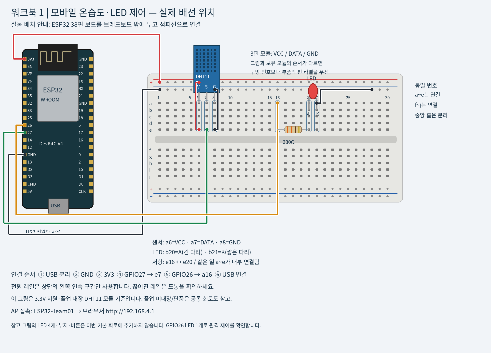
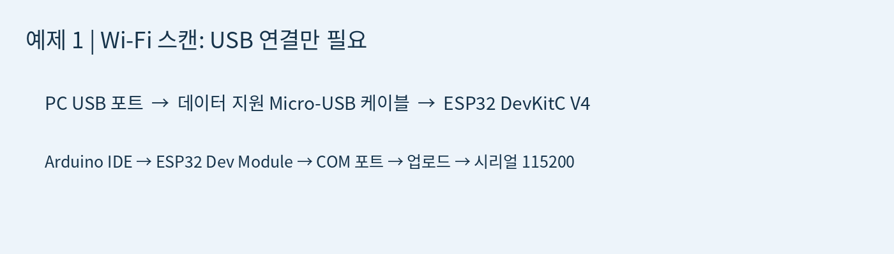

# 워크북 1 · 공유기 없이 모바일 온습도 모니터·LED 제어

예상 65분. 완료 목표: ESP32 AP에 모바일을 연결하고 센서값 3회 확인, LED 켜기·끄기 성공.



## 실제 배선 위치 따라하기

그림의 ESP32는 38핀 DevKitC V4이며 USB가 아래쪽입니다. 보드가 브레드보드 구멍을 가리지 않도록 바깥에 둡니다. 그림의 선이 지나가는 위치가 아닌 선 끝의 연결점을 꽂습니다. 3핀 DHT11은 그림의 VCC-DATA-GND 순서 제품 기준이며 보유 모듈의 인쇄 라벨이 우선입니다.

|순서|한쪽 끝|다른 쪽 끝|확인|
|---|---|---|---|
|1|ESP32 GND|상단 − 전원 레일 1번 구멍|공통 접지|
|2|ESP32 3V3|상단 + 전원 레일 1번 구멍|5V 핀 사용 금지|
|3|DHT11 VCC / DATA / GND|a6 / a7 / a8|모듈 순서가 다르면 라벨대로 재배치|
|4|상단 + 전원 레일 6번|e6|VCC에 3.3V|
|5|상단 − 전원 레일 8번|e8|센서 접지|
|6|ESP32 GPIO27|e7|센서 데이터|
|7|ESP32 GPIO26|a16|LED 출력 시작|
|8|330Ω 저항 양 끝|e16 / e20|열16과 열20 사이 연결|
|9|LED A(긴 다리) / K(짧은 다리)|b20 / b21|서로 다른 열에 꽂기|
|10|a21|상단 − 전원 레일 28번|LED 접지|

a~e의 같은 번호 열은 내부로 연결되어 있습니다. f~j는 별도이며 중앙 홈을 건너 연결되지 않습니다. 모듈을 뽑은 상태에서 멀티미터 도통으로 a6-e6 연결, a6-a7 분리를 확인하면 이해에 도움이 됩니다. 전원 레일에 중간 단절이 있는 브레드보드는 사용 구간 도통을 확인합니다.

## 0단계 · 네트워크보다 먼저 센서 확인 (10분)

1. 아래 실제 배선 위치 표대로 연결합니다. USB를 분리한 상태에서 배선하고 전원·GND를 다시 점검합니다.
2. Arduino IDE의 라이브러리 관리자에서 DHT sensor library 1.4.6 및 Adafruit Unified Sensor 1.1.15를 설치합니다. 보드 패키지는 검증에 사용한 ESP32 by Espressif Systems 3.3.2를 선택할 수 있습니다.
3. `firmware/00_dht_check/00_dht_check.ino`를 열고 ESP32 Dev Module·COM 포트를 선택합니다. 확인(컴파일) 후 업로드합니다.
4. 시리얼 모니터 115200에서 약 2.5초마다 `T=24.0 C, H=52.0 %` 형태의 값을 3회 확인합니다. 숫자는 환경에 따라 다릅니다.
5. `FAIL`이 나오면 네트워크 단계로 넘어가지 말고 DHT11/DHT22 종류, DATA=GPIO27, 3.3V 지원 여부, GND, 풀업을 먼저 확인합니다.

```cpp
#include <DHT.h>
#include <math.h>
DHT dht(27, DHT11);
unsigned long lastSample = 0;
void setup() {
  Serial.begin(115200);
  dht.begin();
  Serial.println("DHT11 check: GPIO27, 3.3V, common GND");
}
void loop() {
  if (millis() - lastSample < 2500) return;
  lastSample = millis();
  float t = dht.readTemperature();
  float h = dht.readHumidity();
  if (isnan(t) || isnan(h)) {
    Serial.println("FAIL: check DHT type, DATA, power and pull-up");
    return;
  }
  Serial.printf("T=%.1f C, H=%.1f %%\n", t, h);
}
```

통과 기준: 오류 문구 없이 온습도 숫자 3회 출력. 학생은 `isnan()`이 필요한 이유를 한 문장으로 작성합니다.

## 공통 연결 순서

1. USB를 뽑는다. ESP32 실크의 3V3, GND, 27, 26을 찾는다.
2. DHT11 VCC를 3V3, GND를 GND, DATA를 GPIO27에 연결한다. 모듈 핀 라벨 기준으로 연결한다.
3. GPIO26 → 330Ω → LED 긴 다리 A → LED 짧은 다리 K → GND 순서로 연결한다.
4. 풀업이 없는 DHT11에는 DATA와 3V3 사이 4.7~10kΩ을 추가한다.
5. 전원·GND 단락이 없는지 확인한 뒤 USB만 연결한다.

## 실습 결과 기록

|항목|학생 기록|
|---|---|
|학번/이름/팀| |
|보드·ESP32 패키지·라이브러리 버전| |
|사용 핀·모듈 핀 순서| |
|접속 주소·시리얼 로그| |
|측정값 3회(온도/습도/시각)| |
|LED 켜기·끄기 결과 및 지연| |
|발생 오류·원인·해결| |

배선 사진, 모바일 화면, 시리얼/서버 로그를 첨부한다. Wi-Fi 비밀번호가 보이는 화면은 제외한다.

## A. 예제 1 · 주변 Wi-Fi 검색



1. 외부 배선 없이 USB만 연결해도 실행 가능하다.
2. `firmware/01_scan/01_scan.ino`를 연다. 보드 ESP32 Dev Module, 해당 COM 포트를 선택한다.
3. 확인(체크) → 업로드 → 시리얼 모니터 115200 baud.
4. 리셋 EN을 눌러 SSID와 RSSI 목록을 확인한다. 가장 강한 신호와 가장 약한 신호를 기록한다.
5. 아무것도 검색되지 않으면 주변에 2.4GHz AP가 있는지 확인한다.

## B. 예제 2 · ESP32 자체 웹서버

1. 위 공통 배선을 완료한다.
2. `firmware/02_mobile_ap/02_mobile_ap.ino`를 연다.
3. `ESP32-Team01`을 팀 고유 이름으로 바꾼다. 암호 `esp32wifi`는 8자 이상이다.
4. 업로드 후 시리얼에서 AP IP를 확인한다. 기본 설정에서는 192.168.4.1이다.
5. 모바일 Wi-Fi 설정 → 해당 SSID → 암호 입력. 인터넷 연결 없음 안내가 나와도 이 Wi-Fi 연결을 유지한다.
6. 모바일 브라우저에 `http://192.168.4.1`을 직접 입력한다. HTTPS가 아니다.
7. 최초 약 2.5초 뒤 값이 표시된다. 센서에 손을 가까이해 3회 변화를 기록한다. 물을 직접 묻히지 않는다.
8. LED 켜기/끄기를 각각 눌러 실물 점등을 확인한다.
9. `/data` 주소를 열어 JSON과 화면 숫자가 같은지 확인한다.

## 코드 읽기 포인트

`server.on`은 URL과 동작을 연결한다. `/`는 화면, `/data`는 센서 JSON, `/led`는 POST 상태 변경이다. `loop()`는 HTTP 요청을 처리하고 2.5초마다 센서를 읽는다. 페이지의 JavaScript는 같은 장치에 GET을 반복하므로 별도 앱 설치가 필요 없다.

## 고장 찾기와 과제

- SSID가 안 보임: 전원·업로드·EN 재시작 확인. 스캔 스케치가 아니라 AP 스케치인지 확인.
- 페이지 안 열림: 모바일이 해당 ESP32 Wi-Fi를 유지하는지 확인. 자동으로 모바일 데이터로 전환되면 잠시 모바일 데이터를 끄고 재시험.
- 값 없음/읽기 실패: DATA 핀·전원·GND·DHT11 종류·풀업 확인. 충분히 기다린 뒤 재시험.
- LED 반응 없음: 26번 핀·극성·저항·GND 확인. 보드 내장 LED와 외부 LED를 구별한다.
- 도전 과제: 화면에 팀명과 온도 28°C 이상 경고 문구를 추가한다. 코드에서 바꾼 부분을 설명한다.

## 통과 체크

- [ ] SSID/RSSI 기록
- [ ] 모듈 핀 라벨을 확인한 배선 사진
- [ ] 모바일에 온습도 3회 표시
- [ ] LED 켜기/끄기 실제 확인
- [ ] AP와 서버 역할을 설명

## 전체 코드 · firmware/01_scan/01_scan.ino

```cpp
#include <WiFi.h>
void setup() {
  Serial.begin(115200);
  WiFi.mode(WIFI_STA);
  WiFi.disconnect();
  delay(100);
  int n = WiFi.scanNetworks();
  for (int i = 0; i < n; i++) {
    Serial.printf("%d: %s (%d dBm)\n", i + 1,
                  WiFi.SSID(i).c_str(), WiFi.RSSI(i));
  }
  WiFi.scanDelete();
}
void loop() { delay(10); }
```

## 전체 코드 · firmware/02_mobile_ap/02_mobile_ap.ino

```cpp
#include <WiFi.h>
#include <DHT.h>
#include <math.h>
const char* DEVICE_ID = "team01";
DHT dht(27, DHT11);
const int LED_PIN = 26;
float temperature = NAN, humidity = NAN;
unsigned long lastRead = 0;
void sampleSensor() {
  if (millis() - lastRead < 2500) return;
  lastRead = millis();
  temperature = dht.readTemperature();
  humidity = dht.readHumidity();
}
String sensorJson() {
  if (isnan(temperature) || isnan(humidity)) return "{\"valid\":false}";
  return String("{\"valid\":true,\"device\":\"") + DEVICE_ID +
    "\",\"temperature\":" +
    String(temperature, 1) + ",\"humidity\":" + String(humidity, 1) + "}";
}
#include <WebServer.h>
WebServer server(80);
const char PAGE[] PROGMEM = R"HTML(
<!doctype html><html lang="ko"><meta charset="utf-8">
<meta name="viewport" content="width=device-width,initial-scale=1">
<title>ESP32 센서</title><h1>온습도 모니터</h1>
<pre id="out">센서 준비 중</pre>
<button onclick="led(1)">LED 켜기</button>
<button onclick="led(0)">LED 끄기</button>
<script>
async function led(v){await fetch('/led?state='+v,{method:'POST'});}
async function poll(){try{let d=await(await fetch('/data')).json();
document.getElementById('out').textContent=d.valid?
`온도 ${d.temperature} °C / 습도 ${d.humidity} %`:'센서 읽기 실패 또는 준비 중';
}catch(e){document.getElementById('out').textContent='연결 확인';}}
setInterval(poll,2500);poll();</script></html>
)HTML";
void setup() {
  Serial.begin(115200);
  pinMode(LED_PIN, OUTPUT);
  digitalWrite(LED_PIN, LOW);
  dht.begin();
  WiFi.mode(WIFI_AP);
  if (!WiFi.softAP("ESP32-Team01", "esp32wifi")) {
    Serial.println("AP start failed");
  }
  Serial.print("AP IP: ");
  Serial.println(WiFi.softAPIP());
  server.on("/", HTTP_GET, [](){server.send(200,"text/html; charset=utf-8",PAGE);});
  server.on("/data", HTTP_GET, [](){server.send(200,"application/json",sensorJson());});
  server.on("/led", HTTP_POST, [](){
    String v = server.arg("state");
    if (v != "0" && v != "1") {server.send(400,"text/plain","bad state");return;}
    digitalWrite(LED_PIN, v == "1" ? HIGH : LOW);
    server.send(200,"text/plain","OK");
  });
  server.begin();
}
void loop() {
  server.handleClient();
  sampleSensor();
}
```

## 검증 보완 결과

Arduino-ESP32 3.3.2, DHT 1.4.6에서 예제 4종 ESP32 타깃 컴파일을 통과했습니다. PC 서버 테스트 5종과 JavaScript 구문 검사도 통과했습니다. 실물 Wi-Fi·센서·MySQL은 현장 확인이 필요합니다. 상세 로그는 verification 폴더, 검토는 docs/learning_review.md를 참고합니다.
