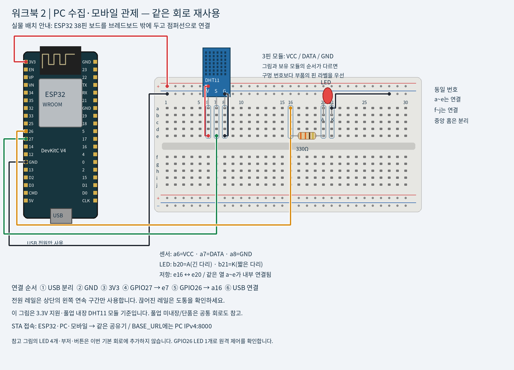

## Windows 11 Home 공통 실습 환경

학생 PC의 OS는 모두 **Windows 11 Home**을 기준으로 합니다. Arduino IDE 2.x, Python 3.13, 선택 MySQL Community Server 8.0.46/Workbench 8을 사용합니다.

1. ZIP 파일을 우클릭 → 모두 압축 풀기로 풉니다. ZIP 안에서 파일을 직접 실행하지 않습니다.
2. 파일 탐색기에서 `week12` 폴더를 열고 주소 표시줄에 `powershell`을 입력해 Enter를 누릅니다. 서버 실행은 일반 권한 PowerShell에서 진행합니다.
3. `py -3.13 --version`을 확인합니다. `py`가 없으면 `python --version`으로 3.13인지 확인하고, 맞을 때만 이후 명령의 `py -3.13`을 `python`으로 바꿉니다. 둘 다 실행되지 않으면 Python 설치와 실행 경로부터 확인합니다.
4. 장치 관리자의 포트(COM 및 LPT)에서 ESP32의 COM 번호를 확인합니다. 포트가 없으면 데이터 USB 케이블과 보드 USB-UART 칩에 맞는 드라이버를 확인합니다.
5. 신뢰하는 실습용 Wi-Fi에서는 설정 → 네트워크 및 인터넷 → Wi-Fi → 연결한 네트워크 속성에서 네트워크 프로필을 개인으로 설정합니다. 공용 Wi-Fi를 임의로 개인으로 바꾸지 않습니다.
6. PC 서버 방화벽 설정은 Windows 보안 → 방화벽 및 네트워크 보호에서 확인합니다. 아래 `New-NetFirewallRule` 명령은 Windows 11 Home에서도 사용할 수 있으며 관리자 PowerShell에서 한 번만 실행합니다. 일반 서버 실행에는 관리자 권한이 필요하지 않습니다. 관리자 계정이 없으면 교수자에게 해당 PC의 규칙 설정을 요청합니다.
7. 모바일은 `http://PC의_IPv4:8000`에 접속합니다. Windows Home이라는 이유로 별도 서버 OS가 필요한 실습은 아닙니다.

[Microsoft 방화벽 공식 안내](https://support.microsoft.com/en-gb/windows/security/windows-security/firewall-and-network-protection-in-the-windows-security-app)

# 워크북 2 · PC 실시간 수집·모바일 관제·선택 MySQL

예상 70분 + 선택 확장. 완료 목표: HTTP POST 수신, CSV 저장, 모바일 조회 및 LED 명령 적용.



## 실제 배선 위치 따라하기

그림의 ESP32는 38핀 DevKitC V4이며 USB가 아래쪽입니다. 보드가 브레드보드 구멍을 가리지 않도록 바깥에 둡니다. 그림의 선이 지나가는 위치가 아닌 선 끝의 연결점을 꽂습니다. 3핀 DHT11은 그림의 VCC-DATA-GND 순서 제품 기준이며 보유 모듈의 인쇄 라벨이 우선입니다.

|순서|한쪽 끝|다른 쪽 끝|확인|
|---|---|---|---|
|1|ESP32 GND|상단 − 전원 레일 1번 구멍|공통 접지|
|2|ESP32 3V3|상단 + 전원 레일 1번 구멍|5V 핀 사용 금지|
|3|DHT11 VCC / DATA / GND|a6 / a7 / a8|모듈 순서가 다르면 라벨대로 재배치|
|4|상단 + 전원 레일 6번|e6|VCC에 3.3V|
|5|상단 − 전원 레일 8번|e8|센서 접지|
|6|ESP32 GPIO27|e7|센서 데이터|
|7|ESP32 GPIO26|a16|LED 출력 시작|
|8|330Ω 저항 양 끝|e16 / e20|열16과 열20 사이 연결|
|9|LED A(긴 다리) / K(짧은 다리)|b20 / b21|서로 다른 열에 꽂기|
|10|a21|상단 − 전원 레일 28번|LED 접지|

a~e의 같은 번호 열은 내부로 연결되어 있습니다. f~j는 별도이며 중앙 홈을 건너 연결되지 않습니다. 모듈을 뽑은 상태에서 멀티미터 도통으로 a6-e6 연결, a6-a7 분리를 확인하면 이해에 도움이 됩니다. 전원 레일에 중간 단절이 있는 브레드보드는 사용 구간 도통을 확인합니다.

## 단계별 통과 기준

워크북 1의 센서 단독 확인이 성공한 회로를 그대로 사용합니다. 펌웨어를 PC 전송용으로 교체하므로 모바일은 ESP32-Team01에서 나와 PC와 같은 공유기 Wi-Fi에 접속해야 합니다.

|단계|실행|정상 결과|실패하면|
|---|---|---|---|
|1|PC 서버·샘플 재생|PC 화면에 team01 샘플값|Python·폴더 경로 확인|
|2|모바일에서 PC 주소 접속|수신 대기 또는 샘플값|방화벽·LAN 주소 확인|
|3|ESP32 펌웨어 업로드|STA IP와 POST: 201|SSID·암호·BASE_URL 확인|
|4|LED 명령|3초 안팎 후 실물 변화|DEVICE_ID·GPIO26 확인|
|5|선택 DB|SELECT에 새 행|계정·테이블·503 로그 확인|

전송 본문 예시는 아래와 같습니다. 서버가 받은 시각을 추가하므로 장치 시계 동기화는 필요 없습니다.

```json
{"valid":true,"device":"team01","temperature":24.0,"humidity":52.0}
```

`POST: 201`은 서버 수신·저장 처리 성공을 뜻합니다. PC의 샘플값을 본 것과 실제 ESP32의 측정값을 본 것을 구별하려면 샘플 재생 종료 후 서버 재시작 → 손을 센서 가까이 가져가기 → 수신값 변화·시리얼 로그·CSV 새 행을 함께 확인합니다.

## 공통 연결 순서

1. USB를 뽑는다. ESP32 실크의 3V3, GND, 27, 26을 찾는다.
2. DHT11 VCC를 3V3, GND를 GND, DATA를 GPIO27에 연결한다. 모듈 핀 라벨 기준으로 연결한다.
3. GPIO26 → 330Ω → LED 긴 다리 A → LED 짧은 다리 K → GND 순서로 연결한다.
4. 풀업이 없는 DHT11에는 DATA와 3V3 사이 4.7~10kΩ을 추가한다.
5. 전원·GND 단락이 없는지 확인한 뒤 USB만 연결한다.

## 실습 결과 기록

|항목|학생 기록|
|---|---|
|학번/이름/팀| |
|보드·ESP32 패키지·라이브러리 버전| |
|사용 핀·모듈 핀 순서| |
|접속 주소·시리얼 로그| |
|측정값 3회(온도/습도/시각)| |
|LED 켜기·끄기 결과 및 지연| |
|발생 오류·원인·해결| |

배선 사진, 모바일 화면, 시리얼/서버 로그를 첨부한다. Wi-Fi 비밀번호가 보이는 화면은 제외한다.

## A. PC 서버 준비 (Windows PowerShell)

1. 배포 ZIP을 `C:\embedded12`처럼 한글·공백 없는 폴더에 풀고 week12 폴더를 찾는다.
2. PowerShell을 week12 폴더에서 연다. Python 설치 시 Python 3.13과 PATH 등록을 확인한다.

```powershell
py -3.13 --version
py -3.13 server/server.py
```

3. PC 브라우저에서 `http://127.0.0.1:8000`을 열면 수신 대기가 보인다.
4. 별도 PowerShell을 같은 폴더에서 열어 미리 제공한 CSV를 재생한다. 인터넷 다운로드가 없다.

```powershell
py -3.13 server/replay.py
```

5. 화면 team01에 샘플값이 나타나고 `server/received.csv`가 생기는지 확인한다. 이것은 모의 데이터다. 실측 시험 전 서버를 종료하고 received.csv를 다른 이름으로 보관한 뒤 서버를 재시작한다.
6. `ipconfig`에서 Wi-Fi 어댑터의 IPv4·서브넷 마스크를 기록한다. 가상머신·VPN 어댑터 주소를 사용하지 않는다.
7. 모바일·PC·ESP32를 같은 공유기 LAN에 연결한다. ESP32는 2.4GHz SSID 사용. 게스트 격리는 해제된 실습용 네트워크를 사용한다.
8. Windows 방화벽 알림은 신뢰하는 사설 실습 네트워크에만 허용한다. 필요하면 관리자 PowerShell에서 아래 규칙을 추가한다. 방화벽 전체를 끄지 않는다.

```powershell
New-NetFirewallRule -DisplayName "Embedded12 HTTP" -Direction Inbound -Action Allow -Protocol TCP -LocalPort 8000 -Profile Private -RemoteAddress LocalSubnet
```

9. 모바일에서 `http://PC의_IPv4:8000`을 열어 화면 접속을 확인한다. 같은 LAN이라도 모바일 AP/핫스팟 종류에 따라 단말 간 통신이 차단될 수 있다.

## B. ESP32에서 실측 데이터 전송

1. `firmware/03_pc_client/03_pc_client.ino`를 연다.
2. SSID/PASSWORD를 실제 2.4GHz 공유기 정보로 바꾼다. BASE_URL의 IPv4를 위에서 확인한 PC 주소로 바꾼다.
3. 여러 팀은 상단의 `DEVICE_ID = "team01"` 한 곳을 팀 ID로 변경한다. 모바일 장치 칸에도 동일 ID를 입력한다.
4. 업로드 후 시리얼 115200으로 `POST: 201`을 확인한다. 음수는 연결 오류, 503은 저장 오류이다.
5. PC 터미널에 POST 요청이 3초마다 보이는지 확인한다. 모바일에서 온습도·수신 시각·경과 시간을 확인한다. 시각은 UTC이고 한국 시간은 +9시간이다.
6. 모바일 LED 버튼을 누른다. ESP32가 약 3초 주기로 명령을 조회하므로 잠시 기다린 후 실물을 확인한다.
7. 서버를 정지했다가 재실행해 재전송을 확인한다. 실패 중 데이터는 버퍼링하지 않아 해당 구간은 누락된다. 최신 화면 값·명령은 재시작 때 초기화되며 CSV 기록은 남는다.
8. USB를 분리하면 화면의 경과 시간이 10초 이상 증가하는지 확인한다. 오래된 데이터와 현재 측정값을 구별한다.

## C. 선택 확장 · MySQL Community Server 8.0.46

ESP32는 HTTP로 PC 서버에 전송하고 PC 서버가 MySQL에 저장한다. ESP32·모바일에 DB 암호를 넣지 않는다. DB가 같은 PC면 127.0.0.1을 사용하므로 MySQL의 외부 포트를 열 필요가 없다.

1. Workbench에서 기존 root 계정으로 연결한다(사용자 실습 암호는 1234). `server/schema.sql`을 열어 전체 실행한다.
2. PC 서버를 Ctrl+C로 멈춘다.
3. 선택 확장을 위한 드라이버를 수업 전에 설치한다. 기본 워크북에는 이 다운로드가 필요 없다.

```powershell
py -3.13 -m pip install mysql-connector-python
$env:MYSQL_ENABLED="1"
$env:MYSQL_HOST="127.0.0.1"
$env:MYSQL_USER="root"
$env:MYSQL_PASSWORD=Read-Host "MySQL 실습 암호"
py -3.13 server/server.py
```

4. 센서 전송 후 Workbench에서 아래 쿼리를 실행해 새 행을 확인한다.

```sql
USE embedded12;
SELECT * FROM readings ORDER BY id DESC LIMIT 20;
```

5. DB가 별도 PC라면 MYSQL_HOST에 DB PC의 LAN IPv4를 지정하고, 그 PC 관리자가 수집 서버 PC에서 접속 가능한 전용 계정·3306 사설망 규칙을 설정해야 한다. root의 원격 접속을 열어 두는 방식은 사용하지 않는다. 같은 Wi-Fi만으로 DB 접근 권한이 생기지 않는다.
6. 확장을 끝내면 서버를 멈추고 `Remove-Item Env:MYSQL_PASSWORD`, `Remove-Item Env:MYSQL_ENABLED`로 현재 PowerShell 값을 지운다. DB 중단 시 503 응답을 확인한 뒤 복구한다.

## 장애 실험·과제

|증상|확인 순서|
|---|---|
|POST 음수|PC IP/포트 → 서버 실행 → 사설 방화벽 → Wi-Fi 격리|
|POST 400|JSON 필드·숫자·장치 ID 확인|
|POST 503|DB 연결·테이블·CSV 쓰기 권한 확인|
|모바일만 접속 실패|localhost 사용 여부·모바일 Wi-Fi·서버 주소 확인|
|다른 팀 값 표시|코드 두 곳과 화면의 device ID 일치 확인|
|값 갱신 중단|센서 실패·무선 연결·시리얼·수신 경과 확인|

과제: ① ESP32와 PC의 역할을 네트워크도에 표시한다. ② 10개 이상 실측 수신 기록을 제출한다. ③ LED 명령 지연을 3회 측정한다. ④ Wi-Fi 재연결 중 누락 데이터 처리 방안을 3문장으로 제안한다.

## 통과 체크

- [ ] 샘플 재생 후 실측과 구별
- [ ] 시리얼 POST 201과 CSV 새 행
- [ ] 모바일의 실측 온습도 표시
- [ ] LED 켜기·끄기 확인
- [ ] 서버 중단·센서 분리 실험 기록
- [ ] 선택: MySQL 새 행과 쿼리 결과

이 서버는 인증 없는 사설 LAN 수업용이다. 공유기 포트포워딩으로 외부에 공개하지 않는다.

## 전체 코드 · firmware/03_pc_client/03_pc_client.ino

```cpp
#include <WiFi.h>
#include <DHT.h>
#include <math.h>
const char* DEVICE_ID = "team01";
DHT dht(27, DHT11);
const int LED_PIN = 26;
float temperature = NAN, humidity = NAN;
unsigned long lastRead = 0;
void sampleSensor() {
  if (millis() - lastRead < 2500) return;
  lastRead = millis();
  temperature = dht.readTemperature();
  humidity = dht.readHumidity();
}
String sensorJson() {
  if (isnan(temperature) || isnan(humidity)) return "{\"valid\":false}";
  return String("{\"valid\":true,\"device\":\"") + DEVICE_ID +
    "\",\"temperature\":" +
    String(temperature, 1) + ",\"humidity\":" + String(humidity, 1) + "}";
}
#include <HTTPClient.h>
const char* SSID = "YOUR_2G_WIFI";
const char* PASSWORD = "YOUR_WIFI_PASSWORD";
const char* BASE_URL = "http://192.168.0.10:8000"; // PC IPv4로 수정
unsigned long lastSend = 0, lastReconnect = 0;
bool wasConnected = false;
void setup() {
  Serial.begin(115200);
  pinMode(LED_PIN, OUTPUT);
  digitalWrite(LED_PIN, LOW);
  dht.begin();
  WiFi.mode(WIFI_STA);
  WiFi.begin(SSID, PASSWORD);
  Serial.println("Connecting to Wi-Fi...");
}
void loop() {
  sampleSensor();
  if (WiFi.status() != WL_CONNECTED) {
    wasConnected = false;
    if (millis() - lastReconnect >= 10000) {
      lastReconnect = millis();
      Serial.println("Wi-Fi disconnected; retrying...");
      WiFi.reconnect();
    }
    return;
  }
  if (!wasConnected) {
    wasConnected = true;
    Serial.print("STA IP: ");
    Serial.println(WiFi.localIP());
  }
  if (millis() - lastSend < 3000) return;
  lastSend = millis();
  WiFiClient client;
  HTTPClient http;
  http.setConnectTimeout(1000);
  http.setTimeout(1000);
  if (!isnan(temperature) && !isnan(humidity)) {
    http.begin(client, String(BASE_URL) + "/api/readings");
    http.addHeader("Content-Type", "application/json");
    int code = http.POST(sensorJson());
    Serial.printf("POST: %d\n", code);
    http.end();
  } else {
    Serial.println("DHT read failed: check power/DATA/pull-up");
  }
  http.begin(client, String(BASE_URL) + "/api/led?device=" + DEVICE_ID);
  int code = http.GET();
  if (code == 200) {
    String body = http.getString();
    body.trim();
    if (body == "0" || body == "1") digitalWrite(LED_PIN, body == "1" ? HIGH : LOW);
  }
  http.end();
}
```

## 전체 코드 · server/server.py

```python
"""Python 3.13 stdlib LAN teaching server; optional MySQL via environment."""
from http.server import BaseHTTPRequestHandler, ThreadingHTTPServer
from urllib.parse import urlparse, parse_qs
from pathlib import Path
from datetime import datetime, timezone
import json, math, os, re, threading, time, csv
ROOT = Path(__file__).resolve().parent
LOCK = threading.Lock()
LATEST, COMMANDS = {}, {}

def device_id(value):
    if not isinstance(value, str) or not re.fullmatch(r"[A-Za-z0-9_-]{1,32}", value):
        raise ValueError("invalid device")
    return value

def save_reading(data):
    device = device_id(data.get("device"))
    t, h = data.get("temperature"), data.get("humidity")
    if any(isinstance(v, bool) or not isinstance(v, (int, float)) or not math.isfinite(v) for v in (t, h)):
        raise ValueError("finite numeric values required")
    if not -40 <= t <= 80 or not 0 <= h <= 100:
        raise ValueError("out of range")
    now = datetime.now(timezone.utc).isoformat()
    row = dict(device=device, temperature=t, humidity=h, received_at=now)
    # Optional persistence must succeed before reporting success.
    if os.getenv("MYSQL_ENABLED") == "1":
        import mysql.connector
        conn = mysql.connector.connect(host=os.getenv("MYSQL_HOST", "127.0.0.1"),
            user=os.getenv("MYSQL_USER", "root"), password=os.environ["MYSQL_PASSWORD"],
            database="embedded12", connection_timeout=3)
        try:
            cur = conn.cursor()
            cur.execute("INSERT INTO readings(device,temperature,humidity) VALUES (%s,%s,%s)", (device,t,h))
            conn.commit()
            cur.close()
        finally:
            conn.close()
    with LOCK:
        path = ROOT / "received.csv"
        new = not path.exists()
        with path.open("a", newline="", encoding="utf-8") as f:
            writer = csv.DictWriter(f, fieldnames=list(row))
            if new: writer.writeheader()
            writer.writerow(row)
        LATEST[device] = (row, time.time())
    return row

class Handler(BaseHTTPRequestHandler):
    def reply(self, code, data, mime="application/json"):
        body = data.encode("utf-8") if isinstance(data, str) else json.dumps(data, ensure_ascii=False).encode("utf-8")
        self.send_response(code)
        self.send_header("Content-Type", mime + "; charset=utf-8")
        self.send_header("Content-Length", str(len(body)))
        self.send_header("Cache-Control", "no-store")
        self.end_headers()
        self.wfile.write(body)

    def do_GET(self):
        u = urlparse(self.path)
        if u.path == "/":
            return self.reply(200, (ROOT / "dashboard.html").read_text(encoding="utf-8"), "text/html")
        if u.path not in ("/api/latest", "/api/led"):
            return self.reply(404, {"error":"not found"})
        try:
            device = device_id(parse_qs(u.query).get("device", ["team01"])[0])
        except ValueError as e:
            return self.reply(400, {"error":str(e)})
        with LOCK:
            if u.path == "/api/led":
                return self.reply(200, str(COMMANDS.get(device, 0)), "text/plain")
            row, stamp = LATEST.get(device, ({}, time.time()))
            result = dict(row, age_seconds=round(time.time()-stamp,1))
        self.reply(200, result)

    def do_POST(self):
        try:
            length = int(self.headers.get("Content-Length", "0"))
            if not 0 < length <= 2048:
                return self.reply(413, {"error":"body size"})
            data = json.loads(self.rfile.read(length))
            if not isinstance(data, dict): raise ValueError("object required")
            path = urlparse(self.path).path
            if path == "/api/readings":
                return self.reply(201, save_reading(data))
            if path == "/api/led":
                device = device_id(data.get("device"))
                state = data.get("state")
                if type(state) is not int or state not in (0,1): raise ValueError("state must be 0 or 1")
                with LOCK: COMMANDS[device] = state
                return self.reply(200, {"accepted":state})
            self.reply(404, {"error":"not found"})
        except (ValueError, UnicodeError) as e:
            self.reply(400, {"error":str(e)})
        except Exception:
            self.reply(503, {"error":"storage unavailable; inspect server configuration"})

if __name__ == "__main__":
    print("LAN teaching server: http://<PC IPv4>:8000 (Ctrl+C stops)")
    ThreadingHTTPServer(("0.0.0.0", 8000), Handler).serve_forever()
```

## 전체 코드 · server/dashboard.html

```html
<!doctype html><html lang="ko"><meta charset="utf-8">
<meta name="viewport" content="width=device-width,initial-scale=1">
<title>12주차 IoT 관제</title><style>body{font:18px sans-serif;max-width:700px;margin:30px auto;padding:20px;background:#eef5fb}button,input{font:inherit;padding:12px}pre{white-space:pre-wrap;background:white;padding:20px}</style>
<h1>ESP32 원격 온습도 관제</h1><label>장치 <input id="device" value="team01"></label>
<pre id="out">수신 대기</pre><button onclick="led(1)">LED 켜기</button> <button onclick="led(0)">LED 끄기</button>
<p id="cmd">명령은 다음 폴링 때 적용됩니다. 실제 점등을 확인하세요.</p>
<script>
async function led(state){let r=await fetch('/api/led',{method:'POST',headers:{'Content-Type':'application/json'},body:JSON.stringify({device:document.getElementById('device').value,state})});document.getElementById('cmd').textContent=r.ok?'명령 접수: 실제 LED를 확인하세요':'명령 오류';}
async function poll(){try{let d=await(await fetch('/api/latest?device='+encodeURIComponent(document.getElementById('device').value))).json();document.getElementById('out').textContent=d.temperature===undefined?'아직 수신값 없음':`온도 ${d.temperature} °C\n습도 ${d.humidity} %\n수신 ${d.received_at}\n경과 ${d.age_seconds}초 (10초 초과 시 연결 확인)`;}catch(e){document.getElementById('out').textContent='서버 연결 실패';}}
setInterval(poll,2500);poll();</script></html>
```

## 전체 코드 · server/replay.py

```python
"""센서 없이 PC 서버 수신을 검증하는 사전 제공 데이터 재생."""
import csv, json, time, urllib.request
from pathlib import Path
for row in csv.DictReader((Path(__file__).resolve().parent.parent / "data/sample_readings.csv").open()):
    row["temperature"] = float(row["temperature"])
    row["humidity"] = float(row["humidity"])
    req = urllib.request.Request("http://127.0.0.1:8000/api/readings",
        data=json.dumps(row).encode(), headers={"Content-Type":"application/json"})
    with urllib.request.urlopen(req, timeout=3) as response:
        print(response.status, response.read().decode())
    time.sleep(3)
```

## 전체 코드 · server/schema.sql

```sql
CREATE DATABASE IF NOT EXISTS embedded12 CHARACTER SET utf8mb4;
USE embedded12;
CREATE TABLE IF NOT EXISTS readings (
 id BIGINT PRIMARY KEY AUTO_INCREMENT,
 device VARCHAR(32) NOT NULL,
 temperature DOUBLE NOT NULL,
 humidity DOUBLE NOT NULL,
 received_at TIMESTAMP DEFAULT CURRENT_TIMESTAMP
);
SELECT * FROM readings ORDER BY id DESC LIMIT 20;
```

## 검증 보완 결과

Arduino-ESP32 3.3.2, DHT 1.4.6에서 예제 4종 ESP32 타깃 컴파일을 통과했습니다. PC 서버 테스트 5종과 JavaScript 구문 검사도 통과했습니다. 실물 Wi-Fi·센서·MySQL은 현장 확인이 필요합니다. 상세 로그는 verification 폴더, 검토는 docs/learning_review.md를 참고합니다.
