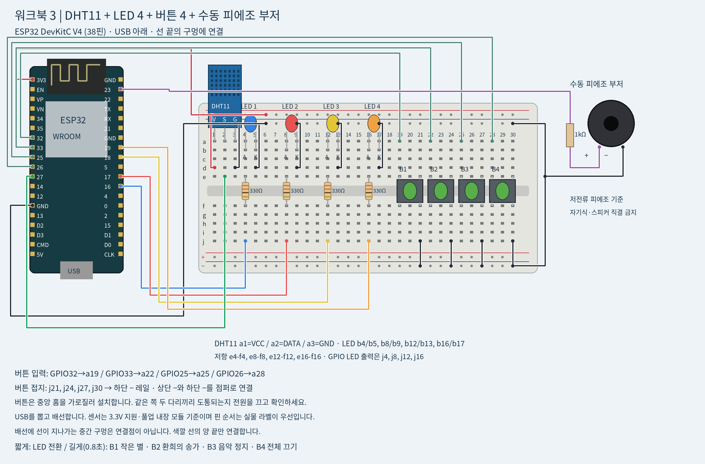
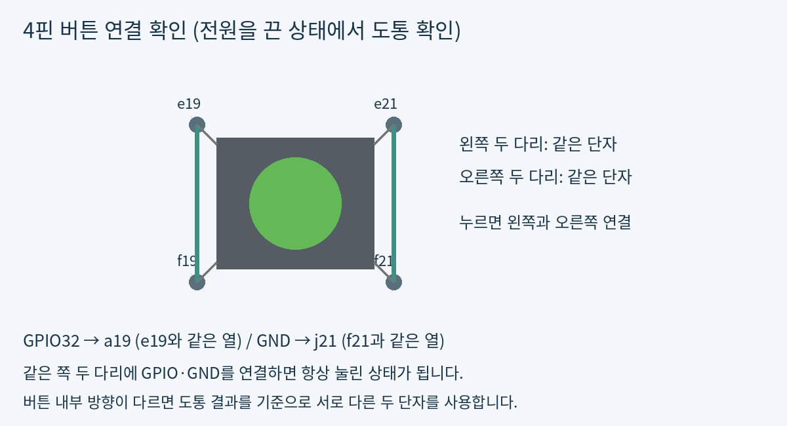

# 워크북 3 · Wi-Fi IoT 통합 제어판

휴대폰과 버튼으로 LED 4개를 제어하고, 멜로디 2곡을 재생합니다. 온습도도 같은 화면에서 확인합니다.

## 1. 준비물

|부품|수량|
|---|---|
|ESP32 DevKitC V4·데이터 USB 케이블|각 1|
|DHT11 모듈(3.3V 지원)|1|
|LED·330Ω 저항|각 4|
|푸시 버튼(4핀)|4|
|저전류 수동 피에조 부저·1kΩ 직렬 저항|각 1|
|브레드보드·점퍼선|1세트|

Windows 11 Home PC와 Arduino IDE를 사용합니다. 보드·라이브러리 설정은 워크북 1과 같습니다. 부저는 수동 피에조형을 사용합니다. 자기식 부저나 스피커는 GPIO에 직접 연결하지 말고 교수자에게 확인합니다.

## 2. 회로 연결하기

1. USB를 뽑습니다.
2. 앞 실습의 배선을 분리하고 아래 그림대로 다시 연결합니다.
3. DHT11의 VCC·DATA·GND 표시와 LED 긴 다리(A)·짧은 다리(K)를 확인합니다.



|부품|ESP32 연결|
|---|---|
|DHT11 VCC / DATA / GND|3V3 / GPIO27 / GND|
|LED 1|GPIO16 → 330Ω → LED A, LED K → GND|
|LED 2|GPIO17 → 330Ω → LED A, LED K → GND|
|LED 3|GPIO18 → 330Ω → LED A, LED K → GND|
|LED 4|GPIO19 → 330Ω → LED A, LED K → GND|
|버튼 1 / 2 / 3 / 4|GPIO32 / GPIO33 / GPIO25 / GPIO26 ↔ 각 버튼 ↔ GND|
|수동 피에조 부저|GPIO23 → 1kΩ → 부저 +, 부저 − → GND|

### 그림의 구멍 번호대로 연결하기

|순서|연결|
|---|---|
|1|ESP32 3V3 → 상단 + 레일, GND → 상단 − 레일|
|2|상단 − 레일과 하단 − 레일을 점퍼로 연결|
|3|DHT11 VCC / DATA / GND → a1 / a2 / a3|
|4|상단 + 레일 → d1, 상단 − 레일 → d3, GPIO27 → e2|
|5|LED A / K → b4/b5, b8/b9, b12/b13, b16/b17|
|6|330Ω 저항 → e4-f4, e8-f8, e12-f12, e16-f16|
|7|GPIO16 / 17 / 18 / 19 → j4 / j8 / j12 / j16|
|8|d5, d9, d13, d17 → 상단 − 레일|
|9|버튼 1 → e19/e21/f19/f21, 버튼 2 → e22/e24/f22/f24|
|10|버튼 3 → e25/e27/f25/f27, 버튼 4 → e28/e30/f28/f30|
|11|GPIO32 / 33 / 25 / 26 → a19 / a22 / a25 / a28|
|12|j21, j24, j27, j30 → 하단 − 레일|
|13|GPIO23 → 1kΩ → 부저 +, 부저 − → GND|

DHT11 핀 순서가 그림과 다르면 모듈 라벨에 맞춰 배치합니다. 풀업 미내장 센서는 DATA와 3V3 사이에 4.7~10kΩ을 추가합니다. 버튼은 중앙 홈을 가로질러 설치합니다.



4. 연결을 확인하고 USB를 꽂습니다.

## 3. 코드 업로드하기

1. 아래 다운로드 링크에서 전체 ZIP을 받아 압축을 풉니다.
2. `week12/firmware/04_iot_panel/04_iot_panel.ino`를 엽니다.
3. 코드 위쪽의 `AP_SSID`를 팀 이름으로 바꿉니다. 예: `ESP32-IoT-Team02`.
4. **ESP32 Dev Module → 해당 COM 포트**를 선택합니다.
5. **확인(✓) → 업로드(→)**를 누릅니다.
6. 시리얼 모니터를 `115200`으로 엽니다.
7. `AP IP: 192.168.4.1`과 온습도 출력이 나오면 다음 단계로 갑니다.

## 4. 버튼으로 먼저 확인하기

|버튼|짧게 눌렀다 떼기|0.8초 이상 누르기|
|---|---|---|
|1|LED 1 켜기/끄기|작은 별 재생|
|2|LED 2 켜기/끄기|환희의 송가 재생|
|3|LED 3 켜기/끄기|음악 정지|
|4|LED 4 켜기/끄기|LED·음악 전체 끄기|

1. 버튼 1~4를 각각 짧게 눌렀다 떼어 LED를 확인합니다.
2. 버튼 1을 길게 눌러 **작은 별**을 듣습니다.
3. 재생 중 버튼 2를 짧게 눌러 LED 2가 바뀌는지 확인합니다.
4. 버튼 2를 길게 눌러 **환희의 송가**로 바꿉니다.
5. 버튼 3을 길게 눌러 음악을 멈춥니다.
6. 버튼 4를 길게 눌러 모두 끕니다.

짧은 누름은 버튼을 뗄 때 동작합니다. 긴 누름으로 음악을 실행한 뒤 버튼을 떼어도 LED는 바뀌지 않습니다. 멜로디는 앞부분을 한 번 재생하고 자동 정지합니다.

## 5. 휴대폰으로 접속하기

1. 휴대폰 Wi-Fi에서 `ESP32-IoT-Team01` 또는 자신이 정한 이름을 선택합니다.
2. 암호 `esp32wifi`를 입력합니다.
3. **인터넷 연결 없음**이 나와도 연결을 유지합니다.
4. 브라우저에서 `http://192.168.4.1`을 엽니다.
5. 온습도가 표시되는지 확인합니다.
6. 화면의 **LED 1~4** 버튼을 눌러 실물 LED를 바꿉니다.
7. **작은 별 → 환희의 송가 → 정지**를 차례로 누릅니다.
8. 음악을 다시 재생한 상태에서 웹 LED 버튼과 물리 버튼을 함께 사용합니다.
9. 물리 버튼으로 바꾼 LED 상태가 약 0.5초 뒤 웹 화면에 반영되는지 확인합니다.
10. **LED·음악 전체 끄기**를 누릅니다.

온습도는 약 2.5초마다 측정합니다. PC에서도 같은 ESP32 Wi-Fi에 접속한 뒤 같은 주소를 열면 제어할 수 있습니다.

## 코드에서 확인하기

|코드|사용한 기능|
|---|---|
|INPUT_PULLUP|버튼을 누르면 LOW, 놓으면 HIGH|
|DEBOUNCE_MS = 30|버튼 접점의 짧은 떨림 무시|
|millis()|음악을 재생하면서 버튼·웹 요청 처리|
|ledcAttach / ledcWriteTone|수동 부저의 음 높이·정지 제어 (ESP32 패키지 3.x)|

## 6. 한 가지 바꿔 보기

`startNote()`의 `300UL`을 `200UL`로 바꾸고 다시 업로드합니다. 멜로디 속도가 어떻게 변하는지 확인합니다.

## 안 될 때

|증상|확인|
|---|---|
|버튼이 항상 눌림|4핀 버튼 방향·내부 연결, GPIO와 GND가 서로 다른 단자인지 확인|
|LED가 안 켜짐|GPIO16~19·각 330Ω·LED 극성 확인|
|음악이 안 나옴|수동 피에조 부저 종류·GPIO23·극성·1kΩ 확인|
|ledcAttach 컴파일 오류|ESP32 보드 패키지 3.3.2 선택|
|센서 FAIL|DHT11 종류·GPIO27·VCC·GND·풀업 확인|
|웹 화면 안 열림|휴대폰 Wi-Fi 이름·http://192.168.4.1 확인|

## 완료 확인

- [ ] 물리 버튼 4개로 LED 4개 전환
- [ ] 웹에서 LED 4개 제어·물리 상태 반영
- [ ] 두 멜로디 재생·변경·정지
- [ ] 음악 재생 중에도 LED·버튼 제어
- [ ] 온습도 표시·전체 끄기

배선 사진과 모바일 화면을 제출합니다. 실습을 마치면 전체 끄기를 누르고 USB를 뽑습니다.

## 7. 실물 회로·모바일 최종 확인

### A. 전원을 넣기 전에

USB를 뽑은 상태에서 확인합니다.

- [ ] DHT11의 VCC→3V3, DATA→GPIO27, GND→GND
- [ ] LED마다 330Ω 저항 1개, 긴 다리·짧은 다리 방향 확인
- [ ] 버튼 입력은 GPIO32·33·25·26, 반대 단자는 GND
- [ ] 상단·하단 GND 레일 연결
- [ ] 저전류 수동 피에조 부저에 GPIO23·1kΩ·GND 연결
- [ ] 앞 실습의 GPIO26 LED 배선을 제거했는지 확인

### B. USB를 연결한 뒤

1. 시리얼 모니터를 115200으로 열고 EN을 누릅니다.
2. `AP IP: 192.168.4.1`을 확인합니다.
3. 초기화 후 LED 4개가 꺼져 있고 부저가 조용한지 확인합니다.
4. 약 3초 기다린 뒤 온습도 숫자가 3회 출력되는지 확인합니다.
5. 버튼 1~4를 짧게 눌렀다 떼어 해당 LED만 한 번씩 바뀌는지 확인합니다.
6. 버튼 1·2를 각각 길게 눌러 두 멜로디를 구별합니다. 버튼 3을 길게 눌러 정지합니다.

### C. 휴대폰 연결 확인

1. 휴대폰을 자신의 팀 SSID에 연결하고 암호 `esp32wifi`를 입력합니다.
2. 인터넷 연결 없음 안내에서는 **연결 유지**를 선택합니다.
3. 브라우저 주소창에 `http://192.168.4.1`을 직접 입력합니다.
4. **ESP32 연결됨**, 온습도 숫자, LED 4개 버튼이 보이는지 확인합니다.
5. LED 1~4를 차례로 누릅니다. 화면 표시와 실물 LED가 같은지 확인합니다.
6. 물리 버튼으로 LED를 바꿉니다. 약 0.5초 뒤 화면도 바뀌는지 확인합니다.
7. 화면에서 작은 별을 재생한 상태로 LED를 제어합니다. 환희의 송가로 바꾸고 정지를 누릅니다.
8. **전체 끄기**를 눌러 LED 4개와 소리가 모두 꺼지는지 확인합니다.

### D. 재접속 확인

1. 휴대폰에서 ESP32 Wi-Fi를 해제합니다.
2. 다시 자신의 팀 SSID에 연결하고 같은 주소를 엽니다.
3. LED를 한 번 제어해 재접속을 확인합니다.
4. ESP32의 EN을 누릅니다. 휴대폰 Wi-Fi를 다시 확인하고 페이지를 새로고침합니다.
5. LED 꺼짐·음악 정지 상태로 시작하고 온습도 표시가 다시 나오는지 확인합니다.

### 연결이 안 될 때 확인 순서

|멈춘 단계|조치|
|---|---|
|AP IP가 안 나옴|COM·115200·업로드 완료 확인 후 EN|
|SSID가 안 보임|팀 이름 확인·보드 재시작·휴대폰 Wi-Fi 목록 새로고침|
|Wi-Fi는 연결됐지만 페이지가 안 열림|https 대신 http 사용·모바일 데이터 잠시 끄기·VPN 잠시 해제 후 재접속|
|화면만 바뀌고 실물 LED는 안 바뀜|GPIO16~19·LED 극성·저항·GND 확인|
|물리 버튼 상태가 계속 누름|버튼 방향과 내부 연결 단자 확인|
|센서만 실패|USB를 뽑고 GPIO27·센서 핀 이름·풀업 확인|

### 확인 결과 기록

직접 확인한 뒤 결과 칸에 **성공/실패**를 적습니다.

|항목|결과|
|---|---|
|학번·이름 / 팀 SSID| |
|센서값 3회 출력| |
|물리 버튼 4개 → 해당 LED 전환| |
|웹 LED 4개 → 실물 일치| |
|물리 LED 변경 → 웹 화면 반영| |
|두 멜로디·정지·자동 종료| |
|음악 재생 중 LED·버튼 제어| |
|Wi-Fi 재접속·보드 재시작| |
|전체 끄기| |
|발생 문제와 해결| |

배선 전체 사진 1장, 시리얼 출력 1장, 모바일 화면 1장을 첨부합니다. 확인을 마치면 전체 끄기를 누르고 USB를 뽑습니다.

## 전체 코드

```cpp
#include <WiFi.h>
#include <WebServer.h>
#include <DHT.h>
#include <math.h>

const char* AP_SSID = "ESP32-IoT-Team01";
const char* AP_PASSWORD = "esp32wifi";
const uint8_t LED_PINS[4] = {16, 17, 18, 19};
const uint8_t BUTTON_PINS[4] = {32, 33, 25, 26};
const uint8_t BUZZER_PIN = 23;
const uint8_t DHT_PIN = 27;
const unsigned long DEBOUNCE_MS = 30;
const unsigned long LONG_PRESS_MS = 800;

WebServer server(80);
DHT dht(DHT_PIN, DHT11);
bool ledState[4] = {false, false, false, false};
bool rawButton[4] = {HIGH, HIGH, HIGH, HIGH};
bool stableButton[4] = {HIGH, HIGH, HIGH, HIGH};
bool longHandled[4] = {false, false, false, false};
unsigned long changedAt[4] = {0, 0, 0, 0};
unsigned long pressedAt[4] = {0, 0, 0, 0};
float temperature = NAN;
float humidity = NAN;
unsigned long lastSensorRead = 0;
unsigned long lastGoodRead = 0;
bool buzzerReady = false;

// Melody 1: Twinkle Twinkle Little Star (opening).
const uint16_t SONG1[] = {
  262, 262, 392, 392, 440, 440, 392,
  349, 349, 330, 330, 294, 294, 262
};
const uint8_t BEATS1[] = {1,1,1,1,1,1,2, 1,1,1,1,1,1,2};
// Melody 2: Ode to Joy (opening).
const uint16_t SONG2[] = {
  330, 330, 349, 392, 392, 349, 330, 294,
  262, 262, 294, 330, 330, 294, 294
};
const uint8_t BEATS2[] = {1,1,1,1,1,1,1,1, 1,1,1,1,1,1,2};
const uint16_t* currentSong = nullptr;
const uint8_t* currentBeats = nullptr;
size_t songLength = 0;
size_t noteIndex = 0;
uint8_t playingSong = 0;
unsigned long noteStarted = 0;
unsigned long noteDuration = 0;
bool noteMuted = false;

void stopMusic() {
  if (buzzerReady) {
    ledcWriteTone(BUZZER_PIN, 0);
  }
  playingSong = 0;
  currentSong = nullptr;
}

void startNote() {
  noteStarted = millis();
  noteDuration = 300UL * currentBeats[noteIndex];
  noteMuted = false;
  ledcWriteTone(BUZZER_PIN, currentSong[noteIndex]);
}

void startMusic(uint8_t song) {
  stopMusic();
  if (!buzzerReady) return;
  if (song == 1) {
    currentSong = SONG1;
    currentBeats = BEATS1;
    songLength = sizeof(SONG1) / sizeof(SONG1[0]);
  } else if (song == 2) {
    currentSong = SONG2;
    currentBeats = BEATS2;
    songLength = sizeof(SONG2) / sizeof(SONG2[0]);
  } else {
    return;
  }
  playingSong = song;
  noteIndex = 0;
  startNote();
}

void updateMusic() {
  if (playingSong == 0) return;
  unsigned long elapsed = millis() - noteStarted;
  if (!noteMuted && elapsed >= noteDuration * 85UL / 100UL) {
    ledcWriteTone(BUZZER_PIN, 0);
    noteMuted = true;
  }
  if (elapsed >= noteDuration) {
    noteIndex++;
    if (noteIndex >= songLength) {
      stopMusic();
    } else {
      startNote();
    }
  }
}

void setLed(uint8_t index, bool state) {
  ledState[index] = state;
  digitalWrite(LED_PINS[index], state ? HIGH : LOW);
}

void allOff() {
  stopMusic();
  for (uint8_t i = 0; i < 4; i++) {
    setLed(i, false);
  }
}

void updateButtons() {
  unsigned long now = millis();
  for (uint8_t i = 0; i < 4; i++) {
    bool reading = digitalRead(BUTTON_PINS[i]);
    if (reading != rawButton[i]) {
      rawButton[i] = reading;
      changedAt[i] = now;
    }
    if (now - changedAt[i] >= DEBOUNCE_MS &&
        reading != stableButton[i]) {
      stableButton[i] = reading;
      if (reading == LOW) {
        pressedAt[i] = now;
        longHandled[i] = false;
      } else if (!longHandled[i]) {
        setLed(i, !ledState[i]);
      }
    }
    if (stableButton[i] == LOW && !longHandled[i] &&
        now - pressedAt[i] >= LONG_PRESS_MS) {
      longHandled[i] = true;
      if (i == 0) startMusic(1);
      if (i == 1) startMusic(2);
      if (i == 2) stopMusic();
      if (i == 3) allOff();
    }
  }
}

void updateSensor() {
  if (millis() - lastSensorRead < 2500) return;
  lastSensorRead = millis();
  temperature = dht.readTemperature();
  humidity = dht.readHumidity();
  if (!isnan(temperature) && !isnan(humidity)) {
    lastGoodRead = millis();
    Serial.printf("T=%.1f C, H=%.1f %%\n", temperature, humidity);
  } else {
    Serial.println("DHT FAIL: check GPIO27 / VCC / GND / pull-up");
  }
}

String stateJson() {
  bool valid = !isnan(temperature) && !isnan(humidity);
  String json = "{\"valid\":";
  json += valid ? "true" : "false";
  json += ",\"temperature\":";
  json += valid ? String(temperature, 1) : "null";
  json += ",\"humidity\":";
  json += valid ? String(humidity, 1) : "null";
  json += ",\"ageSeconds\":";
  json += valid ? String((millis() - lastGoodRead) / 1000UL) : "null";
  json += ",\"leds\":[";
  for (uint8_t i = 0; i < 4; i++) {
    if (i) json += ",";
    json += ledState[i] ? "true" : "false";
  }
  json += "],\"buttons\":[";
  for (uint8_t i = 0; i < 4; i++) {
    if (i) json += ",";
    json += stableButton[i] == LOW ? "true" : "false";
  }
  json += "],\"song\":" + String(playingSong);
  json += ",\"buzzerReady\":";
  json += buzzerReady ? "true" : "false";
  json += "}";
  return json;
}

const char PAGE[] PROGMEM = R"HTML(
<!doctype html>
<html lang="ko">
<meta charset="utf-8">
<meta name="viewport" content="width=device-width,initial-scale=1">
<title>IoT 통합 제어</title>
<style>
body{font:18px sans-serif;background:#eef4fa;margin:0;padding:20px}
main{max-width:650px;margin:auto}
section{background:white;padding:18px;margin:14px 0;border-radius:14px}
button{font:inherit;padding:14px;margin:5px;border:1px solid #99b0c0;
 border-radius:9px;background:#edf4fb;cursor:pointer}
.on{background:#126547;color:white}
#leds{display:grid;grid-template-columns:1fr 1fr}
#sensor{white-space:pre-line;font-size:24px}
</style>
<main>
<h1>Wi-Fi IoT 제어판</h1>
<p id="connection">연결 중...</p>
<section><h2>온습도</h2><div id="sensor">센서 준비 중</div></section>
<section><h2>LED 4개</h2><div id="leds"></div></section>
<section><h2>멜로디</h2>
<button onclick="command('/api/music?track=1')">작은 별</button>
<button onclick="command('/api/music?track=2')">환희의 송가</button>
<button onclick="command('/api/music?track=0')">정지</button>
<p id="music"></p>
</section>
<section><h2>물리 버튼</h2><p id="buttons"></p>
<p>짧게 눌렀다 떼기: 해당 LED 전환<br>
0.8초 이상 누르기: 1번=작은 별, 2번=환희의 송가,
3번=음악 정지, 4번=전체 끄기</p>
</section>
<button onclick="command('/api/off')">LED·음악 전체 끄기</button>
</main>
<script>
const ledBox = document.getElementById('leds');
for (let i = 1; i <= 4; i++) {
  const b = document.createElement('button');
  b.id = 'led' + i;
  b.textContent = 'LED ' + i;
  b.onclick = () => command('/api/led?id=' + i + '&state=toggle');
  ledBox.appendChild(b);
}
let busy = false;
async function refresh() {
  if (busy) return;
  busy = true;
  try {
    const response = await fetch('/api/state', {cache:'no-store'});
    if (!response.ok) throw new Error('state');
    const d = await response.json();
    document.getElementById('connection').textContent = 'ESP32 연결됨';
    document.getElementById('sensor').textContent = d.valid
      ? `온도 ${d.temperature} °C / 습도 ${d.humidity} %\n${d.ageSeconds}초 전 측정`
      : '센서 준비 중 또는 읽기 실패';
    d.leds.forEach((on, i) => {
      const b = document.getElementById('led' + (i + 1));
      b.textContent = `LED ${i + 1}: ${on ? '켜짐' : '꺼짐'}`;
      b.className = on ? 'on' : '';
    });
    document.getElementById('music').textContent = !d.buzzerReady
      ? '부저 초기화 오류: 시리얼 확인'
      : ['정지','작은 별 재생 중','환희의 송가 재생 중'][d.song];
    document.getElementById('buttons').textContent = d.buttons
      .map((pressed,i) => `${i+1}번 ${pressed ? '누름' : '놓음'}`).join(' / ');
  } catch (e) {
    document.getElementById('connection').textContent = 'Wi-Fi 연결을 확인하세요';
  } finally {
    busy = false;
  }
}
async function command(url) {
  try {
    const r = await fetch(url, {method:'POST'});
    if (!r.ok) throw new Error('command');
    await refresh();
  } catch(e) {
    document.getElementById('connection').textContent = '명령 전송 실패';
  }
}
setInterval(refresh, 500);
refresh();
</script>
</html>
)HTML";

void setup() {
  Serial.begin(115200);
  for (uint8_t i = 0; i < 4; i++) {
    pinMode(LED_PINS[i], OUTPUT);
    digitalWrite(LED_PINS[i], LOW);
    pinMode(BUTTON_PINS[i], INPUT_PULLUP);
  }
  dht.begin();
  buzzerReady = ledcAttach(BUZZER_PIN, 2000, 10);
  if (buzzerReady) {
    ledcWriteTone(BUZZER_PIN, 0);
  } else {
    Serial.println("Buzzer LEDC init failed");
  }
  WiFi.mode(WIFI_AP);
  if (!WiFi.softAP(AP_SSID, AP_PASSWORD)) {
    Serial.println("AP start failed");
  }
  Serial.print("AP IP: ");
  Serial.println(WiFi.softAPIP());
  server.on("/", HTTP_GET, []() {
    server.send(200, "text/html; charset=utf-8", PAGE);
  });
  server.on("/api/state", HTTP_GET, []() {
    server.sendHeader("Cache-Control", "no-store");
    server.send(200, "application/json", stateJson());
  });
  server.on("/api/led", HTTP_POST, []() {
    String id = server.arg("id");
    String state = server.arg("state");
    if (id != "1" && id != "2" && id != "3" && id != "4") {
      server.send(400, "text/plain", "id must be 1..4");
      return;
    }
    if (state != "0" && state != "1" && state != "toggle") {
      server.send(400, "text/plain", "state must be 0, 1 or toggle");
      return;
    }
    uint8_t index = id.toInt() - 1;
    setLed(index, state == "toggle" ? !ledState[index] : state == "1");
    server.send(200, "text/plain", "OK");
  });
  server.on("/api/music", HTTP_POST, []() {
    String track = server.arg("track");
    if (track != "0" && track != "1" && track != "2") {
      server.send(400, "text/plain", "track must be 0, 1 or 2");
      return;
    }
    if (track == "0") {
      stopMusic();
    } else if (!buzzerReady) {
      server.send(503, "text/plain", "buzzer unavailable");
      return;
    } else {
      startMusic(track.toInt());
    }
    server.send(200, "text/plain", "OK");
  });
  server.on("/api/off", HTTP_POST, []() {
    allOff();
    server.send(200, "text/plain", "OK");
  });
  server.begin();
}

void loop() {
  server.handleClient();
  updateButtons();
  updateMusic();
  updateSensor();
}
```
