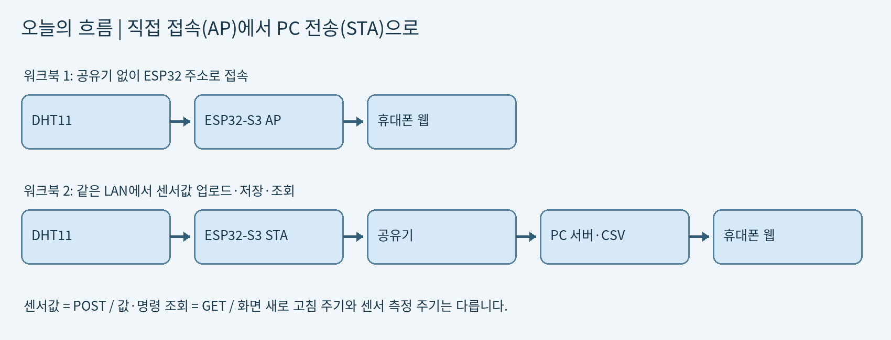
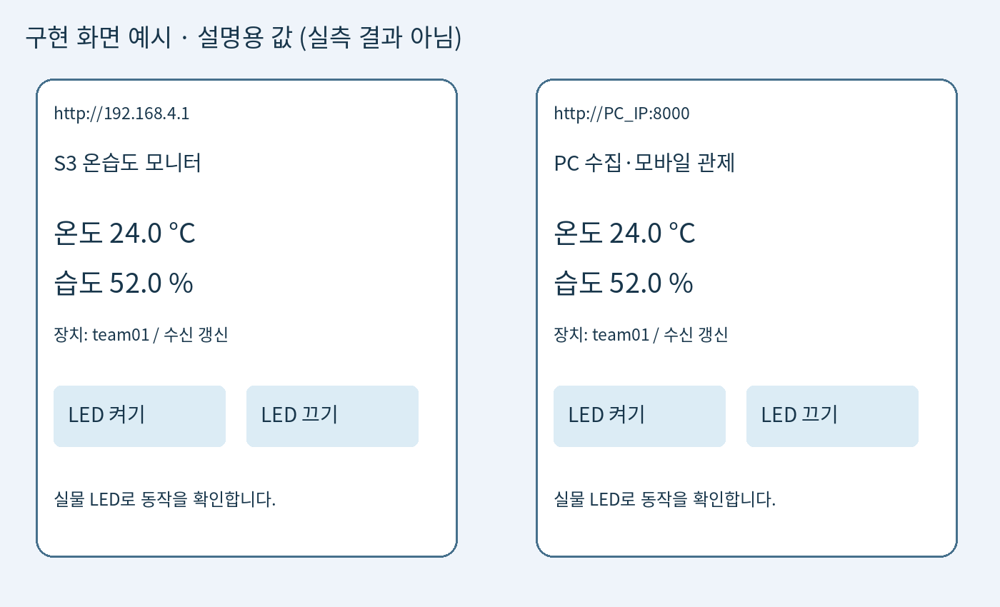
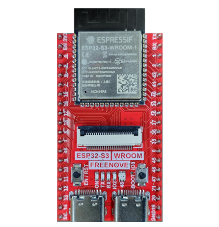
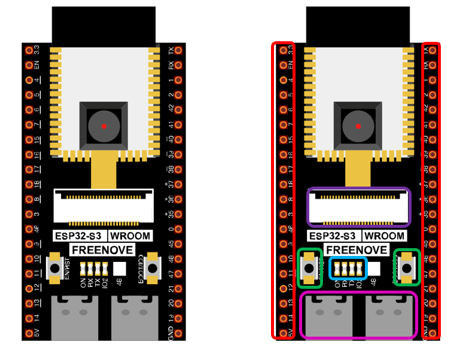
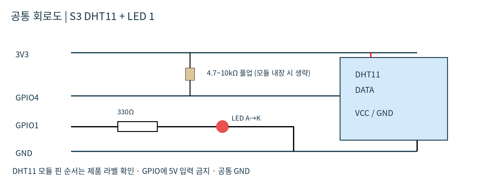
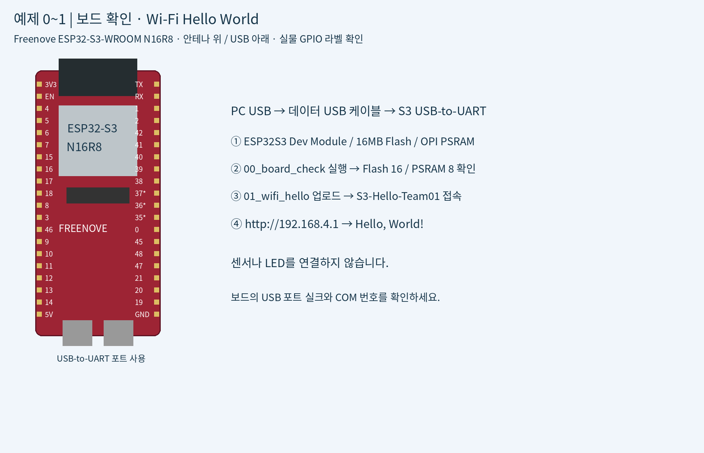
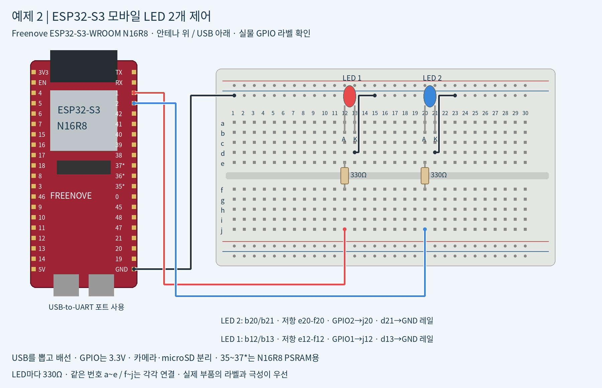

<callout icon="❓" color="blue_bg">
오늘의 학습 질문

1. 인터넷에 연결되지 않은 ESP32에도 휴대폰으로 접속할 수 있을까요?
2. PC로 보내는 온습도는 어떤 주소·형식으로 전달될까요?
</callout>

## 오늘 만들 결과

- 휴대폰에서 ESP32-S3의 웹페이지에 접속해 LED를 제어합니다.
- DHT11의 온도(°C)·습도(%)를 약 3초마다 PC에 전송하고 CSV와 모바일 화면에서 확인합니다.
- AP/STA와 GET/POST의 역할을 실제 주소와 코드로 설명합니다.



위 그림에서 워크북 1과 2의 **웹서버 위치**가 어디인지 찾아봅니다.



설명용 예시 화면이며 온습도 숫자는 실제 측정값으로 바뀝니다.

## 180분 진행

|시간|방식·자료|학생이 할 일|다음 단계 기준|
|---|---|---|---|
|0~20분|설명·보드 사진·통신 그림|질문 예상, AP/STA 구분|주소·역할 말하기|
|20~40분|같이 실행·보드 확인/Hello|S3 설정·웹 접속|16MB/8MB, Hello 표시|
|40~60분|개별·LED 예제|모바일 LED 2개 제어|실물과 화면 일치|
|60~95분|같이 실행→개별·워크북 1|DHT11 배선·단독 측정·AP 웹|측정값 3회 확인|
|95~105분|휴식·전환|PC 공유기 Wi-Fi 확인|PC IPv4 기록|
|105~165분|같이 실행→개별·워크북 2|샘플 수신→실측 POST·CSV|POST 201·실측 10행|
|165~180분|개별 확인·토론|결과 제출·처음 질문 답하기|역방향 제어·전송 경로 설명|

## 1. 보드와 재료 확인



제조사 참고 사진입니다. 보유 보드가 다른 제조사 제품이면 **헤더 순서 대신 인쇄된 GPIO 번호**로 연결합니다. N16R8은 Flash 16MB·PSRAM 8MB입니다. 이번 수업의 웹·CSV는 큰 PSRAM이 필요하지 않지만, 보드 설정과 다음 카메라 실습을 위해 메모리를 확인합니다.



|구역|뜻·이번 실습의 사용|
|---|---|
|3V3 / GND|센서 전원·공통 접지|
|GPIO4|DHT11 DATA|
|GPIO1 / GPIO2|외부 LED 1 / 2|
|GPIO19 / GPIO20|네이티브 USB용: 외부 배선하지 않음|
|GPIO35~37, Flash 관련 26~32|N16R8 메모리 관련: 외부 배선하지 않음|
|GPIO0·3·45·46|부팅 설정 관련: 이번 실습에서 사용하지 않음|
|GPIO43 / 44|UART 전송·수신용: 외부 배선하지 않음|
|카메라·SD 연결부|이번 수업에서는 카메라·microSD를 분리. GPIO4와 카메라가 겹칠 수 있음|

### ESP32 DevKitC V4와 연결 비교

현재 보드는 **ESP32-S3-WROOM N16R8**입니다. ESP32 DevKitC V4의 헤더 위치·핀 번호를 그대로 따라 연결하지 않습니다.

|연결 대상|기존 ESP32 DevKitC V4 예|이번 ESP32-S3 N16R8|
|---|---|---|
|DHT11 DATA|GPIO27|GPIO4|
|LED 1 / 2|GPIO25 / 26|GPIO1 / 2|
|DHT11 VCC / GND|3V3 / GND|3V3 / GND|
|IDE 보드|ESP32 Dev Module|ESP32S3 Dev Module|
|메모리 설정|모듈별 상이|Flash 16MB / OPI PSRAM 8MB|

Arduino UNO는 Wi-Fi가 내장되어 있지 않아 이번 필수 실습에서는 사용하지 않습니다.

### 부품·동작원리

|재료|수량|원리·배선에서 볼 것|
|---|---|---|
|S3 N16R8·데이터 USB 케이블|각 1|USB 전원과 UART 업로드|
|DHT11 3.3V 지원 모듈|1|온습도를 디지털 데이터 선으로 전달. I2C 센서가 아님|
|LED·330Ω 저항|각 2|순방향 전류에서 발광, 저항은 전류 제한. 긴 다리 A·짧은 다리 K|
|브레드보드·점퍼선|1세트|같은 열 a~e, f~j가 각각 연결됨|
|4.7~10kΩ|필요할 때 1|DATA 풀업. 모듈에 내장되어 있으면 추가 생략|
|휴대폰·2.4GHz 공유기·PC|각 1|모바일 표시 및 PC 수집|

### 전원 연결

USB를 뽑고 배선합니다. 기본 전원은 USB 하나만 사용합니다. GPIO에 5V를 입력하지 않습니다. DHT11은 3.3V 동작 지원 제품을 사용하고 핀 라벨을 확인합니다. 5V 전용 센서는 같은 배선으로 연결하지 않습니다. USB 전원과 5V/3V3 헤더 외부 전원을 함께 넣지 않습니다.



회로에서 DATA 풀업과 LED 직렬 저항의 역할이 어떻게 다른지 확인합니다.

## 2. 네트워크 통신 미리 보기

|용어|이번 실습에서의 의미|
|---|---|
|Wi-Fi / 인터넷|Wi-Fi는 무선 LAN. 인터넷 없이도 장치끼리 접속 가능|
|SSID / 암호|접속할 Wi-Fi 이름 / 인증 정보|
|AP|S3가 Wi-Fi를 만들어 휴대폰 접속을 받음|
|STA|S3가 공유기에 접속함. 2.4GHz Wi-Fi 사용|
|IPv4 / 포트|장치 주소 / 서비스 번호. PC 서버는 `http://PC_IP:8000`|
|GET / POST|값 조회 / 센서값·제어 명령 전송|
|JSON|`temperature`, `humidity`, `device`처럼 이름과 값으로 구성한 메시지|
|Polling|화면이 일정 간격으로 다시 조회함. 본 실습은 약 3초 주기의 근실시간|

PC·휴대폰에서 `localhost`는 각 장치 자신입니다. S3의 BASE_URL에는 **PC의 LAN IPv4**를 넣습니다. 같은 SSID여도 게스트 격리가 켜져 있으면 통신할 수 없습니다.

### 실습 코드에서 볼 함수

|함수|할 일|
|---|---|
|WiFi.softAP / softAPIP|AP 생성·주소 확인|
|WiFi.begin / status / reconnect|공유기 접속·상태·재시도|
|server.on / send / handleClient|URL 등록·응답·요청 처리|
|HTTPClient.POST / GET / end|값 전송·명령 조회·자원 정리|
|dht.begin / readTemperature / readHumidity|센서 초기화·°C·% 읽기|
|millis / unsigned long|시간 차이로 2.5~3초 주기 실행|
|isnan|센서 읽기 실패 확인|
|pinMode / digitalWrite|LED 출력 설정·켜기/끄기|

## 3. 설치·보드 확인

## Windows 11 Home · Arduino IDE 설정

1. ESP32-S3의 **USB-to-UART/Download 포트**에 데이터 USB 케이블을 연결합니다. 보드의 포트 라벨을 확인합니다.
2. 장치 관리자 → **포트(COM 및 LPT)**에서 COM 번호를 확인합니다. Freenove CH343 포트가 없으면 제조사 Preface의 CH343 설치 안내를 따릅니다.
3. Arduino IDE 2.x → 파일 → 기본 설정 → 추가 보드 관리자 URL에 다음 주소를 넣습니다.

```text
https://espressif.github.io/arduino-esp32/package_esp32_index.json
```

4. 보드 관리자에서 **esp32 by Espressif Systems 3.3.2**를 설치합니다.
5. 도구 메뉴를 아래처럼 설정합니다.

|항목|설정|
|---|---|
|Board|ESP32S3 Dev Module|
|Flash Size|16MB (128Mb)|
|Flash Mode|QIO 80MHz|
|PSRAM|OPI PSRAM|
|Partition Scheme|16M Flash (3MB APP/9.9MB FATFS)|
|USB CDC On Boot|Disabled (USB-to-UART 포트 기준)|
|USB Mode|Hardware CDC and JTAG|
|Upload Speed|115200|
|Port|장치 관리자에서 확인한 COM 번호|
|Serial Monitor|115200 baud|

네이티브 USB 포트를 사용할 경우에는 USB CDC On Boot를 Enabled로 바꾸고 새 COM 포트를 선택합니다. 두 방식을 섞지 않습니다. 기본 실습은 USB-to-UART 포트로 진행합니다.

6. 라이브러리 관리자에서 **DHT sensor library by Adafruit 1.4.6**, **Adafruit Unified Sensor 1.1.15**를 설치합니다. WiFi/WebServer/HTTPClient는 보드 패키지에 포함됩니다.
7. ZIP을 우클릭 → 모두 압축 풀기 → `week12_v2` 폴더를 엽니다. ZIP 안에서 직접 실행하지 않습니다.

### 예제 0 · 메모리 확인



1. `firmware/00_board_check/00_board_check.ino`를 엽니다.
2. 확인(✓) → 업로드(→) → 시리얼 모니터 115200 → EN/RST를 누릅니다.
3. `Flash: 16 MB`, `PSRAM: 8 MB`를 확인합니다. PSRAM이 0이면 OPI PSRAM 설정·보드 표기를 다시 확인합니다.

```cpp
#include <Arduino.h>
#if !defined(CONFIG_IDF_TARGET_ESP32S3)
#error "Select ESP32S3 Dev Module"
#endif
void setup() {
  Serial.begin(115200);
  delay(1000);
  Serial.print("Chip: ");
  Serial.println(ESP.getChipModel());
  Serial.printf("Flash: %u MB\n", ESP.getFlashChipSize() / (1024 * 1024));
  Serial.printf("PSRAM: %u MB\n", ESP.getPsramSize() / (1024 * 1024));
  Serial.println("Expected: ESP32-S3 / Flash 16 MB / PSRAM 8 MB");
}
void loop() { delay(10); }
```

## 4. 예제 1 · Wi-Fi Hello World

1. `firmware/01_wifi_hello/01_wifi_hello.ino`를 업로드합니다.
2. 시리얼에서 IP를 확인합니다.
3. 휴대폰을 `S3-Hello-Team01`, 암호 `esp32wifi`에 연결합니다. 인터넷 연결 없음이 나와도 유지합니다.
4. `http://192.168.4.1`을 엽니다. **Hello, World!**가 나오면 성공입니다.
5. 팀이 여러 개이면 코드의 Wi-Fi 이름을 자신의 팀 이름으로 바꿉니다.

```cpp
#if !defined(CONFIG_IDF_TARGET_ESP32S3)
#error "Select ESP32S3 Dev Module for this v2 sketch"
#endif

#include <WiFi.h>
#include <WebServer.h>

const char* WIFI_NAME = "S3-Hello-Team01";
const char* WIFI_PASSWORD = "esp32wifi";

WebServer server(80);

void setup() {
  Serial.begin(115200);
  delay(500);

  // ESP32가 휴대폰이 접속할 Wi-Fi를 만듭니다.
  WiFi.mode(WIFI_AP);
  if (!WiFi.softAP(WIFI_NAME, WIFI_PASSWORD)) {
    Serial.println("Wi-Fi start failed");
    return;
  }

  Serial.print("Wi-Fi name: ");
  Serial.println(WIFI_NAME);
  Serial.print("IP address: ");
  Serial.println(WiFi.softAPIP());

  // 브라우저에서 첫 화면을 요청하면 HTML을 보냅니다.
  server.on("/", HTTP_GET, []() {
    server.send(
      200,
      "text/html; charset=utf-8",
      "<!doctype html><html lang='ko'>"
      "<meta charset='utf-8'>"
      "<meta name='viewport' content='width=device-width,initial-scale=1'>"
      "<title>ESP32 Hello</title>"
      "<h1>Hello, World!</h1>"
      "<p>ESP32 Wi-Fi 연결 성공!</p>"
      "</html>"
    );
  });

  server.begin();
  Serial.println("Open http://192.168.4.1");
}

void loop() {
  // 브라우저 요청을 계속 처리합니다.
  server.handleClient();
}
```

## 5. 예제 2 · 모바일 LED 2개 제어

1. USB를 뽑고 아래 그림대로 LED 2개·330Ω 저항 2개를 연결합니다.



|LED|배선|
|---|---|
|1|GPIO1 → 330Ω → A, K → GND|
|2|GPIO2 → 330Ω → A, K → GND|

2. USB 연결 → `firmware/02_wifi_two_led/02_wifi_two_led.ino`를 업로드합니다.
3. 휴대폰 Wi-Fi를 `S3-LED-Team01`로 바꾸고 암호 `esp32wifi`를 입력합니다.
4. 같은 주소 `http://192.168.4.1`을 열고 LED 1·2를 각각 켜고 끕니다.
5. 화면과 실물이 일치하면 워크북 1로 갑니다.

```cpp
#if !defined(CONFIG_IDF_TARGET_ESP32S3)
#error "Select ESP32S3 Dev Module for this v2 sketch"
#endif

#include <WiFi.h>
#include <WebServer.h>

const char* WIFI_NAME = "S3-LED-Team01";
const char* WIFI_PASSWORD = "esp32wifi";
const uint8_t LED_PINS[2] = {1, 2};
bool ledOn[2] = {false, false};
WebServer server(80);

const char PAGE[] PROGMEM = R"HTML(
<!doctype html><html lang="ko">
<meta charset="utf-8">
<meta name="viewport" content="width=device-width,initial-scale=1">
<title>LED 2개 제어</title>
<style>
body{font:20px sans-serif;background:#eef4fa;padding:20px;max-width:600px;margin:auto}
section{background:white;padding:20px;margin:15px 0;border-radius:12px}
button{font:inherit;padding:15px;margin:5px}
</style>
<h1>ESP32 LED 제어</h1><p id="status">연결 중</p>
<section><h2>LED 1 · GPIO1</h2><p id="led1">확인 중</p>
<button onclick="setLed(1,1)">켜기</button>
<button onclick="setLed(1,0)">끄기</button></section>
<section><h2>LED 2 · GPIO2</h2><p id="led2">확인 중</p>
<button onclick="setLed(2,1)">켜기</button>
<button onclick="setLed(2,0)">끄기</button></section>
<script>
let busy = false;
async function refresh(){
  if(busy) return;
  busy = true;
  try{
    const r = await fetch('/state',{cache:'no-store'});
    if(!r.ok) throw new Error('state');
    const d = await r.json();
    document.getElementById('led1').textContent = d.led1 ? '켜짐' : '꺼짐';
    document.getElementById('led2').textContent = d.led2 ? '켜짐' : '꺼짐';
    document.getElementById('status').textContent = 'ESP32 연결됨';
  }catch(e){
    document.getElementById('status').textContent = 'Wi-Fi 연결 확인';
  }finally{busy = false;}
}
async function setLed(id,state){
  try{
    const r = await fetch('/led?id='+id+'&state='+state,{method:'POST'});
    if(!r.ok) throw new Error('command');
    await refresh();
  }catch(e){document.getElementById('status').textContent = '명령 전송 실패';}
}
setInterval(refresh,1000);
refresh();
</script></html>
)HTML";

void setup() {
  Serial.begin(115200);
  delay(500);
  for (int i = 0; i < 2; i++) {
    pinMode(LED_PINS[i], OUTPUT);
    digitalWrite(LED_PINS[i], LOW);
  }
  WiFi.mode(WIFI_AP);
  if (!WiFi.softAP(WIFI_NAME, WIFI_PASSWORD)) {
    Serial.println("Wi-Fi start failed");
    return;
  }
  Serial.print("Wi-Fi name: ");
  Serial.println(WIFI_NAME);
  Serial.print("IP address: ");
  Serial.println(WiFi.softAPIP());

  server.on("/", HTTP_GET, []() {
    server.send(200, "text/html; charset=utf-8", PAGE);
  });
  server.on("/state", HTTP_GET, []() {
    String json = "{\"led1\":";
    json += ledOn[0] ? "true" : "false";
    json += ",\"led2\":";
    json += ledOn[1] ? "true" : "false";
    json += "}";
    server.sendHeader("Cache-Control", "no-store");
    server.send(200, "application/json", json);
  });
  server.on("/led", HTTP_POST, []() {
    String id = server.arg("id");
    String state = server.arg("state");
    if ((id != "1" && id != "2") ||
        (state != "0" && state != "1")) {
      server.send(400, "text/plain", "Invalid id or state");
      return;
    }
    int index = id.toInt() - 1;
    ledOn[index] = (state == "1");
    digitalWrite(LED_PINS[index], ledOn[index] ? HIGH : LOW);
    server.send(200, "text/plain", "OK");
  });
  server.begin();
}

void loop() {
  server.handleClient();
}
```

## 6. 워크북 진행

- **워크북 1:** DHT11 단독 확인 → AP 웹에서 온습도·LED 확인
- **워크북 2:** PC 서버 → 샘플 전송 → S3 실측 전송 → 모바일 관제·CSV 확인

## 7. 처음 질문에 답하기

1. 인터넷 없이도 S3의 AP와 같은 LAN에서 웹페이지에 접속할 수 있습니다.
2. 센서는 GPIO로 읽고, S3가 PC IPv4의 8000번 HTTP 서버에 JSON을 POST합니다. 화면은 GET으로 최신값을 조회합니다.

## 8. 확인·제출

1. AP/STA에서 각각 웹서버가 실행되는 장치를 쓰세요.
2. `localhost`를 S3의 PC 서버 주소로 쓰면 안 되는 이유를 쓰세요.
3. `POST: 201`과 LED의 실제 점등은 같은 성공 조건인가요? 각각 무엇을 확인하나요?

제출: 배선 사진, 모바일 화면, POST 201 시리얼 화면, 본인 팀의 실측 CSV 10행. Wi-Fi 암호가 보이는 화면은 제외합니다.

|평가 항목|배점|
|---|---|
|핀·전원·저항·극성 배선|4|
|AP 모바일 센서값·LED|4|
|PC 실측 전송·CSV 10행|8|
|통신 역할·주소 설명|4|

## 참고 자료

- [Espressif ESP32-S3 시작하기](https://docs.espressif.com/projects/esp-idf/en/stable/esp32s3/get-started/index.html)
- [Freenove FNK0083 보드·핀·설치 안내](https://docs.freenove.com/projects/fnk0083/en/latest/fnk0083/codes/C/Preface.html)
- [ESP32-S3-DevKitC-1 N16R8·핀 안내](https://docs.espressif.com/projects/esp-dev-kits/en/latest/esp32s3/esp32-s3-devkitc-1/user_guide_v1.1.html)
- [Arduino-ESP32 도구 메뉴](https://docs.espressif.com/projects/arduino-esp32/en/latest/guides/tools_menu.html)
