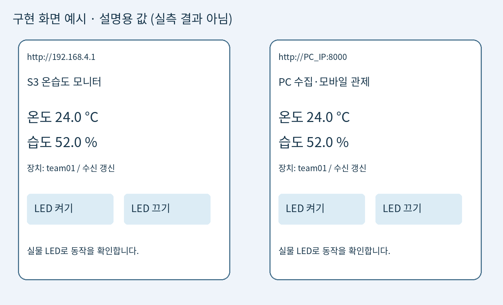
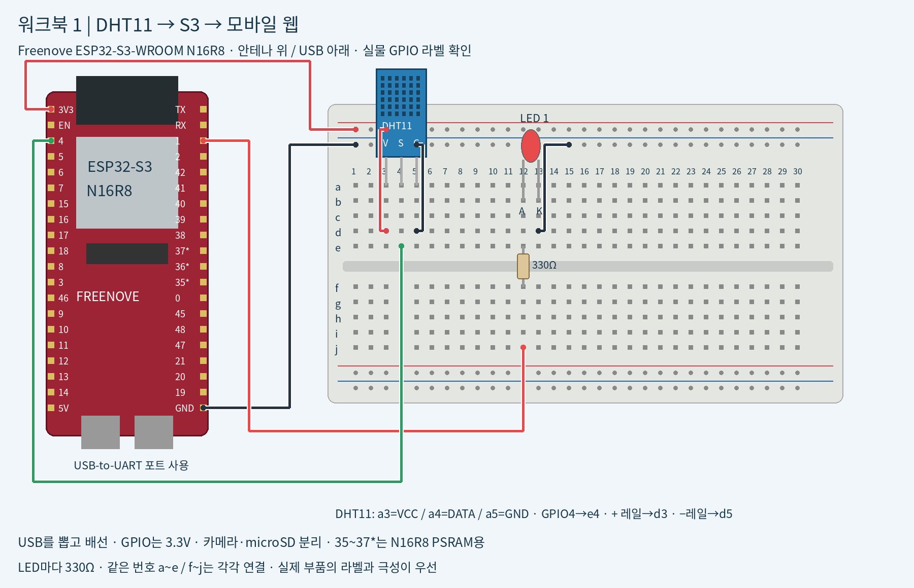

# 워크북 1 · DHT11을 모바일 웹에서 보기

목표: 온습도 3회 확인, 모바일 LED 제어. 환경: Windows 11 Home·ESP32-S3 N16R8. 먼저 강의 본문의 IDE·메모리 확인을 끝냅니다.



센서값은 예시이며 실제 환경에 따라 달라집니다.



## 1. 회로 연결하기

1. USB를 뽑고 카메라·microSD·앞 예제 배선을 분리합니다.
2. DHT11과 LED 1개를 연결합니다. 모듈의 핀 이름이 그림보다 우선입니다.

|연결|그림의 구멍|
|---|---|
|S3 3V3 → 상단 + 레일|센서 VCC 전원|
|S3 GND → 상단 − 레일|센서·LED 공통 접지|
|DHT11 VCC / DATA / GND|a3 / a4 / a5|
|상단 + 레일 → d3, 상단 − 레일 → d5|센서 전원|
|GPIO4 → e4|센서 DATA|
|LED 긴 다리 A / 짧은 다리 K|b12 / b13|
|330Ω 저항|e12-f12|
|GPIO1 → j12, d13 → 상단 − 레일|LED 출력·접지|

3. 풀업 미내장 센서에는 DATA와 3V3 사이에 4.7~10kΩ을 추가합니다.
4. 배선을 확인한 뒤 USB를 연결합니다.


## 2. DHT11 단독으로 확인하기

1. `firmware/03_dht_check/03_dht_check.ino`를 엽니다.
2. ESP32S3 Dev Module·16MB·OPI PSRAM·COM을 확인하고 업로드합니다.
3. 시리얼 모니터 115200에서 EN을 누릅니다.
4. 약 2.5초마다 `T=24.0 C, H=52.0 %` 같은 숫자가 3회 나오면 통과합니다. FAIL이면 배선을 수정한 뒤 진행합니다.

```cpp
#if !defined(CONFIG_IDF_TARGET_ESP32S3)
#error "Select ESP32S3 Dev Module for this v2 sketch"
#endif

#include <DHT.h>
#include <math.h>
DHT dht(4, DHT11);
unsigned long lastSample = 0;
void setup() {
  Serial.begin(115200);
  delay(500);
  dht.begin();
  Serial.println("DHT11 check: GPIO4, 3.3V, common GND");
}
void loop() {
  if (millis() - lastSample < 2500) return;
  lastSample = millis();
  float t = dht.readTemperature();
  float h = dht.readHumidity();
  if (isnan(t) || isnan(h)) {
    Serial.println("FAIL: check DHT type, DATA, power and pull-up");
    return;
  }
  Serial.printf("T=%.1f C, H=%.1f %%\n", t, h);
}
```

## 3. 모바일 센서 웹서버 업로드하기

1. `firmware/04_dht_mobile_ap/04_dht_mobile_ap.ino`를 엽니다.
2. `S3-Sensor-Team01`을 자기 팀 이름으로 바꿉니다.
3. 업로드 후 시리얼에서 AP IP를 확인합니다.
4. 휴대폰을 해당 Wi-Fi에 연결합니다. 암호는 `esp32wifi`입니다.
5. 브라우저에서 `http://192.168.4.1`을 엽니다.
6. 온습도 숫자를 3회 기록하고 LED 켜기·끄기를 확인합니다.
7. 주소 끝에 `/data`를 붙여 JSON을 확인합니다.

```cpp
#if !defined(CONFIG_IDF_TARGET_ESP32S3)
#error "Select ESP32S3 Dev Module for this v2 sketch"
#endif

#include <WiFi.h>
#include <DHT.h>
#include <math.h>
const char* DEVICE_ID = "team01";
DHT dht(4, DHT11);
const int LED_PIN = 1;
float temperature = NAN, humidity = NAN;
unsigned long lastRead = 0;
void sampleSensor() {
  if (millis() - lastRead < 2500) return;
  lastRead = millis();
  temperature = dht.readTemperature();
  humidity = dht.readHumidity();
}
String sensorJson() {
  if (isnan(temperature) || isnan(humidity)) return "{\"valid\":false}";
  return String("{\"valid\":true,\"device\":\"") + DEVICE_ID +
    "\",\"temperature\":" +
    String(temperature, 1) + ",\"humidity\":" + String(humidity, 1) + "}";
}
#include <WebServer.h>
WebServer server(80);
const char PAGE[] PROGMEM = R"HTML(
<!doctype html><html lang="ko"><meta charset="utf-8">
<meta name="viewport" content="width=device-width,initial-scale=1">
<title>ESP32 센서</title><h1>온습도 모니터</h1>
<pre id="out">센서 준비 중</pre>
<button onclick="led(1)">LED 켜기</button>
<button onclick="led(0)">LED 끄기</button>
<script>
async function led(v){await fetch('/led?state='+v,{method:'POST'});}
async function poll(){try{let d=await(await fetch('/data')).json();
document.getElementById('out').textContent=d.valid?
`온도 ${d.temperature} °C / 습도 ${d.humidity} %`:'센서 읽기 실패 또는 준비 중';
}catch(e){document.getElementById('out').textContent='연결 확인';}}
setInterval(poll,2500);poll();</script></html>
)HTML";
void setup() {
  Serial.begin(115200);
  delay(500);
  pinMode(LED_PIN, OUTPUT);
  digitalWrite(LED_PIN, LOW);
  dht.begin();
  WiFi.mode(WIFI_AP);
  if (!WiFi.softAP("S3-Sensor-Team01", "esp32wifi")) {
    Serial.println("AP start failed");
  }
  Serial.print("AP IP: ");
  Serial.println(WiFi.softAPIP());
  server.on("/", HTTP_GET, [](){server.send(200,"text/html; charset=utf-8",PAGE);});
  server.on("/data", HTTP_GET, [](){server.send(200,"application/json",sensorJson());});
  server.on("/led", HTTP_POST, [](){
    String v = server.arg("state");
    if (v != "0" && v != "1") {server.send(400,"text/plain","bad state");return;}
    digitalWrite(LED_PIN, v == "1" ? HIGH : LOW);
    server.send(200,"text/plain","OK");
  });
  server.begin();
}
void loop() {
  server.handleClient();
  sampleSensor();
}
```

## 안 될 때

|증상|조치|
|---|---|
|시리얼 출력 없음|UART 포트·COM·115200·CDC Disabled 확인 후 EN|
|DHT 읽기 실패|GPIO4·센서 핀 라벨·3.3V·GND·풀업 확인|
|모바일 페이지 안 열림|S3-Sensor Wi-Fi 유지, http 주소 확인|
|LED 안 켜짐|GPIO1·330Ω·A/K·GND 확인|

## 확인·기록

- [ ] 단독 온습도 숫자 3회
- [ ] 모바일 온습도 표시
- [ ] 모바일로 외부 LED 켜기·끄기

|회차|온도(°C)|습도(%)|
|---|---|---|
|1| | |
|2| | |
|3| | |

질문: S3는 AP인가요, STA인가요? 이 단계의 웹서버는 어디에 있나요?

배선·모바일 화면을 저장하고 워크북 2로 이동합니다.
