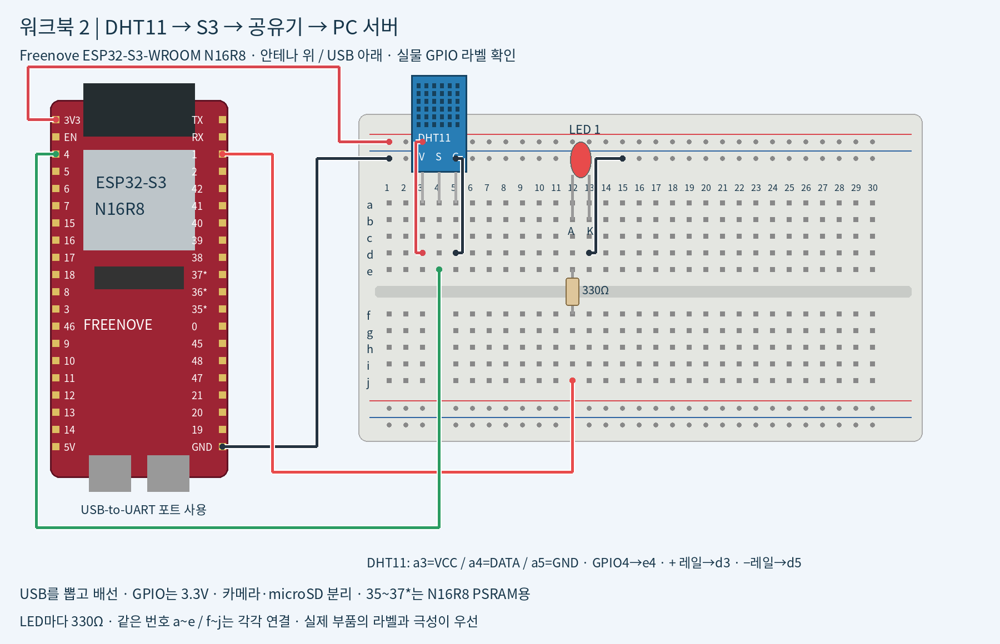
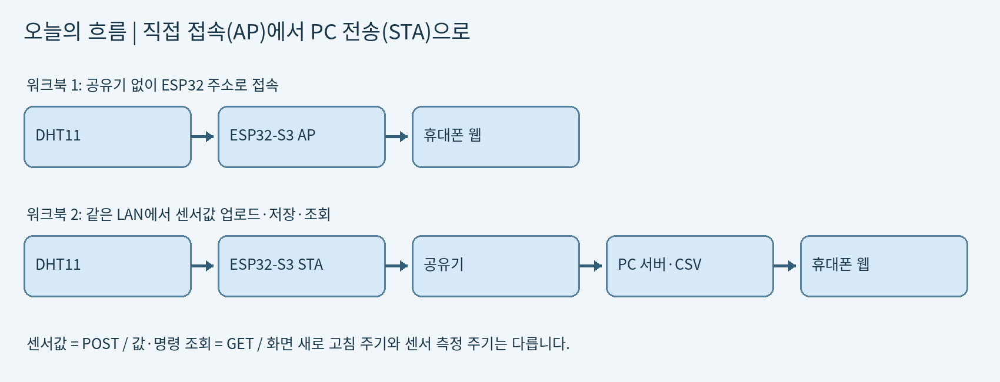

# 워크북 2 · DHT11 값을 PC로 보내기

목표: S3에서 3초마다 PC로 전송하고 모바일 화면·CSV 10행을 확인합니다. 워크북 1의 **DHT11 GPIO4·LED GPIO1 배선**을 그대로 사용합니다.





## 1. PC 서버 실행하기

1. 전체 ZIP을 모두 압축 풉니다.
2. 파일 탐색기에서 `week12_v2` 폴더를 열고 주소 표시줄에 `powershell`을 입력합니다.
3. 아래 명령을 실행합니다. 서버는 추가 Python 패키지 없이 실행됩니다.

```powershell
py -3.13 --version
py -3.13 server/server.py
```

`py`가 없으면 `python --version`으로 3.13인지 확인하고 `py -3.13` 대신 `python`을 사용합니다.

4. PC 브라우저에서 `http://127.0.0.1:8000`을 엽니다. 수신 대기 화면이면 성공입니다. 서버 창을 닫지 않습니다.

## 2. 미리 준비된 데이터로 시험하기

1. 같은 `week12_v2` 폴더에서 PowerShell 창을 하나 더 엽니다.
2. 다음 명령을 실행합니다. 샘플 파일은 ZIP의 `data/sample_readings.csv`에 있습니다.

```powershell
py -3.13 server/replay.py
```

3. PC 화면의 team01 값과 `201` 응답을 확인합니다. 이 값은 **모의 데이터**입니다.
4. 첫 서버 창에서 Ctrl+C → `server/received.csv`를 `received_sample.csv`로 이름 변경 → 서버를 다시 실행합니다.

```powershell
py -3.13 server/server.py
```

## 3. 같은 Wi-Fi에 연결하기

1. PC를 실습용 공유기에 연결합니다. S3가 사용할 SSID는 2.4GHz여야 합니다.
2. 두 번째 PowerShell 창에서 아래 명령을 입력합니다.

```powershell
ipconfig
```

3. 무선 LAN 어댑터 Wi-Fi의 IPv4를 적습니다. 예: `192.168.0.10`. VPN·가상 어댑터 주소는 사용하지 않습니다.
4. Windows 11 → 설정 → 네트워크 및 인터넷 → Wi-Fi → 현재 실습 네트워크 속성 → **개인 네트워크**를 선택합니다.
5. 시작 버튼 우클릭 → 터미널(관리자) → PowerShell에서 다음 규칙을 한 번 추가합니다. 관리자 계정이 없으면 교수자에게 요청합니다.

```powershell
New-NetFirewallRule -DisplayName "Embedded12v2 HTTP" -Direction Inbound -Action Allow -Protocol TCP -LocalPort 8000 -Profile Private -RemoteAddress LocalSubnet
```

6. 휴대폰을 S3-Sensor Wi-Fi에서 해제하고 **PC와 같은 공유기**에 연결합니다.
7. 모바일에서 `http://PC_IP:8000`을 엽니다. 예: `http://192.168.0.10:8000`.

## 4. S3 전송 코드 업로드하기

1. `firmware/05_dht_pc_client/05_dht_pc_client.ino`를 엽니다.
2. 아래 네 항목을 바꿉니다.

|항목|입력할 값|
|---|---|
|DEVICE_ID|team01 대신 자기 팀 ID, 예: team02|
|SSID|공유기의 2.4GHz Wi-Fi 이름|
|PASSWORD|공유기 암호|
|BASE_URL|http://PC의_IPv4:8000|

3. 업로드하고 시리얼 모니터 115200을 엽니다.
4. `STA IP: ...`, `POST: 201`이 반복되면 성공입니다.

```cpp
#if !defined(CONFIG_IDF_TARGET_ESP32S3)
#error "Select ESP32S3 Dev Module for this v2 sketch"
#endif

#include <WiFi.h>
#include <DHT.h>
#include <math.h>
const char* DEVICE_ID = "team01";
DHT dht(4, DHT11);
const int LED_PIN = 1;
float temperature = NAN, humidity = NAN;
unsigned long lastRead = 0;
void sampleSensor() {
  if (millis() - lastRead < 2500) return;
  lastRead = millis();
  temperature = dht.readTemperature();
  humidity = dht.readHumidity();
}
String sensorJson() {
  if (isnan(temperature) || isnan(humidity)) return "{\"valid\":false}";
  return String("{\"valid\":true,\"device\":\"") + DEVICE_ID +
    "\",\"temperature\":" +
    String(temperature, 1) + ",\"humidity\":" + String(humidity, 1) + "}";
}
#include <HTTPClient.h>
const char* SSID = "YOUR_2G_WIFI";
const char* PASSWORD = "YOUR_WIFI_PASSWORD";
const char* BASE_URL = "http://192.168.0.10:8000"; // PC IPv4로 수정
unsigned long lastSend = 0, lastReconnect = 0;
bool wasConnected = false;
void setup() {
  Serial.begin(115200);
  delay(500);
  pinMode(LED_PIN, OUTPUT);
  digitalWrite(LED_PIN, LOW);
  dht.begin();
  WiFi.mode(WIFI_STA);
  WiFi.begin(SSID, PASSWORD);
  Serial.println("Connecting to Wi-Fi...");
}
void loop() {
  sampleSensor();
  if (WiFi.status() != WL_CONNECTED) {
    wasConnected = false;
    if (millis() - lastReconnect >= 10000) {
      lastReconnect = millis();
      Serial.println("Wi-Fi disconnected; retrying...");
      WiFi.reconnect();
    }
    return;
  }
  if (!wasConnected) {
    wasConnected = true;
    Serial.print("STA IP: ");
    Serial.println(WiFi.localIP());
  }
  if (millis() - lastSend < 3000) return;
  lastSend = millis();
  WiFiClient client;
  HTTPClient http;
  http.setConnectTimeout(1000);
  http.setTimeout(1000);
  if (!isnan(temperature) && !isnan(humidity)) {
    http.begin(client, String(BASE_URL) + "/api/readings");
    http.addHeader("Content-Type", "application/json");
    int code = http.POST(sensorJson());
    Serial.printf("POST: %d\n", code);
    http.end();
  } else {
    Serial.println("DHT read failed: check power/DATA/pull-up");
  }
  http.begin(client, String(BASE_URL) + "/api/led?device=" + DEVICE_ID);
  int code = http.GET();
  if (code == 200) {
    String body = http.getString();
    body.trim();
    if (body == "0" || body == "1") digitalWrite(LED_PIN, body == "1" ? HIGH : LOW);
  }
  http.end();
}
```

전송 본문은 다음 형식입니다. 온도·습도는 문자열이 아닌 숫자입니다.

```json
{"valid":true,"device":"team02","temperature":24.0,"humidity":52.0}
```

## 5. 모바일 관제·CSV 확인하기

1. 모바일에서 PC 서버 주소를 열고 장치 칸에 자신의 DEVICE_ID를 넣습니다.
2. 온습도·수신 시각·경과 시간을 확인합니다. 수신 시각은 UTC이며 한국은 +9시간입니다.
3. 센서 가까이에 손을 가져가 값이 변하는지 관찰합니다. 물을 묻히지 않습니다.
4. 모바일 LED 켜기·끄기를 누른 후 약 3초 기다려 실물 LED를 확인합니다.
5. `server/received.csv`에서 자기 팀 실측 기록 10행을 확인합니다.
6. S3 USB를 뽑고 수신 경과 시간이 증가하는지 확인합니다. 오래된 값과 현재 측정값을 구별합니다.

서버가 중단된 동안의 데이터는 본 예제에서 자동 복원되지 않습니다. 서버 재시작 시 최신 화면·명령은 초기화되고 CSV는 남습니다. 화면의 명령 접수는 물리 LED 동작 확인을 대신하지 않습니다.

## 안 될 때

|증상|조치|
|---|---|
|Wi-Fi 재시도만 반복|SSID·암호·2.4GHz 확인|
|POST 음수|PC 주소·8000·서버 실행·방화벽·게스트 격리 확인|
|POST 400|device·숫자 필드 확인|
|POST 503|CSV 쓰기 권한·선택 DB 설정 확인|
|모바일만 접속 실패|localhost 대신 PC IPv4, 동일 LAN 확인|
|다른 팀 값 표시|DEVICE_ID와 장치 칸 일치 확인|

## 기록·제출

|항목|기록|
|---|---|
|학번·이름·팀| |
|S3 / PC IPv4| |
|실측 온도·습도 3회| |
|POST 201·CSV 10행 확인| |
|모바일 LED 제어 결과| |
|발생 오류와 해결| |

제출: 배선 사진, 모바일 화면, 시리얼 POST 201, 실측 CSV. 종료할 때 서버 Ctrl+C, S3 USB를 분리합니다. 서버는 사설 LAN 수업용이며 외부 공개하지 않습니다.

## 서버 파일 확인

다음 파일은 ZIP에 들어 있습니다. 먼저 다운로드한 그대로 실행합니다.

|파일|역할|
|---|---|
|server/server.py|JSON 수신·최신값·LED 명령·CSV 저장|
|server/dashboard.html|모바일 화면|
|server/replay.py|샘플 CSV 전송|
|data/sample_readings.csv|온도 °C·상대습도 % 모의 데이터 3행|

### PC 서버 전체 코드

```python
"""Python 3.13 stdlib LAN teaching server; optional MySQL via environment."""
from http.server import BaseHTTPRequestHandler, ThreadingHTTPServer
from urllib.parse import urlparse, parse_qs
from pathlib import Path
from datetime import datetime, timezone
import json, math, os, re, threading, time, csv
ROOT = Path(__file__).resolve().parent
LOCK = threading.Lock()
LATEST, COMMANDS = {}, {}

def device_id(value):
    if not isinstance(value, str) or not re.fullmatch(r"[A-Za-z0-9_-]{1,32}", value):
        raise ValueError("invalid device")
    return value

def save_reading(data):
    device = device_id(data.get("device"))
    t, h = data.get("temperature"), data.get("humidity")
    if any(isinstance(v, bool) or not isinstance(v, (int, float)) or not math.isfinite(v) for v in (t, h)):
        raise ValueError("finite numeric values required")
    if not -40 <= t <= 80 or not 0 <= h <= 100:
        raise ValueError("out of range")
    now = datetime.now(timezone.utc).isoformat()
    row = dict(device=device, temperature=t, humidity=h, received_at=now)
    # Optional persistence must succeed before reporting success.
    if os.getenv("MYSQL_ENABLED") == "1":
        import mysql.connector
        conn = mysql.connector.connect(host=os.getenv("MYSQL_HOST", "127.0.0.1"),
            user=os.getenv("MYSQL_USER", "root"), password=os.environ["MYSQL_PASSWORD"],
            database="embedded12", connection_timeout=3)
        try:
            cur = conn.cursor()
            cur.execute("INSERT INTO readings(device,temperature,humidity) VALUES (%s,%s,%s)", (device,t,h))
            conn.commit()
            cur.close()
        finally:
            conn.close()
    with LOCK:
        path = ROOT / "received.csv"
        new = not path.exists()
        with path.open("a", newline="", encoding="utf-8") as f:
            writer = csv.DictWriter(f, fieldnames=list(row))
            if new: writer.writeheader()
            writer.writerow(row)
        LATEST[device] = (row, time.time())
    return row

class Handler(BaseHTTPRequestHandler):
    def reply(self, code, data, mime="application/json"):
        body = data.encode("utf-8") if isinstance(data, str) else json.dumps(data, ensure_ascii=False).encode("utf-8")
        self.send_response(code)
        self.send_header("Content-Type", mime + "; charset=utf-8")
        self.send_header("Content-Length", str(len(body)))
        self.send_header("Cache-Control", "no-store")
        self.end_headers()
        self.wfile.write(body)

    def do_GET(self):
        u = urlparse(self.path)
        if u.path == "/":
            return self.reply(200, (ROOT / "dashboard.html").read_text(encoding="utf-8"), "text/html")
        if u.path not in ("/api/latest", "/api/led"):
            return self.reply(404, {"error":"not found"})
        try:
            device = device_id(parse_qs(u.query).get("device", ["team01"])[0])
        except ValueError as e:
            return self.reply(400, {"error":str(e)})
        with LOCK:
            if u.path == "/api/led":
                return self.reply(200, str(COMMANDS.get(device, 0)), "text/plain")
            row, stamp = LATEST.get(device, ({}, time.time()))
            result = dict(row, age_seconds=round(time.time()-stamp,1))
        self.reply(200, result)

    def do_POST(self):
        try:
            length = int(self.headers.get("Content-Length", "0"))
            if not 0 < length <= 2048:
                return self.reply(413, {"error":"body size"})
            data = json.loads(self.rfile.read(length))
            if not isinstance(data, dict): raise ValueError("object required")
            path = urlparse(self.path).path
            if path == "/api/readings":
                return self.reply(201, save_reading(data))
            if path == "/api/led":
                device = device_id(data.get("device"))
                state = data.get("state")
                if type(state) is not int or state not in (0,1): raise ValueError("state must be 0 or 1")
                with LOCK: COMMANDS[device] = state
                return self.reply(200, {"accepted":state})
            self.reply(404, {"error":"not found"})
        except (ValueError, UnicodeError) as e:
            self.reply(400, {"error":str(e)})
        except Exception:
            self.reply(503, {"error":"storage unavailable; inspect server configuration"})

if __name__ == "__main__":
    print("LAN teaching server: http://<PC IPv4>:8000 (Ctrl+C stops)")
    ThreadingHTTPServer(("0.0.0.0", 8000), Handler).serve_forever()
```
