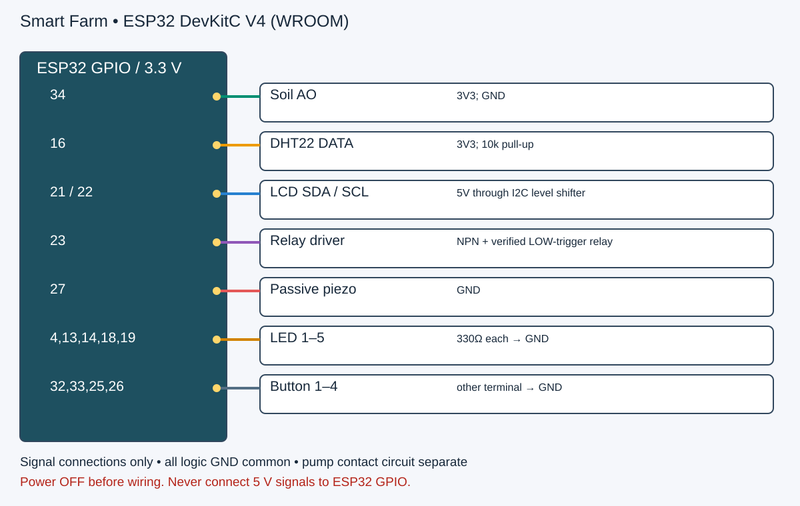
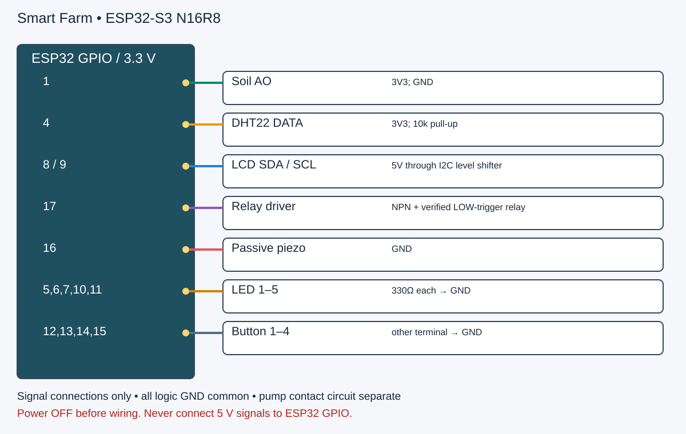
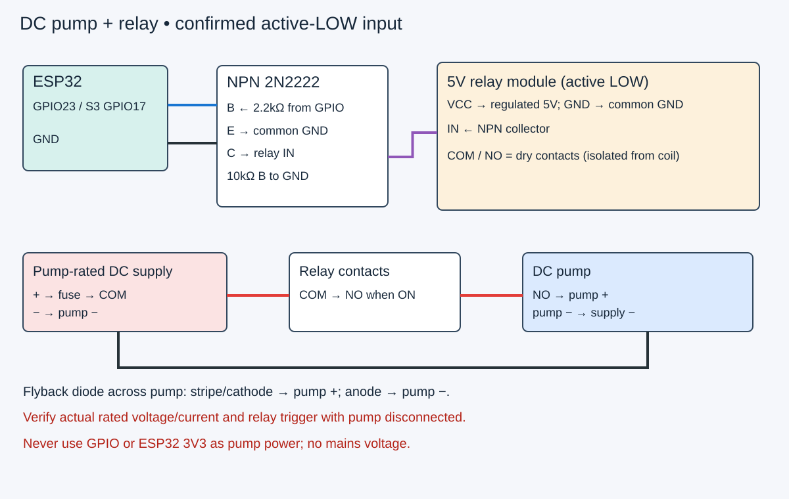

# 13주차 v2 스마트팜 자료

**최신 실습: [rev2_led4_csv](rev2_led4_csv/README.md)** — ESP32 DevKitC V4·LED4·버튼4·DHT22·Python CSV 웹서버, 통합 스마트팜. 2026-11-25 개정.

아래 기존 LED5/AP 자료는 구판입니다. 이번 수업은 rev2_led4_csv 폴더만 사용하세요.

---

# 13주차 v2 · Wi-Fi 스마트팜 (2026-11-25)

<callout icon="❓" color="blue_bg">
오늘의 학습 질문

- 흙이 마르면 어떤 숫자가 바뀌며, 어느 시점에 펌프를 켜야 할까요?
- 인터넷 없이 휴대폰에서 관수 상태를 확인하고 정지할 수 있을까요?
</callout>

## 오늘 만들 결과

토양 수분 지표, 온습도, 관수 상태를 LCD와 휴대폰 웹에 표시하고 버튼 및 웹에서 자동/수동을 제어합니다. 펌프는 기본 OFF이며 한 번 최대 3초, 20초 휴지시간을 둡니다.

## 180분 진행표

|시간|활동|완료 기준|
|---|---|---|
|0~20분|키트와 전원·ADC 설명|AO/DO, COM/NO 구분|
|20~50분|토양센서 연결 및 보정|건조·습윤 ADC 기록|
|50~80분|릴레이 단독 → 펌프 테스트|w 명령 2초 후 OFF|
|80~90분|휴식|전원 분리|
|90~115분|DHT22 및 LCD|온도/습도 표시|
|115~165분|LED·버튼·Wi-Fi 통합|웹/버튼 제어, 자동 관수|
|165~180분|시험·결과 제출|정지/타임아웃 확인|

## 1. 재료 및 특성

|부품|수량|특성|
|---|---:|---|
|ESP32 DevKitC V4 WROOM 또는 ESP32-S3 N16R8|1|3.3V GPIO, Wi-Fi AP|
|첨부 키트 저항식 토양수분 탐침 + 비교기 보드|1|전도도에 따라 AO 변화, DO는 가변저항 임계값 비교|
|키트 DC 워터펌프, 호스|1|DC 모터, 수중형이면 물에 잠긴 상태에서만 사용; 실제 정격 확인|
|키트 릴레이 모듈|1|접점 COM/NO/NC; 실제 VCC와 LOW 트리거 확인|
|LCD1602 I2C + 양방향 I2C 레벨시프터|1씩|PCF8574 주소 0x27 또는 0x3F; 5V 풀업을 3.3V로 변환|
|DHT22|1|온도 °C·상대습도 %, 2초 이상 간격, 10kΩ 풀업(모듈 내장 시 생략)|
|LED + 330Ω|5씩|접속·건조·관수·AUTO·경보|
|버튼|4|INPUT_PULLUP, 눌림 LOW|
|수동 피에조 부저|1|tone; 전자식/코일형이면 별도 드라이버 확인|
|NPN 2N2222 및 2.2kΩ, 10kΩ, 역기전력 보호 다이오드|1씩|5V 릴레이 입력 구동; 핀 배열 확인|
|브레드보드, 점퍼, 정격 DC 전원, 퓨즈, USB|각 1|펌프 전원 별도, USB는 보드 전원|

사진의 제품명만으로 펌프 전압·전류·릴레이 트리거를 확정할 수 없습니다. 실물 라벨과 멀티미터로 확인한 후 교수자 승인을 받습니다. 토양 모듈이 3.3V에서 작동하는지 확인하고 AO가 0~3.3V 범위인지 측정합니다. 5V 전용이면 적절한 전압 변환 필요. 토양센서의 PCB는 물에 담그지 않습니다. 저항식 탐침은 부식 및 염분 영향을 받으므로 상대 지표로만 사용합니다.

## 2. 전체 회로 연결

|부품 신호|DevKitC V4|S3 N16R8|배선 추가 사항|
|---|---|---|---|
|Soil AO|34|1|3V3; GND|
|DHT22 DATA|16|4|3V3; 10k pull-up|
|LCD SDA / SCL|21 / 22|8 / 9|5V through I2C level shifter|
|Relay driver|23|17|NPN + verified LOW-trigger relay|
|Passive piezo|27|16|GND|
|LED 1–5|4,13,14,18,19|5,6,7,10,11|330Ω each → GND|
|Button 1–4|32,33,25,26|12,13,14,15|other terminal → GND|

두 보드의 핀 번호를 혼용하지 않습니다. S3의 카메라·SD는 분리하고 제조사 핀 라벨 확인. ADC1을 사용해 Wi-Fi와 동시에 ADC를 읽습니다. LCD는 5V 전원과 HV 측, ESP32 3.3V는 LV 측에 연결하고 GND 공통. LED의 긴 다리(애노드)는 GPIO와 저항, 짧은 다리는 GND. 버튼은 GPIO와 GND 사이에 연결합니다. DHT22는 DATA와 3V3 사이 풀업. 센서 AO만 연결, DO는 미사용.

펌프 전원 OFF 상태에서 배선합니다. 정격에 맞는 별도 저전압 DC 전원 + → 퓨즈 → COM, NO → 펌프 +, 펌프 − → 전원 −. 펌프 양단 역기전력 다이오드의 줄 표시가 +. 릴레이 모듈은 검증된 5V LOW 입력형에 한해 NPN 오픈컬렉터로 연결. GPIO HIGH가 펌프 ON입니다. 미확인 모듈은 LED로 대체하며 펌프를 연결하지 않습니다. 물과 회로를 분리하고 누수 및 무수운전을 피합니다.

## 3. Arduino IDE 설정

Windows 11, Arduino IDE 2.x, ESP32 by Espressif 3.3.2; DevKitC V4는 ESP32 Dev Module, S3는 ESP32S3 Dev Module(16MB Flash / OPI PSRAM). USB COM 확인 후 업로드, 시리얼 115200. 라이브러리 관리자에서 DHT sensor library (Adafruit), Adafruit Unified Sensor, LiquidCrystal I2C(0x27, init/backlight 제공)를 설치. WiFi/WebServer/Wire는 보드 패키지 내장.

## 4. 데이터 → 판단 → 제어

건조값 DRY와 충분히 습한 흙 WET 각각 10회 평균을 기록합니다. 상대 수분지표 = 100 × (ADC−DRY)/(WET−DRY), 0~100으로 제한. 예시 DRY=3000, WET=1200, 측정 2100 → 50%. 실제 측정값으로 보정해야 합니다. 임계값 35% 미만이면 건조; AUTO에서 최대 3초 관수 후 20초 휴지. 수분이 임계값+10 이상이면 즉시 관수 정지. 센서 값이 범위를 벗어나면 정지(모든 센서 고장 탐지는 보장하지 않음). DHT22는 환경 모니터링과 경보용.

## 5. 실습 자료

[GitHub 주차 폴더](https://github.com/itlects/2026-2_embedded-basic/tree/main/week13_v2_WiFi_SmartFarm) · [Google Drive 주차 폴더](https://drive.google.com/drive/folders/1nnFdFD24t-gpT_DNQiyMhhJozS5CDnBu)

아래 워크북을 순서대로 따라합니다. 처음에는 실제 펌프를 연결하지 말고 실습용 LED로 상태 확인 후 진행합니다.

## 6. 결과 제출

건조/습윤 ADC 10회 평균, LCD 사진, 모바일 화면, LED 5개 의미 및 버튼 4개 동작, 펌프 2초/3초 정지 확인 영상 또는 기록, 센서 데이터 오류 시 정지 결과를 제출합니다. 점수: 안전 배선 25, 센서 보정 20, LCD·입출력 20, Wi-Fi/자동관수 25, 관찰·설명 10.

실습 후 질문: ADC값이 반드시 물의 절대 함량인가? 인터넷이 없어도 AP에 접속 가능한가? 관수 시간 제한과 정지 버튼이 왜 필요한가?

검증 범위: 연결도와 코드 핀 매핑 검토. 실물·Wokwi 실행 및 실제 부품 사양은 미확인. 그림은 Wokwi 방식의 신호 배선 참고도이며 실제 시뮬레이션 프로젝트는 아님. 참고: [Espressif GPIO 공식 문서](https://docs.espressif.com/projects/esp-idf/en/latest/esp32/api-reference/peripherals/gpio.html).
