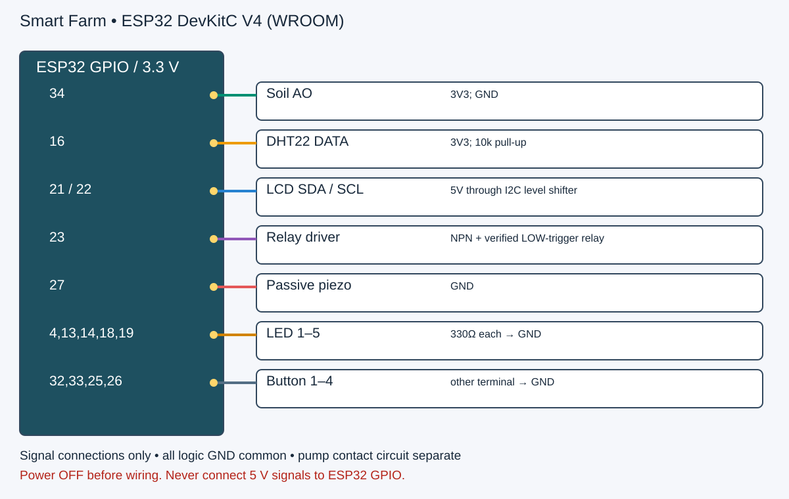

# 워크북 1 · 토양수분센서 ADC 보정

## 최종 결과
시리얼 모니터에서 건조·습윤 흙의 ADC를 비교하고 두 보정값을 기록합니다.



1. USB를 분리하고 탐침을 비교기 보드에 꽂습니다. 3.3V 지원 확인 후 VCC→3V3, GND→GND, AO→GPIO34(DevKitC) 또는 GPIO1(S3). DO는 연결하지 않습니다. AO 전압 확인 후 USB 연결.
2. [01_soil.ino](https://github.com/itlects/2026-2_embedded-basic/blob/main/week13_v2_WiFi_SmartFarm/examples/01_soil/01_soil.ino)를 열고 보드/포트 선택, 업로드.
3. 시리얼 115200에서 마른 흙에 10회, 같은 흙에 물을 조금씩 추가 후 10회 측정. 탐침 깊이를 고정합니다. PCB를 물에 담그지 않습니다.
4. DRY/WET 평균을 기록합니다. 두 평균이 지나치게 가까우면 배선·토양 확인. 예시 3000/1200/2100→50%.

```cpp
#if CONFIG_IDF_TARGET_ESP32S3
const int SOIL=1,DHTPIN=4,SDA_PIN=8,SCL_PIN=9,RELAY=17,BUZZ=16;
const int LEDS[]={5,6,7,10,11}, BTNS[]={12,13,14,15};
#else
const int SOIL=34,DHTPIN=16,SDA_PIN=21,SCL_PIN=22,RELAY=23,BUZZ=27;
const int LEDS[]={4,13,14,18,19}, BTNS[]={32,33,25,26};
#endif
void setup(){Serial.begin(115200); analogReadResolution(12);}
void loop(){int sum=0;for(int i=0;i<16;i++){sum+=analogRead(SOIL);delay(5);} Serial.println(sum/16);delay(1000);}

```

|측정|ADC 10회 평균|비고|
|---|---|---|
|건조| | |
|습윤| | |
|중간| | |

확인: 읽기값이 변하지 않으면 AO/GND 및 GPIO 확인. 물의 절대 함량이 아닌 상대 지표입니다.