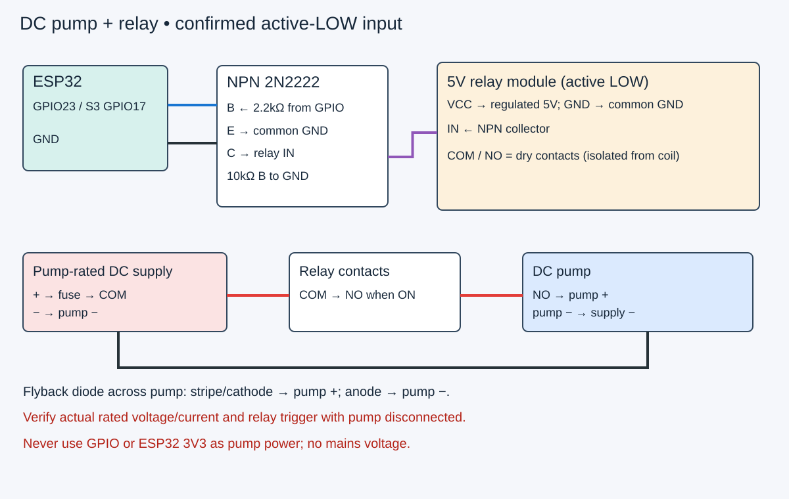

# 워크북 2 · 릴레이·워터펌프

## 최종 결과
시리얼에서 w를 입력하면 2초 ON 후 OFF, s는 즉시 정지합니다.



1. 모듈 정격·트리거를 확인합니다. 5V LOW 트리거 모듈만 그림대로 NPN(2N2222 핀 배열 확인)으로 구동. GPIO→2.2kΩ→Base, Base→10kΩ→GND, E→GND, C→IN. 릴레이 전원 5V, GND 공통. 부팅 중 OFF 확인. 다른 모듈은 연결 금지.
2. 펌프 미연결 상태에서 [02_pump.ino](https://github.com/itlects/2026-2_embedded-basic/blob/main/week13_v2_WiFi_SmartFarm/examples/02_pump/02_pump.ino) 업로드. w/s 명령으로 릴레이 LED·클릭 테스트. COM/NO 도통 확인.
3. 전원 OFF 후 펌프 정격 DC 전원 +→퓨즈→COM, NO→펌프+, 펌프−→전원−. 보호다이오드 줄 표시→펌프+, 반대→펌프−. 펌프를 GPIO에 연결하지 않습니다.
4. 수중형 펌프를 물통에 넣고 호스를 고정합니다. 물이 전자회로에 닿지 않게 합니다. 교사 승인 후 w→2초 관수·정지 확인. 이상 시 전원 즉시 차단.

```cpp
#if CONFIG_IDF_TARGET_ESP32S3
const int SOIL=1,DHTPIN=4,SDA_PIN=8,SCL_PIN=9,RELAY=17,BUZZ=16;
const int LEDS[]={5,6,7,10,11}, BTNS[]={12,13,14,15};
#else
const int SOIL=34,DHTPIN=16,SDA_PIN=21,SCL_PIN=22,RELAY=23,BUZZ=27;
const int LEDS[]={4,13,14,18,19}, BTNS[]={32,33,25,26};
#endif
// HIGH turns on an external NPN open-collector driver for a verified active-LOW relay.
void setup(){digitalWrite(RELAY,LOW);pinMode(RELAY,OUTPUT);Serial.begin(115200);Serial.println("Type w for 2-second test");}
unsigned long start=0;bool running=false;
void loop(){if(Serial.available()){char c=Serial.read();if(c=='w'&&!running){digitalWrite(RELAY,HIGH);start=millis();running=true;}if(c=='s'){digitalWrite(RELAY,LOW);running=false;}}
if(running&&millis()-start>=2000){digitalWrite(RELAY,LOW);running=false;Serial.println("OFF");}}

```

체크: w 입력 전 OFF, w 후 2초 OFF, s 즉시 OFF. 로직 전원 재부팅 시 OFF. 실제 부품 확인 전 펌프 연결 금지.