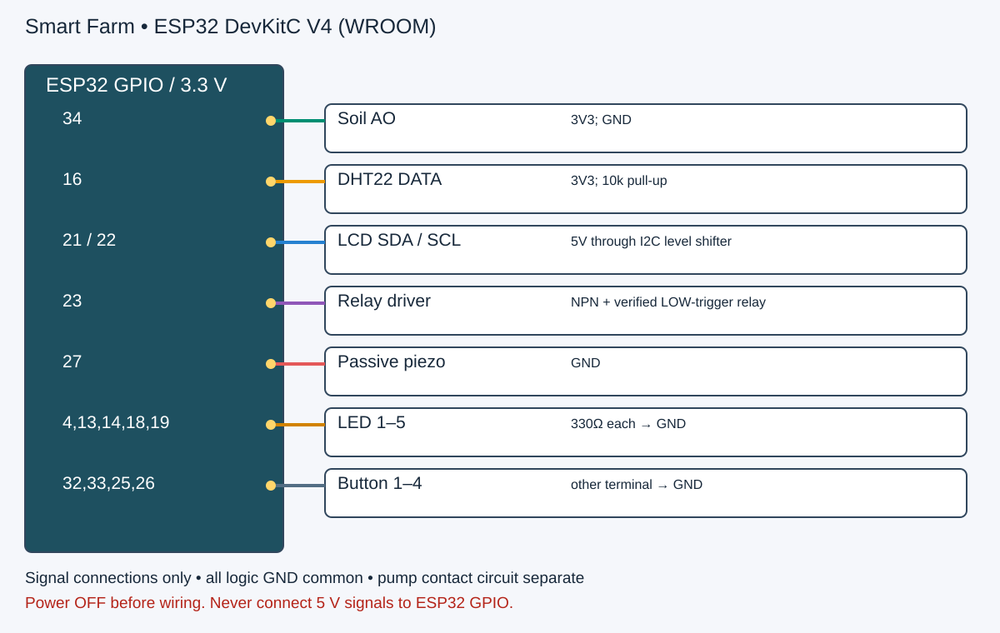
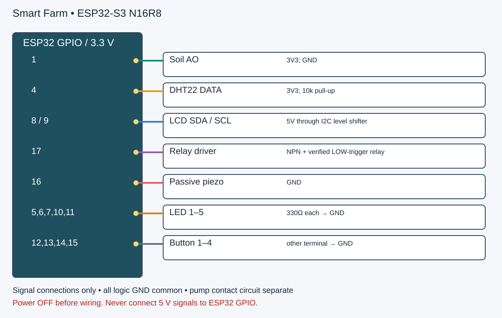

# 워크북 4 · Wi-Fi 스마트팜 통합

## 최종 결과
휴대폰이 ESP32의 AP에 연결되어 수분/온습도/펌프 상태를 읽고 제어합니다.





1. 각 예제 동작 확인 후 전원을 모두 분리하고 통합 배선. LED 5개 각 330Ω 직렬, 버튼 4개 GPIO-GND, 부저는 저전류 수동 피에조만 사용. 다른 부저는 드라이버 필요.
2. [SmartFarm.ino](https://github.com/itlects/2026-2_embedded-basic/blob/main/week13_v2_WiFi_SmartFarm/workbook/SmartFarm/SmartFarm.ino) 열기. DRY/WET를 워크북1 값으로 변경한 뒤 CALIBRATED=true. 처음에는 PUMP_CONNECTED=false, 펌프 미연결 유지. 릴레이 대신 테스트 LED로 제어 확인할 때만 true로 변경하고 확인 후 다시 false. 실제 펌프는 워크북2 검증과 교수자 승인 후 true.
3. AP 이름을 팀별 변경(Farm-Team01). 업로드, 시리얼 IP 확인. 휴대폰 Wi-Fi에서 AP 선택(암호 farmclass13), 인터넷 없음 경고에도 유지. 브라우저 http://192.168.4.1 접속(시리얼 IP 우선).
4. 버튼 1=AUTO 전환 / 2=수동 3초 / 3=정지·수동모드 / 4=임계값+5(20~60 반복). LED 1=모바일 접속, 2=건조, 3=관수, 4=AUTO, 5=경보. 부저=센서 경보. LCD 수분/펌프, 온습도.
5. 수동 관수 후 3초 OFF, 20초 쉬는 동안 재시작 차단. AUTO에서 건조 흙 관찰, 습윤값이 임계값+10 이상이면 정지. 먼저 LED 대체 실험 후 실제 펌프로 진행. STOP 버튼과 웹 STOP 모두 테스트.

```cpp
#include <WiFi.h>
#include <WebServer.h>
#include <Wire.h>
#include <LiquidCrystal_I2C.h>
#include <DHT.h>
#if CONFIG_IDF_TARGET_ESP32S3
const int SOIL=1,DHTPIN=4,SDA_PIN=8,SCL_PIN=9,RELAY=17,BUZZ=16;
const int LEDS[]={5,6,7,10,11}, BTNS[]={12,13,14,15};
#else
const int SOIL=34,DHTPIN=16,SDA_PIN=21,SCL_PIN=22,RELAY=23,BUZZ=27;
const int LEDS[]={4,13,14,18,19}, BTNS[]={32,33,25,26};
#endif
DHT dht(DHTPIN,DHT22);
LiquidCrystal_I2C lcd(0x27,16,2);
WebServer server(80);
// Replace with classroom measurements AFTER dry/wet calibration.
const int DRY=3000,WET=1200;
const bool CALIBRATED=false; // set true only after calibration
const bool PUMP_CONNECTED=false; // true only after supervised relay-only and pump tests
int raw=0, moisture=0, threshold=35;
float temp=NAN,hum=NAN;
bool autoMode=false,pump=false,valid=false,alarm=false;
unsigned long pumpStart=0,lastStop=0,lastSample=0,lastLCD=0;
const unsigned long MAX_RUN=3000,COOLDOWN=20000;
bool stable[4]={HIGH,HIGH,HIGH,HIGH},observed[4]={HIGH,HIGH,HIGH,HIGH};
unsigned long changed[4]={0,0,0,0};
void stopPump(){if(pump){digitalWrite(RELAY,LOW);pump=false;lastStop=millis();}}
void startPump(){if(PUMP_CONNECTED&&valid&&!pump&&millis()-lastStop>=COOLDOWN){pumpStart=millis();digitalWrite(RELAY,HIGH);pump=true;}}
void readSensors(){
 long sum=0;for(int i=0;i<16;i++)sum+=analogRead(SOIL);raw=sum/16;
 valid=CALIBRATED&&abs(DRY-WET)>100&&raw>15&&raw<4080;
 if(valid)moisture=constrain((int)(100.0*(raw-DRY)/(WET-DRY)),0,100);
 temp=dht.readTemperature();hum=dht.readHumidity();
 if(!valid)stopPump();
 alarm=!valid||isnan(temp)||isnan(hum);
}
void action(int i){switch(i){case 0:autoMode=!autoMode;stopPump();break;case 1:autoMode=false;startPump();break;case 2:autoMode=false;stopPump();break;case 3:threshold=(threshold>=60?20:threshold+5);break;}}
void buttons(){for(int i=0;i<4;i++){bool v=digitalRead(BTNS[i]);if(v!=observed[i]){observed[i]=v;changed[i]=millis();}if(v!=stable[i]&&millis()-changed[i]>=40){stable[i]=v;if(!v)action(i);}}}
void page(){
 String s="<meta charset='utf-8'><meta name='viewport' content='width=device-width'><meta http-equiv='refresh' content='3'><h1>Smart Farm</h1><p>Soil raw: "+String(raw)+" / moisture: "+(valid?String(moisture)+"%":"UNCALIBRATED")+"</p><p>Temperature: "+String(temp)+" C / RH: "+String(hum)+"%</p><p>Pump: "+String(pump?"ON":"OFF")+" / Mode: "+String(autoMode?"AUTO":"MANUAL")+" / threshold: "+String(threshold)+"%</p>";
 s+="<form method='POST' action='/cmd'><button name='b' value='0'>Toggle AUTO</button><button name='b' value='1'>Water 3s</button><button name='b' value='2'>STOP</button><button name='b' value='3'>Threshold +5</button></form>";
 server.send(200,"text/html; charset=utf-8",s);
}
void setup(){
 digitalWrite(RELAY,LOW);pinMode(RELAY,OUTPUT);
 for(int p:LEDS){pinMode(p,OUTPUT);digitalWrite(p,LOW);}for(int p:BTNS)pinMode(p,INPUT_PULLUP);pinMode(BUZZ,OUTPUT);
 Serial.begin(115200);analogReadResolution(12);Wire.begin(SDA_PIN,SCL_PIN);lcd.init();lcd.backlight();dht.begin();
 WiFi.mode(WIFI_AP);WiFi.softAP("Farm-Team01","farmclass13");Serial.println(WiFi.softAPIP());
 server.on("/",HTTP_GET,page);server.on("/cmd",HTTP_POST,[]{String b=server.arg("b");if(b=="0"||b=="1"||b=="2"||b=="3")action(b.toInt());server.sendHeader("Location","/");server.send(303);});server.begin();
 lastStop=millis();readSensors();
}
void loop(){
 server.handleClient();buttons();unsigned long now=millis();
 if(now-lastSample>=2500){lastSample=now;readSensors();Serial.printf("raw=%d soil=%d valid=%d pump=%d\n",raw,moisture,valid,pump);}
 if(pump&&(now-pumpStart>=MAX_RUN||!valid||(autoMode&&moisture>=threshold+10)))stopPump();
 if(autoMode&&valid&&moisture<threshold)startPump();
 digitalWrite(LEDS[0],WiFi.softAPgetStationNum()>0);digitalWrite(LEDS[1],valid&&moisture<threshold);digitalWrite(LEDS[2],pump);digitalWrite(LEDS[3],autoMode);digitalWrite(LEDS[4],alarm);
 // brief intermittent alarm; passive piezo only
 if(alarm&&now%3000<120)tone(BUZZ,1200);else noTone(BUZZ);
 if(now-lastLCD>=1000){lastLCD=now; char line[17];lcd.setCursor(0,0);if(valid)snprintf(line,sizeof(line),"Soil:%3d%% %4s",moisture,pump?"PUMP":"OFF");else snprintf(line,sizeof(line),"CALIBRATE FIRST ");lcd.print("                ");lcd.setCursor(0,0);lcd.print(line);lcd.setCursor(0,1);lcd.print("                ");lcd.setCursor(0,1);if(isnan(temp)||isnan(hum))lcd.print("DHT error");else{snprintf(line,sizeof(line),"%4.1fC %4.1f%%",temp,hum);lcd.print(line);}}
}

```

## 관찰 기록
|시험|예상|실제|
|---|---|---|
|부팅|펌프 OFF| |
|휴대폰 접속|LED1 ON| |
|건조 자동|관수 최대 3초| |
|STOP|OFF 및 AUTO 해제| |
|ADC 극단값|경보 및 OFF| |

AP는 교실 내 실습 전용이며 외부 네트워크 포트포워딩을 하지 않습니다. 이 제어기는 농업용 인증 제품이 아니며 실습 중 감독합니다.