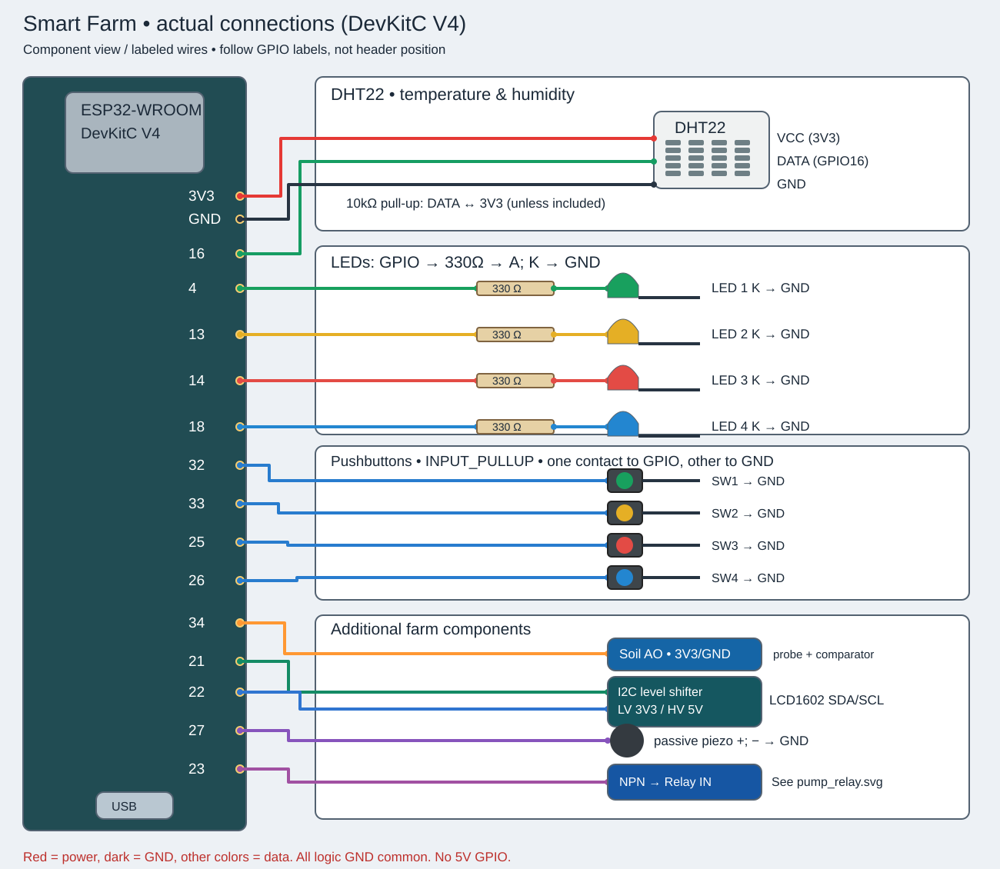
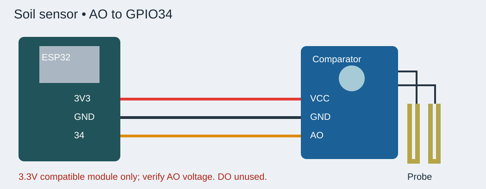
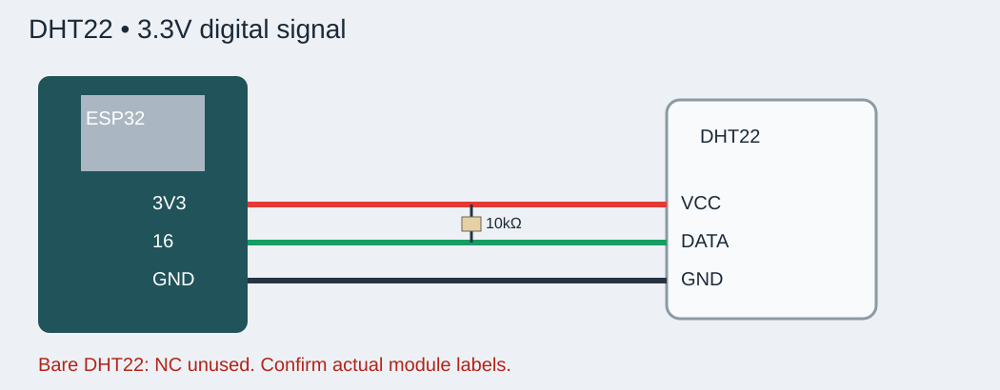

<callout icon="❓" color="blue_bg">
오늘의 학습 질문

- 마른 흙과 젖은 흙의 ADC값은 어떻게 달라질까요?
- ESP32가 측정한 값이 어떻게 PC CSV와 스마트폰 웹페이지에 표시될까요?
</callout>

## 오늘 만들 결과 · 2026-11-25 / 180분

ESP32 DevKitC V4에서 토양·DHT22 측정, 릴레이와 워터펌프 제어, LED 4개/버튼 4개, LCD I2C, 수동 부저 연결. 공유기 Wi-Fi → PC Python 서버 → CSV → HTML 대시보드. 스마트폰은 PC의 IP로 접속. Arduino UNO와 ESP32-S3 CAM은 선택 확장.

|시간|학습 활동|다음 진행 기준|
|---|---|---|
|0~15|부품과 연결·전원 설명|AO, DO, COM, NO 설명|
|15~40|워크북1 토양 보정|건조/습윤 평균|
|40~60|워크북2 펌프·릴레이|2초 후 OFF|
|60~75|워크북3 DHT22|온습도 표시|
|75~85|휴식|안전 확인|
|85~125|워크북4 Wi-Fi·CSV|HTTP 201, 측정 10행|
|125~170|워크북5 통합 스마트팜|LCD, 웹, 자동·수동 관수|
|170~180|결과 확인·제출|정지/시간 제한|

## 부품과 준비

|부품|수량|설명|
|---|---:|---|
|ESP32 DevKitC V4|1|3.3V GPIO, Wi-Fi STA|
|저항식 토양센서+비교기|1|첨부 키트; AO/DO|
|DC 워터펌프·릴레이·호스|각 1|첨부 키트; 펌프/릴레이 실제 정격 확인|
|DHT22|1|디지털 온습도, 2초 이상 간격|
|LCD1602 I2C|1|주소 0x27/0x3F, 5V일 때 양방향 레벨시프터|
|LED + 330Ω 저항|각 4|전류 제한|
|푸시버튼|4|내부 풀업, 눌림 LOW|
|수동 피에조 부저|1|tone 함수, 저전류 제품 확인|
|2N2222, 2.2kΩ/10kΩ, 보호 다이오드, 퓨즈|각 1|확인된 LOW 트리거 릴레이 및 펌프 보호|
|브레드보드, USB, 점퍼, 별도 정격 저전압 DC 전원|각 1 세트|전원 분리 및 공통 접지|
|Arduino UNO / ESP32-S3 CAM|각 선택 1|UNO 비교, CAM 영상 감시; SD 없음|

## 연결 및 전원

전원 OFF 상태에서 배선. ESP32 GPIO는 3.3V, 5V 신호를 직접 입력하지 않음. ADC1 GPIO34 사용(Wi-Fi와 동시에 ADC2 사용 제한). 펌프 전압·전류·릴레이 활성 레벨은 제품 사진으로 확정 불가. 정격 확인, 무부하 릴레이 시험 후 감독하에 실제 펌프 연결. LCD 5V I2C 레벨시프터 사용, DHT22 DATA 풀업. 펌프에 별도 DC 전원을 사용하고 물과 회로를 분리합니다.

## 개발환경 및 학습 목표

Windows 11, Arduino IDE 2.x, ESP32 by Espressif 3.3.2, ESP32 Dev Module, COM 포트, 시리얼 115200. 라이브러리: DHT sensor library by Adafruit, Adafruit Unified Sensor, LiquidCrystal I2C(init/backlight API). PC Python 3.11/3.13 표준 라이브러리만 사용. 기본 보드 패키지 WiFi, HTTPClient, FreeRTOS, Wire 제공.

- ADC값을 보정하고 상대 수분지표로 변환.
- GPIO 버튼/LED를 제어하고 DHT22를 주기적으로 읽기.
- Wi-Fi STA, HTTP POST, CSV 저장, GET /api/history, 브라우저 HTML 관계 이해.
- 자동/수동 관수의 임계값, 안전 정지 및 상태 표시를 구현.

## 데이터 전달 흐름

ESP32(센서/버튼) → 같은 2.4GHz 공유기 → PC:8000/api/sample (POST) → server/data.csv → /api/history (GET) → 웹 HTML. 웹/CSV에서 온도·습도·토양·LED·버튼·펌프·모드 확인. PC/휴대폰이 같은 네트워크라면 http://PC_IP:8000 이용. 인터넷 공개 필요 없음.

## 실습자료

[GitHub 최신 개정 폴더](https://github.com/itlects/2026-2_embedded-basic/tree/main/week13_v2_WiFi_SmartFarm/rev2_led4_csv) · [Google Drive 주차 폴더](https://drive.google.com/drive/folders/1nnFdFD24t-gpT_DNQiyMhhJozS5CDnBu)

아래 워크북 1~5 순서로 진행. 앞의 LED 5개/AP 자료는 구판이며 이번 수업은 LED 4개 + PC CSV 개정본만 사용.

## 선택 실습 · Arduino UNO 및 ESP32-S3 CAM

UNO는 5V 보드로 토양 AO 단독 측정 비교에 사용할 수 있습니다(센서 정격 확인, ESP32와 GPIO 직접 연결 금지). 필수 프로젝트의 센서/구동은 DevKitC V4 한 대에서 처리합니다.

ESP32-S3 CAM은 별도 장치로 식물/화분 영상 감시를 추가할 수 있습니다. microSD가 없으므로 영상 저장 실습은 하지 않습니다. ESP32-S3 CAM의 카메라 센서 표기(사용자가 적은 OVS2660은 모델 불명, OV2640/OV3660 가능성)와 제조사·정확한 핀맵·PSRAM을 먼저 확인합니다. Arduino IDE → File → Examples → ESP32 → Camera → CameraWebServer 열기, board_config.h에서 실제 모델과 일치하는 항목 하나만 선택 혹은 제조사 핀 설정 사용. SSID/PASS를 변경, 제조사 권장 USB 및 PSRAM 설정, 프로그래밍 후 시리얼 IP 확인, 같은 LAN 브라우저에서 http://CAM_IP 접속해 Start Stream. SD 카드 필요 없음. 실제 핀맵을 확인하지 않은 상태에서 특정 모델 코드를 강제로 선택하지 않습니다. [Espressif 카메라 예제](https://github.com/espressif/arduino-esp32/tree/master/libraries/ESP32/examples/Camera/CameraWebServer) / [지원 센서 목록](https://github.com/espressif/esp32-camera). 카메라 영상을 PC CSV에 저장하지 않으며, 스트리밍 화면은 별도 접속합니다.

## 결과 제출

토양값 보정 기록, 펌프 2초 및 3초 정지 확인, 온습도 측정 사진, HTML 화면, CSV 실측 10행 이상, 자동/수동/STOP 시험 결과. 안전 배선 25, 부품 예제 20, 서버 CSV·웹 25, 통합관수 20, 결과 설명 10.

학습 질문 돌아보기: 토양값과 수분 지표는 어떻게 변환되는가? PC IP가 필요한 이유는? 펌프가 웹 응답에 의존해서는 안 되는 이유는?

회로 그림은 실제 부품 형태를 단순화한 배선 참고도이며 Wokwi 화면 캡처는 아님. Wokwi용 diagram.json/sketch를 제공하지만 시뮬레이터·실물 실행은 미검증. 참고: [ADC 공식 문서](https://docs.espressif.com/projects/esp-faq/en/latest/software-framework/peripherals/adc.html), [Wokwi diagram.json](https://docs.wokwi.com/diagram-format).

[학생 실습결과 제출 페이지](https://app.notion.com/p/13-422b2e6bf807807e81c5ea14ebef2b5a) — 작품 전체 사진 1장 및 예제/워크북 결과표 제출.

PC 서버 로컬 테스트: HTML 200, POST 201, CSV 저장/조회 정상, 잘못된 LED mask 16 → 400. 실물 및 Wokwi 실행 미검증.

## 실제 키트 및 브레드보드 배선

[상세 배선표와 사진](docs/breadboard_wiring.md), [학생 제출 양식](docs/report_template.md).