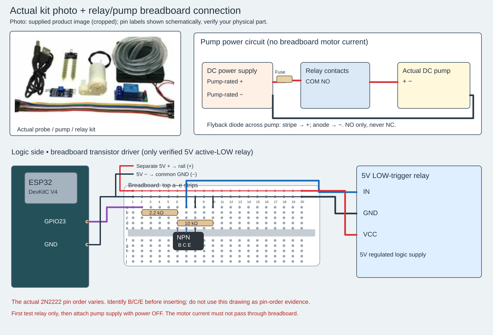
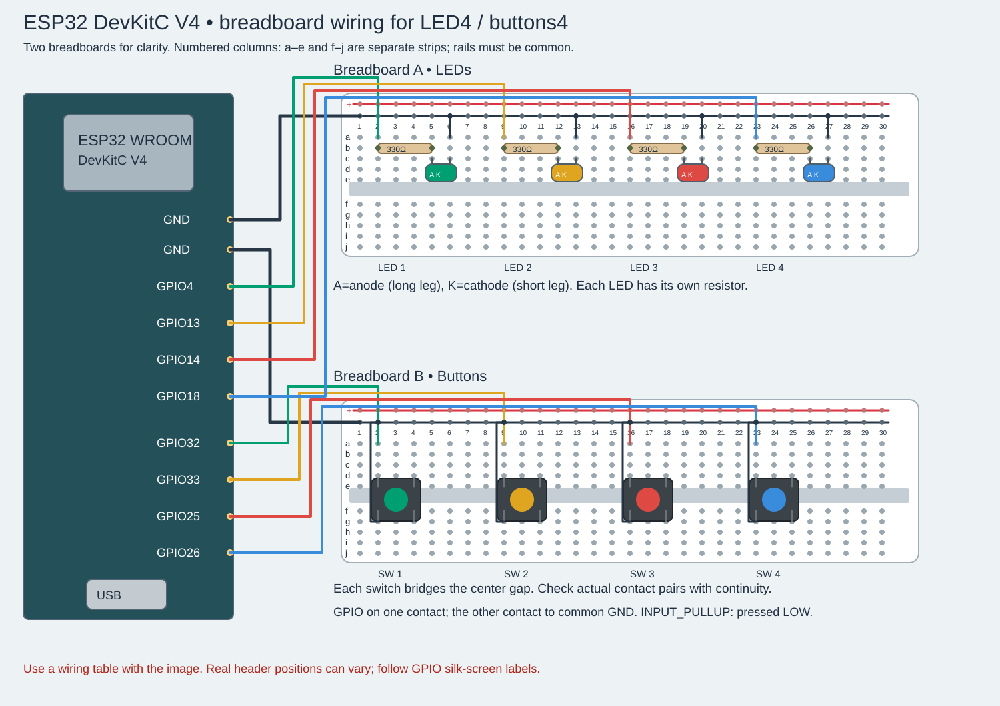

# 브레드보드 상세 배선 및 실제 키트 사진

## 실제 부품 사진을 이용한 브레드보드 연결

위 사진은 제공하신 키트 사진에서 워터펌프·릴레이를 잘라 쓴 것입니다. 실제 모듈에서 VCC/GND/IN과 COM/NO/NC의 인쇄를 반드시 확인합니다. 브레드보드에는 로직 입력만 배선하고 펌프 전원은 릴레이 접점에서 별도 배선합니다.

|브레드보드 열(예시)|배선|
|---|---|
|a2/b2|GPIO23 → 2.2kΩ 한쪽|
|b6/d6/e6|2.2kΩ 반대쪽·10kΩ 한쪽·NPN Base|
|e7/a7|NPN Collector → 릴레이 IN|
|e8/a8|NPN Emitter → GND 레일|
|d10/a10|10kΩ 반대쪽 → GND 레일|
|+ 레일 / − 레일|정격 5V 로직 전원 + / 공통 GND|

NPN의 실제 B/C/E 순서가 다를 수 있어 개별 리드의 실제 핀맵을 확인하고 필요하면 점퍼로 해당 열을 연결합니다. 브레드보드 전원 레일이 중간에서 분리된 제품은 점퍼 연결 후 도통 확인.

## 브레드보드 배선 상세 · LED 4개와 버튼 4개

|LED|GPIO → a열|저항 b열|LED A / K|K→GND|
|---|---|---|---|---|
|1|GPIO4 → a2|b2–b5|c5/c6|a6→−|
|2|GPIO13 → a9|b9–b12|c12/c13|a13→−|
|3|GPIO14 → a16|b16–b19|c19/c20|a20→−|
|4|GPIO18 → a23|b23–b26|c26/c27|a27→−|

LED 브레드보드와 버튼 브레드보드를 그림처럼 구분했습니다. 모두 GND를 ESP32와 연결합니다. 버튼은 중심 홈을 가로질러 꽂고 한 접점을 a2/a9/a16/a23의 GPIO와, 반대 접점을 f측 GND에 연결합니다. 실제 버튼의 4개 핀 중 같은 접점 쌍을 멀티미터로 확인하세요(아래/위 방향을 무조건 추정하지 않습니다). 330Ω 저항은 LED마다 하나씩 사용합니다. 선이 교차해도 점 또는 같은 홀에서 연결되지 않으면 전기적으로 접속하지 않은 것입니다.
