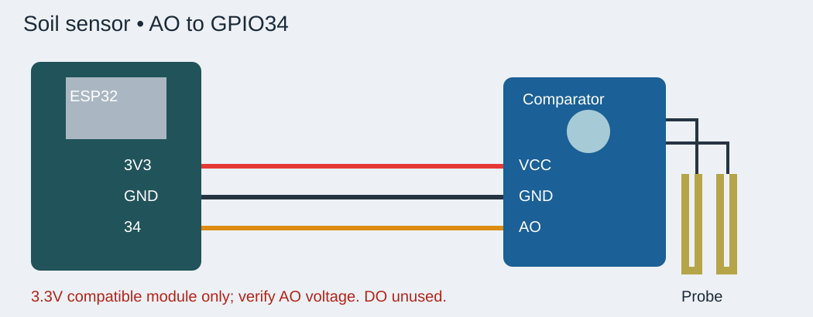

# 워크북 1 · 토양수분센서 특성 및 ADC 보정

## 실습 결과
흙의 수분 변화에 따라 12비트 ADC 값이 달라지는 것을 확인합니다.



저항식 두 탐침 사이의 전기 전도도는 수분·염분에 영향을 받습니다. 비교기 모듈의 AO는 아날로그 값, DO는 가변저항으로 정한 임계값의 논리 결과입니다. PCB는 물에 담그지 않습니다. 탐침은 부식 가능성이 있어 장기 시스템에는 정전용량 방식 권장.

|모듈|DevKitC V4|
|---|---|
|VCC (3.3V 지원 확인)|3V3|
|GND|GND|
|AO|GPIO34 ADC1|
|DO|미사용|

1. USB 분리 후 탐침·비교기 연결. 3.3V에서 정상 작동하는 모듈만 사용, AO 전압을 멀티미터로 확인.
2. [01_soil.ino](https://github.com/itlects/2026-2_embedded-basic/blob/main/week13_v2_WiFi_SmartFarm/rev2_led4_csv/examples/01_soil/01_soil.ino) 열기, ESP32 Dev Module / COM 선택, 업로드, 시리얼 115200.
3. 마른 흙·물을 넣은 흙에서 각 10회 읽고 평균 DRY, WET 기록. 두 값의 간격이 작은 경우 배선·흙 확인.
4. 수분 지표 = 100×(ADC−DRY)/(WET−DRY), 0~100 제한. 예: 3000/1200/2100→50%. 수분의 절대 함량이 아님.

```cpp
const int SOIL=34,DHTPIN=16,SDA_PIN=21,SCL_PIN=22,RELAY=23,BUZZ=27;
const int LEDS[]={4,13,14,18}, BTNS[]={32,33,25,26};
void setup(){Serial.begin(115200);analogReadResolution(12);}
void loop(){long sum=0;for(int i=0;i<16;i++)sum+=analogRead(SOIL);Serial.println(sum/16);delay(1000);}

```

|건조 평균 DRY|습윤 평균 WET|중간값|지표|
|---|---|---|---|
| | | | |
