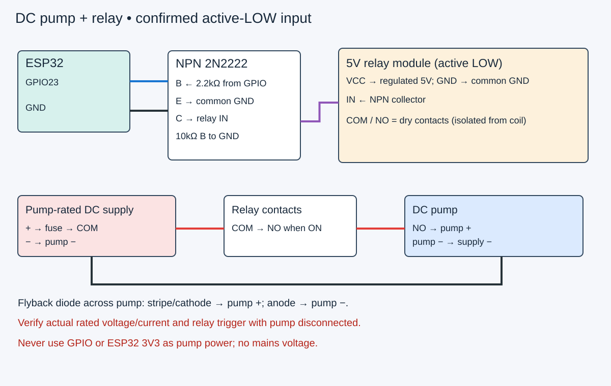

# 워크북 2 · 릴레이·워터펌프 동작

## 실습 결과
시리얼 w 입력 시 릴레이 ON 2초 후 OFF, s 즉시 OFF. 워터펌프는 전기 접점으로 별도 저전압 전원을 제어합니다.



첨부 키트의 실제 정격 및 릴레이 트리거 확인 필요. ESP32에서는 GPIO23만 사용. 펌프 전원을 ESP32 3V3에 연결하지 않습니다.

1. 5V LOW 트리거 모듈 여부를 확인. 해당 모듈일 때 NPN 2N2222의 E→GND, C→IN, B→GPIO23(2.2kΩ 직렬), B→GND(10kΩ). 릴레이 VCC→정격 5V, GND 공통. NPN 핀 배치 확인. 다른 제품이면 교수자에게 확인.
2. 펌프 미연결 그대로 [02_pump.ino](https://github.com/itlects/2026-2_embedded-basic/blob/main/week13_v2_WiFi_SmartFarm/rev2_led4_csv/examples/02_pump/02_pump.ino) 업로드. w/s 시리얼 입력으로 릴레이 클릭 및 접점 측정. 전원 인가/리셋 때 OFF 확인.
3. 펌프·모듈 정격에 맞는 DC 전원 및 퓨즈: DC+→퓨즈→COM, NO→펌프+, 펌프−→DC−. 모터 양단 보호 다이오드 줄(캐소드)→펌프+, 반대→펌프−. NC 사용하지 않음.
4. 물통/호스 고정, 수중형인 경우 펌프를 물에 잠근 후 교수자 승인 아래 2초 테스트. 물과 전자회로 분리, 누수/무수 운전 방지. 이상 시 전원 차단.

```cpp
const int SOIL=34,DHTPIN=16,SDA_PIN=21,SCL_PIN=22,RELAY=23,BUZZ=27;
const int LEDS[]={4,13,14,18}, BTNS[]={32,33,25,26};
// GPIO HIGH -> NPN -> confirmed active-LOW relay. Pump disconnected first.
bool running=false;unsigned long started=0;
void setup(){digitalWrite(RELAY,LOW);pinMode(RELAY,OUTPUT);Serial.begin(115200);Serial.println("w=2s, s=stop");}
void loop(){if(Serial.available()){char c=Serial.read();if(c=='w'&&!running){started=millis();running=true;digitalWrite(RELAY,HIGH);}if(c=='s'){running=false;digitalWrite(RELAY,LOW);}}
if(running&&millis()-started>=2000){digitalWrite(RELAY,LOW);running=false;Serial.println("OFF");}}

```

체크: w 입력 전 OFF, 2초 후 OFF, s 즉시 OFF, 재부팅 OFF.