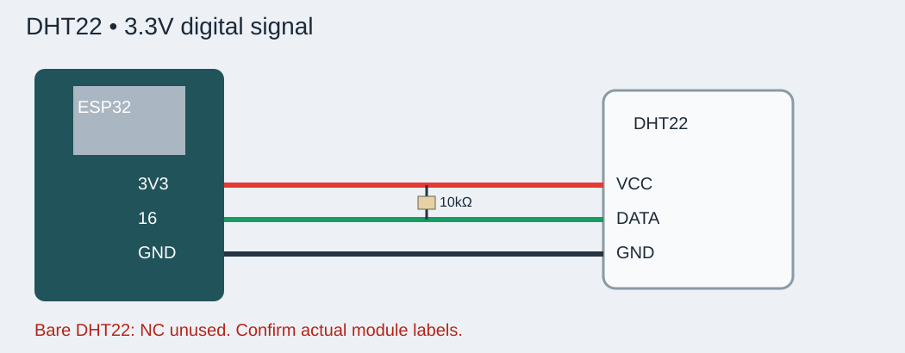

# 워크북 3 · DHT22 온습도 센서

## 실습 결과
온도(°C), 상대습도(%RH)를 2.5초 주기로 시리얼에 표시합니다.



DHT22는 디지털 데이터 프로토콜을 통해 온도와 습도를 보냅니다. I2C가 아니며 2초보다 짧게 읽지 않습니다. 모듈 핀 라벨 확인. DATA와 3V3 사이 10kΩ 풀업(내장 모듈 생략).

1. VCC→3V3, DATA→GPIO16, GND→GND. 4핀 센서 NC 미연결.
2. Arduino IDE 라이브러리 관리자에서 DHT sensor library (Adafruit), Adafruit Unified Sensor 설치.
3. [03_dht22.ino](https://github.com/itlects/2026-2_embedded-basic/blob/main/week13_v2_WiFi_SmartFarm/rev2_led4_csv/examples/03_dht22/03_dht22.ino) 업로드, 115200 확인.

```cpp
#include <DHT.h>
const int SOIL=34,DHTPIN=16,SDA_PIN=21,SCL_PIN=22,RELAY=23,BUZZ=27;
const int LEDS[]={4,13,14,18}, BTNS[]={32,33,25,26};

DHT dht(DHTPIN,DHT22);
void setup(){Serial.begin(115200);dht.begin();}
void loop(){float t=dht.readTemperature(),h=dht.readHumidity();if(isnan(t)||isnan(h))Serial.println("DHT error");else Serial.printf("%.1f C / %.1f %%\n",t,h);delay(2500);}

```

DHT error: 센서 종류·핀·풀업 확인. 주변 습도 변화를 3회 기록.