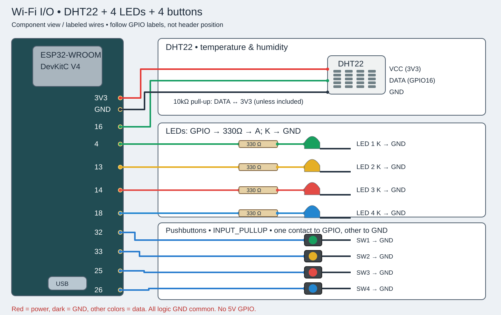

# 워크북 4 · Wi-Fi·DHT22·LED 4·버튼 4와 CSV 서버

## 오늘 만들 결과
PC 브라우저와 휴대폰에서 ESP32 센서값 및 LED 4개와 버튼 4개 상태를 확인하고 CSV로 다운로드합니다. 버튼을 누를 때마다 해당 LED가 토글됩니다. 버튼 표시는 3초 주기 순간 상태이므로 짧은 누름은 CSV에 기록되지 않을 수 있습니다(LED 상태 변화는 유지).



|부품|GPIO|
|---|---|
|DHT22 DATA|16|
|LED1~4 (330Ω 각 1)|4,13,14,18|
|버튼1~4 (다른 접점 GND)|32,33,25,26|

## 1. PC 웹서버 실행 (Windows 11)

ZIP 전체를 풀고 rev2_led4_csv 폴더에서 PowerShell을 엽니다. Python 3.11/3.13 사용, pip 설치 없음.

```powershell
py -3.13 server/server.py
```

3.11만 설치되어 있으면 py -3.11 server/server.py. PC에서 http://localhost:8000 열면 대기 화면. ipconfig로 무선 LAN IPv4 기록. Windows 방화벽은 수업용 개인 네트워크에 한해 Python/8000 허용. 외부 인터넷에 포트 전달하지 않음.

[server.py](https://github.com/itlects/2026-2_embedded-basic/blob/main/week13_v2_WiFi_SmartFarm/rev2_led4_csv/server/server.py) · [index.html](https://github.com/itlects/2026-2_embedded-basic/blob/main/week13_v2_WiFi_SmartFarm/rev2_led4_csv/server/index.html) — HTML은 서버가 서비스하므로 파일을 직접 더블클릭하지 않음.

## 2. 샘플 데이터 확인

새 PowerShell에서 아래 실행 (가상 데이터). 201 및 CSV 행 확인.

```powershell
Invoke-RestMethod -Uri http://localhost:8000/api/sample -Method Post -Body @{device='demo';temperature=24.5;humidity=56;soil=-1;leds=5;buttons=0;pump=0;mode=0}
```

http://localhost:8000/data.csv 열고 timestamp/device/temperature/humidity/soil/leds/buttons/pump/mode 9열 확인. soil=-1은 아직 측정하지 않는다는 의미. LED mask 5=이진 0101 → LED1과 LED3 ON. 시간은 UTC 기록, 화면은 브라우저 현지 시간 표시.

## 3. ESP32 연결 및 실제 데이터 전송

[04_wifi_csv.ino](https://github.com/itlects/2026-2_embedded-basic/blob/main/week13_v2_WiFi_SmartFarm/rev2_led4_csv/examples/04_wifi_csv/04_wifi_csv.ino) 열고 SSID, PASS, URL의 IP를 교실 2.4GHz Wi-Fi와 PC IP로 바꿈. TEAM을 팀별 고유 이름으로 변경. 보드 업로드.

```cpp
#include <DHT.h>
const int SOIL=34,DHTPIN=16,SDA_PIN=21,SCL_PIN=22,RELAY=23,BUZZ=27;
const int LEDS[]={4,13,14,18}, BTNS[]={32,33,25,26};

#include <WiFi.h>
#include <HTTPClient.h>
#include <freertos/FreeRTOS.h>
#include <freertos/queue.h>
const char* SSID="YOUR_2.4GHz_WIFI";
const char* PASS="YOUR_WIFI_PASSWORD";
const char* URL="http://192.168.0.100:8000/api/sample"; // replace PC IPv4
const char* TEAM="team01";
struct Sample {float t,h; int soil,leds,buttons,pump,mode;};
QueueHandle_t samples;
void networkTask(void*) {
  for(;;){
    if(WiFi.status()!=WL_CONNECTED){WiFi.begin(SSID,PASS);vTaskDelay(pdMS_TO_TICKS(5000));continue;}
    Sample s;
    if(xQueueReceive(samples,&s,pdMS_TO_TICKS(1000))==pdTRUE){
      char body[256];
      snprintf(body,sizeof(body),"device=%s&temperature=%.2f&humidity=%.2f&soil=%d&leds=%d&buttons=%d&pump=%d&mode=%d",TEAM,s.t,s.h,s.soil,s.leds,s.buttons,s.pump,s.mode);
      HTTPClient http;http.setConnectTimeout(800);http.setTimeout(1000);
      if(http.begin(URL)){http.addHeader("Content-Type","application/x-www-form-urlencoded");int status=http.POST(body);Serial.printf("HTTP %d\n",status);http.end();}
    }
  }
}
void startNetwork(){
  samples=xQueueCreate(1,sizeof(Sample));if(!samples){Serial.println("Queue failed");return;}
  WiFi.mode(WIFI_STA);xTaskCreate(networkTask,"network",4096,nullptr,1,nullptr);
}
void sendSample(Sample s){if(samples)xQueueOverwrite(samples,&s);}

bool observed[4]={HIGH,HIGH,HIGH,HIGH},stable[4]={HIGH,HIGH,HIGH,HIGH};
unsigned long changed[4]={0,0,0,0};
void action(int i);
void pollButtons(){for(int i=0;i<4;i++){bool v=digitalRead(BTNS[i]);if(v!=observed[i]){observed[i]=v;changed[i]=millis();}if(v!=stable[i]&&millis()-changed[i]>=40){stable[i]=v;if(!v)action(i);}}}
int buttonMask(){int mask=0;for(int i=0;i<4;i++)if(!stable[i])mask|=1<<i;return mask;}
int ledMask(){int mask=0;for(int i=0;i<4;i++)if(digitalRead(LEDS[i]))mask|=1<<i;return mask;}

DHT dht(DHTPIN,DHT22);unsigned long last=0;
bool on[4]={false,false,false,false};
void action(int i){on[i]=!on[i];digitalWrite(LEDS[i],on[i]);}
void setup(){Serial.begin(115200);dht.begin();for(int i=0;i<4;i++){pinMode(LEDS[i],OUTPUT);digitalWrite(LEDS[i],LOW);pinMode(BTNS[i],INPUT_PULLUP);}startNetwork();}
void loop(){pollButtons();if(millis()-last>=3000){last=millis();float t=dht.readTemperature(),h=dht.readHumidity();if(!isnan(t)&&!isnan(h)){sendSample({t,h,-1,ledMask(),buttonMask(),0,0});Serial.printf("%.1f C / %.1f %% / LEDs %d\n",t,h,ledMask());}else Serial.println("DHT error");}}

```

ESP32 시리얼에 HTTP 201 표시 → PC 화면 팀 선택 → 3초마다 온습도/LED 갱신 → 휴대폰을 같은 공유기에 연결 후 http://PC_IP:8000 접속. 학교 게스트 Wi-Fi의 장치 간 격리가 있으면 승인된 개인 핫스팟/라우터 사용. PC 방화벽을 전체 비활성화하지 않습니다.

## 4. 확인

버튼 1~4로 LED를 각각 켜고 끕니다. 최소 10행의 실측 CSV를 확보. LED 1/3 ON → leds=5 확인. 서버를 중단하고 다시 실행하면 CSV 누적 보존 확인. ESP32 전송이 막히면 IP, 같은 네트워크, 방화벽, URL 확인. CSV에는 가상 demo와 실측 team01을 구분합니다.

Wokwi: [diagram.json](https://github.com/itlects/2026-2_embedded-basic/blob/main/week13_v2_WiFi_SmartFarm/rev2_led4_csv/wokwi/01_wifi_io/diagram.json) · [sketch.ino](https://github.com/itlects/2026-2_embedded-basic/blob/main/week13_v2_WiFi_SmartFarm/rev2_led4_csv/wokwi/01_wifi_io/sketch.ino) · [libraries.txt](https://github.com/itlects/2026-2_embedded-basic/blob/main/week13_v2_WiFi_SmartFarm/rev2_led4_csv/wokwi/01_wifi_io/libraries.txt). 새 ESP32 프로젝트에 복사하여 LED/버튼/DHT22 기초 회로를 확인하는 별도 시뮬레이션용 예제입니다. PC LAN 전송은 실물로 진행합니다.