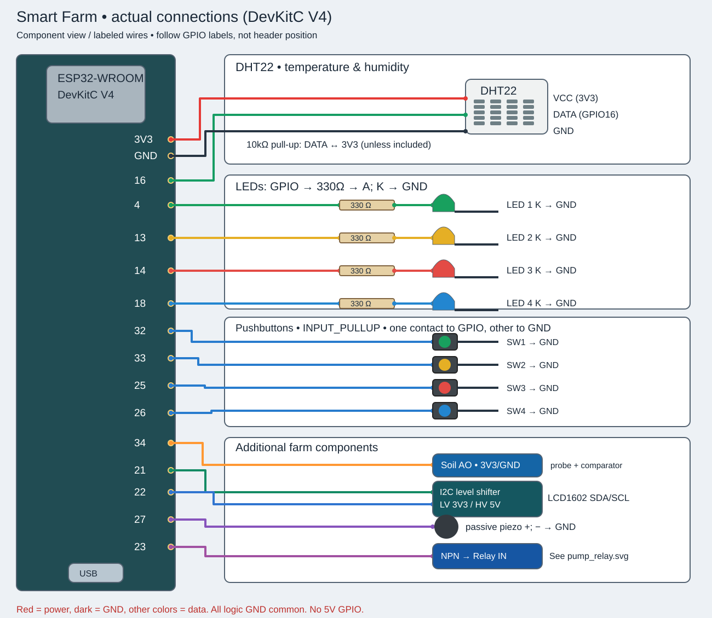
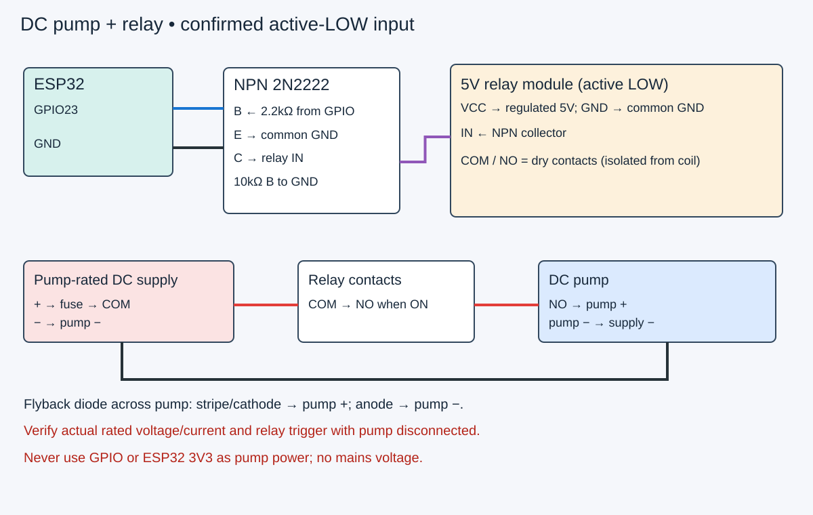

# 워크북 5 · Wi-Fi 스마트팜 통합

## 목표
워크북 1~4의 회로와 프로그램을 통합하여 LCD/모바일 PC 웹 모니터링, 자동 및 수동 관수를 구현합니다.





|부품|GPIO / 연결|
|---|---|
|토양 AO|34 (ADC1)|
|DHT22 DATA|16, 3V3 및 10kΩ 풀업|
|LCD I2C SDA/SCL|21/22, 5V LCD는 양방향 I2C 레벨시프터 사용 (LV=3V3, HV=5V, 공통 GND)|
|LED 1~4|4,13,14,18, 각 330Ω 직렬|
|버튼 1~4|32,33,25,26, INPUT_PULLUP, 다른 접점 GND|
|수동 피에조|27, GND (저전류 수동 피에조 제품만 직접 구동)|
|릴레이 NPN 제어|23, 워크북2 안전 회로 그대로|

LED1=Wi-Fi 연결, LED2=건조, LED3=관수, LED4=AUTO. 버튼1=AUTO 전환, 버튼2=수동 관수 요청, 버튼3=정지+AUTO 해제, 버튼4=임계값+5(20~60 반복). 부저는 센서 경보.

## 순서

1. USB/펌프 전원 분리 후 통합 배선. 처음에는 펌프 미연결; 릴레이 또는 별도 저항+테스트 LED로 검증. LCD에 5V 풀업이 있으면 ESP32 GPIO 직접 연결 금지. LCD 주소 0x27(다르면 0x3F 확인).
2. IDE 라이브러리 LiquidCrystal I2C(init/backlight API), Adafruit DHT/Unified Sensor 설치.
3. [SmartFarm.ino](https://github.com/itlects/2026-2_embedded-basic/blob/main/week13_v2_WiFi_SmartFarm/rev2_led4_csv/workbook/SmartFarm/SmartFarm.ino) 열기. DRY/WET 실측값, CALIBRATED=true, Wi-Fi SSID/PASS/PC URL/TEAM 설정. PUMP_CONNECTED=false 기본. 감독하에 릴레이-only 또는 테스트 LED 검증할 때 true로 바꾸고, 실제 펌프는 워크북2 안전 확인 후 명시적으로 true. 관수 최대 3초, 20초 휴지. 펌프 구동 시 PC 전원이나 GPIO에서 모터 전류를 공급하지 않음.
4. 워크북4와 동일한 PC 서버 실행. LCD 첫 줄 수분과 펌프, 둘째 줄 온습도 확인. 웹 팀을 선택해 토양/펌프/AUTO 열 확인.
5. 건조 기준 35% 미만에서 AUTO → 최대 3초 구동, 20초 휴지. threshold+10 이상이면 정지. ADC 극단값/미보정이면 관수 방지. 네트워크 작업은 별도 태스크로 처리하여 관수 타이머와 버튼이 네트워크 응답을 기다리지 않게 함. DHT 오류 시 온습도 전송 중단, 로컬 부저 알림. 장치 장애나 모든 센서 단선은 소프트웨어만으로 완전 검출할 수 없음.
6. 버튼3으로 즉시 정지, AUTO 해제. 웹은 관찰 전용으로 구성(펌프 동작은 물통 앞에서 감독). 네트워크가 끊겨도 로컬 제어는 유지, CSV 전송은 최신값만 재시도 후 재개(누락 가능).

```cpp
#include <Wire.h>
#include <LiquidCrystal_I2C.h>
#include <DHT.h>
const int SOIL=34,DHTPIN=16,SDA_PIN=21,SCL_PIN=22,RELAY=23,BUZZ=27;
const int LEDS[]={4,13,14,18}, BTNS[]={32,33,25,26};

#include <WiFi.h>
#include <HTTPClient.h>
#include <freertos/FreeRTOS.h>
#include <freertos/queue.h>
const char* SSID="YOUR_2.4GHz_WIFI";
const char* PASS="YOUR_WIFI_PASSWORD";
const char* URL="http://192.168.0.100:8000/api/sample"; // replace PC IPv4
const char* TEAM="team01";
struct Sample {float t,h; int soil,leds,buttons,pump,mode;};
QueueHandle_t samples;
void networkTask(void*) {
  for(;;){
    if(WiFi.status()!=WL_CONNECTED){WiFi.begin(SSID,PASS);vTaskDelay(pdMS_TO_TICKS(5000));continue;}
    Sample s;
    if(xQueueReceive(samples,&s,pdMS_TO_TICKS(1000))==pdTRUE){
      char body[256];
      snprintf(body,sizeof(body),"device=%s&temperature=%.2f&humidity=%.2f&soil=%d&leds=%d&buttons=%d&pump=%d&mode=%d",TEAM,s.t,s.h,s.soil,s.leds,s.buttons,s.pump,s.mode);
      HTTPClient http;http.setConnectTimeout(800);http.setTimeout(1000);
      if(http.begin(URL)){http.addHeader("Content-Type","application/x-www-form-urlencoded");int status=http.POST(body);Serial.printf("HTTP %d\n",status);http.end();}
    }
  }
}
void startNetwork(){
  samples=xQueueCreate(1,sizeof(Sample));if(!samples){Serial.println("Queue failed");return;}
  WiFi.mode(WIFI_STA);xTaskCreate(networkTask,"network",4096,nullptr,1,nullptr);
}
void sendSample(Sample s){if(samples)xQueueOverwrite(samples,&s);}

bool observed[4]={HIGH,HIGH,HIGH,HIGH},stable[4]={HIGH,HIGH,HIGH,HIGH};
unsigned long changed[4]={0,0,0,0};
void action(int i);
void pollButtons(){for(int i=0;i<4;i++){bool v=digitalRead(BTNS[i]);if(v!=observed[i]){observed[i]=v;changed[i]=millis();}if(v!=stable[i]&&millis()-changed[i]>=40){stable[i]=v;if(!v)action(i);}}}
int buttonMask(){int mask=0;for(int i=0;i<4;i++)if(!stable[i])mask|=1<<i;return mask;}
int ledMask(){int mask=0;for(int i=0;i<4;i++)if(digitalRead(LEDS[i]))mask|=1<<i;return mask;}

const bool CALIBRATED=false,PUMP_CONNECTED=false;
// Set measured values and CALIBRATED=true after soil experiment.
// PUMP_CONNECTED=true only after instructor supervised relay/pump test.
const int DRY=3000,WET=1200;
const unsigned long MAX_RUN=3000,REST=20000;
DHT dht(DHTPIN,DHT22);LiquidCrystal_I2C lcd(0x27,16,2);
bool pump=false,autoMode=false,valid=false;
int threshold=35,moisture=-1,raw=0;
float t=NAN,h=NAN;
unsigned long started=0,lastStop=0,lastSample=0,lastLCD=0;
void stopPump(){digitalWrite(RELAY,LOW);if(pump){pump=false;lastStop=millis();}}
void startPump(){if(PUMP_CONNECTED&&valid&&!pump&&millis()-lastStop>=REST){started=millis();pump=true;digitalWrite(RELAY,HIGH);}}
void action(int i){if(i==0){autoMode=!autoMode;stopPump();}if(i==1){autoMode=false;startPump();}if(i==2){autoMode=false;stopPump();}if(i==3)threshold=threshold>=60?20:threshold+5;}
void sample(){long sum=0;for(int i=0;i<16;i++)sum+=analogRead(SOIL);raw=sum/16;valid=CALIBRATED&&abs(DRY-WET)>100&&raw>15&&raw<4080;
moisture=valid?constrain((int)(100.0*(raw-DRY)/(WET-DRY)),0,100):-1;t=dht.readTemperature();h=dht.readHumidity();if(!valid){autoMode=false;stopPump();}}
void setup(){digitalWrite(RELAY,LOW);pinMode(RELAY,OUTPUT);Serial.begin(115200);analogReadResolution(12);for(int i=0;i<4;i++){pinMode(LEDS[i],OUTPUT);pinMode(BTNS[i],INPUT_PULLUP);}pinMode(BUZZ,OUTPUT);dht.begin();Wire.begin(SDA_PIN,SCL_PIN);lcd.init();lcd.backlight();lastStop=millis();startNetwork();}
void loop(){
  pollButtons();unsigned long now=millis();
  if(pump&&(now-started>=MAX_RUN||!valid||(autoMode&&moisture>=threshold+10)))stopPump();
  if(now-lastSample>=3000){lastSample=now;sample();if(!isnan(t)&&!isnan(h))sendSample({t,h,moisture,ledMask(),buttonMask(),pump,autoMode});Serial.printf("ADC=%d soil=%d pump=%d\n",raw,moisture,pump);}
  if(autoMode&&valid&&moisture<threshold)startPump();
  bool alarm=!valid||isnan(t)||isnan(h);
  digitalWrite(LEDS[0],WiFi.status()==WL_CONNECTED);
  digitalWrite(LEDS[1],valid&&moisture<threshold);
  digitalWrite(LEDS[2],pump);digitalWrite(LEDS[3],autoMode);
  // Short alarm beep. Keep loop free from network waits.
  if(alarm&&now%3000<120)tone(BUZZ,1200);else noTone(BUZZ);
  if(now-lastLCD>=1000){lastLCD=now;char row[17];lcd.setCursor(0,0);lcd.print("                ");lcd.setCursor(0,0);if(valid){snprintf(row,sizeof(row),"Soil:%3d%% %s",moisture,pump?"ON":"OFF");lcd.print(row);}else lcd.print("CALIBRATE FIRST");lcd.setCursor(0,1);lcd.print("                ");lcd.setCursor(0,1);if(isnan(t)||isnan(h))lcd.print("DHT error");else{snprintf(row,sizeof(row),"%4.1fC %4.1f%%",t,h);lcd.print(row);}}
}

```

## 확인표

|시험|예상 결과|실제|
|---|---|---|
|부팅|펌프 OFF| |
|토양 건조/AUTO|LED2·4 ON, 펌프 최대 3초| |
|버튼3|즉시 OFF 및 AUTO 해제| |
|20초 이내 재요청|관수 차단| |
|PC/휴대폰|CSV 최신 측정 표시| |

시뮬레이터: [diagram.json](https://github.com/itlects/2026-2_embedded-basic/blob/main/week13_v2_WiFi_SmartFarm/rev2_led4_csv/wokwi/02_farm_proxy/diagram.json) · [sketch.ino](https://github.com/itlects/2026-2_embedded-basic/blob/main/week13_v2_WiFi_SmartFarm/rev2_led4_csv/wokwi/02_farm_proxy/sketch.ino) · [libraries.txt](https://github.com/itlects/2026-2_embedded-basic/blob/main/week13_v2_WiFi_SmartFarm/rev2_led4_csv/wokwi/02_farm_proxy/libraries.txt). 토양은 가변저항, 펌프는 별도 LED(시뮬레이터만), LCD는 모델 내부 가상 I2C. 실제 전압 변환·모터 전원·릴레이 접점은 실물용 도면을 따릅니다. Wokwi 실행과 물펌프 실물 검증은 미수행.